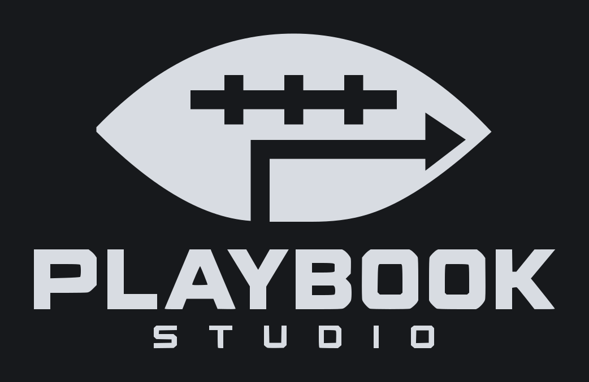
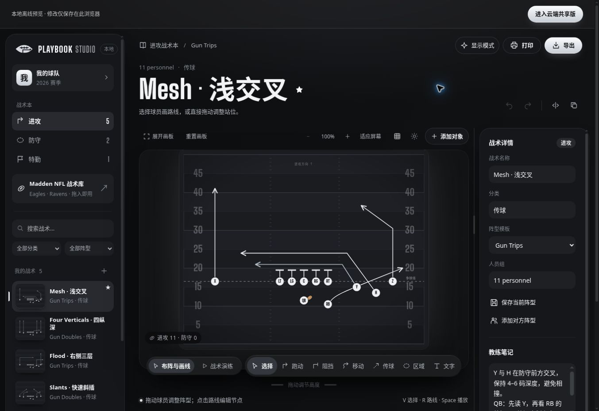
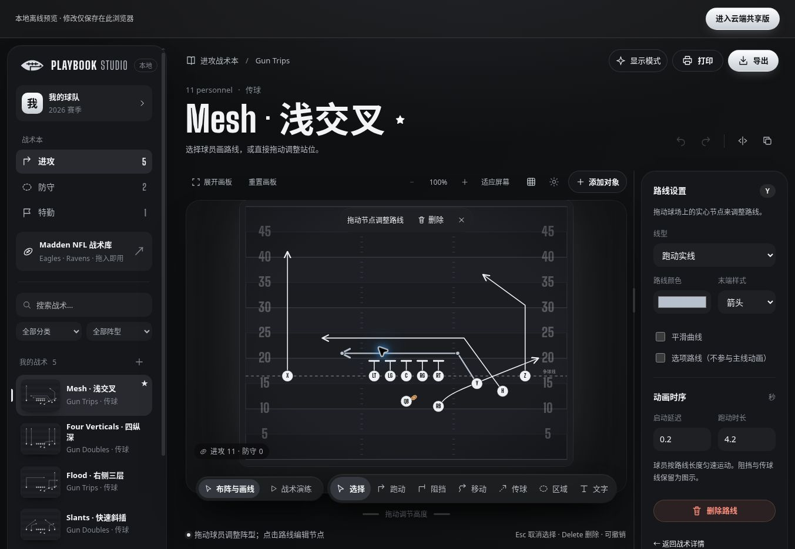
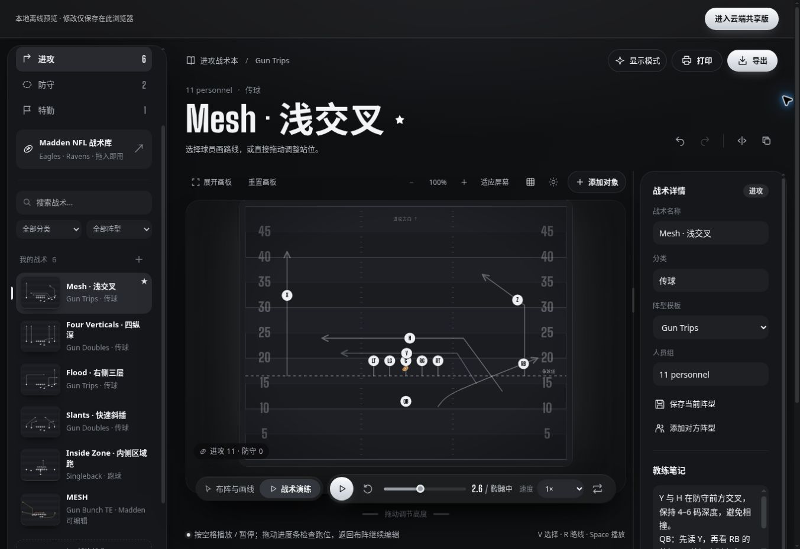
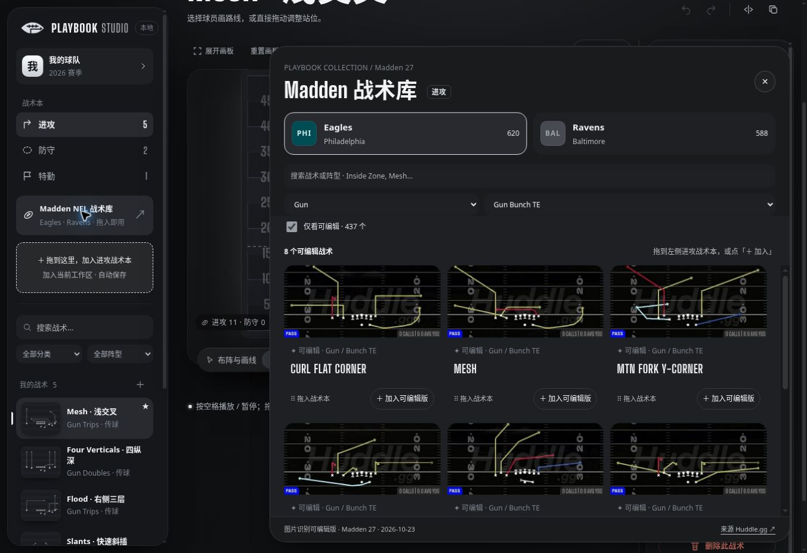
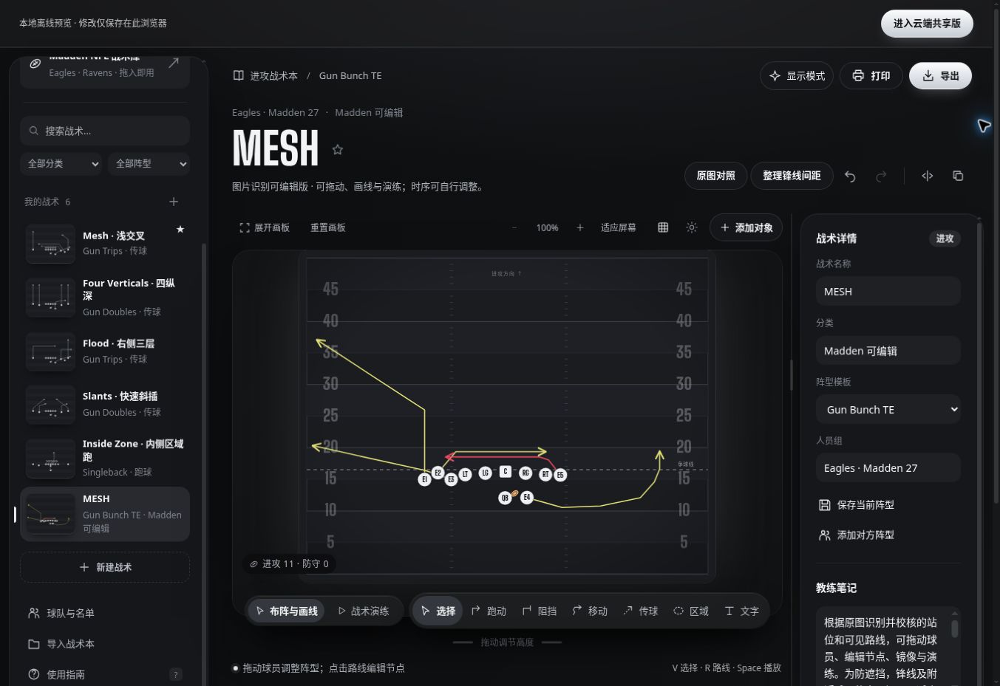
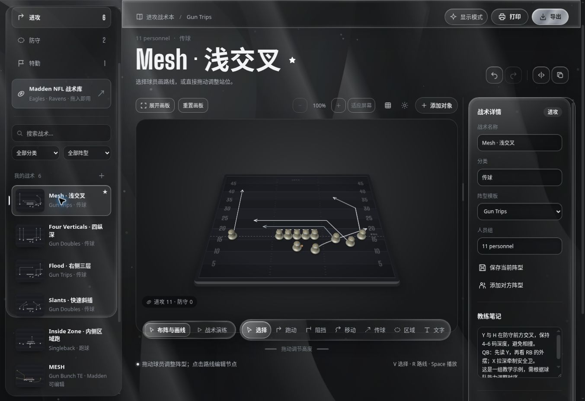

[简体中文](README.md) · **English**

<div align="center">



# Playbook Studio

An American football playbook workspace for drawing plays, rehearsing routes, analyzing matchups, and sharing a playbook with your team.

[Open the cloud app](https://playbook-studio-tim.kind-wolf-6204.chatgpt.site/editor/) · [Try without signing in](https://timpickle.github.io/playbook-studio-web/local.html) · [Visual walkthrough](#visual-walkthrough) · [AI deployment](#ai-agent-deployment-guide) · [Local development](#local-development)

</div>

The interface supports English and Simplified Chinese. Choose a language from the language menu; play names and notes you create remain unchanged. See the [localization guide](docs/I18N.md) for adding languages.



Choose a play on the left, arrange players and draw routes in the center, and adjust properties on the right. Below the field, switch between **布阵与画线** (Edit) and **战术演练** (Rehearse). All screenshots below were captured from the current local demo using built-in examples and Madden catalog plays.

## What you can do

| Workflow | Available features |
|---|---|
| **Design plays** | Move offensive and defensive players; draw routes, blocks, pre-snap motion, passes, coverage zones, and text. Use curves, option routes, mirroring, undo, and redo |
| **Explain and rehearse** | Play, pause, loop, change speed, and scrub the timeline. Set route start times, durations, ball carriers, and pass timing |
| **Build a playbook** | Organize offense, defense, and special teams; search, favorite, duplicate, and save formation templates, rosters, and coaching notes |
| **Import Madden plays** | Filter, preview, and add Eagles / Ravens plays. Edit players and routes in 437 reconstructed entries |
| **Analyze matchups with AI** | Select an offensive and a defensive play in the cloud app, use your own model service and API key, and review conditional scenarios, player choices, evidence, and missing information |
| **Share with your team** | Cloud autosave, access across devices, per-playbook permissions, conflict handling, and the latest 20 saved versions |
| **Export and print** | Export PNG, SVG, an individual play, or a full playbook as JSON. Print A4 playbooks, nine-panel wristband cards, and call sheets |

The current interface uses a silver and graphite palette. Drawing and rehearsal controls share a floating toolbar below the field. The cloud home screen offers separate playbook editing and AI matchup analysis views; phones and iPads use the traditional view with touch controls.

## Quick start

1. Open the [demo without signing in](https://timpickle.github.io/playbook-studio-web/local.html). Choose a sample or select **新建战术** (New play).
2. Drag players into position. Use **添加对象** (Add objects) to add individual players or a complete **4–3 defensive formation**.
3. Select a player, choose **跑动** (Route) or press `R`, then click to place route points. Press `Enter` or select **完成** (Finish).
4. Switch to **战术演练** (Rehearsal) to play, pause, or scrub the timeline. The space bar also toggles playback.
5. Save in the current browser or export a JSON backup. For team sharing, sign in to the [cloud app](https://playbook-studio-tim.kind-wolf-6204.chatgpt.site/editor/) and create a playbook.

Eight teaching examples are included: Mesh, Four Verticals, Flood, Slants, Inside Zone, Cover 3, Nickel Blitz, and Field Goal. Formation tools support 6-, 7-, 8-, 9-, 11-, and 12-player formats, plus custom templates.

<details>
<summary>Keyboard shortcuts</summary>

| Action | Shortcut | Action | Shortcut |
|---|---|---|---|
| Select / move | `V` | Route | `R` |
| Block | `B` | Pre-snap motion | `M` |
| Pass | `P` | Coverage zone / text | `Z` / `T` |
| Play / pause | `Space` | Finish a route | `Enter` |
| Undo | `Ctrl / ⌘ + Z` | Redo | `Ctrl / ⌘ + Shift + Z` |
| Cancel / close | `Esc` | Delete selection | `Delete` |

</details>

## Visual walkthrough

### 1. Select a route and adjust its points and timing

Open **Mesh · 浅交叉** from the play list and click a route on the field. Drag its solid control points to change the path. The right panel switches from play details to **路线设置** (Route settings).



| Task | Control |
|---|---|
| Change a route's direction or depth | Drag the solid points on the selected route |
| Draw a new route | Select a player → choose **跑动** or press `R` → click turning points → press `Enter` |
| Change line appearance | Set the line type, color, end marker, or **平滑曲线** (Smooth curve) in the right panel |
| Adjust departure and arrival timing | Set **启动延迟** (Start delay) and **跑动时长** (Duration), in seconds, under **动画时序** |
| Undo a change | Use the undo button next to the title or press `Ctrl / ⌘ + Z` |

### 2. Scrub the timeline to inspect crossings and passes

Select **战术演练** (Rehearse) below the field, then press play or the space bar. Drag the timeline to inspect player positions at a specific moment. The toolbar also provides speed, loop, and reset controls.



This example is paused at **2.6 seconds**, showing the crossing routes and the ball in flight. Switch back to **布阵与画线** (Edit) to make changes. Set the passer, receiver, and pass timing under **足球移动** (Ball movement) in the right panel.

## Madden play library

Filter by team, formation group, specific formation, or English play name. Preview a play, then drag it into your playbook or select **＋ 加入** (Add); the button also works on mobile. Importing detects duplicates and supports undoing the most recent eligible addition.

### 3. Filter and import an editable play

1. Open **Madden NFL 战术库** on the left and choose **Eagles** or **Ravens**.
2. Enable **仅看可编辑** (Editable only), then choose a formation. The example below uses **Gun → Gun Bunch TE**.
3. Click an image to preview it. Select **＋ 加入可编辑版** (Add editable version), or drag the card into the dashed target on the left.
4. Close the library and continue editing. Next to the play title, **原图对照** (Original image) opens the source image, and **整理锋线间距** (Normalize line spacing) spreads crowded positions.



**MESH after importing:** the visible source routes are now selectable, editable objects. Continue adjusting player positions, route points, and rehearsal timing.



| Current Madden 27 catalog snapshot | Count |
|---|---:|
| Eagles entries | 620 |
| Ravens entries | 588 |
| **Total entries** | **1,208** |
| Editable entries | 437 |
| Image-only entries | 771 |
| Deduplicated source image files | 1,121 |

**Editable plays** let you move players, adjust visible routes, mirror the formation, and rehearse. Open the original image for comparison. Imports normalize offensive line spacing; existing editable plays also have an undoable **整理锋线间距** (Normalize line spacing) action.

**Image-only plays** can be favorited, annotated with notes, exported, and printed. Players inside the image cannot be moved, and its original routes cannot be played automatically. Editable reconstructions use only visible image content: off-image routes, real timing, and game decisions cannot be established from the image. Rehearsals use adjustable default timing.

[Catalog data](web/data/huddle-catalog.json) · [Data notes](docs/MADDEN_BATCH.md) · [Reconstruction records](docs/MADDEN_REVIEW_2026-10-28-FINAL.md)

## AI matchup analysis

AI analysis is available from the cloud home screen to any member with read access to the selected playbook:

1. Open **AI分析战局** (AI matchup analysis) and choose one offensive and one defensive play from the same playbook.
2. Optionally select a player perspective and coverage assumption, or mirror the defense for alignment. These choices affect only the analysis, not the saved plays.
3. Select a provider, enter a model that supports tool calling and your own API key, then run the analysis.
4. Review the overview and conditional scenarios. Switch the player of interest to see relevant players, routes, and zones highlighted on the combined diagram.

Supported providers are DeepSeek (OpenAI or Anthropic API format), Anthropic, OpenRouter, and OpenAI. Custom HTTPS services require an administrator to allow the host. The backend uses **LangGraph to run a single analysis agent with read-only tools**, checking permissions, playbook revisions, output structure, and evidence references. Each analysis makes at most **four model requests**.

The application does not persist your API key; refresh or sign out and you must enter it again. Requests pass through the authenticated backend to your chosen provider, include necessary data from the selected plays, and may incur provider charges. Names, rosters, images, and notes are excluded by default; notes can be included explicitly. Results distinguish saved facts, geometric observations, and model assumptions. They do not predict win probabilities or real game outcomes. Image-only entries provide no editable coordinates, limiting the available analysis.

[Implementation guide](docs/AI_MATCHUP_IMPLEMENTATION.md) · [Agent workflow and tools](docs/AI_MATCHUP_AGENT_DESIGN.md) · [Future analysis roadmap](docs/AI_MATCHUP_ANALYSIS_ROADMAP.md)

## Traditional and digital views

| View | Experience |
|---|---|
| **Traditional** | Enabled by default. Flat player markers, clear routes, and no decorative motion for everyday editing and reading |
| **Digital** | Optional on desktop. A perspective board, raised pieces, glass and metal materials, and route, movement, blocking, passing, and zone feedback during rehearsal |

Switch views through **显示模式** (Display mode) in the upper right. The screenshot below shows the silver glass interface and raised pieces in the **compatibility view**. WebGL was unavailable in the capture environment, so this is not a screenshot of the full WebGL 3D renderer.



Phones and iPads use the traditional view while retaining editing and rehearsal. When WebGL is unavailable, digital mode uses an interactive compatibility view. Reduced-motion preferences retain materials while stopping decorative movement.

The board supports **100–300% zoom**, fit-to-screen, and adjustable height. Desktop users can also change its width or expand the board. Display preferences stay on the current device and do not modify shared plays. See the [digital board guide](docs/DIGITAL_BOARD.md).

## Cloud collaboration and storage

| Entry point | Access | Data and capabilities |
|---|---|---|
| [Cloud app](https://playbook-studio-tim.kind-wolf-6204.chatgpt.site/editor/) | An administrator-provided username and password, or the existing ChatGPT sign-in option | Cloud database, member permissions, access across devices, version history, and AI analysis |
| [Demo without sign-in](https://timpickle.github.io/playbook-studio-web/local.html) | Open the editor directly | Stores data in the current browser. Drawing, rehearsal, and import/export are available; cloud accounts, sharing, and AI analysis are not |
| [GitHub Pages landing page](https://timpickle.github.io/playbook-studio-web/) | Project links and migration tools | Opens the cloud app or local demo and exports data from the earlier browser-only version |

Sharing is scoped to a **playbook**, with independent membership for each one. Owners manage members and restore history; editors change plays; viewers can inspect, rehearse, export, and print. Under **成员与权限** (Members and permissions), an owner can create a member account or add an existing one. Email invitation links must be copied and sent manually.

Changes save automatically, and background polling retrieves other members' updates. Conflict handling retains the local draft and asks users to resolve changes that cannot be merged automatically. Owners can restore from the latest **20 saved versions**. Unsynced drafts support recovery on the original device; they do not guarantee offline sign-in or a cold start. Keep JSON backups of important playbooks.

To migrate from the earlier version, open GitHub Pages on the **original device and browser**, export the local plays, then upload the JSON when creating or importing a cloud playbook. Browser storage is separate for the two domains. Uploading during playbook creation imports the full backup; **导入战术本** (Import playbook) inside the editor appends plays.

A separate team hierarchy, team owner accounts, and full multi-tenant team management remain planned. Current collaboration is implemented at the playbook level. See the [cloud architecture guide](docs/CLOUD.md) and [multi-team roadmap](docs/MULTI_TENANCY_ROADMAP.md).

## AI Agent deployment guide

Give this section to an AI coding agent that can inspect files and run commands. Select the target first:

| Target | Current support | Storage and capabilities |
|---|---|---|
| Local demo | Node.js static editor | Browser-local storage, editing, rehearsal and import/export; no accounts, cloud sharing or AI analysis |
| GitHub Pages / static hosting | Included build script and Pages workflow | Same static capabilities; each visitor's data stays in their browser |
| Cloud collaboration | Current implementation uses ChatGPT Sites + Worker + D1 | Accounts, shared playbooks and AI analysis require your own Site, database and platform access |

**Before distributing a copy:** the `project_id` in `.openai/hosting.json` belongs to the original project. Do not use it to create another person's Site or overwrite the original. Cloud links in `web/landing.html` and `web/cloud.js` point to the original deployment. Replace them with your own URL, or remove/clearly label them when publishing a static-only copy. The MIT license does not cover the original Madden / Huddle.gg images; verify their terms before public redistribution.

### Prompt for your agent

```text
Deploy Playbook Studio following the AI Agent deployment guide in the README.

Target: [local demo / GitHub Pages static version / my own ChatGPT Sites cloud version]
Repository or hosting account: [provide the destination; omit for local use]
Audience: [local only / specified audience / public]

Read the README, package.json, docs/CLOUD.md and relevant deployment configuration first.
Inspect the current branch and uncommitted changes; preserve existing files and data.
Choose the appropriate path for my target. Do not reuse the original owner's Site ID, database, cloud URL or credentials.
If the target, platform access or audience is unclear, ask me. Use the platform's secure authentication flow; do not ask me to paste passwords or API keys into chat.
Configure, build and validate, then publish to the destination I authorized. Verify the actual entry point, core operations, data persistence and capability boundaries.
Report the URL, deployed version, verification results, data location and any unfinished work. State blockers honestly; do not claim unverified features work.
```

### Path A: local static demo

Requires Git and **Node.js 24** (minimum 22.13.0). Inspect the branch and working tree before using an existing checkout.

```bash
git clone https://github.com/TIMPICKLE/playbook-studio-web.git
cd playbook-studio-web
npm run start:local
```

Open `http://localhost:3000/`. The script restores bundled Madden images; stop the server with `Ctrl+C`. This is a development static server, not a public production service. Data is stored in the current browser: export a JSON backup before clearing it or changing devices.

Verify that the page and Madden images load, player movement and route drawing work, both languages are selectable, edits survive refresh, and JSON export works. `/api/*` is not supplied by this static server.

### Path B: GitHub Pages / static hosting

1. Fork or prepare a repository you can publish from and resolve the original cloud links as described above.
2. Ensure GitHub Actions can run in the repository. In **Settings → Pages → Build and deployment → Source**, select **GitHub Actions**. The included `.github/workflows/pages.yml` publishes the static build. If your default branch is not `main`, adjust its branch condition first.
3. Changes to `web/**`, `scripts/prepare-pages.mjs` or the workflow on `main` trigger the workflow. You can also run **Deploy GitHub Pages** manually; README-only changes do not trigger it. Check the run and the actual URL in Pages settings.
4. For another static host, generate and publish the entire `github-pages/` directory:

   ```bash
   node scripts/prepare-pages.mjs
   ```

   `index.html` is the landing page and `local.html` is the editor. Include the generated image assets. See [GitHub's publishing-source documentation](https://docs.github.com/en/pages/getting-started-with-github-pages/configuring-a-publishing-source-for-your-github-pages-site).

Verify the deployed root and `local.html`, language switching, editing, refresh persistence, Madden images, JSON export and workflow status. Static storage does not sync across users or devices and does not provide cloud accounts or AI analysis. Browser data and language preferences are separate across origins.

### Path C: your own cloud collaboration Site

The current cloud implementation needs **Vinext / Cloudflare Worker, D1 bound as `DB`, database migrations, and a platform-verified identity entry point**. For ChatGPT Sites, an authorized deployer must create **their own new Site and database**; use the Sites workflow available in that environment to configure the new project, build, apply migrations, publish and check status. Do not initialize, reset or migrate an existing Site or database without identifying the target.

To initialize team accounts, configure a one-time `PLAYBOOK_SETUP_KEY` as a secure runtime secret. `POST /api/auth/bootstrap` requires `X-Playbook-Setup-Key` and a JSON `accounts` list: the first account is an `owner`, subsequent accounts are `editor` or `viewer`; each account includes `username`, `password`, `role`, and an optional display `name`. Usernames contain 3–32 lowercase letters, digits or underscores and start with a letter; passwords are 8–128 characters. The request's `Origin` must exactly match the Site origin. Initialization succeeds only once and is not a password-reset mechanism. Remove the setup secret afterward. Use secure platform inputs; never put credentials in the repository, logs, command arguments or chat. See `server/auth.mjs` and [cloud operations](docs/CLOUD.md) for the implementation.

Verify HTTPS login, `/api/health`, anonymous denial of playbook access, and authenticated creation/read, autosave, refresh recovery and language switching. Where needed, test membership permissions with two authorized accounts. AI analysis requires separate provider/model credentials and validation. Report the Site URL, source version, database and checks without disclosing credentials.

`npm run build && npm start` starts a local Worker / Wrangler environment; it is **not** an already configured public production deployment. A turnkey VPS cloud deployment is not currently provided. Other Worker / D1 platforms require their own deployment configuration, migrations and verified authentication; never trust externally supplied Sites identity headers. If platform access is missing, report the blocker rather than presenting the static version as a complete cloud deployment.


## Local development

**Node.js 24** is recommended; the repository declares a minimum of 22.13.0.

```bash
git clone https://github.com/TIMPICKLE/playbook-studio-web.git
cd playbook-studio-web
npm ci --ignore-scripts

# Static editor: http://localhost:3000/
npm run start:local
```

Scripts extract the play images from archives in the repository; viewing them does not require runtime requests to the source image website. The static server is suitable for editor development. Cloud APIs, accounts, and shared data require the Worker / D1 runtime.

```bash
npm run check       # JavaScript syntax checks
npm run typecheck   # TypeScript checks
npm test            # Model, UI, permission, and synchronization tests
npm run dev         # Vinext development environment
npm run build       # Prepare editor assets and build the Worker
```

Production builds copy `web/` into `public/editor/` before producing `dist/`. GitHub Pages hosts the static experience; ChatGPT Sites deployment uses Cloudflare Workers and D1. Standalone server support remains planned, so deploying the static files alone does not provide the complete cloud service.

| Component | Main implementation |
|---|---|
| Editor and rehearsal | Vanilla JavaScript, SVG, and CSS; Three.js for the digital view |
| Web and API | Vinext, React, Cloudflare Workers |
| Cloud storage | Cloudflare D1 and Drizzle |
| AI analysis | LangGraph, LangChain, and third-party models with tool calling |
| Validation | Node.js Test Runner, Happy DOM, and TypeScript |

Use `npm run db:generate` to generate database migrations and `npm run import:huddle` to refresh Madden data. Deployment, migration, and identity integration details are in [CLOUD.md](docs/CLOUD.md).

## Scope and licensing

- Rehearsal is a teaching visualization, with no autonomous defensive AI or real game physics. AI matchup analysis is not a game-outcome predictor either.
- Cloud requests for a single playbook are limited to approximately **950 KB**. Exporting an image-only play as SVG still embeds the image; it does not turn it into editable vector routes. Calibrate printed pages and wristband sizes for your printer.
- Local data belongs to the current browser. Export before clearing browser data or switching devices; cloud saving is not a substitute for personal backups.
- The project independently implements features inspired by public examples. It does not connect to the Playmaker X backend, and compatibility with that product's file format has not been verified.
- Source code is available under the [MIT License](LICENSE). Original Madden / Huddle.gg images, game assets, official runtime templates, and third-party components retain their respective terms. **The project's MIT license does not cover the Madden source images.** Catalog sources: [Eagles](https://huddle.gg/playbooks/eagles-off/) / [Ravens](https://huddle.gg/playbooks/ravens-off/).

## Further reading

Most technical documentation is currently in Chinese.

[Interaction and visual design](docs/DESIGN.md) · [Liquid materials](docs/LIQUID_MATERIALS.md) · [Validation notes](docs/VALIDATION.md) · [Public script investigation](docs/PUBLIC_BUNDLE_STATIC_FINDINGS.md) · [Reproduction guide](docs/REA_REPRODUCE.md)

---

## Sponsors

Individuals, teams, and companies are welcome to support the continued development of Playbook Studio. The spaces below are reserved for future sponsors.


**Interested in sponsoring? [Contact the maintainer through an issue](https://github.com/TIMPICKLE/playbook-studio-web/issues).**
