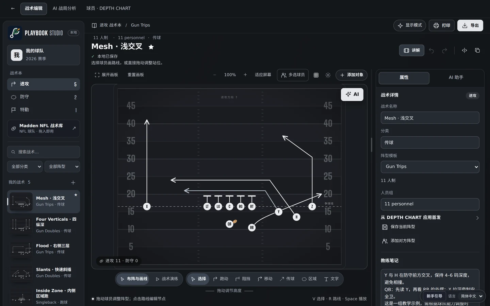
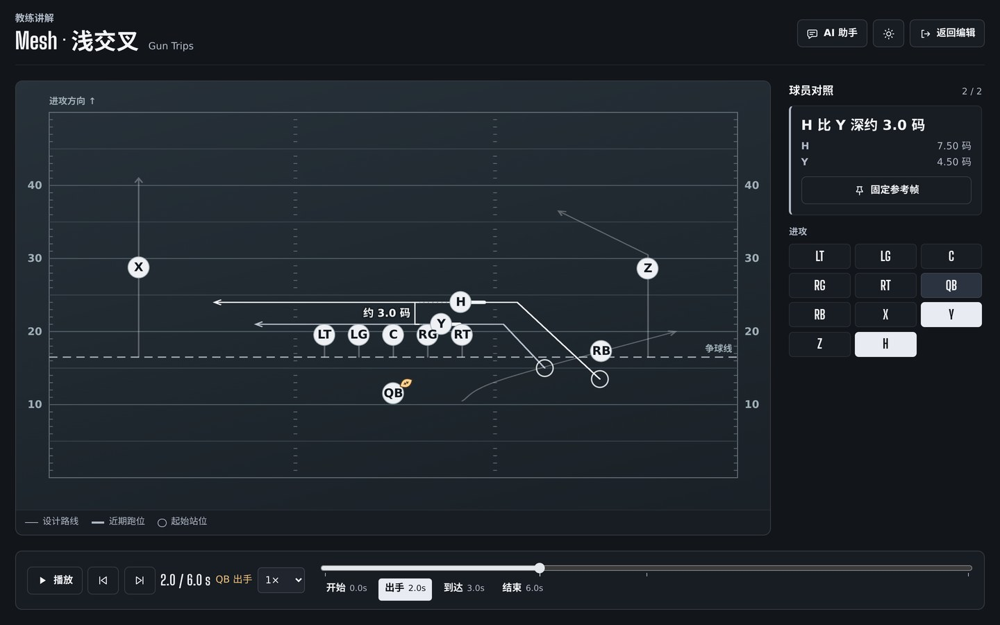
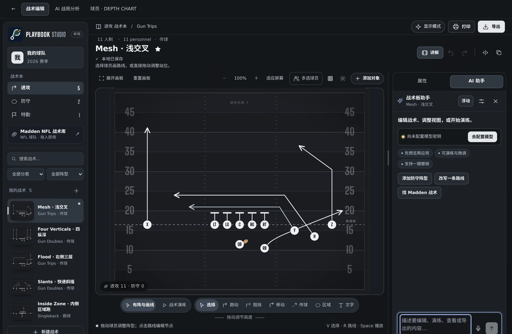
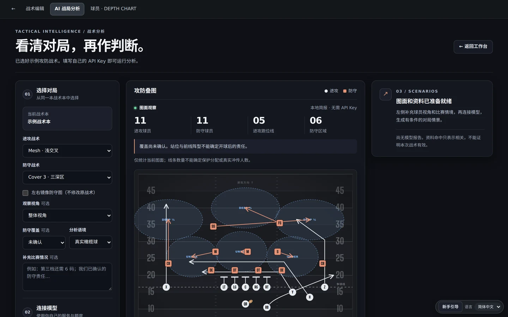
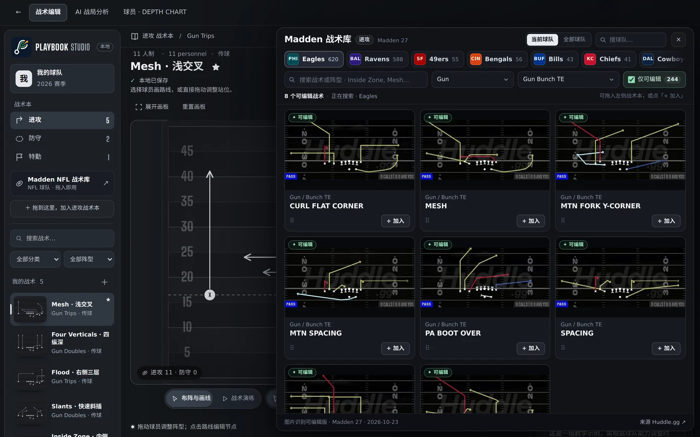

[简体中文](README.md) · **English**

<div align="center">

<picture>
  <source media="(prefers-color-scheme: dark)" srcset="docs/assets/brand/playbook-studio-logo-dark-transparent.svg">
  <source media="(prefers-color-scheme: light)" srcset="docs/assets/brand/playbook-studio-logo-light.svg">
  
</picture>

<br>

**An American football workspace for drawing plays, 3D rehearsal, coach film review, AI-assisted analysis and team collaboration.**

[Watch video](#showcase-video) · [Live demo](https://playbook-d8gv8tvxiac9ddb6d-1539632452.ap-shanghai.app.tcloudbase.com/editor/index.html) · [Demo accounts](#live-demo) · [AI feature guide](docs/AI_GUIDE.en.md) · [User guide](docs/USER_GUIDE.en.md) · [Deployment](docs/AGENT_DEPLOYMENT.en.md) · [Agent deploy Skill](skills/playbook-studio-local-deploy/SKILL.md)

</div>

## Showcase video

<div align="center">

<a href="https://github.com/TIMPICKLE/playbook-studio-web/blob/main/docs/assets/readme/playbook-studio-promo.mp4">
  
</a>

<br>

<sub>
  <strong>64s · 1080p full promotional film (with custom 120 BPM soundtrack)</strong>
  &nbsp;·&nbsp;
  <a href="https://github.com/TIMPICKLE/playbook-studio-web/raw/main/docs/assets/readme/playbook-studio-promo.mp4"><strong>▶ Watch / Download full MP4 with audio</strong></a>
  &nbsp;·&nbsp;
  <a href="docs/assets/readme/playbook-studio-promo.mp4">View video file</a>
</sub>

</div>

<details>
<summary>9-scene chapter guide (00:00 – 01:04)</summary>

| Time | Chapter | Highlights |
|---|---|---|
| `00:00` | **Opening** | ReactDrops WebGL 2 `Glass Slab Logo` ray-traced glass discs revealing the new `P`-route emblem |
| `00:08` | **Tactical canvas** | Animated **Mesh** route drawing, `3.0 YD` depth caliper, and 5v5 / 11v11 format switcher |
| `00:15` | **5v5 flag football** | Dedicated 5v5 templates, one-click 5-player opponents, and per-page guided quick tour |
| `00:21` | **Digital 3D board** | Instant flat ↔ WebGL 3D toggle, live rehearsal timeline, Dark Graphite ↔ Cool Silver wipe |
| `00:29` | **Coach film room** | Release keyframe freeze, live `H / Y 3.0 yd` depth telemetry, and on-device interactive lesson deck |
| `00:36` | **AI board assistant** | Natural-language editing with 3 safety safeguards (preview first, rehearse & refine, one-click undo) |
| `00:43` | **AI matchup analysis** | Zero-key Cover 3 × Mesh overlay & facts brief, 13 coaching principles, and browser-memory BYOK |
| `00:50` | **Madden & mobile** | 13 NFL teams / 1,827 plays, Dark Studio touch workspace, DEPTH CHART & 20-version team sync |
| `00:57` | **Finale** | Online live demo, MIT open source, and one-command Agent local deployment |

</details>

## What you can do



| Feature | Capabilities |
|---|---|
| **Edit plays** | **5v5 flag football** and 6–12 player formats; multi-player selection & group edits; routes, blocks, motion, passes, coverage zones and text; mirroring, templates, undo and redo |
| **Coach film room** | Desktop full-screen teaching playback: jump to release/arrival markers, compare two players' depth, pin reference frames and author private on-device lessons |
| **Per-page quick tour** | First-visit contextual highlights on editor, AI analysis and roster pages with per-page **Skip page** memory; replay beside the language selector on desktop or inside `⋯` on mobile |
| **Rehearse** | Playback, looping, speed and timeline controls for inspecting route and pass timing |
| **Playbooks and players** | Offense, defense and special teams; favorites, notes, formations and personnel-group **DEPTH CHARTs** |
| **Madden library** | Redesigned compact dark studio drawer covering **13 NFL teams and 1,827 entries (1,056 editable)**; filter, preview and click or drag into your playbook |
| **AI board assistant** | Natural-language editing, formations, Madden search, rehearsal and film-room controls; built-in readiness banner and 3-item safety strip (preview first, rehearse & refine, one-click undo) |
| **AI matchup analysis** | Zero-key high-contrast matchup overlay, diagram facts brief and coaching references; connect a model for sourced conditional scenarios and non-destructive edit handoffs |
| **Team collaboration** | Cloud autosave, owner/editor/viewer permissions, access across devices, conflict handling and recovery across the latest 20 saved versions |
| **Export and print** | PNG, SVG and JSON; A4 playbooks, wristband cards and call sheets |

English and Simplified Chinese are supported in a unified **Dark Studio** theme. Phones and iPads get a redesigned touch workspace with a `⋯` overflow menu; desktops support both the traditional flat field and the digital 3D board. [UX changes and validation →](docs/UX_REDESIGN.md) · [Non-AI acceptance records →](docs/acceptance/README.md)

## Live demo

Open the **[online demo](https://playbook-d8gv8tvxiac9ddb6d-1539632452.ap-shanghai.app.tcloudbase.com/editor/index.html)** and sign in with any of the following demo accounts for **Group C (`C组 · 战术本`)**:

| Account | Role | Password |
|---|---|---|
| `team_c_01` | Owner | `797016` |
| `team_c_02` | Editor | `604869` |
| `team_c_03` | Editor | `432973` |
| `team_c_04` | Editor | `146939` |
| `team_c_05` | Editor | `375900` |

## Quick start

1. Open the [online demo](https://playbook-d8gv8tvxiac9ddb6d-1539632452.ap-shanghai.app.tcloudbase.com/editor/index.html), sign in with one of the demo accounts above, and select the **Mesh** sample play.
2. Open a sample or create a play. Drag players into position; **Add objects** can add a complete **4–3 defense** (or 5-player opponents for 5v5 flag plays).
3. Select a player, press `R`, click route points, then press `Enter` to finish.
4. Switch to **Rehearse**, press Space to play or pause, and scrub the timeline; on desktop click **Film room** beside the play title for full-screen coaching playback.
5. Export JSON backups. Follow the Agent Skill below to run your own full persistent local instance.

[Full visual walkthrough, shortcuts and DEPTH CHART instructions →](docs/USER_GUIDE.en.md)

## Digital board

### Teach one throw with Mesh

Open the sample **Mesh** on a desktop and select **Film room** beside the play title. Jump to **Release 2.0s**, then select **H** and **Y**. The ball is at the quarterback’s hand. Starting positions and recent movement remain visible, and the comparison reads **H is ~3.0 yd deeper than Y**. Scrub back to 1.0 second and the gap reads **1.0 yd**. Pin a frame to compare positions across time. Press `Esc` or choose **Back to editor** to resume your work.



The **AI assistant** shares the film controls. Ask it to “freeze at release, compare H and Y, pin the frame, then go back one second.” It reads the actual time and depth from the field, and can author an on-device lesson. [Film commands and receipts](docs/COACH_FILM_COMMANDS.md)

Save up to three lesson stops on this device, each with a question, an answer and the selected players. Reopen the same play in the same workspace to continue preparing the lesson. While a question is on screen, players can judge the positions for themselves. Choose **Reveal** to show the answer and depth readings. Use `Alt+↑` and `Alt+↓` to move between stops, including when a player has keyboard focus.

Release and arrival markers appear for a valid designed pass. Defense-only diagrams show possession when the play assigns it. Schematic fields report relative depth. Phones and iPads use the touch workspace.

[Open the online demo](https://playbook-d8gv8tvxiac9ddb6d-1539632452.ap-shanghai.app.tcloudbase.com/editor/index.html#editor) · [Try an on-device lesson](https://playbook-d8gv8tvxiac9ddb6d-1539632452.ap-shanghai.app.tcloudbase.com/editor/index.html?filmPilot=lesson#editor) · [Study protocol and practice plays](docs/COACH_FILM_PILOT.md) · [Film room verification](docs/acceptance/COACH_FILM.md)

### Edit and rehearse on the digital field

In the desktop editor, choose **Display mode → Digital**. Click the brightness button above the field to switch between dark graphite and cool silver. The screenshot shows receiver X selected in Mesh on the 3D digital board. Fixed toolbars and the timeline use solid graphite surfaces; selecting a matte puck emphasizes its routes in their original colors while keeping the other assignments readable.


- **Edit a route:** ask the AI to change X’s go route to a post. The shared stem stays in place as the route bends inside, and a single stroke traces the new break. Press the mouse button to take over during the preview, or undo the change after applying it.
- **Rehearse a pass:** choose **Rehearse** and scrub between the quarterback’s release and the catch. Exporting a paused frame keeps the ball and routes at that instant (perspective PNG when WebGL is ready; flat diagram in compatibility view).
- **Drag and scrub:** a player and its linked routes move in the same refresh. Scrubbing shows the latest position on each refresh and settles at the time you release the slider.

[Visual checks and export samples](docs/DIGITAL_BOARD_ACCEPTANCE.md) · [Performance measurements and test conditions](docs/DIGITAL_BOARD_PERFORMANCE.md)

## AI features

Playbook Studio provides two complementary AI workspaces sharing one browser model connection, both tailored to American football diagrams and coaching facts:

### 1. Board AI assistant (editing, rehearsal and film room)

Click **✦ AI** on the field or switch to the docked **AI assistant** tab (also supports floating drag). The panel includes a readiness banner, a three-item safety strip (**Preview before applying · Rehearse & refine · One-click undo**), and quick-start examples:

- **Draw and edit:** try “Add a complete 4–3 defense and retain the offense,” “Have X run a 12-yard post,” “Have the OL zone block left,” or “Duplicate this play.”
- **Continuous drafts and group selection:** refine across multiple turns before committing, preview-rehearse pending edits, choose specific turn groups, click **Apply** to write as one undoable transaction, or discard cleanly.
- **Editor and film controls:** drive rehearsal, zoom, Madden catalog search, and Coach Film Room keyframes, depth comparisons, and on-device lessons.



### 2. AI matchup analysis (zero-key brief + conditional scenarios)

Open **AI matchup analysis** from the top navigation bar and choose one offense and one defense from the same playbook:

- **Works immediately without an API key:** renders the high-contrast Dark Studio overlay diagram, computes the local diagram facts brief, and retrieves matching principles from the 13 built-in bilingual cards or your locally imported team knowledge packs (Markdown / TXT / JSON / local PDF preprocessing).
- **Conditional model scenarios:** combine coverage assumptions (unknown, Cover 3 spot, Cover 3 Match, Cover 2, Cover 2 Read, man) and an optional player perspective to generate sourced “if… then…” scenarios with clickable diagram and reference highlights, follow-up discussion, and non-destructive edit handoffs to the editor.



### Model connections and security boundaries (BYOK)

| Provider | Supported API formats | Notes |
|---|---|---|
| **DeepSeek** | OpenAI Chat Completions, Anthropic Messages | Preset endpoints, no manual URL needed |
| **Anthropic / Claude** | Anthropic Messages | Preset endpoint (API format, not Claude Code CLI sign-in) |
| **OpenAI** | OpenAI Chat Completions, OpenAI Responses | Preset endpoints; stateless Responses history managed automatically |
| **OpenRouter** | OpenAI Chat Completions, OpenAI Responses | Preset endpoints for multi-model routing |
| **Custom compatible service** | All three formats | Enter full HTTPS base URL (never auto-adds `/v1`); requires `AI_ALLOWED_HOSTS` in full local mode |

- **Browser-memory BYOK only:** both AI entry points share one configuration; non-secret preferences persist in `localStorage`, while the **API key stays strictly in current page memory** and clears on page reload, provider switch, or sign-out. The backend has **no** server-side LLM API key environment variables, and local deployment does not supply model credits.
- **Use an active model ID:** prefilled UI defaults (such as `gpt-6.1-terra` or `deepseek-flash`) may not match your personal provider account; replace them with an enabled tool-calling model ID (for example `gpt-4o`, `deepseek-chat`, or `claude-sonnet-4-6`).

**[Detailed AI guide: setup, examples, knowledge, troubleshooting and limits →](docs/AI_GUIDE.en.md)** · **[AI protocol, rate-limit and security reference →](skills/playbook-studio-local-deploy/references/ai-providers-and-protocols.md)**

## Play library and player management

The redesigned **Madden NFL play library** opens as a compact dark studio drawer with 13 NFL teams and 1,827 entries (1,056 editable). Filter by team, formation, or **Editable only**, then click **Add** or drag into your playbook. **Editable entries** support route editing, offensive-line spacing normalization, original-image comparison and rehearsal; **image-only entries** support viewing, favorites, notes and exports (images are not automatically converted into editable routes).

Open **Players · DEPTH CHART** for starters and backups in each personnel group, then apply matching starters in the editor without changing positions or routes. [User guide](docs/USER_GUIDE.en.md) · [Madden data notes](docs/MADDEN_BATCH.md)



## Mobile, storage and devices

- **Mobile touch workspace:** the redesigned Dark Studio mobile layout optimizes field height and touch controls for phones and iPads, with a header `⋯` overflow menu for mirroring, duplicating, Madden library, export, print, and replaying the quick tour.
- **Online demo / full local deployment:** sharing and owner/editor/viewer permissions are scoped to each playbook, with recovery across the latest 20 saved versions.
- **Local static preview:** when running `npm run start:local`, data stays in the current browser and does not sync across devices. Export JSON before clearing browser data.
- **View and layout:** zoom and resize the field and panels on desktop; the digital view falls back to an interactive compatibility view when WebGL is unavailable.

<p align="center">
  
</p>

[Collaboration and migration](docs/USER_GUIDE.en.md#cloud-collaboration-and-storage) · [Touch devices](docs/TOUCH_WORKSPACE.md) · [Digital board](docs/DIGITAL_BOARD.md)

## Full local deployment (recommended) & Agent Skill

Run the complete frontend, Cloudflare Worker API, persistent local D1 database and team accounts on your machine (**Node.js 24** recommended; minimum **22.13.0**).

### Option 1: Deploy automatically with an AI coding agent (built-in Skill, recommended)

This repository ships a standard Agent Skill designed for **Claude Code, Codex, Cursor, Antigravity, OpenCode** and other coding agents:

- **Repository entrypoint:** [`AGENTS.md`](AGENTS.md) (auto-discovery pointer and hard safety guardrails)
- **Primary Skill:** [`skills/playbook-studio-local-deploy/SKILL.md`](skills/playbook-studio-local-deploy/SKILL.md) (7-phase runbook: preflight & LangSmith/OTEL 503 check → build → read-only D1 inspection & safe migration → secret-safe account bootstrap → teardown & clean restart → AI/gateway setup → structured handoff report)
- **Reference modules:**
  - [`references/ai-providers-and-protocols.md`](skills/playbook-studio-local-deploy/references/ai-providers-and-protocols.md) (5 providers × 3 protocols, default model ID caveat, `AI_ALLOWED_HOSTS` SSRF rules, LangSmith 503 guard, exact rate/payload/knowledge budgets)
  - [`references/troubleshooting.md`](skills/playbook-studio-local-deploy/references/troubleshooting.md) (HTTP `400`–`504`, D1 migration errors, `dist/` rebuild `.dev.vars` reset, `127.0.0.1` vs `localhost`, Ollama constraints)
  - [`references/verification-checklist.md`](skills/playbook-studio-local-deploy/references/verification-checklist.md) (automated CLI/HTTP checks and standardized handoff report template)

Clone the repo and give this prompt directly to your coding agent:

```text
Read AGENTS.md and skills/playbook-studio-local-deploy/SKILL.md (plus its references/) and follow the 7-phase local full deployment workflow for Playbook Studio. Do not publish publicly by default.
Enforce all guardrails (preserve any existing .wrangler/state/, check host LangSmith/OTEL env vars, keep credentials and PLAYBOOK_SETUP_KEY strictly in ignored local files, close bootstrap afterward), verify via verification-checklist.md, and deliver the structured handoff report with browser AI setup steps.
```

### Option 2: Manual setup

```bash
git clone https://github.com/TIMPICKLE/playbook-studio-web.git
cd playbook-studio-web
npm run install:ci
npm run build
```

Then follow the **[six deployment steps](docs/AGENT_DEPLOYMENT.en.md)** to initialize the local D1 database and accounts, start the service, and open `http://127.0.0.1:8787/editor/index.html` (do not substitute `npm run dev` or `/editor/local.html` for full deployment).

**AI requires a separate provider, active model ID and API key in the browser; deploying locally does not supply model credits.** See [AI setup](docs/AGENT_DEPLOYMENT.en.md#ai-configuration).

For a no-sign-in static preview, run `npm run start:local` and open `http://localhost:3000/` (no accounts or shared APIs).

```bash
npm run check       # JavaScript syntax checks
npm run typecheck   # TypeScript checks
npm test            # Automated tests
npm run dev         # Vinext development server (mockAuth enabled; dev only)
```

See the [deployment appendix](docs/AGENT_DEPLOYMENT.en.md#appendix-other-deployment-options) for GitHub Pages and public hosting options.

## Documentation

| Guide | Contents |
|---|---|
| [Agent local deployment Skill](skills/playbook-studio-local-deploy/SKILL.md) / [AGENTS.md](AGENTS.md) | 7-phase coding-agent runbook, AI protocol contracts, troubleshooting matrix and verification template |
| [Deployment guide](docs/AGENT_DEPLOYMENT.en.md) | Human-facing local deployment steps, AI setup, maintenance and hosting appendix |
| [AI feature guide](docs/AI_GUIDE.en.md) | Both AI entry points, configuration, knowledge packs, data boundaries and troubleshooting |
| [User guide](docs/USER_GUIDE.en.md) | Visual walkthrough, 5v5 flag football, per-page tour, DEPTH CHART, rehearsal, Madden and collaboration |
| [Web platform optimization](docs/WEB_PLATFORM_OPTIMIZATION.md) | Lazy geometry, stable rendering, native dialogs and repeatable audits |
| [AI command architecture](docs/EDITOR_COMMAND_ARCHITECTURE.md) / [Tool flow](docs/BOARD_ASSISTANT.md) | Shared manual/AI execution, previews and undo |
| [AI analysis research](docs/ai-analysis/README.md) | Competitors, knowledge architecture, implementation and evaluations |
| [Cloud architecture](docs/CLOUD.md) / [Localization](docs/I18N.md) | APIs, storage, identity and internationalization |
| [Design](docs/DESIGN.md) / [Liquid materials](docs/LIQUID_MATERIALS.md) / [Validation](docs/VALIDATION.md) | Interaction, visuals and regression notes |
| [Public script investigation](docs/PUBLIC_BUNDLE_STATIC_FINDINGS.md) / [Reproduction](docs/REA_REPRODUCE.md) | Public-source research and reproduction records |

User-facing guides and Agent Skills are available in English (with Chinese UI/error references); most engineering documents are in Chinese.

## Scope and licensing

- Rehearsal is a teaching visualization. AI analysis supports review, without real game physics or outcome predictions.
- The project is independently implemented and does not connect to the Playmaker X backend. File-format compatibility is unverified.
- Source code uses the [MIT License](LICENSE). Madden / Huddle.gg images and third-party components retain their own terms and **are not covered by the project's MIT license**. [Full scope notes](docs/USER_GUIDE.en.md#scope-and-licensing)

## Sponsors

Individuals, teams and companies can [submit a sponsorship inquiry](https://github.com/TIMPICKLE/playbook-studio-web/issues/new?template=sponsorship.yml). Maintainer [@TIMPICKLE](https://github.com/TIMPICKLE) will respond. No payment channel is currently published; this form is for discussing cooperation.


<details>
<summary>Cooperation process and recognition policy</summary>

No verified GitHub Sponsors or other payment channel is currently published. This form is for discussing cooperation and does not accept payments. Do not post payment details, identity documents, contracts, or other sensitive information in public issues.

1. Describe your proposed support, goals, and preferred recognition. Amounts and private contact details may be omitted initially.
2. After the maintainer responds, agree on a suitable private contact channel before discussing amounts, duration, and terms. Any payment requires separate confirmation of an official channel.
3. Once cooperation is confirmed and support has been delivered, recognition is added to both READMEs through a PR with the sponsor's consent. An inquiry does not automatically reserve a placement.

**Recognition policy:** choose a credit, name / logo with one official website link, or anonymity. Content, order, and display duration are agreed in advance; there is no unagreed ranking by contribution amount. Recognition does not imply product endorsement or promises of code merges, feature priority, or exclusivity. Contact the maintainer in the original issue to change a name, link, or duration, or request removal.

</details>
