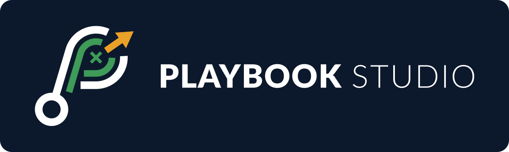
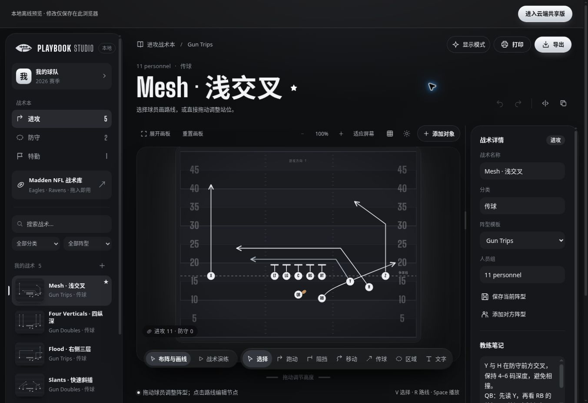
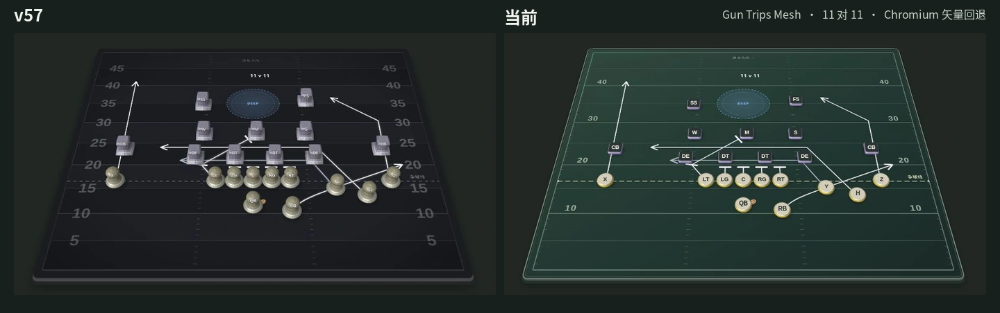
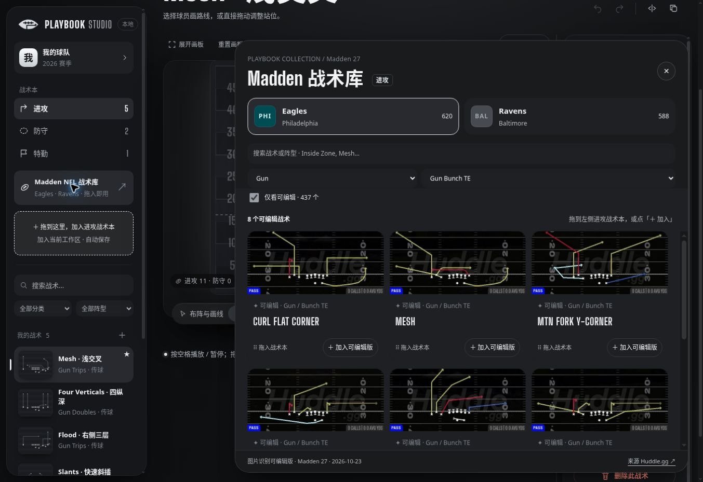
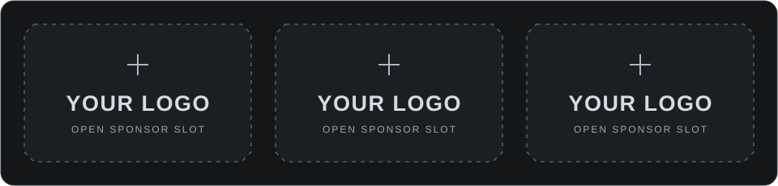

[简体中文](README.md) · **English**

<div align="center">



# Playbook Studio

An American football workspace for drawing plays, rehearsal, AI-assisted analysis and team collaboration.

[Live demo · no sign-in](https://playbook-studio-tim.kind-wolf-6204.chatgpt.site/editor/local) · [Cloud app](https://playbook-studio-tim.kind-wolf-6204.chatgpt.site/editor/) · [AI feature guide](docs/AI_GUIDE.en.md) · [User guide](docs/USER_GUIDE.en.md) · [Deployment](docs/AGENT_DEPLOYMENT.en.md)

</div>



## What you can do

| Feature | Capabilities |
|---|---|
| **Edit plays** | 5v5 flag football and other player counts; players, routes, blocks, motion, passes, coverage zones and text; mirroring, templates, undo and redo |
| **Quick tour** | First-visit highlights with step-by-step tips; skip anytime or replay beside the language selector |
| **Rehearse** | Playback, looping, speed and timeline controls; route and pass timing |
| **Playbooks and players** | Offense, defense and special teams; favorites, notes, formations and personnel-group DEPTH CHARTs |
| **Madden library** | 13 NFL teams and 1,827 entries, including 1,056 editable plays; filter, preview and import |
| **AI board assistant** | Natural-language editing, formations, playbook management, view and rehearsal controls, and file workflows |
| **AI matchup analysis** | Diagram briefs, retrieved coaching evidence and conditional model scenarios with diagram highlights |
| **Team collaboration** | Cloud autosave, permissions, access across devices, conflict handling and version history |
| **Export and print** | PNG, SVG and JSON; A4 playbooks, wristband cards and call sheets |

English and Simplified Chinese are supported. Phones and iPads use the traditional view; desktops also offer a digital board.

**Workflow update:** refine a continuous AI draft, preview selected change groups, and apply them; select and edit multiple players, share one properties/AI task area, and retain the current play and browsing position across modules. [UX changes and validation →](docs/UX_REDESIGN.md)

[Non-AI acceptance: fixes, browser evidence, and remaining blockers](docs/acceptance/README.md)

## Quick start

1. Open the [no-sign-in editor](https://playbook-studio-tim.kind-wolf-6204.chatgpt.site/editor/local) and select the **Mesh** sample play.
2. Open a sample or create a play. Drag players into position; **Add objects** can add a complete **4–3 defense**.
3. Select a player, press `R`, click route points, then press `Enter` to finish.
4. Switch to **Rehearse**, press Space to play or pause, and scrub the timeline.
5. Export JSON backups. Use the cloud app to create a shared team playbook.

[Full visual walkthrough, shortcuts and DEPTH CHART instructions →](docs/USER_GUIDE.en.md)

## Digital board

In the desktop editor, choose **Display mode → Digital**. Both views below show the same 11-on-11 Mesh play. The lower pieces on the right leave the block markers beyond the center visible. Each piece carries its position label on top and the player’s chosen color around the edge.



- **Edit a route.** Ask the AI to change X’s go route to a post. The shared release stays in place as the route bends inside. Press the mouse button to take over during the preview, or undo the change after applying it. [Watch the route edit](docs/acceptance/evidence/digital-edit-continuity.mp4)
- **Rehearse a pass.** Choose **Rehearse** and scrub between the quarterback’s release and the catch. Exporting a paused frame keeps the ball and routes at that instant. A ready WebGL scene exports a perspective PNG. The compatibility view exports a flat diagram. [Watch the rehearsal comparison](docs/acceptance/evidence/digital-rehearsal-compare.mp4)

[Visual checks and export samples](docs/DIGITAL_BOARD_ACCEPTANCE.md) · [Performance measurements and test conditions](docs/DIGITAL_BOARD_PERFORMANCE.md)

## AI features

- **Board assistant:** click **AI** on the field and enter your model and API key. Try “Add a 4-3 defense,” “Have X run a 12-yard post,” or “Duplicate this play.” Data edits are previewed before applying and undo together.
- **Matchup analysis:** open **AI matchup analysis** from the workspace. Diagram briefs and retrieved references work without a key. Connect a model for sourced conditional scenarios, and optionally import team knowledge packs.

Both entry points support **Anthropic Messages, OpenAI Chat Completions and Responses**, with DeepSeek, Claude, OpenAI, OpenRouter and custom compatible services. Available formats follow the selected provider.

**[Detailed AI guide: setup, examples, knowledge, troubleshooting and limits →](docs/AI_GUIDE.en.md)**

## Play library and player management

Filter Madden entries and select **Add**, or drag them into the playbook. **Editable entries** support route editing and rehearsal; **image-only entries** support viewing, favorites, notes and exports. An image is not automatically converted into editable routes.

Open **Player management → DEPTH CHART** for starters and backups in each personnel group. Apply matching starters in the editor without changing positions or routes. [User guide](docs/USER_GUIDE.en.md) · [Madden data notes](docs/MADDEN_BATCH.md)



## Storage and devices

- **No-sign-in demo:** data stays in the current browser and does not sync across devices. Export JSON before clearing browser data.
- **Cloud:** sharing and owner/editor/viewer permissions are scoped to each playbook, with the latest 20 saved versions available for recovery.
- **View and layout:** zoom and resize the field and panels. The desktop digital view uses a compatibility display when WebGL is unavailable.

[Collaboration and migration](docs/USER_GUIDE.en.md#cloud-collaboration-and-storage) · [Touch devices](docs/TOUCH_WORKSPACE.md) · [Digital board](docs/DIGITAL_BOARD.md)

## Full local deployment (recommended)

Run the frontend, API, persistent database and team accounts on your computer. Use **Node.js 24** (minimum 22.13.0):

```bash
git clone https://github.com/TIMPICKLE/playbook-studio-web.git
cd playbook-studio-web
npm run install:ci
npm run build
```

Follow the **[six deployment steps](docs/AGENT_DEPLOYMENT.en.md)** to initialize the local database and accounts, then start the service and open `http://127.0.0.1:8787/editor/`. The guide includes a complete prompt for your coding agent.

**AI requires a separate provider, model and API key configuration; deploying locally does not supply a model.** See [AI setup](docs/AGENT_DEPLOYMENT.en.md#ai-configuration) for both entry points.

For a no-sign-in static preview, run `npm run start:local` and open `http://localhost:3000/`. This mode does not include accounts or shared APIs.

```bash
npm run check       # JavaScript syntax checks
npm run typecheck   # TypeScript checks
npm test            # Automated tests
npm run dev         # Vinext development environment
```

See the [guide appendix](docs/AGENT_DEPLOYMENT.en.md) for GitHub Pages and public hosting options.

## Documentation

| Guide | Contents |
|---|---|
| [User guide](docs/USER_GUIDE.en.md) | Visual walkthrough, personnel groups, rehearsal, Madden and collaboration |
| [AI feature guide](docs/AI_GUIDE.en.md) | Both AI entry points, configuration, knowledge and troubleshooting |
| [Deployment guide](docs/AGENT_DEPLOYMENT.en.md) | Full local deployment, AI setup and hosting appendix |
| [Web platform optimization](docs/WEB_PLATFORM_OPTIMIZATION.md) | Lazy geometry, stable rendering, native dialogs and repeatable audits |
| [AI command architecture](docs/EDITOR_COMMAND_ARCHITECTURE.md) / [Tool flow](docs/BOARD_ASSISTANT.md) | Shared manual/AI execution, previews and undo |
| [AI analysis research](docs/ai-analysis/README.md) | Competitors, knowledge architecture, implementation and evaluations |
| [Cloud architecture](docs/CLOUD.md) / [Localization](docs/I18N.md) | APIs, storage, identity and internationalization |
| [Design](docs/DESIGN.md) / [Liquid materials](docs/LIQUID_MATERIALS.md) / [Validation](docs/VALIDATION.md) | Interaction, visuals and regression notes |
| [Public script investigation](docs/PUBLIC_BUNDLE_STATIC_FINDINGS.md) / [Reproduction](docs/REA_REPRODUCE.md) | Public-source research and reproduction records |

User-facing guides are bilingual; most engineering documents are in Chinese.

## Scope and licensing

- Rehearsal is a teaching visualization. AI analysis supports review, without real game physics or outcome predictions.
- The project is independently implemented and does not connect to the Playmaker X backend. File-format compatibility is unverified.
- Source code uses the [MIT License](LICENSE). Madden / Huddle.gg images and third-party components retain their own terms and **are not covered by the project's MIT license**. [Full scope notes](docs/USER_GUIDE.en.md#scope-and-licensing)

## Sponsors

Individuals, teams and companies can [submit a sponsorship inquiry](https://github.com/TIMPICKLE/playbook-studio-web/issues/new?template=sponsorship.yml). Maintainer [@TIMPICKLE](https://github.com/TIMPICKLE) will respond. No payment channel is currently published; this form is for discussing cooperation.



<details>
<summary>Cooperation process and recognition policy</summary>

No verified GitHub Sponsors or other payment channel is currently published. This form is for discussing cooperation and does not accept payments. Do not post payment details, identity documents, contracts, or other sensitive information in public issues.

1. Describe your proposed support, goals, and preferred recognition. Amounts and private contact details may be omitted initially.
2. After the maintainer responds, agree on a suitable private contact channel before discussing amounts, duration, and terms. Any payment requires separate confirmation of an official channel.
3. Once cooperation is confirmed and support has been delivered, recognition is added to both READMEs through a PR with the sponsor's consent. An inquiry does not automatically reserve a placement.

**Recognition policy:** choose a credit, name / logo with one official website link, or anonymity. Content, order, and display duration are agreed in advance; there is no unagreed ranking by contribution amount. Recognition does not imply product endorsement or promises of code merges, feature priority, or exclusivity. Contact the maintainer in the original issue to change a name, link, or duration, or request removal.

</details>
