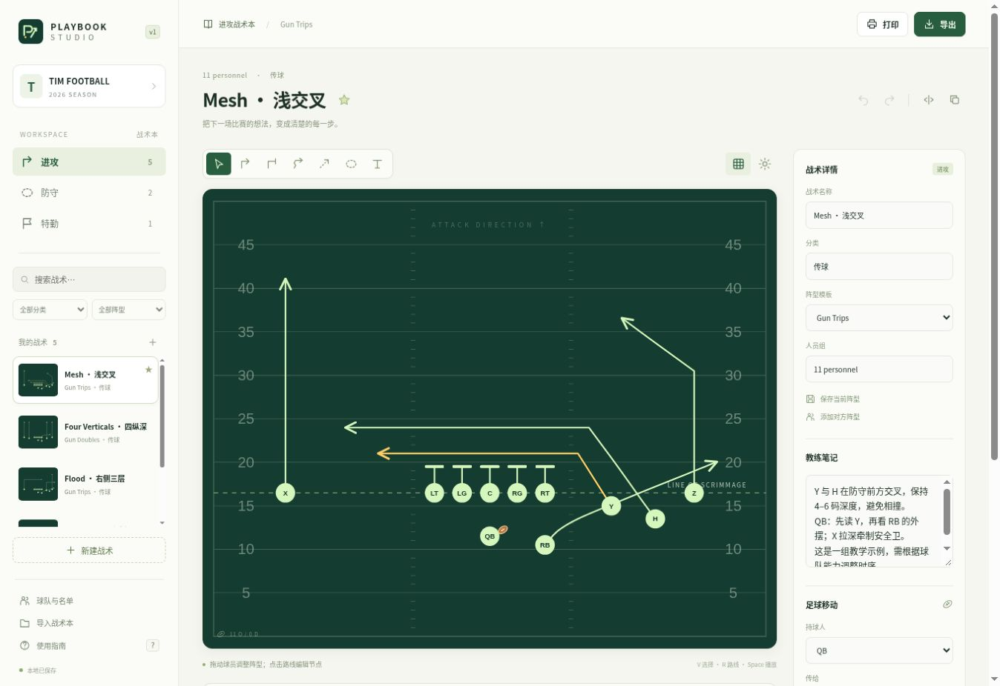

# Playbook Studio

中文美式橄榄球战术工作台。参考 Playmaker X 的公开功能与网页脚本结构，独立实现阵型编辑、路线绘制、战术演练、战术本管理和打印。前端运行不依赖第三方服务，也不需要账号。

**[在线使用 →](https://timpickle.github.io/playbook-studio-web/)** · [公开脚本调查](docs/PUBLIC_BUNDLE_STATIC_FINDINGS.md) · [验证记录](docs/VALIDATION.md)



## 能做什么

| 场景 | 已实现 |
|---|---|
| 战术本 | 进攻 / 防守 / 特勤；名称、阵型、分类、搜索、收藏、复制与删除 |
| 阵型 | 8 种初始阵型；6、7、8、9、11、12 人制；拖动球员；一键添加完整 4–3 防守；添加对手；保存自定义模板 |
| 绘图 | 多节点路线；实线跑动、横杠阻挡、锯齿移动、虚线传球；平滑曲线、圆点和选项路线；区域与文字 |
| 修改 | 拖动路线节点；球员与路线整体移动；左右镜像；撤销与重做 |
| 演练 | 播放、暂停、重置、循环、0.5–2 倍速度、时间轴；逐路线延迟与时长；持球、传球及接球后的球移动 |
| 球队 | 名称、赛季、主题色、球员名单、位置标签、颜色、图形及姓名分配 |
| 分享 | SVG 矢量图、2000×1600 PNG、自有 JSON 战术本导入 / 导出 |
| 打印 | A4 战术本、9 格腕带卡、Call Sheet；浏览器可保存为 PDF |
| 设备 | 响应式布局、鼠标与触摸；本地自动保存；HTTPS 下提供离线缓存 |

内置 8 个教学示例：Mesh、Four Verticals、Flood、Slants、Inside Zone、Cover 3、Nickel Blitz、Field Goal。示例阵型和路线为本项目自有数据。

## 启动

需要 Node.js 24 或更高版本。前端本身没有运行依赖。

```bash
npm start
```

打开终端显示的本地地址（默认 `http://localhost:3000`）。也可以把整个 `dist/` 目录部署到任意静态服务器。不建议用 `file://` 直接打开，因为浏览器的 ES Module 与存储策略不同。

验证代码：

```bash
npm ci --ignore-scripts
npm run check
npm test
```

测试覆盖见 [验证记录](docs/VALIDATION.md)。开发依赖仅用于 DOM 交互测试，不会发给网页访客。

## 先画一个战术

1. 点「新建战术」，选择阵型和人数。
2. 拖动球员确定站位。选中球员，按 **R**，点击转折点，按 **Enter** 完成路线。
3. 点击路线，在右侧调整线型、末端、曲线与启动时序；拖动实心节点微调。
4. 按 **Space** 演练，拖动时间轴检查站位。在战术详情中设定持球人与接球人。
5. 点「导出」备份 JSON，或点「打印」生成战术本 / 腕带。

每个球员有一条主跑动 / 移动路线；新增同类路线默认作为选项分支。将某条路线的「选项路线」取消勾选，会把同球员其他跑动路线设为选项。阻挡和传球线用于图示，不使球员移动。

在右侧「添加对象」点 **添加 4–3 防守阵型（11 人）**，一次放入 4 名防守锋线、3 名线卫和 4 名后卫，保留进攻球员与进攻路线。这一整组始终是 11 人，不随默认联赛人数缩减。已有防守球员时按钮显示「重设」，替换该组及其路线，避免重复添加；可用撤销恢复。

| 快捷键 | 操作 |
|---|---|
| V / R / B / M / P / Z / T | 选择 / 跑动 / 阻挡 / 移动 / 传球 / 区域 / 文字 |
| Enter / Esc | 完成路线 / 取消绘制或关闭弹窗 |
| Space | 播放 / 暂停 |
| Ctrl 或 ⌘ Z | 撤销 |
| Ctrl 或 ⌘ Shift Z | 重做 |
| Delete | 删除当前选中对象 |
| ? | 使用指南 |

## 数据与范围

数据保存在当前浏览器的 `localStorage`，不会发送到 Playmaker X 或本项目服务器。清理站点数据会删除本地战术，建议定期导出 JSON。导入采用追加方式，保留已有战术和球队设置，支持撤销。JSON 文件最大 5 MB，最多 500 个战术、100 个模板、200 名球队成员。每个战术最多 40 个球员标记、100 条路线。

这是本地设计与教学版本。没有接入账号、多人实时协作、云同步、Playmaker X 后端，也没有验证原版文件格式兼容性。路线播放不是碰撞、对抗、防守 AI 或真实比赛模拟。打印布局为本项目新设计，腕带实际尺寸需按纸张和腕带调整。

## REA 调查

实际使用 **REA 6.4.0** 对公开网页脚本进行了文件检查、摘要投影、资产分页和资产追踪。REA 的核心 JavaScript 语义分析受当前执行环境的 procps/PID 检查阻挡；功能结构另由独立 Babel AST 分析补充，两者在报告中分别标注，未把补充结果冒充 REA 语义证据。

- [公开脚本调查及证据 ID](docs/PUBLIC_BUNDLE_STATIC_FINDINGS.md)
- [脱敏摘要 JSON](docs/rea-public-summary.json)
- [在受支持环境重跑 REA](docs/REA_REPRODUCE.md)

仓库包含本项目源代码、教学数据与调查摘要；不包含原产品源码、产品图片、凭证或原始含源码分析输出。Playmaker X 是原产品名称，本项目为独立实现。

## 工程结构

- `dist/model.js`：数据模型、几何、动画、备份验证与历史。
- `dist/field.js`：SVG 球场、路线和逐帧位置更新。
- `dist/app.js`：界面、鼠标 / 触摸交互、战术本、导入导出及打印。
- `dist/styles.css`：桌面、移动端和 A4 打印样式。
- `tests/`：模型测试与 Happy DOM 交互测试。
- `docs/`：证据、验证和复核说明。
- `.github/workflows/`：代码检查与 GitHub Pages 发布。

GitHub Pages 使用 `Deploy GitHub Pages` 工作流发布 `dist/`；Settings → Pages 的 Source 应设为 GitHub Actions。网站代码使用相对资源路径，支持仓库子路径部署。

本项目源代码采用 [MIT](LICENSE) 许可。
