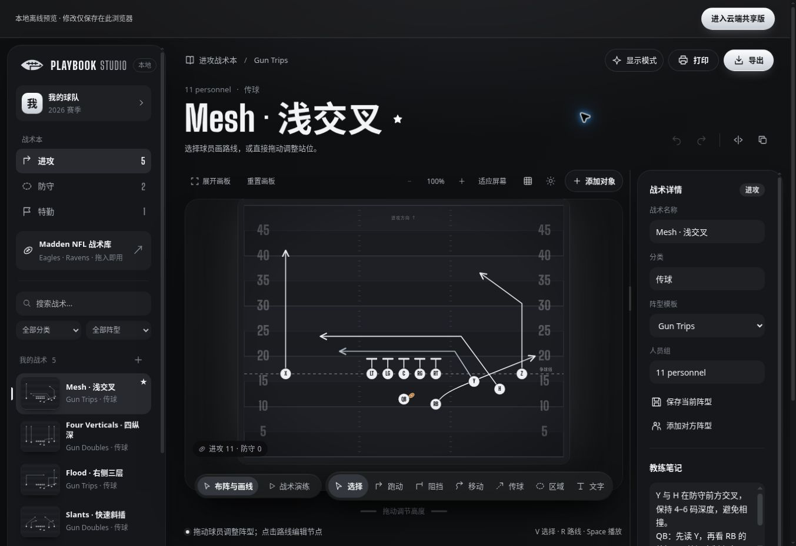
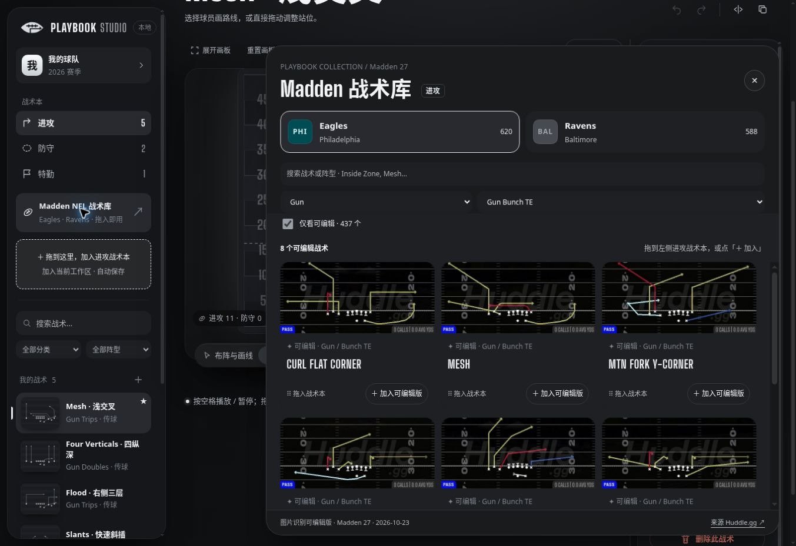

**简体中文** · [English](README.en.md)

<div align="center">


# Playbook Studio

美式橄榄球战术工作台：布阵、画线、演练、AI 辅助分析与球队协作。

[免登录体验](https://timpickle.github.io/playbook-studio-web/) · [云端版](https://playbook-studio-tim.kind-wolf-6204.chatgpt.site/editor/) · [AI 功能详解](docs/AI_GUIDE.md) · [使用指南](docs/USER_GUIDE.md) · [部署手册](docs/AGENT_DEPLOYMENT.md)

</div>



## 能做什么

| 功能 | 说明 |
|---|---|
| **战术编辑** | 支持 5 人腰旗与其他人数制；攻防球员、路线、阻挡、预动、传球、覆盖区域和文字；支持镜像、模板、撤销与重做 |
| **新手引导** | 首次进入分步高亮说明，随时跳过；语言切换旁可重新查看 |
| **战术演练** | 播放、暂停、循环、调速和时间轴；调整球员路线与传接球时序 |
| **战术本与球员** | 进攻／防守／特勤分类，收藏、笔记、自定义阵型，以及各人员组的 DEPTH CHART |
| **Madden 战术库** | 13 支 NFL 球队、1,827 个条目，其中 1,056 个可编辑；筛选、预览后加入战术本 |
| **AI 战术板助手** | 用自然语言编辑对象、添加阵型、管理战术本，控制视图、演练及导入导出流程 |
| **AI 攻防分析** | 查看图面简报与知识证据，连接模型生成条件化分析，并高亮相关球员和路线 |
| **团队协作** | 云端自动保存、成员权限、跨设备访问、冲突处理和历史版本 |
| **导出与打印** | PNG、SVG、JSON，A4 战术本、腕带卡和 Call Sheet |

支持简体中文与英文。手机和 iPad 使用传统模式，桌面可切换数字化战术板。

## 快速开始

1. 打开[免登录工作台](https://timpickle.github.io/playbook-studio-web/)，进入 **「编辑战术本」**。
2. 选择内置示例或新建战术，拖动球员调整站位；「添加对象」可一次加入完整 **4–3 防守**。
3. 选中球员，按 `R` 并点击路线点，按 `Enter` 完成。
4. 切到 **「战术演练」**，按空格播放／暂停，拖动时间轴检查跑位。
5. 导出 JSON 备份；需要球队共享时，使用云端版创建战术本。

[完整图解教程、快捷键与 DEPTH CHART 操作 →](docs/USER_GUIDE.md)

## AI 功能

- **战术板助手**：点击球场边缘的 **AI**，填写模型和自己的 API Key。例如「添加 4–3 防守」「把 X 改为 12 码 post」「复制当前战术」。数据修改先预览、应用后可整组撤销。
- **攻防对位分析**：从工作台进入 **「AI分析战局」**。无需 Key 即可查看图面简报和检索资料；连接模型后生成有来源的条件情景，也可导入球队知识包。

两个入口均支持 **Anthropic Messages、OpenAI Chat Completions 和 Responses**；可选 DeepSeek、Claude、OpenAI、OpenRouter 或自定义兼容服务，格式选项随服务商调整。

**[AI 功能详解：配置、操作示例、知识库、常见问题与能力边界 →](docs/AI_GUIDE.md)**

## 战术库与球员管理

Madden 战术可通过筛选后点击加入，或拖入战术本。**可编辑条目**支持改线与演练；**原图条目**用于查看、收藏、笔记和导出。原图不会自动变成可编辑路线。

在 **「球员管理」→「DEPTH CHART」** 查看各人员组的首发与替补；编辑器可按位置匹配并应用已有首发，保留站位和路线。[操作教程](docs/USER_GUIDE.md) · [Madden 数据说明](docs/MADDEN_BATCH.md)



## 数据保存与设备

- **免登录版**：数据保存在当前浏览器，不会自动跨设备同步；清理浏览器数据前请导出 JSON。
- **云端版**：以战术本为单位共享，管理员／编辑者／只读成员权限独立，可恢复最近 20 个已保存版本。
- **显示与布局**：支持缩放、调整画板与侧栏尺寸；桌面数字化视图在 WebGL 不可用时使用兼容显示。

[云端协作与旧数据迁移](docs/USER_GUIDE.md#云端协作与数据保存) · [触摸设备说明](docs/TOUCH_WORKSPACE.md) · [数字化战术板](docs/DIGITAL_BOARD.md)

## 本地完整部署（推荐）

推荐在本机运行完整的前端、API、持久数据库和团队账号。使用 **Node.js 24**（最低 22.13.0）：

```bash
git clone https://github.com/TIMPICKLE/playbook-studio-web.git
cd playbook-studio-web
npm run install:ci
npm run build
```

接着按 **[部署手册的六步流程](docs/AGENT_DEPLOYMENT.md)** 初始化本地数据库和账号，再启动服务，打开 `http://127.0.0.1:8787/editor/`。手册含可直接交给 AI Agent 的完整指令。

**AI 功能需另行配置服务商、模型和 API Key；本地部署不会自动提供模型。** 两个 AI 入口的配置见[详细说明](docs/AGENT_DEPLOYMENT.md#ai-功能配置)。

只需免登录静态体验时，运行 `npm run start:local` 并打开 `http://localhost:3000/`；该模式不含账号和共享 API。

```bash
npm run check       # JavaScript 语法检查
npm run typecheck   # TypeScript 检查
npm test            # 自动化测试
npm run dev         # Vinext 开发环境
```

GitHub Pages 与公网部署方式见[手册附录](docs/AGENT_DEPLOYMENT.md)。

## 文档导航

| 文档 | 内容 |
|---|---|
| [使用指南](docs/USER_GUIDE.md) | 图解教程、人员组、演练、Madden 与协作 |
| [AI 功能详解](docs/AI_GUIDE.md) | 两个 AI 入口的配置、用法、知识库与问题排查 |
| [部署手册](docs/AGENT_DEPLOYMENT.md) | 本地完整部署、AI 配置与托管附录 |
| [Web 平台优化](docs/WEB_PLATFORM_OPTIMIZATION.md) | 按需加载、局部渲染、原生弹窗与可重复审计 |
| [AI 命令架构](docs/EDITOR_COMMAND_ARCHITECTURE.md) / [工具流程](docs/BOARD_ASSISTANT.md) | 手动与 AI 的共享执行器、预览和撤销 |
| [AI 分析研究](docs/ai-analysis/README.md) | 竞品、知识库架构、实施与评估记录 |
| [云端架构](docs/CLOUD.md) / [多语言开发](docs/I18N.md) | API、数据、身份接入与国际化 |
| [设计](docs/DESIGN.md) / [液态材质](docs/LIQUID_MATERIALS.md) / [验证记录](docs/VALIDATION.md) | 交互、视觉与回归说明 |
| [公开脚本调查](docs/PUBLIC_BUNDLE_STATIC_FINDINGS.md) / [复现说明](docs/REA_REPRODUCE.md) | 公开资料研究与复现记录 |

## 使用边界与许可

- 演练是教学图示，AI 分析是辅助复核，不模拟真实比赛物理，也不预测比赛结果。
- 项目独立实现，不连接 Playmaker X 后端；未验证其文件格式兼容性。
- 源代码采用 [MIT License](LICENSE)。Madden / Huddle.gg 原图及第三方组件保留各自许可，**不由本项目 MIT 许可覆盖**。[完整使用边界](docs/USER_GUIDE.md#使用边界与许可)

## 赞助者

欢迎个人、团队和企业[提交赞助合作意向](https://github.com/TIMPICKLE/playbook-studio-web/issues/new?template=sponsorship.yml)，由维护者 [@TIMPICKLE](https://github.com/TIMPICKLE) 回复。目前未公布收款渠道，此入口仅用于洽谈合作。


<details>
<summary>合作流程与展示规则</summary>

目前未公布经确认可用的 GitHub Sponsors 或其他收款渠道；此入口仅用于洽谈合作，不接受付款。请勿在公开 Issue 中提交支付信息、证件、合同或其他敏感资料。

1. 提交支持方式、合作目标和期望展示方式；金额与私人联系方式可暂不提供。
2. 维护者回复后，双方先确认适合的私下联系渠道，再沟通金额、周期和具体条款。任何付款均需另行确认正式渠道。
3. 合作确认且支持实际落实后，经赞助者同意，再通过 PR 更新中英文 README 的展示信息；提交意向不会自动获得展示位。

**展示规则：**可选择署名、名称 / Logo 与一个官网链接，或保持匿名；内容、顺序及展示期限由双方事先确认，不按未经约定的金额排名。展示不代表产品背书，也不附带代码合并、功能排期或独家权益承诺。名称、链接或期限变更以及退出展示，可在原 Issue 中联系维护者。

</details>
