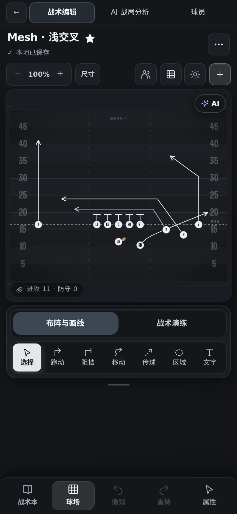

**简体中文** · [English](README.en.md)

<div align="center">


# Playbook Studio

美式橄榄球战术工作台：布阵、画线、演练、教练讲解、AI 辅助分析与球队协作。

[在线体验版本](https://playbook-d8gv8tvxiac9ddb6d-1539632452.ap-shanghai.app.tcloudbase.com/editor/index.html) · [体验账号](#在线体验) · [AI 功能详解](docs/AI_GUIDE.md) · [使用指南](docs/USER_GUIDE.md) · [部署手册](docs/AGENT_DEPLOYMENT.md) · [Agent 本地部署 Skill](skills/playbook-studio-local-deploy/SKILL.md)

</div>


## 能做什么

| 功能 | 说明 |
|---|---|
| **战术编辑** | 支持 **5 人制腰旗** 与 6–12 人制；攻防球员、多选整组编辑、路线、阻挡、预动、传球、覆盖区域和文字；镜像、阵型模板、撤销与重做 |
| **教练讲解台** | 桌面全屏 Coach Film 演示与回放教学，定格出手／到达关键帧、对照两名球员纵深、固定参考帧并保存本机提问课件 |
| **按页新手引导** | 首次进入编辑、AI 分析或球员管理时分步高亮说明，支持「跳过本页」按页记忆；桌面语言切换旁、移动端 `⋯` 菜单可随时重看 |
| **战术演练** | 播放、暂停、循环、调速和时间轴；可视化检查球员路线与传接球时序 |
| **战术本与球员** | 进攻／防守／特勤分类，收藏、笔记、自定义阵型，以及按人员组管理的比赛日 **DEPTH CHART** |
| **Madden 战术库** | 新版紧凑暗色抽屉，覆盖 **13 支 NFL 球队、1,827 个条目（1,056 个可编辑）**；筛选、预览后点击或拖入战术本 |
| **AI 战术板助手** | 自然语言改图、加防守、搜 Madden 库、操控演练与教练讲解台；内置就绪状态条与三项安全保障（先预览再应用、可演练微调、一键撤销） |
| **AI 战局分析** | 免 API Key 即可查看高对比攻防叠图、图面事实简报与教练知识证据；连接模型后生成有来源的条件化推演与可转入编辑器的修改建议 |
| **团队协作** | 云端自动保存、成员权限（管理员／编辑者／只读）、跨设备访问、冲突处理与最近 20 个历史版本恢复 |
| **导出与打印** | PNG、SVG、JSON，以及 A4 战术本、腕带卡和 Call Sheet |

支持简体中文与英文，统一采用 **Dark Studio** 深色工作室界面。手机和 iPad 提供专为触控重设计的移动工作台与 `⋯` 溢出菜单；桌面支持传统平面球场与数字化 3D 战术板切换。[UX 改造与验证记录 →](docs/UX_REDESIGN.md) · [非 AI 严格验收记录 →](docs/acceptance/README.md)

## 在线体验

访问 **[在线体验版本](https://playbook-d8gv8tvxiac9ddb6d-1539632452.ap-shanghai.app.tcloudbase.com/editor/index.html)**，使用以下任一体验账号登录 **C组（C组 · 战术本）**：

| 账号 | 权限 | 密码 |
|---|---|---|
| `team_c_01` | Owner | `797016` |
| `team_c_02` | Editor | `604869` |
| `team_c_03` | Editor | `432973` |
| `team_c_04` | Editor | `146939` |
| `team_c_05` | Editor | `375900` |

## 快速开始

1. 打开[在线体验版本](https://playbook-d8gv8tvxiac9ddb6d-1539632452.ap-shanghai.app.tcloudbase.com/editor/index.html)，使用上方体验账号登录，选择 **Mesh · 浅交叉**。
2. 选择内置示例或新建战术，拖动球员调整站位；「添加对象」可一次加入完整 **4–3 防守**（5 人腰旗支持一键添加 5 人对手）。
3. 选中球员，按 `R` 并点击路线点，按 `Enter` 完成。
4. 切到 **「战术演练」**，按空格播放／暂停，拖动时间轴检查跑位；桌面点击标题旁 **「讲解」** 进入全屏讲解台。
5. 导出 JSON 备份；需要球队独立私有部署与持久化时，按下方 Skill 在本机部署完整服务。

[完整图解教程、快捷键与 DEPTH CHART 操作 →](docs/USER_GUIDE.md)

## 数字化战术板

### 用 Mesh 讲清一次出手

在桌面打开 **Mesh 浅交叉**，点战术标题旁的 **讲解**。点时间轴上的 **出手 2.0s**，再选 **H** 和 **Y**。球停在 QB 手上，画面同时给出两人的开球站位、近期跑位和纵深差。此时 H 比 Y 深约 **3.0 码**，拖回 1.0 秒，两人只差 **1.0 码**。固定参考帧再拖动，可以同时指给队员看差距怎样形成。按 `Esc` 或点「返回编辑」继续原先的工作。


讲解台里的 **AI 助手** 可以连续执行「停在出手，比较 H 和 Y，固定这一帧，再倒回一秒」，读取场上的实际停点和纵深，并按教练指令编排本机课件。[讲解工具与回执](docs/COACH_FILM_COMMANDS.md)

本机课件可以保存三个停点，每个停点记住问题、答案和聚焦球员。下次在同一工作区打开这套战术，可以直接续编。投屏提问时，队员能看场上站位，点「揭示」后才出现答案和纵深读数。即使焦点在球员身上，教练也能用 `Alt+↑` 和 `Alt+↓` 切换停点。

战术定义了有效传球时，时间轴会标出「出手」和「到达」。纯防守布阵按编排显示球权，无比例的场地显示相对纵深。手机和 iPad 使用触屏工作区。

[打开在线体验版本](https://playbook-d8gv8tvxiac9ddb6d-1539632452.ap-shanghai.app.tcloudbase.com/editor/index.html#editor) · [试用本机课件](https://playbook-d8gv8tvxiac9ddb6d-1539632452.ap-shanghai.app.tcloudbase.com/editor/index.html?filmPilot=lesson#editor) · [试教材料与两套战术](docs/COACH_FILM_PILOT.md) · [讲解台验收记录](docs/acceptance/COACH_FILM.md)

### 在数字球场编辑与演练

在桌面编辑器选择 **显示模式 → 数字化模式**。点击球场上方的明暗切换按钮，即可在石墨深色与冷银浅色之间切换。下图显示在数字球场中选中外接手 X 后的 Mesh 浅交叉：固定工具栏和播放条使用石墨实底，选中一枚哑光棋子时，其路线沿原色加粗，其余球员的任务仍清晰可读。


- **改线**：让 AI 把 X 的 Go 改为 Post，重合的起跑段保持原位，新的内切段描亮一次。预览中按下鼠标即可接管，应用后可一键撤销。
- **演练**：切到「战术演练」，拖动时间轴查看四分卫出手和接球时刻。暂停后导出 PNG 会保留当时的球位和路线（WebGL 就绪导出透视图，兼容视图导出平面图）。
- **拖动与回看**：拖动球员时，棋子与关联路线在同一次刷新中移动；快速拖动时间轴时持续对齐最新位置，松手后停在最终时刻。

[验收画面与导出样例](docs/DIGITAL_BOARD_ACCEPTANCE.md) · [性能实测与设备条件](docs/DIGITAL_BOARD_PERFORMANCE.md)

## AI 功能

Playbook Studio 提供两个互补且共用模型连接的 AI 入口，全部围绕美式橄榄球规则与图面事实设计：

### 1. 板内 AI 助手（编辑、演练与讲解控制）

点击球场边缘 **✦ AI** 或右侧 **「AI 助手」** 标签即可停靠打开（也支持浮动拖动）。助手内置就绪状态提示、三项安全保障条（**先预览再应用 · 可演练与微调 · 支持一键撤销**）与快捷示例：

- **改图与布阵**：例如「添加完整 4–3 防守，保留进攻」「把 X 的路线改为 12 码 Post」「OL 全线向左 Zone 阻挡」「复制当前战术」。
- **连续草稿与分组确认**：未应用前可多轮追问调整，支持先「预览演练」或按轮次勾选保留组，确认点击 **应用** 才写入战术，并作为单一事务支持一键撤销。
- **操控视图与讲解台**：控制演练、缩放、检索 Madden 战术库，以及在 Coach Film 讲解台中定位关键帧、对照纵深和编排本机课件。


### 2. AI 攻防战局分析（免 Key 简报 + 条件化推演）

从顶部导航进入 **「AI 战局分析」**，选择同一战术本中的一攻一守：

- **免 API Key 立即可用**：立即渲染高对比 Dark Studio 攻防叠图，计算图面事实简报并召回内置 13 条双语教练原则或本机导入的球队知识包（支持 Markdown / TXT / JSON 及 PDF 本地预处理）。
- **连接模型深度推演**：结合覆盖假设（未知 / Cover 3 spot / Cover 3 Match / Cover 2 / Cover 2 Read / Man）与指定球员观察视角，输出带可点击证据高亮的条件化情景，支持继续追问，并可将修改建议一键带回编辑器（**不会自动覆盖原图**）。


### 模型接入与安全边界（BYOK）

| 服务商 | 支持的 API 格式 | 说明 |
|---|---|---|
| **DeepSeek** | OpenAI Chat Completions、Anthropic Messages | 预设端点，无需手填 URL |
| **Anthropic / Claude** | Anthropic Messages | 预设端点（Messages 指 API 格式，非 CLI 登录） |
| **OpenAI** | OpenAI Chat Completions、OpenAI Responses | 预设端点，应用自动管理无状态 Responses 续接 |
| **OpenRouter** | OpenAI Chat Completions、OpenAI Responses | 预设端点，适合多模型切换 |
| **其他兼容服务** | 以上全部三种格式 | 填写 HTTPS 基础地址（不自动补 `/v1`）；本地完整版需配置 `AI_ALLOWED_HOSTS` |

- **纯浏览器内存 BYOK**：两个入口共享同一份连接配置；非密钥偏好保存在浏览器 `localStorage`，**API Key 仅保存在当前页面内存**，刷新页面、切换服务商或退出登录后自动清空。仓库没有任何服务端模型 Key 环境变量（本地部署不会自动赠送模型额度）。
- **替换真实模型 ID**：界面预填的默认模型 ID（如 `gpt-6.1-terra`、`deepseek-flash`）仅供占位或特定环境；使用您自己的 API Key 时，请确认替换为账号实际开通且支持工具调用的模型 ID（如 `gpt-4o`、`deepseek-chat`、`claude-sonnet-4-6`）。

**[AI 功能详解：配置、操作示例、知识库、常见问题与能力边界 →](docs/AI_GUIDE.md)** · **[AI 协议、限流与安全契约参考 →](skills/playbook-studio-local-deploy/references/ai-providers-and-protocols.md)**

## 战术库与球员管理

新版 **Madden NFL 战术库** 采用紧凑暗色抽屉，覆盖 13 支 NFL 球队、1,827 个条目（其中 1,056 个可编辑），支持按球队、阵型与「仅看可编辑」筛选后点击加入或拖入战术本。**可编辑条目**支持改线、整理锋线间距、原图对照与演练；**原图条目**用于查看、收藏、笔记和导出（原图不会自动转为可编辑路线）。

在 **「球员·DEPTH CHART」** 中查看各人员组的首发与替补；编辑器可按位置匹配并应用已有首发，同时保留原有站位和路线。[操作教程](docs/USER_GUIDE.md) · [Madden 数据说明](docs/MADDEN_BATCH.md)


## 移动端与数据保存

- **移动端触控工作台**：重设计后的 Dark Studio 移动端界面针对手机和 iPad 触控优化，提供紧凑球场画布、底部触控工具条，以及标题栏 `⋯` 溢出菜单（镜像、复制、Madden 战术库、导出、打印与重看新手引导）。
- **在线体验版本／本地完整部署**：以战术本为单位共享，管理员／编辑者／只读成员权限独立，支持恢复最近 20 个已保存版本。
- **本地静态预览**：运行 `npm run start:local` 时数据保存在当前浏览器，不会自动跨设备同步；清理浏览器数据前请导出 JSON。
- **显示与布局**：桌面支持画板缩放、展开与可调侧栏；数字化视图在 WebGL 不可用时自动切到可操作兼容视图。

<p align="center">
  
</p>

[云端协作与旧数据迁移](docs/USER_GUIDE.md#云端协作与数据保存) · [触摸设备说明](docs/TOUCH_WORKSPACE.md) · [数字化战术板](docs/DIGITAL_BOARD.md)

## 本地完整部署（推荐）与 AI Agent 部署 Skill

推荐在本机运行完整的前端、Cloudflare Worker API、持久本地 D1 数据库和团队账号（需要 **Node.js 24**，最低 **22.13.0**）。

### 方式一：交给 AI Agent 自动部署（内置标准 Skill，推荐）

本仓库内置符合 Agent Skills 开放规范的完整本地部署技能包，兼容 **Claude Code、Codex、Cursor、Antigravity、OpenCode** 等主流编码 Agent：

- **仓库根入口**：[`AGENTS.md`](AGENTS.md)（自动引导与安全红线）
- **核心技能文档**：[`skills/playbook-studio-local-deploy/SKILL.md`](skills/playbook-studio-local-deploy/SKILL.md)（7 阶段可执行编排：环境与 LangSmith/OTEL 503 预检 → 构建 → 只读探针 + 安全 D1 迁移 → 临时文件创建账号 → 关闭初始化入口与清理 → AI 接入/网关配置 → 验收与结构化交付报告）
- **配套参考模块**：
  - [`references/ai-providers-and-protocols.md`](skills/playbook-studio-local-deploy/references/ai-providers-and-protocols.md)（5 服务商 × 3 协议、真实模型 ID 提醒、`AI_ALLOWED_HOSTS` SSRF 规则、LangSmith 503 陷阱与全部限流/字节上限）
  - [`references/troubleshooting.md`](skills/playbook-studio-local-deploy/references/troubleshooting.md)（HTTP `400`–`504`、D1、重建清空 `.dev.vars`、`127.0.0.1` vs `localhost`、Ollama 限制排查矩阵）
  - [`references/verification-checklist.md`](skills/playbook-studio-local-deploy/references/verification-checklist.md)（CLI/HTTP 自动化验收脚本与标准交付汇报模板）

克隆仓库后，直接把下面这段指令发给您的 AI Agent：

```text
请先阅读仓库根目录 AGENTS.md 与 skills/playbook-studio-local-deploy/SKILL.md（含 references/ 参考文档），按其中的 7 阶段流程在本机完整部署 Playbook Studio，默认不发布公网。
严格遵守安全红线（保留已有 .wrangler/state/、先检查 LangSmith/OTEL 环境变量、只通过受忽略本机文件处理账号与 PLAYBOOK_SETUP_KEY、初始化后立即关闭 bootstrap），完成后按 verification-checklist.md 验收并给出结构化交付报告与浏览器内 AI 配置步骤。
```

### 方式二：手动执行

```bash
git clone https://github.com/TIMPICKLE/playbook-studio-web.git
cd playbook-studio-web
npm run install:ci
npm run build
```

接着按 **[部署手册的六步流程](docs/AGENT_DEPLOYMENT.md)** 初始化本机 D1 数据库和团队账号，再启动服务并打开 `http://127.0.0.1:8787/editor/index.html`（请勿用 `npm run dev` 或 `/editor/local.html` 替代完整部署）。

**AI 功能需在浏览器内另行配置服务商、真实模型 ID 与 API Key；本地部署不会自动提供模型额度。** 完整配置见[AI 功能配置](docs/AGENT_DEPLOYMENT.md#ai-功能配置)。

只需免登录静态体验时，运行 `npm run start:local` 并打开 `http://localhost:3000/`（不含账号与后端 API）。

```bash
npm run check       # JavaScript 语法检查
npm run typecheck   # TypeScript 检查
npm test            # 自动化测试
npm run dev         # Vinext 开发环境（含 mockAuth，仅用于开发）
```

GitHub Pages 与公网部署方式见[部署手册附录](docs/AGENT_DEPLOYMENT.md#附录其他部署方式)。

## 文档导航

| 文档 | 内容 |
|---|---|
| [Agent 本地部署 Skill](skills/playbook-studio-local-deploy/SKILL.md) / [AGENTS.md](AGENTS.md) | 面向编码 Agent 的 7 阶段本机部署、AI 协议契约、排障矩阵与验收模板 |
| [部署手册](docs/AGENT_DEPLOYMENT.md) | 面向人工阅读的本地完整部署、AI 配置、日常维护与托管附录 |
| [AI 功能详解](docs/AI_GUIDE.md) | 两个 AI 入口的配置、用法、知识库、数据边界与问题排查 |
| [使用指南](docs/USER_GUIDE.md) | 图解教程、5 人腰旗、按页引导、DEPTH CHART、演练、Madden 与协作 |
| [Web 平台优化](docs/WEB_PLATFORM_OPTIMIZATION.md) | 按需加载、局部渲染、原生弹窗与可重复审计 |
| [AI 命令架构](docs/EDITOR_COMMAND_ARCHITECTURE.md) / [工具流程](docs/BOARD_ASSISTANT.md) | 手动与 AI 的共享执行器、预览和撤销 |
| [AI 分析研究](docs/ai-analysis/README.md) | 竞品、知识库架构、实施与评估记录 |
| [云端架构](docs/CLOUD.md) / [多语言开发](docs/I18N.md) | API、数据、身份接入与国际化 |
| [设计](docs/DESIGN.md) / [液态材质](docs/LIQUID_MATERIALS.md) / [验证记录](docs/VALIDATION.md) | 交互、视觉与回归说明 |
| [公开脚本调查](docs/PUBLIC_BUNDLE_STATIC_FINDINGS.md) / [复现说明](docs/REA_REPRODUCE.md) | 公开资料研究与复现记录 |

## 使用边界与许可

- 演练是教学图示，AI 分析是辅助复核，不模拟真实比赛物理，也不预测比赛结果。
- 项目独立实现，不连接 Playmaker X 后端；未验证其文件格式兼容性。
- 源代码采用 [MIT License](LICENSE)。Madden / Huddle.gg 原图及第三方组件保留各自许可，**不由本项目 MIT 许可覆盖**。[完整使用边界](docs/USER_GUIDE.md#使用边界与许可)

## 赞助者

欢迎个人、团队和企业[提交赞助合作意向](https://github.com/TIMPICKLE/playbook-studio-web/issues/new?template=sponsorship.yml)，由维护者 [@TIMPICKLE](https://github.com/TIMPICKLE) 回复。目前未公布收款渠道，此入口仅用于洽谈合作。


<details>
<summary>合作流程与展示规则</summary>

目前未公布经确认可用的 GitHub Sponsors 或其他收款渠道；此入口仅用于洽谈合作，不接受付款。请勿在公开 Issue 中提交支付信息、证件、合同或其他敏感资料。

1. 提交支持方式、合作目标和期望展示方式；金额与私人联系方式可暂不提供。
2. 维护者回复后，双方先确认适合的私下联系渠道，再沟通金额、周期和具体条款。任何付款均需另行确认正式渠道。
3. 合作确认且支持实际落实后，经赞助者同意，再通过 PR 更新中英文 README 的展示信息；提交意向不会自动获得展示位。

**展示规则：**可选择署名、名称 / Logo 与一个官网链接，或保持匿名；内容、顺序及展示期限由双方事先确认，不按未经约定的金额排名。展示不代表产品背书，也不附带代码合并、功能排期或独家权益承诺。名称、链接或期限变更以及退出展示，可在原 Issue 中联系维护者。

</details>
