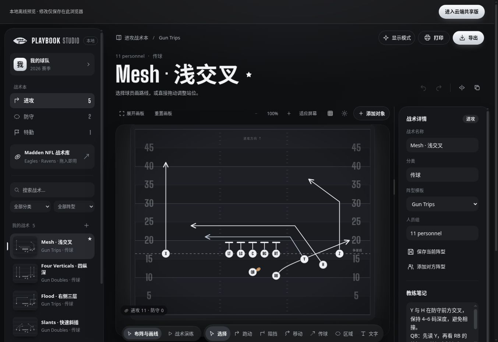
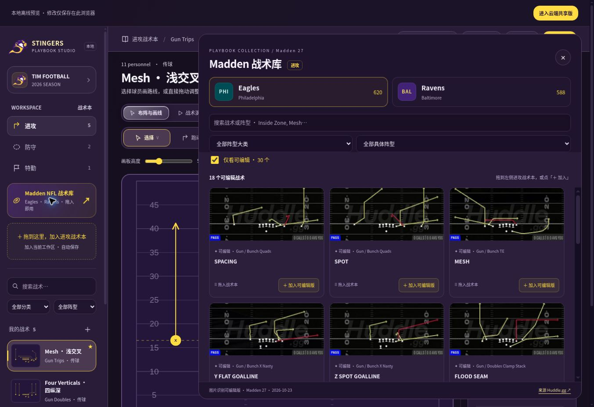
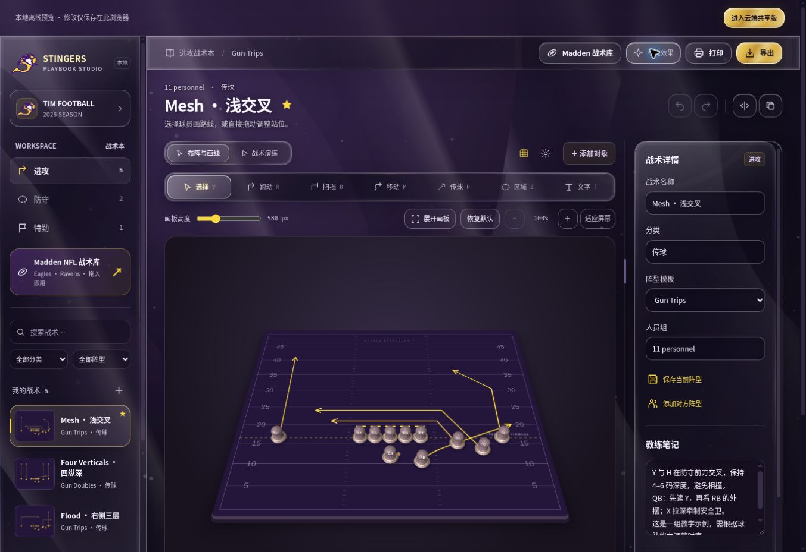

# Playbook Studio

**把脑海里的战术，变成球队看得懂、练得起来的一张图。**

一个中文美式橄榄球战术工作台：布阵、画路线、播放演练、整理战术本，与教练和球员共享。

[进入云端共享版](https://playbook-studio-tim.kind-wolf-6204.chatgpt.site/editor/index.html) · [无需登录，先试用本地演示](https://timpickle.github.io/playbook-studio-web/local.html) · [查看使用指南](#从一张战术开始) · [多球队路线图](docs/MULTI_TENANCY_ROADMAP.md)

封面为 AI 生成的概念插画，实际软件界面见下方截图。

---

## 先看一眼，你可以做什么

| 从想法到比赛 | 在 Playbook Studio 里 |
|---|---|
| **设计战术** | 添加进攻和防守球员、拖动站位；绘制跑动、阻挡、开球前移动、传球线、覆盖区域和文字 |
| **把路线动起来** | 播放、暂停、循环和拖动时间轴；调整路线启动时间、跑动时长和传球时间 |
| **借鉴 Madden 战术** | 浏览 Eagles / Ravens 战术，筛选、预览，再拖入或点击加入自己的战术本 |
| **整理球队战术** | 按进攻、防守、特勤管理；搜索、收藏、复制、镜像、记录教练笔记 |
| **和球队一起使用** | 云端保存与成员权限，让教练编辑、球员以只读方式查看和演练 |
| **带去训练** | 导出 PNG、SVG 或 JSON，打印战术本、腕带卡和 Call Sheet |

## 真实界面：打开就能开始画

*真实本地演示截图：左侧选择战术，中间布阵与画线，右侧调整阵型、战术信息和教练笔记。示例内容仅用于演示。*

### 从一张战术开始

1. 打开[本地演示](https://timpickle.github.io/playbook-studio-web/local.html)，选择内置示例，或点击左侧 **「新建战术」**。
2. 拖动球员调整站位；也可以在 **「添加对象」** 中一次加入完整的 4–3 防守阵型。
3. 选中球员，选择 **「跑动」** 或按 `R`，点击球场添加路线点，按 `Enter` 或点击 **「完成」**。
4. 点击 **「战术演练」** 或按空格播放；需要调整时返回布阵，最后导出或打印。

不想从零开始？项目内置 Mesh、Four Verticals、Flood、Slants、Inside Zone、Cover 3、Nickel Blitz 和 Field Goal 八个教学示例。

## Madden 战术库：先找到，再变成自己的战术

*真实本地演示截图：选择球队和阵型、搜索战术，预览后拖入左侧战术本，或点击「＋ 加入」。图片拍摄于上一批次，数量以当前界面为准；手机端可使用加入按钮。*

- **两支球队**：Eagles 和 Ravens，按球队、阵型大类、具体阵型及英文名称筛选。
- **437 个可编辑战术条目**：可移动球员、编辑可见路线、镜像和演练，也可打开原图对照。导入时会整理锋线间距；之前保存的可编辑战术可使用「整理锋线间距」，并可撤销。
- **其余 771 个条目保留原图**：可收藏、记笔记、导出和打印，但不能直接移动图片里的球员或播放原版路线。
- **导入有反馈**：支持去重；加入后可在库内查看结果或撤销最近一次符合条件的加入。

> **识别边界：** 可编辑版本依据图片中的可见站位和路线重建。图外路线、真实时序、接球目标和比赛决策不能仅凭图片确认；演练使用可调整的默认时序，不代表原版比赛模拟。

当前目录快照为 Madden 27：Eagles 620 个、Ravens 588 个，共 **1,208 个球队战术条目**和 **1,121 张去重原图**。来源、抓取信息和图像校验记录见 [300 张识别记录](docs/MADDEN_REVIEW_2026-10-28-FINAL.md)、[继续识别记录](docs/MADDEN_REVIEW_2026-10-28-CONTINUED.md)、[2026-10-28 增量复核](docs/MADDEN_REVIEW_2026-10-28.md)、[此前 80 张原图的重建记录](docs/MADDEN_REVIEW_80.md)、[Madden 全目录处理说明](docs/MADDEN_BATCH.md)、[首批可编辑战术](docs/MADDEN_EDITABLE.md) 和 [目录数据](web/data/huddle-catalog.json)。

## 平面战术板，或立体数字化战术板

*真实本地演示截图：数字化模式的兼容视图。截图环境未启用 WebGL；它不代表硬件 WebGL 的最终玻璃折射和阴影效果。*

| 模式 | 适合什么场景 |
|---|---|
| **传统模式** | 默认开启；平面棋子、简洁路线，关闭装饰动效，适合专注布阵和阅读 |
| **数字化模式** | 桌面可选；透视战术板、立体棋子、玻璃金属材质，以及跟随演练的路线、跑动、阻挡、传球和区域反馈 |

手机和 iPad 固定使用传统模式，战术演练仍可正常使用。系统启用减少动态效果时，数字化材质保留、装饰运动停止；WebGL 不可用时会切换到可操作的兼容视图。模式偏好只保存在当前设备，不修改共享战术。

画板支持 **100–300% 缩放**、适应屏幕、调整高度；桌面还可调整画板宽度或展开画板。具体实现与验证边界见 [数字化战术板说明](docs/DIGITAL_BOARD.md) 和 [验证记录](docs/VALIDATION.md)。

## 功能一览

| 功能 | 可以进行的操作 |
|---|---|
| **战术本** | 进攻 / 防守 / 特勤分类；搜索、收藏、复制、删除和教练笔记 |
| **阵型与球员** | 八种内置阵型模板；支持 6、7、8、9、11、12 人制；自定义阵型、球员形状、颜色、位置与名单 |
| **路线与标注** | 跑动、阻挡、开球前移动、传球线；曲线、选项路线、防守区域、文字与节点编辑 |
| **编辑辅助** | 移动球员及关联路线、左右镜像、撤销 / 重做；替换阵型前确认 |
| **战术演练** | 播放 / 暂停、循环、速度、时间轴、路线时序、持球人与传接球 |
| **导出与打印** | SVG、PNG、完整战术本或单个战术 JSON；A4 战术本、9 格腕带卡、Call Sheet |
| **云端协作** | 团队账号、战术本成员权限、自动保存、冲突处理和最近 20 个保存版本 |
| **手机与 iPad** | 战术列表 / 球场 / 属性面板切换、触摸布阵、缩放和平移 |

### 常用快捷键

| 操作 | 快捷键 | 操作 | 快捷键 |
|---|---|---|---|
| 选择 / 移动 | `V` | 跑动路线 | `R` |
| 阻挡 | `B` | 开球前移动 | `M` |
| 传球线 | `P` | 防守区域 / 文字 | `Z` / `T` |
| 播放 / 暂停 | `Space` | 完成路线 | `Enter` |
| 撤销 | `Ctrl / ⌘ + Z` | 重做 | `Ctrl / ⌘ + Shift + Z` |
| 取消 / 关闭 | `Esc` | 删除选中对象 | `Delete` |

## 给教练，也给每一位球员

 AI 生成概念插画 · 一张战术图，可以成为球队共同的语言。

云端版以**战术本**为共享单位：

1. 使用管理员分配的用户名和密码登录，或使用原有 ChatGPT 登录入口。
2. 创建战术本；创建者成为该战术本的管理员。
3. 在 **「成员与权限」** 中新建成员账号，或将已有团队账号加入该战术本。邮箱邀请链接需手动复制发送。
4. 管理员管理成员和恢复历史；编辑者修改战术；只读成员可以查看、演练、导出和打印。

不同战术本的成员权限相互独立。云端修改约 0.9 秒后自动保存，空闲时约每 6 秒检查其他成员的更新；冲突会保留本机草稿并提示处理。定期导出 JSON 仍是必要的额外备份。

> **多球队多租户仍在规划中。** 当前已有战术本级协作与隔离，独立的球队层级、球队主账号及后续独立服务器部署尚未实现。详细计划见 [多球队多租户路线图](docs/MULTI_TENANCY_ROADMAP.md)。

## 从哪里进入？

| 入口 | 适合谁 | 数据保存在哪里 |
|---|---|---|
| [云端共享版](https://playbook-studio-tim.kind-wolf-6204.chatgpt.site/editor/index.html) | 需要团队共享、成员权限与跨设备访问 | 云端数据库；首次登录和加载需要网络 |
| [本地演示版](https://timpickle.github.io/playbook-studio-web/local.html) | 想立即体验绘图和演练 | 当前浏览器；换设备或清除浏览器数据前请先导出 JSON |
| [GitHub Pages 入口](https://timpickle.github.io/playbook-studio-web/) | 了解项目，或从旧版导出本地战术 | 提供入口、旧版迁移工具和本地预览，不提供共享数据库 |

### 把旧版战术迁移到云端

1. 在**原设备、原浏览器**打开 [GitHub Pages 入口](https://timpickle.github.io/playbook-studio-web/)，点击「导出这台设备的本地战术」。
2. 登录云端版，在「新建」或「导入本机」时选择导出的 JSON。
3. 确认战术后再邀请成员；原浏览器的数据不会被这次导入清除。

两个域名的浏览器存储相互隔离。新建时上传 JSON 为完整导入；编辑器内的「导入战术本」采用追加方式。云端数据和权限机制详见 [CLOUD.md](docs/CLOUD.md)。

## 本地开发

推荐 Node.js 24。仓库中的战术图资源会由脚本从打包文件解出，不需要运行时访问第三方图片站点。

~~~bash
git clone https://github.com/TIMPICKLE/playbook-studio-web.git
cd playbook-studio-web
npm ci --ignore-scripts

# 本地静态编辑器：http://localhost:3000/
npm run start:local
~~~

开发及验证：

~~~bash
npm run check
npm run typecheck
npm test
npm run dev
~~~

云端数据库和 API 当前使用 Sites 的 Vinext + Cloudflare Worker / D1 运行时；GitHub Pages 不提供云端数据库。数据库结构迁移可用 `npm run db:generate` 生成，生产构建使用 `npm run build`。独立服务器的适配尚在规划，详见 [云端技术说明](docs/CLOUD.md) 和 [多球队路线图](docs/MULTI_TENANCY_ROADMAP.md)。

维护者：刷新 Madden 数据与工程目录

- `npm run import:huddle` 从指定的 Eagles / Ravens 公开页面刷新目录和图片；更新后检查来源、游戏版本和数量，再执行测试与构建。
- `web/`：编辑器、共享界面、同步与迁移工具。
- `server/`、`app/`、`db/`、`drizzle/`：认证、API、数据库模型与迁移。
- `tests/`：模型、DOM、权限、同步和界面测试。
- `scripts/`、`build/`、`docs/`：构建工具、运行时和验证记录。

## 使用边界与素材说明

- 云端单份战术本请求上限约 **950 KB**；每账号最多创建 50 份战术本。备份校验上限为 5 MB、500 个战术、100 个模板和 200 名名单成员；单个战术最多 40 个球员标记和 100 条路线。
- 战术演练用于教学图示，不包含防守 AI 或真实比赛物理模拟。实际打印与腕带尺寸需要按设备校准。
- 项目参考公开功能独立实现，不接入 Playmaker X 后端，也未验证原版文件格式兼容性。
- Madden / Huddle.gg 原始图片和游戏素材保留来源与水印，**不适用本项目代码的 MIT 许可证**；目录来自 [Eagles](https://huddle.gg/playbooks/eagles-off/) 和 [Ravens](https://huddle.gg/playbooks/ravens-off/) 公开页面。
- 浏览器尺寸与自动化验证不等于所有实体设备实测。硬件 WebGL 最终效果、实体 iPhone / iPad、打印等验证边界见 [验证记录](docs/VALIDATION.md) 和 [数字化战术板说明](docs/DIGITAL_BOARD.md)。

公开功能研究与更多文档

- [公开脚本调查](docs/PUBLIC_BUNDLE_STATIC_FINDINGS.md) · [脱敏摘要](docs/rea-public-summary.json) · [REA 重跑说明](docs/REA_REPRODUCE.md)
- [交互与组件设计记录](docs/DESIGN.md) · [液态材质说明](docs/LIQUID_MATERIALS.md) · [验证记录](docs/VALIDATION.md)
- 项目公开功能研究使用 REA 6.4.0；核心 JavaScript 语义分析受环境限制，另用 Babel AST 补充，覆盖范围分别说明。
- 仓库不包含 Playmaker X 原产品源码、图片或凭证。Playmaker X 是原产品名称，本项目为独立实现。

---

**画清路线，读懂比赛。**

源代码采用 [MIT License](LICENSE)；官方运行时模板及第三方素材的许可证另行保留。

