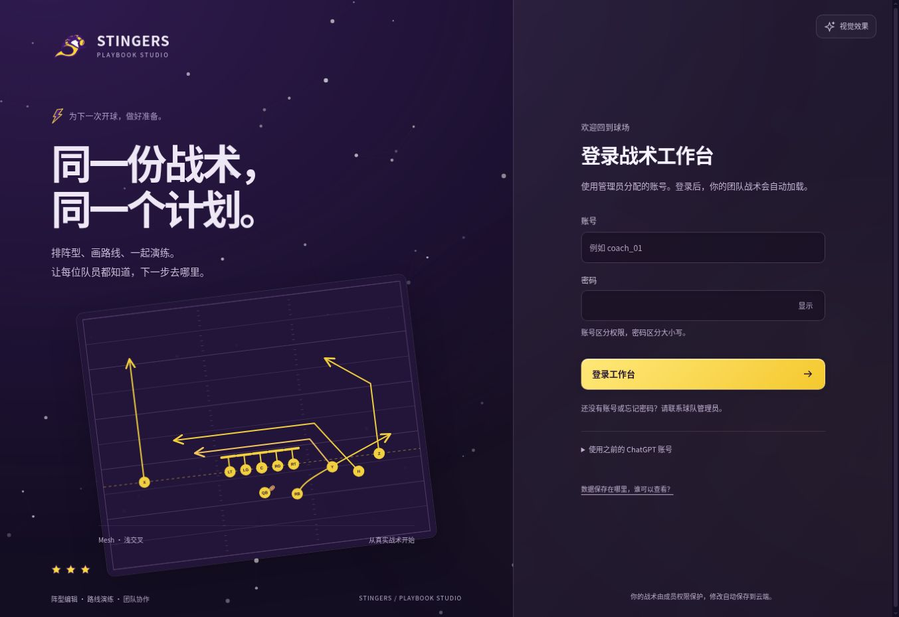

# Playbook Studio

中文美式橄榄球战术工作台。独立实现阵型、路线、演练和打印，现支持登录、共享数据库、云端保存和成员权限。

**[进入云端共享版](https://playbook-studio-tim.kind-wolf-6204.chatgpt.site/editor/index.html)** · [GitHub Pages 入口与旧版迁移](https://timpickle.github.io/playbook-studio-web/) · [云端技术说明](docs/CLOUD.md) · [验证记录](docs/VALIDATION.md)



## 切换战术本

点击顶栏「当前战术本」卡片，展开后左右滑动或使用箭头浏览，点选卡片打开对应战术本。卡片显示真实名称、成员权限与当前使用状态；浏览不会自动切换。有未同步更改时会等待保存，加载失败保留当前内容并允许重试。支持键盘方向键、Home / End 浏览、Enter 点选、Esc 关闭。

采用自托管 Embla Carousel 8.6.0 原生模块，手机、iPad 与桌面沿用同一个切换入口。组件及相关 skills 的调研与选择见[设计记录](docs/DESIGN.md)。

## 手机与 iPad

中小屏幕使用底部「战术本 / 球场 / 属性」导航，战术列表与属性按需展开，保留主要球场空间。手机工具栏分行、画板尺寸设置可折叠，iPad 横竖屏自动调整默认尺寸。画板提供 100–300% 缩放与「适应屏幕」；选择工具下可滑动空白处平移、拖动球员布阵，手机战术库可直接点击加入。

适配安全区域、表单字号、触控按钮和可见视口高度；原有桌面面板与可调节布局继续保留。屏幕尺寸、触控坐标及真机验证边界见[验证记录](docs/VALIDATION.md)。

## Madden NFL 战术库

工作台左侧与顶部的「Madden NFL 战术库」可浏览 Eagles、Ravens 的进攻战术，按球队、阵型大类、具体阵型和英文名称筛选。将卡片拖到左侧「进攻战术本」或投放框即可加入当前工作区；手机上使用「＋ 加入」。支持去重、撤销、教练笔记、收藏、共享保存、JSON 备份、图片导出和打印，沿用工作区成员权限。

本次数据快照来自用户指定的 [Eagles](https://huddle.gg/playbooks/eagles-off/) 与 [Ravens](https://huddle.gg/playbooks/ravens-off/) 页面：Madden 27，Eagles 43 个阵型 / 620 个战术，Ravens 42 个阵型 / 588 个战术，共 1,208 个队伍战术条目、1,121 张去重后的原始战术图。原始 JPEG 按 SHA-256 校验后打包在 `vendor/huddle-art/`，构建时自动解包为站内图片；无需额外安装解压工具，不依赖运行时抓取或第三方图片热链。来源、游戏版本与抓取时间保存在 `web/data/huddle-catalog.json`。

**可编辑战术：** 当前共 30 个（Eagles 18 / Ravens 12）。本轮对剩余 1,188 项尝试识别并视觉复核通过项，新增 10 个；未可靠恢复的 1,178 个继续保留原图。战术库默认展示可编辑项，取消筛选可查看原图及未通过原因。可移动球员、编辑路线、镜像、演练；旧原图可创建可编辑副本。详情见[本轮结果与识别边界](docs/MADDEN_BATCH.md)及[首批 20 个说明](docs/MADDEN_EDITABLE.md)。

**数据边界：** 其余目录项仍是原图，不能拖动图中球员或播放路线。可编辑项还原的是可见站位和路径，图外路线、真实时序、接球目标与比赛决策不能仅凭图片确认；演练采用可调整的默认时序。原图水印与来源链接保留。第三方战术图及游戏素材不适用本项目代码许可证。

刷新公开目录与图片：`npm run import:huddle`。导入脚本仅访问这两队的公开阵型页与图片，缓存已下载内容并对图片去重；不访问登录内容或私有 API。每次更新后应检查版本及数量变化，再运行 `npm test` 与构建发布。清除 `/tmp/playbook-huddle-cache` 后可重新抓取网页。单个工作区仍最多容纳 500 个战术。


## 共享与权限

1. 进入云端版，使用管理员分配的账号和密码登录；原有 ChatGPT 登录入口继续可用。
2. 点「新建」，创建自己的战术本；创建者是管理员。
3. 在「成员与权限」点击「新建成员账号」，填写登录账号、初始密码和编辑 / 只读权限。
4. 将该账号和密码单独交付给成员。新账号直接加入当前战术本，登录后自动加载。已有团队账号可用「添加已有账号」加入其他战术本，各战术本权限独立。也可展开邮箱邀请入口，邀请已有 ChatGPT 用户。

| 身份 | 权限 |
|---|---|
| 管理员 | 查看、修改、邀请、调整权限、移除成员、恢复历史版本 |
| 编辑者 | 查看和修改共同战术；导出与下载历史版本 |
| 只读成员 | 查看、演练、导出和打印；不能修改或管理成员 |
| 未登录者 / 非成员 | 无法读取共享战术数据 |

每个战术本只与加入的成员共享。团队账号不需要注册 ChatGPT；初始账号清单单独交付，不写入公开仓库。成员可以在右上角账号菜单修改密码；管理员可以重置自己创建的成员账号密码，旧登录会失效。

其他访客可以登录并创建自己的战术本，不会自动获得你的数据。邀请绑定邮箱，7 天内有效、仅能接受一次，可撤销。邀请通过手动复制链接分享，不自动发送邮件。

战术、名单、模板、设置保存到云端 SQLite 数据库。修改后约 0.9 秒自动保存，空闲时每 6 秒检查其他成员的更改。不同对象或字段的修改会尝试合并；同一处冲突会暂停同步，允许下载自己的草稿、采用云端版本或另存副本。同步状态可点击重新处理。服务端使用版本号检查，过期修改不能直接覆盖他人数据。

保留最近 20 个保存版本；管理员恢复时生成新版本。正在编辑时断网，会保留本机未同步草稿，联网后重试。完整云端首次加载与登录需要网络；跨设备通过云端读取，旧版离线预览仍使用各浏览器本地数据。

如果浏览器已使用 ChatGPT 登录而没有显示团队战术，点击「切换到团队账号」，再使用分配的账号登录。

## 迁移旧版数据

旧版 GitHub Pages 的战术在原浏览器中，云端站点不能直接读取另一域名的浏览器存储。

1. 用原设备、原浏览器打开 [GitHub Pages 入口](https://timpickle.github.io/playbook-studio-web/)，点「导出这台设备的本地战术」。
2. 进入云端版，登录，点「新建」或「导入本机」。
3. 选择导出的 JSON 文件，保存到云端，再邀请成员。

新建时上传 JSON 会完整导入。编辑器内「导入战术本」采用追加方式，保留已有内容。迁移不会清除原浏览器里的数据。

## v3 界面与操作

交互更新：Madden 战术库内部切换保留面板和焦点，加入后在库内显示「撤销 / 查看」；左侧搜索保留当前画板并支持中文组合输入。错误提示使用独立状态，保存失败可直接导出备份。


依据 [taste-skill](https://github.com/Leonxlnx/taste-skill) 优化操作层级与反馈，沿用 STINGERS 紫黄主题、透明队标、闪电与星形图标。当前材质使用自托管 Paper Shaders 液态金属背景，以及玻璃控件的厚边折射、色散、移动高光和触碰涟漪。右上角「视觉效果」可选「液态玻璃 · 全开」「柔和流动」「关闭动效」；默认全开，手机与 iPad 不按性能降档。偏好只作用于当前设备，并跟随系统减少动画设置。WebGL 不可用时使用持续流动的 Canvas 材质。调研、许可证、实现边界和验收记录见 [液态材质说明](docs/LIQUID_MATERIALS.md)。

v3.4 提高默认战术板高度。拖动画板底部调节高度，电脑上拖动画板与属性栏之间的分隔条调节宽度；也可以使用「画板高度」滑块。「展开画板」收起两侧面板并放大球场，Esc 或「退出展开」返回；「恢复默认」重置尺寸与布局。普通 / 展开高度分别记住，只保存在当前设备，不写入团队共享数据。手机支持高度滑块与触摸拖柄。

绘图工具有文字名称，路线绘制有步骤提示，草稿切换与阵型替换会先确认；请求提供加载、成功与错误状态。详见 [组件调研与设计记录](docs/DESIGN.md)。

## 编辑功能

| 场景 | 已实现 |
|---|---|
| 战术本 | 进攻 / 防守 / 特勤；名称、阵型、分类、搜索、收藏、复制、删除 |
| 阵型 | 8 种模板；6、7、8、9、11、12 人制；自定义模板；完整 4–3 防守 |
| 绘图 | 跑动、阻挡、移动、传球路线；曲线、选项路线、区域、文字、节点编辑 |
| 修改 | 拖动球员与关联路线；镜像；撤销与重做 |
| 演练 | 播放、暂停、循环、时间轴、速度、路线时序、持球与传接球 |
| 球队 | 名称、赛季、颜色、球员名单、位置标签与姓名分配 |
| 输出 | SVG、PNG、自有 JSON；A4 战术本、9 格腕带卡、Call Sheet |
| 协作 | 登录、云端保存、成员角色、邀请、冲突处理与最近 20 个版本 |

内置 Mesh、Four Verticals、Flood、Slants、Inside Zone、Cover 3、Nickel Blitz、Field Goal 共 8 个自有教学示例。

右侧「添加对象」→ **添加 4–3 防守阵型（11 人）**：一次添加 4 名锋线、3 名线卫、4 名后卫，保留进攻与进攻路线。已有防守时可重设，替换旧防守与其路线，避免叠加，并支持撤销。这一组始终为 11 人。

选中球员，按 **R**，点击路线转折点，按 **Enter** 完成；按 **Space** 演练。V / R / B / M / P / Z / T 分别选择、跑动、阻挡、移动、传球、区域、文字。Ctrl 或 ⌘ Z 撤销，Shift Z 重做；Esc 取消或关闭；Delete 删除选中对象。

## 本地开发与部署

需要 Node.js 24。数据库 / Worker 使用 Sites 的 Vinext + Cloudflare 运行时；GitHub Pages 只发布入口、迁移工具和本地预览。

```bash
npm ci --ignore-scripts
npm run check
npm run typecheck
npm test
npm run dev
```

本地预览 `editor/local.html` 可以直接测试编辑器；团队登录需要应用 D1 迁移并配置测试账号。非托管本地环境仍保留官方 Sites 插件的 ChatGPT 模拟登录。生成数据库迁移与构建：

```bash
npm run db:generate
npm run build
```

仅运行本地静态编辑器：`npm run start:local`。GitHub Pages 产物：`node scripts/prepare-pages.mjs`，输出到 `github-pages/`；工作流自动发布。云端生产数据库与登录由 Sites 提供，不由 GitHub Pages 提供。详细绑定、API、数据库迁移及部署方式见 [CLOUD.md](docs/CLOUD.md)。

## 范围与限制

云端每份战术本的请求最大约 950 KB，超过时会保留本机草稿并提示拆分 / 导出。每个账号最多创建 50 份战术本。备份校验上限为 5 MB、500 个战术、100 个模板、200 名名单成员；云端上传还受请求大小限制。每个战术最多 40 个球员标记、100 条路线。

没有接入 Playmaker X 后端，也未验证原版文件格式兼容性。路线播放用于教学图示，不包含防守 AI 或真实比赛模拟。实际打印和腕带尺寸需按设备校准。历史版本是应用内恢复功能，建议仍定期下载 JSON 备份。

## REA 调查

使用 **REA 6.4.0** 检查公开脚本、摘要投影、资产分页和资产追踪。核心 JavaScript 语义分析受环境 procps/PID 检查限制，另用 Babel AST 分析补充，报告中分别标注。

- [公开脚本调查](docs/PUBLIC_BUNDLE_STATIC_FINDINGS.md)
- [脱敏摘要 JSON](docs/rea-public-summary.json)
- [重跑 REA](docs/REA_REPRODUCE.md)

仓库包含独立实现的源代码、自有教学数据和调查摘要，不包含原产品源码、图片或凭证。Playmaker X 为原产品名称。

## 工程结构

- `web/`：独立编辑器、共享界面、同步与迁移工具。
- `server/api.mjs`：认证上下文、角色校验、D1 事务和版本检查。
- `app/`：官方 ChatGPT 登录助手、API 路由和云端入口。
- `db/schema.ts`、`drizzle/`：数据库模型与不可变 SQL 迁移。
- `tests/`：模型、DOM、数据库权限和协作同步测试。
- `scripts/`、`build/`：Sites 运行时、构建与 GitHub Pages 打包。
- `docs/`：调查、云端说明与验证记录。

源代码采用 [MIT](LICENSE) 许可；官方运行时模板中的许可证另行保留。
