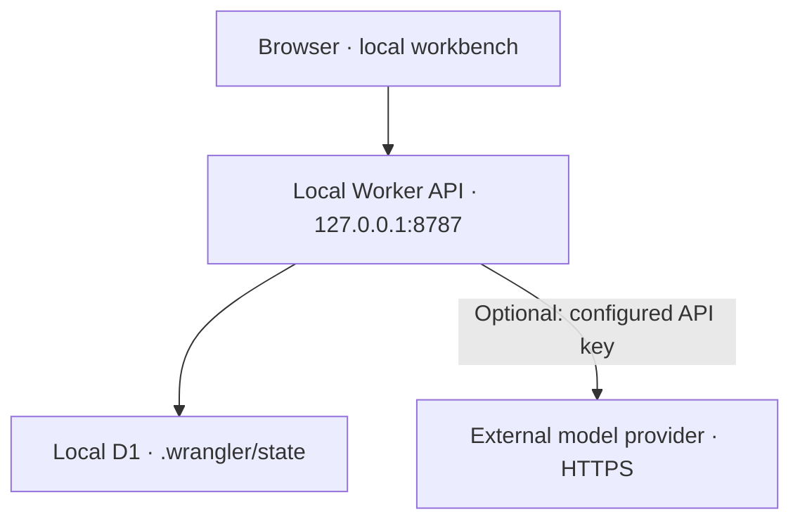

# Deployment guide · Complete local setup first

[简体中文](AGENT_DEPLOYMENT.md) · **English** · [Back to README](../README.en.md) · [AI guide](AI_GUIDE.en.md) · [Agent deploy Skill](../skills/playbook-studio-local-deploy/SKILL.md)

> **Deploying with an AI coding agent?** This repository includes a standard Agent Skill at [`skills/playbook-studio-local-deploy/SKILL.md`](../skills/playbook-studio-local-deploy/SKILL.md) (7-phase runbook, preflight checks, AI protocol contracts, troubleshooting matrix, and verification template, also linked from [`AGENTS.md`](../AGENTS.md)). Point Claude Code, Codex, Cursor, or Antigravity straight to that Skill.

Start with the **complete application on your own computer**: frontend, API, database, and team accounts all run locally. It supports play editing, autosave, roster management, rehearsal, and AI features. No ChatGPT sign-in or remote database is required. **AI requires a separate provider, model ID, and API key**; deploying the application does not include model credits.

Follow this guide yourself or pair it with the Agent Skill above. Run every command from the project root.

**Quick navigation:** [Choose a setup](#choose-a-setup) · [Complete local setup](#complete-local-setup-in-six-steps) · [Configure AI](#ai-configuration) · [Acceptance checks](#deployment-acceptance-checks) · [Maintenance](#restart-upgrade-and-back-up) · [Troubleshooting](#troubleshooting) · [Other deployments](#appendix-other-deployment-options)

## Choose a setup

| Setup | Best for | Accounts and storage | AI requests |
|---|---|---|---|
| **Complete local setup, recommended** | Personal use, development, full feature access | Local team accounts; persistent local D1 database | Local API connects to the selected provider |
| Lightweight static version | Quick trials, GitHub Pages | No sign-in; data in the current browser | Browser connects directly; provider must allow CORS |
| Public collaboration site | Remote teams and access across devices | Separate site, database, and runtime configuration | Deployed API connects to the provider |

The complete local setup has this structure. Cloning the repository, installing dependencies, and calling external models require network access. The build restores bundled Madden assets locally.



## Complete local setup in six steps

### 1. Prepare Git and Node.js

Use **Node.js 24** (recommended; minimum **22.13.0**). Check the tools, then clone the repository. If you already have a checkout, use it and inspect its branch and uncommitted changes first.

```bash
node --version
git --version
git clone https://github.com/TIMPICKLE/playbook-studio-web.git
cd playbook-studio-web
```

### 2. Install dependencies and build the complete application

```bash
npm run install:ci
npm run build
```

The build prepares the editor and Madden assets, and generates frontend/backend output plus `dist/server/wrangler.json`. The following commands use this generated configuration. You do not need to sign in to Cloudflare or create a remote D1 database.

### 3. Initialize the local database, once on an empty database

Run these SQL scripts in order, using the `DB` binding:

```bash
npx --no-install wrangler d1 execute DB --local --config dist/server/wrangler.json --persist-to .wrangler/state --file drizzle/0000_curved_toad_men.sql
npx --no-install wrangler d1 execute DB --local --config dist/server/wrangler.json --persist-to .wrangler/state --file drizzle/0001_optimal_turbo.sql
```

**Do not rerun both commands against an existing database.** They create tables, so repeating them causes “table already exists” errors. `.wrangler/state/` contains your actual data; deleting it is not a migration fix. See [maintenance](#restart-upgrade-and-back-up) for upgrades.

### 4. Create a one-time setup key and start the server

After building, create `dist/server/.dev.vars` with the following command. It writes a random key locally without printing it. If the file already exists, the command refuses to overwrite it; edit the existing file and preserve its settings instead.

```bash
node --input-type=module -e "import { randomBytes } from 'node:crypto'; import { writeFileSync } from 'node:fs'; writeFileSync('dist/server/.dev.vars', 'PLAYBOOK_SETUP_KEY=' + randomBytes(32).toString('hex') + '\n', { flag: 'wx', mode: 0o600 });"
npm start -- --port 8787
```

Leave this terminal running. The server runs in local mode on `127.0.0.1` and keeps its database in `.wrangler/state/`. Accounts have not been created yet; complete the next step in a **second terminal**.

> Place runtime settings in `dist/server/.dev.vars`, beside the generated configuration, rather than in a root-level `.dev.vars`. `dist/` is ignored by Git, but rebuilding regenerates it. Keep your custom runtime settings separately and restore them after a build.

### 5. Create local team accounts

In the second terminal, enter the same project root and create the temporary configuration directory:

```bash
node --input-type=module -e "import { mkdirSync } from 'node:fs'; mkdirSync('.sites-runtime', { recursive: true });"
```

Create `.sites-runtime/local-accounts.json` in an editor with the following content. **Replace the example password with your own password**:

```json
{
  "accounts": [
    {
      "username": "coach",
      "password": "REPLACE_WITH_YOUR_OWN_STRONG_PASSWORD",
      "name": "Coach",
      "role": "owner"
    }
  ]
}
```

Usernames must contain 3–32 lowercase letters, digits, or underscores and start with a letter. Passwords must contain 8–128 characters. You can provision 1–10 accounts at once: the first must be `owner`, and additional accounts must be `editor` or `viewer`. This temporary directory is ignored by Git.

Run the initialization request below. It reads the key and account configuration from local files without putting either value in command arguments or printing them.

```bash
node --env-file=dist/server/.dev.vars --input-type=module -e "
import { readFile } from 'node:fs/promises';
const origin = 'http://127.0.0.1:8787';
const accounts = JSON.parse(await readFile('.sites-runtime/local-accounts.json', 'utf8'));
if (accounts.accounts.some(account => account.password === 'REPLACE_WITH_YOUR_OWN_STRONG_PASSWORD')) {
  throw new Error('Replace the example password first');
}
const response = await fetch(origin + '/api/auth/bootstrap', {
  method: 'POST',
  headers: {
    'Content-Type': 'application/json',
    Origin: origin,
    'X-Playbook-Setup-Key': process.env.PLAYBOOK_SETUP_KEY
  },
  body: JSON.stringify(accounts)
});
const result = await response.json();
if (response.ok === false) throw new Error(result.error || 'Account initialization failed');
console.log('Accounts created. Sign in at ' + origin + '/editor/index.html');
"
```

This endpoint provisions the first accounts only. A `409` response means initialization is already complete; it cannot be used to provision accounts again or reset passwords. See [architecture and operations](CLOUD.md) for account and permission details.

### 6. Close initialization and sign in

1. Return to the first terminal and stop the server with `Ctrl+C`.
2. Edit `dist/server/.dev.vars` and remove its `PLAYBOOK_SETUP_KEY` line, preserving other runtime settings.
3. Delete the temporary `.sites-runtime/local-accounts.json` and keep your account credentials in an appropriate place.
4. Restart the server:

   ```bash
   npm start -- --port 8787
   ```

Open **[http://127.0.0.1:8787/editor/index.html](http://127.0.0.1:8787/editor/index.html)** and sign in with the team account you just created. For subsequent use, start the server and visit this address.

**Use `/editor/index.html` or `/editor/` for the complete application.** `/editor/local.html` uses the static browser-storage mode even when served by the same server. Keep initialization and browsing on `127.0.0.1` to avoid origin and session confusion.

## AI configuration

**A working deployment does not automatically connect a model.** Without an API key you can still edit, rehearse, manage players, import/export, use the Madden catalog, and read diagram briefs and retrieved knowledge. Sending AI assistant instructions or generating model analysis requires a model configuration.

### Shared connection settings for both entries

| Entry | Settings location | Main use |
|---|---|---|
| Board assistant | Workbench → **Edit playbook** → field-edge **AI** → settings | Add defenses, edit routes, and operate the board using natural language |
| Matchup analysis | Workbench → **AI matchup analysis** → left step **02 Connect model** | Analyze diagrams together with knowledge sources |

In either entry, choose **provider → API format → model ID → API key**; the confirmed connection settings are shared by both. Preset providers need no manual URL. Use a model ID actually available from your provider that supports the required tool calls.

| Provider | Supported API formats |
|---|---|
| DeepSeek | OpenAI Chat Completions, Anthropic Messages |
| Anthropic / Claude | Anthropic Messages |
| OpenAI | OpenAI Chat Completions, OpenAI Responses |
| OpenRouter | OpenAI Chat Completions, OpenAI Responses |
| Custom compatible service | All three formats; also supply an HTTPS URL |

Both entries share the model connection. Non-secret preferences persist in this browser; **the API key stays only in current page memory**. Enter the key again after refreshing; switching providers also clears it. This repository has **no** server-side provider API key env vars (setting `OPENAI_API_KEY` or `DEEPSEEK_API_KEY` in `.dev.vars` has no effect). Replace prefilled default model IDs (`gpt-6.1-terra`, `deepseek-flash`) with an active tool-calling model enabled on your own provider account (such as `gpt-4o`, `deepseek-chat`, or `claude-sonnet-4-6`). “Claude Code Messages” here means the Anthropic Messages API format with API credentials, rather than CLI sign-in or a subscription account.

In the complete local version, your local API sends the model requests. The provider still needs network access and available credits. **Complete local deployment does not include offline model inference.**

### Use a custom model gateway

In addition to the page settings, add permitted **hostnames** to `dist/server/.dev.vars`, separated by commas, and restart the server:

```dotenv
AI_ALLOWED_HOSTS="gateway.example.com,api.example.net"
```

In the page, enter the full HTTPS base path or endpoint required by the provider. The allowlist contains hostnames only, without a scheme, path, or port. The server requires the standard HTTPS port and rejects URL credentials, query strings, and fragments, as well as `localhost`, names ending in `.localhost` / `.local` / `.internal`, and IP-address hosts. It cannot connect directly to Ollama at `http://localhost:11434`.

See the **[AI feature guide](AI_GUIDE.en.md)** for endpoint path handling, tool calls, the knowledge base, and document imports, and the **[Skill AI protocol reference](../skills/playbook-studio-local-deploy/references/ai-providers-and-protocols.md)** for exact contracts and budgets.

## Deployment acceptance checks

The local migration, account provisioning, sign-in, permissions, saving, and restart-persistence flow has been exercised. Verify real model calls separately using your own API key; a page loading successfully does not establish that AI is connected.

| Check | Action | Expected result |
|---|---|---|
| API and database | Open `http://127.0.0.1:8787/api/health` | HTTP 200 with `ready: true` in the JSON |
| Team account | Sign in through the complete entry | Your playbook opens; anonymous requests cannot read its data |
| Editing and saving | Move a player, edit a route, wait for saving, and refresh | Changes return without save errors |
| Persistence | Stop with `Ctrl+C`, restart, and sign in again | Accounts and saved plays remain |
| Common features | Open a Madden image, add an editable play, rehearse, and export JSON | Assets load and the exported data is correct |
| AI assistant | Configure a model and request “Add a complete 4–3 defense, keeping the offense” | A reviewable preview appears; applying it adds the full defense |
| AI analysis | Select offense and defense, inspect the brief, and run model analysis | Brief and sources work without a key; model analysis works with one |

If you provisioned multiple roles, check `editor` and `viewer` permissions as well. Record the source revision, actual URL, and any checks you did not perform.

## Restart, upgrade, and back up

| Situation | Action |
|---|---|
| Start normally | Run `npm start -- --port 8787` from the project root; do not recreate tables or accounts |
| Stop | Press `Ctrl+C` in the server terminal |
| Back up data | Stop the server, then copy all of `.wrangler/state/`; also export playbook JSON for portability |
| Back up runtime settings | Keep custom `.dev.vars` settings separately (e.g., `.sites-runtime/dev.vars.backup`); do not commit secrets or copy them into public logs |
| Upgrade code | Back up, inspect uncommitted changes, pull code, run `npm run install:ci` and `npm run build`, restore required runtime settings, and start |
| Future database changes | Follow the new version's migration instructions and apply only unapplied migrations; do not replay initial table-creation scripts |

The local database depends on this project's `.wrangler/state/` directory and database binding configuration. A different persistence directory can make existing data appear missing. Stop the server before restoring a backup and use matching configuration. Browser preferences may still live in the browser; a database backup does not replace playbook exports.

## Troubleshooting

| Symptom | What to check |
|---|---|
| Missing `dist/server/wrangler.json` | Finish `npm run build` before database and server commands |
| `table already exists` | Tables already exist. Inspect `sqlite_master` read-only and apply only missing scripts; never delete `.wrangler/state/` |
| Health endpoint errors or returns `ready: false` | Use `npm start` (not `npm run dev`), verify the SQL scripts succeeded, and use the same `--persist-to` path for migration and serving |
| Initialization returns `404` | Check `PLAYBOOK_SETUP_KEY` in the built `dist/server/.dev.vars`, restart after changes, and ensure the client reads that same file |
| Initialization returns `403` | Match the request `Origin` to the site origin; this guide consistently uses `http://127.0.0.1:8787` |
| Initialization returns `409` | Accounts already exist. Sign in; this endpoint does not reset passwords |
| Data still looks like the demo | Check for `/editor/local.html` or `npm run dev` (port 5173 with `mockAuth`); use `npm start` and `/editor/index.html` instead |
| AI returns HTTP `503` asking to disable LangSmith tracing | Host shell or `.dev.vars` sets `LANGCHAIN_TRACING` (**even `"false"`**), `LANGSMITH_TRACING`, or `OTEL_ENABLED`; unset those variables before launching `npm start` |
| AI reports no key, auth failure, or unavailable model (`400/404`) | Check provider, format, **whether prefilled defaults (`gpt-6.1-terra`/`deepseek-flash`) were replaced with an active model ID**, API key, and credits; re-enter key after refreshing |
| Custom AI URL is rejected | Check `AI_ALLOWED_HOSTS`, HTTPS path, and port; use a hostname meeting the restrictions above and restart after changes |
| Custom gateway stops working after a build | Restore `AI_ALLOWED_HOSTS` and other runtime settings in the rebuilt `dist/` before starting |
| Other devices cannot connect | The server listens on local loopback by default. On a phone or iPad, `127.0.0.1` refers to that device. Access across devices needs separate network configuration or a public deployment |

See the complete error matrix in [Skill troubleshooting](../skills/playbook-studio-local-deploy/references/troubleshooting.md).

## Appendix: other deployment options

### Lightweight static version and GitHub Pages

For a quick trial without sign-in:

```bash
npm run start:local
```

Open `http://localhost:3000/`. This is a static server with data in the current browser, without accounts, database APIs, or cross-device sync. AI connects directly from the browser and requires provider CORS support. Export JSON before clearing browser data.

For GitHub Pages, use the existing `.github/workflows/pages.yml` and select **GitHub Actions** in **Settings → Pages → Source**. Alternatively, run `node scripts/prepare-pages.mjs` and publish the entire generated `github-pages/` directory to a static host. Do not copy only `web/` or omit generated resources. Automatic Pages runs depend on the workflow's branch and path filters.

Madden geometry assets load on demand. A previously unfetched shard cannot be imported on its first offline visit; imported plays remain editable. Visiting the homepage does not cache every Madden asset for offline use.

### Public team collaboration

The existing public collaboration implementation uses ChatGPT Sites, Worker, and D1. An independent deployment needs its own site and database, `DB` binding, migrations, trusted identity configuration, and runtime settings. Publish only after configuring the target, then verify HTTPS, sign-in, permissions, and saving. Do not reuse the original Site ID in `.openai/hosting.json`; replace links to the original cloud site as well.

`npm start` runs a local Worker rather than a public production service. The repository does not offer a universal one-command VPS deployment; public configuration, migrations, and platform identity checks must be completed for the target environment. See [architecture and operations](CLOUD.md). For checks after changing the web application, see [Web platform optimization and regression](WEB_PLATFORM_OPTIMIZATION.md).

### Ready-to-use agent prompt

```text
Read AGENTS.md and skills/playbook-studio-local-deploy/SKILL.md (plus its references/) and follow the 7-phase local full deployment workflow for Playbook Studio. Do not publish publicly by default.
Strictly enforce all guardrails: preflight Node, Git, host LangSmith/OTEL env vars, and port 8787; preserve any existing .wrangler/state/ and inspect sqlite_master before running SQL migrations; handle account credentials and PLAYBOOK_SETUP_KEY only in ignored local files without printing secrets, then close bootstrap and remove temporary files.
Verify using verification-checklist.md and deliver the structured handoff report, clearly explaining browser-memory BYOK AI settings and replacing prefilled default model IDs; mark live LLM calls as UNVERIFIED when no authorized API key is provided.
```
