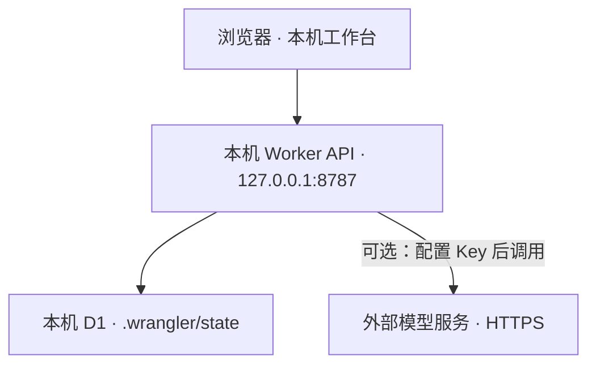

# 部署手册 · 本地完整部署优先

**简体中文** · [English](AGENT_DEPLOYMENT.en.md) · [返回 README](../README.md) · [AI 使用指南](AI_GUIDE.md)

推荐先在自己的电脑上运行**完整版本**：前端、API、数据库和团队账号都在本机，支持战术编辑、自动保存、球员管理、演练和 AI 功能。无需 ChatGPT 登录，也无需创建云端数据库。**AI 模型需要另外配置服务商、模型 ID 和 API Key**；本地部署本身不会附送模型额度。

本文既可手动执行，也可交给能操作终端与文件的 AI Agent。所有命令均在项目根目录运行。

**快速导航：** [部署方式](#选择部署方式) · [本地完整部署](#本地完整部署六步完成) · [配置 AI](#ai-功能配置) · [验收](#部署验收) · [日常维护](#重启升级与备份) · [常见问题](#常见问题) · [其他部署](#附录其他部署方式)

## 选择部署方式

| 方式 | 适合用途 | 账号与数据 | AI 请求路径 |
|---|---|---|---|
| **本地完整部署，推荐** | 自用、开发、完整功能体验 | 本机团队账号；本机 D1 数据库持久化 | 本机 API 连接所选模型服务 |
| 轻量静态版 | 快速体验、GitHub Pages | 免登录；数据保存在当前浏览器 | 浏览器直连，服务商需允许 CORS |
| 公网协作站点 | 跨设备访问、团队远程协作 | 独立站点、数据库与运行时配置 | 已部署的 API 连接模型服务 |

本地完整部署的结构如下。拉取源码、安装依赖和调用外部模型需要网络；已打包的 Madden 素材由构建流程在本机还原。



## 本地完整部署：六步完成

### 1. 准备 Git 和 Node.js

推荐 **Node.js 24**，项目最低要求为 **22.13.0**。确认工具可用后拉取源码；已有仓库可直接进入原目录，先检查分支和未提交改动。

```bash
node --version
git --version
git clone https://github.com/TIMPICKLE/playbook-studio-web.git
cd playbook-studio-web
```

### 2. 安装依赖并构建完整应用

```bash
npm run install:ci
npm run build
```

构建会准备编辑器和 Madden 资源，并生成前后端产物与 `dist/server/wrangler.json`。后续命令使用这份生成的配置，不需要登录 Cloudflare 或创建远程 D1。

### 3. 初始化本机数据库，仅首次空库执行

按顺序执行两份数据库脚本，绑定名为 `DB`：

```bash
npx --no-install wrangler d1 execute DB --local --config dist/server/wrangler.json --persist-to .wrangler/state --file drizzle/0000_curved_toad_men.sql
npx --no-install wrangler d1 execute DB --local --config dist/server/wrangler.json --persist-to .wrangler/state --file drizzle/0001_optimal_turbo.sql
```

**已有数据库不要重复执行这两条命令。**它们包含建表语句，重复执行会提示表已存在。`.wrangler/state/` 是实际的数据目录，不能通过删除它来解决迁移报错；升级方式见[日常维护](#重启升级与备份)。

### 4. 创建一次性初始化密钥，启动服务

构建完成后，用以下命令创建 `dist/server/.dev.vars`。密钥只写入本机文件，不显示在终端中；若文件已存在，命令会拒绝覆盖，应编辑原文件并保留现有设置。

```bash
node --input-type=module -e "import { randomBytes } from 'node:crypto'; import { writeFileSync } from 'node:fs'; writeFileSync('dist/server/.dev.vars', 'PLAYBOOK_SETUP_KEY=' + randomBytes(32).toString('hex') + '\n', { flag: 'wx', mode: 0o600 });"
npm start -- --port 8787
```

保持这个终端运行。启动命令以本地模式监听 `127.0.0.1`，并持续使用 `.wrangler/state/` 保存数据库。首次启动时账号尚未创建，下一步在**第二个终端**完成初始化。

> 运行时配置放在生成配置旁的 `dist/server/.dev.vars`，不是项目根目录的 `.dev.vars`。`dist/` 已被 Git 忽略，但重新构建会重建它；自定义运行时配置需另行保留并在构建后恢复。

### 5. 创建本机团队账号

第二个终端也进入同一项目根目录，创建存放临时配置的目录：

```bash
node --input-type=module -e "import { mkdirSync } from 'node:fs'; mkdirSync('.sites-runtime', { recursive: true });"
```

用编辑器创建 `.sites-runtime/local-accounts.json`，填写以下内容，**把示例密码替换为自己的密码**：

```json
{
  "accounts": [
    {
      "username": "coach",
      "password": "REPLACE_WITH_YOUR_OWN_STRONG_PASSWORD",
      "name": "Coach",
      "role": "owner"
    }
  ]
}
```

用户名为 3–32 位小写字母、数字或下划线，且以字母开头；密码为 8–128 个字符。可一次配置 1–10 个账号，第一个必须是 `owner`，其余只能是 `editor` 或 `viewer`。该临时目录已被 Git 忽略。

执行下面的初始化请求。脚本从本机文件读取密钥和账号配置，不把它们放进命令参数，也不打印出来。

```bash
node --env-file=dist/server/.dev.vars --input-type=module -e "
import { readFile } from 'node:fs/promises';
const origin = 'http://127.0.0.1:8787';
const accounts = JSON.parse(await readFile('.sites-runtime/local-accounts.json', 'utf8'));
if (accounts.accounts.some(account => account.password === 'REPLACE_WITH_YOUR_OWN_STRONG_PASSWORD')) {
  throw new Error('请先替换示例密码');
}
const response = await fetch(origin + '/api/auth/bootstrap', {
  method: 'POST',
  headers: {
    'Content-Type': 'application/json',
    Origin: origin,
    'X-Playbook-Setup-Key': process.env.PLAYBOOK_SETUP_KEY
  },
  body: JSON.stringify(accounts)
});
const result = await response.json();
if (response.ok === false) throw new Error(result.error || '账号初始化失败');
console.log('账号已创建，请登录：' + origin + '/editor/index.html');
"
```

此接口只用于首次创建账号。返回 `409` 表示已初始化，不能用它重复创建账号或重置密码。团队账号与权限详情见[云端架构与运维](CLOUD.md)。

### 6. 关闭初始化入口并登录

1. 回到第一个终端，按 `Ctrl+C` 停止服务。
2. 编辑 `dist/server/.dev.vars`，删除 `PLAYBOOK_SETUP_KEY` 这一行；保留其他运行时设置。
3. 删除临时的 `.sites-runtime/local-accounts.json`，将自己的账号密码保存在合适的位置。
4. 重新启动：

   ```bash
   npm start -- --port 8787
   ```

浏览器打开 **[http://127.0.0.1:8787/editor/index.html](http://127.0.0.1:8787/editor/index.html)**，使用刚创建的团队账号登录。以后只需启动服务、访问这个地址。

**完整版本入口是 `/editor/index.html` 或 `/editor/`。**`/editor/local.html` 是浏览器本地数据的静态模式，即使通过同一个服务打开，也不会因此变成账号与数据库模式。为避免会话和同源校验混淆，初始化与访问统一使用 `127.0.0.1`。

## AI 功能配置

**部署成功不等于已经连接模型。**没有 API Key 时，仍可编辑战术、演练、管理球员、导入导出、使用 Madden 目录，以及查看攻防图面简报和检索资料；发送 AI 助手指令或生成模型分析时才需要配置模型。

### 两个入口共享连接设置

| 入口 | 设置位置 | 主要用途 |
|---|---|---|
| 战术板助手 | 工作台 → **编辑战术本** → 球场边缘 **AI** → 设置 | 用自然语言添加防守、改路线、操作战术板 |
| 攻防对位分析 | 工作台 → **AI分析战局** → 左侧 **02 连接模型** | 结合图面和知识资料生成分析 |

在任一入口依次选择**服务商 → API 格式 → 模型 ID → API Key**，确认后的连接配置供两个入口共用。预设服务商无需手填 URL；使用服务商实际开放、且支持所需工具调用的模型 ID。

| 服务商 | 当前支持的 API 格式 |
|---|---|
| DeepSeek | OpenAI Chat Completions、Anthropic Messages |
| Anthropic / Claude | Anthropic Messages |
| OpenAI | OpenAI Chat Completions、OpenAI Responses |
| OpenRouter | OpenAI Chat Completions、OpenAI Responses |
| 自定义兼容服务 | 以上三种格式；另填 HTTPS 地址 |

两个入口共用模型连接；非密钥偏好保存在本机浏览器，**密钥仅保存在当前页面内存**，刷新后需重新输入，切换服务商也会清空密钥。不需要为预设服务商设置统一的服务器 `OPENAI_API_KEY`。这里的「Claude Code Messages」指 Anthropic Messages API 格式，需要相应 API 凭据，不等同于 CLI 登录或订阅账号。

本地完整版本由本机 API 转发模型请求。模型服务仍需联网，按所选服务商额度计费；本地完整部署**不包含离线大模型推理**。

### 使用自定义模型网关

除页面内的模型设置外，还需在 `dist/server/.dev.vars` 加入允许访问的**主机名**，多个主机用逗号分隔，并重启服务：

```dotenv
AI_ALLOWED_HOSTS="gateway.example.com,api.example.net"
```

页面中填写服务商要求的完整 HTTPS 基础路径或端点；允许列表只填主机名，不含协议、路径或端口。服务器仅接受标准 HTTPS 端口，不接受 URL 中的账号密码、查询参数或片段；也拒绝 `localhost`、以 `.localhost` / `.local` / `.internal` 结尾的主机名及 IP 地址。因此不能直接填写 `http://localhost:11434` 来连接 Ollama。

API 路径拼接、工具调用、知识库与资料导入的完整说明见 **[AI 功能使用指南](AI_GUIDE.md)**。

## 部署验收

本地迁移、账号初始化、登录、权限、保存和重启持久化流程已实测。真实模型调用仍需使用部署者自己的 API Key 单独验证，不能仅凭页面能打开判断 AI 已连接。

| 检查 | 操作 | 预期结果 |
|---|---|---|
| API 与数据库 | 打开 `http://127.0.0.1:8787/api/health` | HTTP 200，JSON 中 `ready: true` |
| 团队账号 | 从完整入口使用新账号登录 | 进入自己的战术本，未登录时不能读取战术本数据 |
| 编辑与保存 | 移动球员、修改路线，等待保存后刷新 | 改动恢复，保存无报错 |
| 数据持久化 | `Ctrl+C` 后重新启动，再登录 | 账号和已保存战术仍存在 |
| 常用功能 | 打开 Madden 图、添加可编辑战术、演练、导出 JSON | 资源能加载，导出文件内容正确 |
| AI 助手 | 配置模型，发送「添加完整 4–3 防守，保留进攻」 | 生成可检查的预览；应用后新增完整防守 |
| AI 分析 | 选一攻一守，检查图面简报，再连接模型分析 | 无 Key 可读图面与资料；有 Key 可生成分析 |

如初始化了多个角色，再用 `editor`、`viewer` 账号核对权限。验收记录应注明源码版本、实际访问地址和未验证项目。

## 重启、升级与备份

| 场景 | 操作 |
|---|---|
| 日常启动 | 在项目根目录运行 `npm start -- --port 8787`；无需重建表或重新初始化账号 |
| 停止 | 服务终端按 `Ctrl+C` |
| 数据备份 | 先停止服务，再备份整个 `.wrangler/state/`；另导出战术本 JSON，便于迁移 |
| 运行时配置备份 | 单独保留自定义 `.dev.vars` 设置；不要提交密钥或复制到公开日志 |
| 升级代码 | 先备份，检查未提交改动，再拉取代码、执行 `npm run install:ci` 与 `npm run build`；恢复所需运行时配置后启动 |
| 后续数据库变化 | 对照新版本迁移说明，仅执行尚未应用的迁移；不要重放首次建表脚本 |

本地数据库依赖当前项目的 `.wrangler/state/` 和数据库绑定配置。不要改到另一个持久化目录后误以为原数据丢失；恢复备份时也应停止服务，并使用匹配的配置。浏览器显示偏好等仍可能保存在浏览器中，数据库备份不替代战术本导出。

## 常见问题

| 现象 | 排查与处理 |
|---|---|
| 找不到 `dist/server/wrangler.json` | 先完成 `npm run build`，再执行数据库与启动命令 |
| `table already exists` | 当前数据库已有表。停止重复初始化；检查已应用的脚本，不要删除数据库 |
| `/api/health` 报错或 `ready: false` | 确认启动的是 `npm start`，数据库脚本执行成功，且迁移与服务使用同一 `--persist-to` 路径 |
| 初始化接口返回 `404` | 检查构建后的 `dist/server/.dev.vars` 是否有 `PLAYBOOK_SETUP_KEY`，设置后是否已重启，客户端是否读到同一文件 |
| 初始化返回 `403` | 检查请求 `Origin` 与访问地址是否一致；本文统一使用 `http://127.0.0.1:8787` |
| 初始化返回 `409` | 账号已创建，直接登录；此接口不提供密码重置 |
| 登录后似乎仍是演示数据 | 检查是否误用了 `/editor/local.html`；改用 `/editor/index.html` |
| AI 提示缺少 Key、认证失败或模型不可用 | 分别检查两个入口的设置、协议、真实模型 ID、API Key 与服务商额度；刷新后需重新输入 Key |
| 自定义 AI 地址被拒绝 | 核对 `AI_ALLOWED_HOSTS`、HTTPS 路径与端口；使用符合上述限制的主机名，修改配置后重启 |
| 重建后自定义 AI 网关失效 | `dist/` 已重建，恢复 `.dev.vars` 中的 `AI_ALLOWED_HOSTS` 等设置后再启动 |
| 其他设备无法访问 | 默认只监听本机回环地址；手机或 iPad 上的 `127.0.0.1` 指向设备自身。跨设备访问需另行配置网络或使用公网版 |

## 附录：其他部署方式

### 轻量静态版与 GitHub Pages

只需免登录体验时，可运行：

```bash
npm run start:local
```

访问 `http://localhost:3000/`。这是静态服务，数据保存在当前浏览器，不提供账号、数据库 API 或跨设备同步；AI 由浏览器直连，需要服务商允许 CORS。清理浏览器数据前先导出 JSON。

GitHub Pages 使用仓库已有的 `.github/workflows/pages.yml`，在仓库 **Settings → Pages → Source** 选择 **GitHub Actions**。也可运行 `node scripts/prepare-pages.mjs`，将生成的整个 `github-pages/` 目录发布到静态托管平台。不要只复制 `web/` 或漏掉生成资源；Pages 工作流是否自动触发，以工作流中的分支和路径条件为准。

Madden 几何资源按需加载，首次离线访问尚未获取的分片无法导入；已导入战术可继续编辑。打开过首页不代表全部 Madden 资源均已离线缓存。

### 公网团队协作

当前已有的公网协作实现使用 ChatGPT Sites、Worker 和 D1。部署独立副本时，需要创建自己的站点与数据库，配置 `DB`、迁移、可信身份与运行时变量，再发布并验证 HTTPS、登录、权限和保存。不要复用仓库中原项目的 `.openai/hosting.json` Site ID，也要替换原项目云端入口链接。

`npm start` 是本地 Worker 运行方式，不是公网生产服务。仓库没有一条可直接套用的通用 VPS 部署命令；公网配置、迁移和平台身份验证需按目标环境完成。详见[云端架构与运维](CLOUD.md)。修改网页后的发布检查见 [Web 平台优化与回归方法](WEB_PLATFORM_OPTIMIZATION.md)。

### 可直接交给 Agent 的指令

```text
请按 docs/AGENT_DEPLOYMENT.md 在本机完整部署 Playbook Studio，默认不发布公网。
先检查 Node、Git、分支及未提交改动，保留现有文件与数据库。
完成依赖安装、前后端构建、本地 D1 首次迁移和团队账号初始化；已有数据库只补尚未应用的迁移。
账号与初始化密钥仅通过本机受忽略文件处理，不写进聊天、日志或 Git；完成后关闭初始化入口。
从 /editor/index.html 验证登录、自动保存、重启持久化、Madden、演练和 JSON 导出。
说明两个 AI 入口共用的模型连接及密钥仅在当前页面内存保留；有授权 API 凭据时实测，没有时明确记录 AI 尚未连接。
最后提供实际访问地址、源码版本、数据保存位置、维护方法和验证结果。
```
