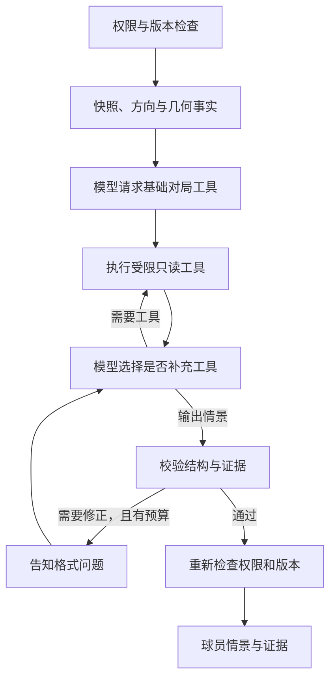

# 球员对局分析 Agent：工作流与审核说明

> 范围：为已选的一攻一守生成球员可学习的条件情景。该功能是纸面战术分析，不能模拟真实对抗、预测胜率，也不能替代球队规则。相关产品路径见 [首版实现说明](AI_MATCHUP_IMPLEMENTATION.md)，长期规划见 [路线图](AI_MATCHUP_ANALYSIS_ROADMAP.md)。

## 1. 目标和非目标

球员需要知道：**关注哪个对象、什么变化可能发生、不同变化对自己的责任有什么影响、哪些信息仍需确认。** Agent 可以分析传球、跑球、盯人或冲传；当输入不足以支撑某种判断时，只返回已知内容和缺失项。

本次只处理同一 workspace 中有权读取的两套已保存战术。不会修改战术本，不执行任意代码、查询其他战术本、访问互联网资料、调用图片识别、自动执行战术或自动训练模型。模型不能决定身份、权限、费用、坐标或事实。

## 2. 图与状态

实际编排使用 LangGraph.js 的状态图；图中只保存阶段和计数，战术、模型消息、密钥和中间推理保存在当前请求的闭包中，不作为图状态。每次请求单独运行，不使用持久化 checkpoint、跨用户共享会话或后台续跑。**隐私保护采用失败关闭：** 如果服务端全局开启 LangSmith / LangChain 跟踪或相关遥测，本功能会在调用模型和执行图之前拒绝运行，提示管理员先关闭；调用同时标记 tracing disabled 作为额外保护。之所以要加这一前置检查，是因为实测仅设置单次调用的关闭参数不能可靠阻止嵌套图追踪。模型内部推理只作为服务商协议需要的中间数据，不显示、不落库、不写日志。

`LANGCHAIN_TRACING` 是例外：当前 LangChain 对任何非空值（包括字符串 `false`）都可能创建追踪器，因此必须清空或移除该环境变量，不能只设为 `false`。这些限制仅控制本功能使用的 LangChain / LangSmith 集成，不能代替部署平台和模型服务商的数据处理政策。

| 阶段 | 必须完成的事 | 失败时 |
|---|---|---|
| 权限和输入 | 服务器读取当前用户可访问的 workspace，核对版本、两套战术、球员视角和用户授权 | 401/403/404/409 或明确的输入错误；不联系模型 |
| 事实准备 | 只取各自攻防侧；按用户选择镜像；计算路线与区域的几何交叠；记录已知、未知和来源 | 原图或缺少数据时保留限制；不能推导覆盖归属、时序和比赛结果 |
| 基础对局 | OpenAI 格式首先指定只读的 `get_matchup_context`；Anthropic 格式首轮只提供该工具并验证模型确实调用，由应用返回经授权快照、已算事实和适用规则 | 若模型不支持或忽略 tool calling，明确提示更换支持工具调用的模型，不伪称 Agent 已分析 |
| 自主补充 | 模型可以请求球员路线、路线 / 区域交叠或已选择的覆盖规则；应用验证工具名和参数后执行 | 无效参数只返回安全错误；未知工具不执行；超过预算时停止 |
| 情景校验 | 情景含触发条件、观察对象、可能情况、限制及证据 ID；引用必须来自当前快照或已提供的规则 | 可在预算内进行一次格式修正；引用不存在时要求修正为无引用，标记信息有限；仍失败则返回错误，不能输出伪造证据 |
| 运行中和响应前复核 | 每次调用模型、执行工具及响应前重新验证登录状态、workspace 权限与版本 | 撤权或版本变化停止后续步骤并不返回分析内容；已发给服务商的数据无法撤回 |

## 3. 工具契约

| 工具 | 参数 | 返回 | 关键限制 |
|---|---|---|---|
| `get_matchup_context` | 无 | 双方选定侧的战术、覆盖假设、事实、交叠、可用证据与规则 | 只读取已授权快照；不提供球员真实姓名、名单或原始图片；笔记由用户选择是否包含 |
| `inspect_player` | `playerId` | 当前快照中该球员的站位、路线 | ID 必须属于选中的一攻或一守；防守区域没有责任人时不能擅自关联 |
| `inspect_route_coverage` | `routeId` | 当前进攻路线与已标注区域的交叠 | 只报告几何关系；零交叠不代表空位、成功、同一时刻或某球员责任 |
| `read_coverage_rule` | 无 | 用户选择的 coverage 对应规则卡或“未知” | 不从前线阵型或未确认的标签推导 coverage；真实橄榄球知识不等于 Madden 游戏机制 |

每次响应最多 4 次模型请求、2 轮工具请求和 6 次工具调用；只有一次结果格式修正机会。并行请求超过剩余执行额度时，只执行额度内的工具，向其余工具返回限额错误；单轮请求超过 12 个或超过轮次限制时结束。不会自动重试网络错误或付费请求。系统限制模型输入和回复大小、工具参数长度、执行时间、频率及允许的 HTTPS 主机；不跟随模型服务重定向。实际 token 消耗由模型服务商计费，可能因多轮对话高于原单次调用。

## 4. 信息可信度和用户可见结果

- **已保存事实**：经权限与版本验证的路线、球员和区域。站位和数值只是画板相对坐标；姓名字段和原图不发送。
- **计算事实**：程序计算的路线与区域的几何交叠。演示时长、用户手绘位置、球员速度并非真实追踪数据。
- **知识规则**：只返回有来源且与用户选择的语境和覆盖类型适用的少量概念卡。球队自己的规则优先由用户明确提供；未经教练审核的推断不写回知识库。
- **条件推断**：模型给出的“如果……可能……”。结果必须附条件和限制；不能把“证据 ID 存在”误说成战术判断已经正确。

当仅有原图、缺少路线、缺少防区或 coverage 未确认时，返回有限分析和需补充内容，不生成坐标或虚构防守人。结果不包含模型的思维链；界面显示已执行的分析步骤、模型调用数与证据；若每次服务商响应都提供 token 用量，则显示汇总，否则不假装用量为零。

## 5. 模型协议和隐私

支持 OpenAI Chat Completions 和 Anthropic Messages 两种工具调用协议。DeepSeek 支持两种格式，分别使用固定的官方地址；原生 Anthropic 使用 `https://api.anthropic.com/v1/messages`。其他服务仍须由管理员配置 `AI_ALLOWED_HOSTS`，按所选协议拼接地址，不跟随重定向。服务商切换时清空页面中的 Key，避免误发给另一家服务。

DeepSeek Chat Completions 默认开启思考模式，且思考模式拒绝强制指定工具；因此本工作流对 DeepSeek 显式禁用思考，保留首轮命名工具及后续工具预算。Anthropic 协议将 system 独立传递，使用 `tool_use` 和同一用户消息中的 `tool_result`，并在多轮中原样传回带签名的思考块；首轮只提供基础对局工具并由服务端验证实际调用，兼容不接受强制工具选择的 Claude 模型。OpenRouter 的 `reasoning_details` 和必要的中间推理仅保留在单次请求内，不展示、记录或持久化。参考 [DeepSeek Chat Completions](https://api-docs.deepseek.com/api/create-chat-completion/)、[DeepSeek Anthropic 格式](https://api-docs.deepseek.com/guides/anthropic_api/) 和 [Anthropic 工具调用](https://platform.claude.com/docs/en/agents-and-tools/tool-use/how-tool-use-works)。

API Key 只保留在页面内存并在请求期间使用。点击分析会向所选服务商发送必要的战术数据，默认不传姓名字段、名单、图片和笔记；服务商使用者自行选择，可能产生费用。用户输入和笔记是不可信数据；即使要求忽略规则、调用任意地址或泄露密钥，也不能改变系统权限和可执行工具集。

## 6. 审核与验收

- Graph 在 Workers 兼容环境可执行；对实际项目进行构建与完整回归测试。模拟测试不等于部署环境或真实模型验证。
- 覆盖正常工具调用、并行工具请求、无工具能力的模型、无效 / 未知工具、非法参数、工具和模型次数上限、超时 / 用户取消、格式修正、引用造假和模型服务异常。
- 覆盖双方权限与 revision、请求期间撤权、敏感字段不外发、密钥不进入状态 / 返回 / 日志、提示词注入、镜像和几何计算。
- 验收不少于真实训练所需的 Hook / Flat、覆盖未知、Cover 3 spot / match、原图和跑球数据不足案例；测试固定事实与禁止断言，教练评审战术内容，球员评审是否能理解。
- 2026-10-28：以虚构战术实测 DeepSeek `deepseek-flash` 的 OpenAI 和 Anthropic 两种格式，均完成 Agent 工具调用和情景校验；两次成功运行各使用 4 次模型请求，并触发一次格式修正。原生 Anthropic 服务目前只有模拟协议测试，尚未使用真实 Claude Key 验证；真实战术的外发应由球队自行管理。

## 7. 代码审核入口

| 文件 | 审核重点 |
|---|---|
| `server/matchup-agent.mjs` | 图状态与私有闭包、工具参数和调用预算、模型协议、追踪关闭 |
| `server/api.mjs` | 登录、workspace 权限及版本在每个外发步骤前复核；取消和时限 |
| `server/matchup.mjs` | 图形事实、证据 ID 与输出结构校验的边界 |
| `web/ai-matchup.js` | 模型配置、取消、情景与证据呈现 |
| `tests/matchup-agent.test.mjs`、`tests/matchup-api.test.mjs` | 工具越权、提示词注入、撤权、输出造假与隐私回归 |
| `scripts/verify-matchup-worker.mjs`、`tests/matchup-worker.test.mjs` | 使用模拟模型在 Workers 运行时执行真实 Agent 图 |

复现验证：`npm ci`、`npm run check`、`npm run typecheck`、`npm test`、`npm run build` 和 `npm audit --omit=dev`。生产依赖审计只覆盖已知依赖公告，不代表完成渗透测试或证实模型输出正确。

本次依赖扫描（2026-10-28）：`npm audit --omit=dev` 为 0 项；包含开发依赖的完整 `npm audit` 仍有 21 项（10 项 high、10 项 moderate、1 项 low），涉及既有 Vite、Vinext、Cloudflare 工具链等。部分开发依赖参与构建，不应仅凭 npm 的分类认定其不会进入部署产物；需要另行逐项核实实际暴露面并安排兼容性升级。扫描结果随公告和依赖版本变化。
