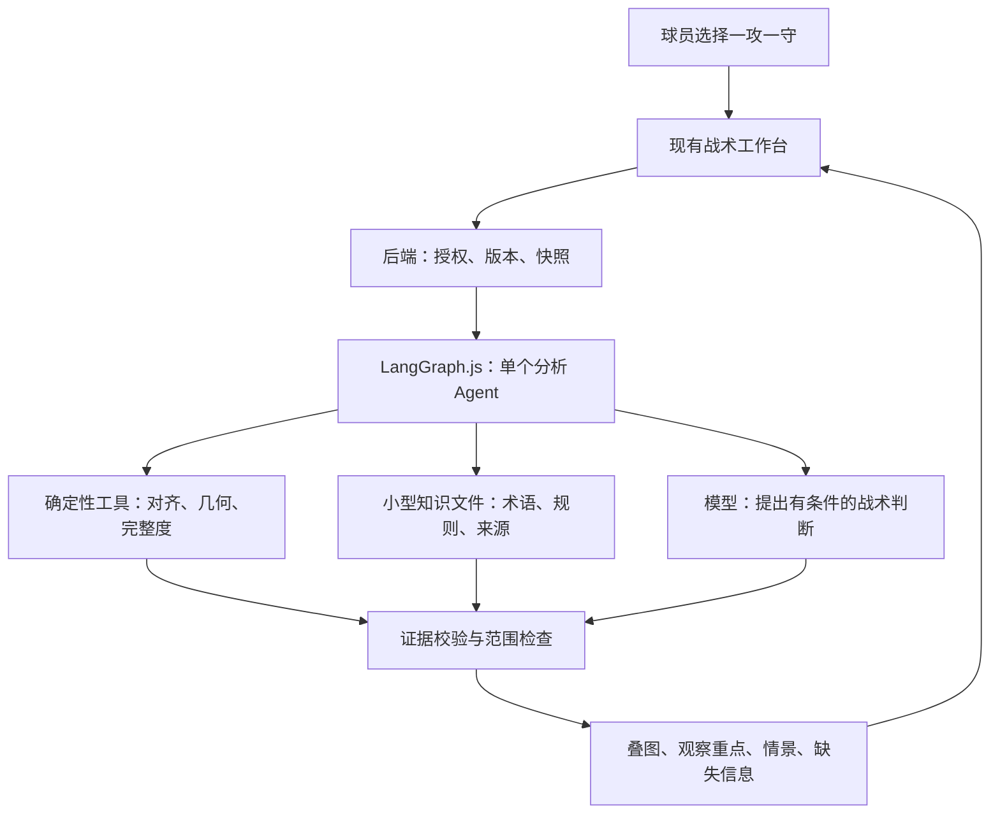
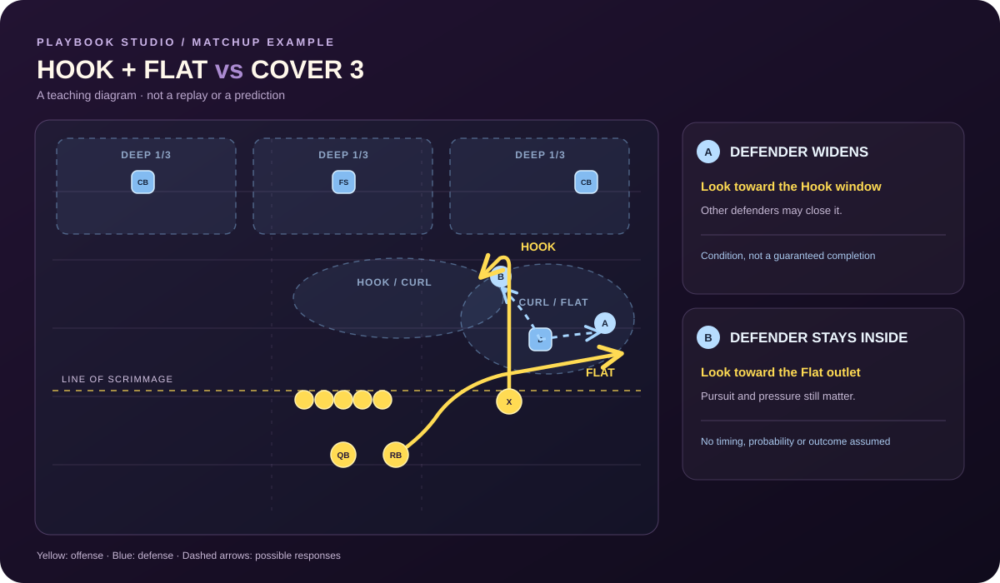
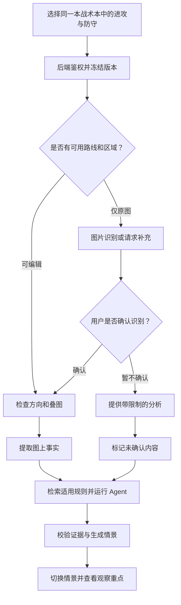
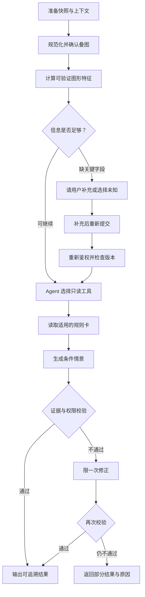
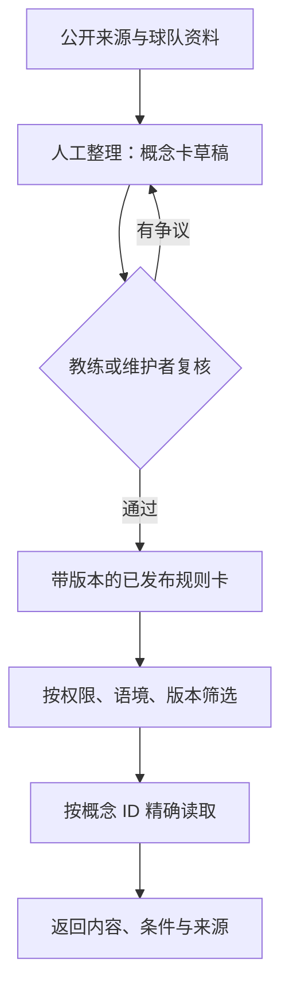

# AI 对局分析：Agent 与知识库技术路线图

> 状态：**调研与设计，尚未实施**。文中接口、字段、组件和数据表均为建议，不表示已有 AI 功能、真实比赛预测或多球队能力。
>
> 调研日期：2026-10-28。项目基线为 `main` 的 [`379a63d093a9664e158ec0abdd9ea04d9f22b9b2`](https://github.com/TIMPICKLE/playbook-studio-web/tree/379a63d093a9664e158ec0abdd9ea04d9f22b9b2)。实施前重新核对代码、第三方版本、部署能力和授权。
>
> 关联规划：[多球队多租户与独立部署路线图](MULTI_TENANCY_ROADMAP.md)。本文的阶段编号以 **A** 开头，原路线图的 P0–P5 仍表示球队与部署工作，两者不是同一条进度。
>
> 目标澄清：现阶段主要面向**球员观察对局中可能出现的情况**。教练仍可审核知识和球队规则，但不是首版输出的主要视角。

## 1. 要解决什么问题

球员从当前战术本选择一套进攻、一套防守，系统展示双方叠图和几种可能的对局情景，帮助球员理解：**应该关注谁或哪里、出现某种变化时可能发生什么、自己的位置可能面对什么选择、哪些情况尚不明确。** 用户可选择自己的攻防侧和具体球员，未选择时先查看整体情景。教练可以使用同样的信息进行教学和复核。

这是一项**赛前学习和战术演练中的情景分析**：根据两套已选择的战术说明有条件的可能性，不计算“胜率 73%”，也不声称已还原真实比赛或知道对手真实意图。用户可以选择两种分析语境：真实橄榄球的纸面概念，或 Madden 27 战术图的参考分析；前者不能被说成后者的游戏机制，Madden 26 和 27 的资料也不能混为同一版本。

**推荐方案：** 一个有边界的对局分析 Agent + 一组确定性工具 + 一份可审核的小型战术知识文件。用 LangGraph.js 作为首选编排候选，先在现有 Worker 环境做验证；项目已有的数据库负责授权和战术数据；第一版不强制部署向量库、GraphRAG、多个 Agent 或专用训练模型。



**看图的方法：** 工具只陈述可计算的图上事实；知识文件给出战术概念和适用条件；模型根据前两者解释球员可能看到的情况；最后由代码检查引用和权限。Agent 不直接更改战术图、不代替球队作战术决定。

## 2. 用一个对位说明系统应该怎么思考



*这是为了说明分析方法绘制的假设示意图，并非用户真实战术或比赛截图。黄色是进攻路线，蓝色是防守位置与区域，蓝色虚线 A / B 是同一防守者的两种可能反应；图上不代表实际时序。*

假设进攻右侧有一条 **Hook**、跑卫向同侧 **Flat** 出去；防守方明确说明采用一种普通落位的 Cover 3，并安排一名浅层球员负责该侧 Curl/Flat。

| 分析层 | 可以输出什么 | 不应输出什么 |
|---|---|---|
| 图上事实 | X 的 Hook 与 RB 的 Flat 位于同侧；两条路线及已确认区域的几何关系 | “接球手和防守者在第 2 秒相遇”，除非时序已被确认 |
| 条件判断 A | 如果该防守者外展追 Flat，Hook 一侧**可能**出现窗口；还要看内侧防守者补位 | “Hook 一定空了” |
| 条件判断 B | 如果他留在内侧保护 Hook，Flat **可能**成为短传选项；还要看追防与出球时间 | “RB 一定能获得 8 码” |
| 防守建议 | 根据本队规则核对浅层区域交接和内侧协防 | 把图中未指定的责任强加给某个线卫 |
| 缺失信息 | 防守版本、分工、冲传、保护和真实球员时序 | 补写图上没有的数据，并把猜测伪装成事实 |

这个例子参考 USA Football 对 [Hank 的 Hook / Flat 阅读讲解](https://blogs.usafootball.com/blog/7736/teaching-the-quarterback-to-read-hank)。它只说明一种可能的阅读逻辑；Cover 3 的 match 变体会根据接球手的释放和路线改变责任，不能用同一张静态区域图替代，见 [Cover 3 与 simulated pressure 案例](https://blogs.usafootball.com/blog/7544/how-to-play-cover-3-behind-a-simulated-pressure)。

### 2.1 同一情景，不同球员关注什么

以下仍沿用图中的假设：Hook、Flat 和该侧 Curl/Flat 责任都已确认。球员看到的是同一组可能情景，但观察重点不同。

| 球员视角 | 观察重点 | 条件情景和需要确认的内容 |
|---|---|---|
| 四分卫 QB | 同侧浅层防守者的反应，同时留意内侧协防与保护 | 如果他外展，Hook 一侧**可能**出现窗口；如果他保护内侧，Flat **可能**成为短传选项。实际阅读顺序以球队规则为准 |
| Hook 接球手 X | 自己的路线、同侧浅层防守者及可能接近的协防 | 理解两个反应会怎样改变附近空间；是否允许改变路线或调整落点，需要球队明确，不能由 AI 默认决定 |
| 已确认负责 Curl/Flat 的防守者 | 同侧 Hook / Flat 的分布以及队友协防 | 比较向外和留内可能留下的空间；实际交接、队友帮助和动作由球队覆盖规则决定 |

分析输入可能包含两队完整战术，**这不意味着球员在真实比赛开球前就知道对方的完整路线和意图**。界面应区分：图中已知的训练假设、开球前可能观察到的站位，以及开球后情景中才可能出现的路线或反应。模型不知道球员实际视野、遮挡和临场反应时，也不能声称其一定看见了某个动作。

## 3. 项目已有数据与分析边界

| 数据类型 | 现在代码里有什么 | 对设计的影响 |
|---|---|---|
| 手绘战术 | [`web/model.js`](../web/model.js) 保存球员、`side`、位置、路线节点、路线类型、演示时间、区域和笔记 | 能做同场对齐、展示和几何关系；是否为真实码数和真实时序仍需确认 |
| 防守覆盖区域 | `zones` 保存区域中心、半径、颜色和文字标签 | 当前区域对象**没有防守人 ID**；不能从画了椭圆就宣称某个球员一定负责它 |
| 两种 Madden 数据 | [`web/madden-model.js`](../web/madden-model.js) 区分 `diagramSource` 可编辑重建版和 `reference` 原图版 | 目录在本基线有 437 个可编辑、771 个原图条目；已保存的原图不会自动变成可编辑版 |
| Madden 可编辑版 | 可见路线由图重建；锋线间距经整理；默认路线 `duration: 3` 秒用于演示 | 不能把默认时长、整理后的精确距离、位置标签或截图之外的路线当作真实比赛证据 |
| 用户后续编辑 | 保存的站位和路线可能已改过，但来源图仍显示原始图片 | 对编辑版以**当前保存数据**为准；原图仅用于来源对照，不能覆盖用户改动 |
| 云端权限与保存 | [`server/api.mjs`](../server/api.mjs) 按单本 `workspace` 检查成员；保存使用 `revision`；[`server/http.mjs`](../server/http.mjs) 当前请求上限为 950,000 字节 | 首版在一份战术本内选攻守；服务器读取当前版本，不能只信客户端提交的用户 ID、角色或未经授权的 JSON |
| 模型校验 | `validatePlay` / `decodeWorkspace` 会重建并验证允许的字段 | 如果将来要把新战术标签存回战术本，必须同步修改前后端校验与旧数据兼容；仅在请求中临时补充信息不必先改旧数据 |
| 部署 | 当前是 Sites / Vinext / Cloudflare Worker + D1；GitHub Pages 的 `local.html` 是静态本地演示 | 先在云端版接服务端分析；静态页没有现成的同域后端，跨域、会话与授权要单独设计 |

一份战术本里可能已经画了双方球员。合并进攻和防守方案时，必须先让用户确认取哪一侧，去掉另一套图中的重复对方球员，不能机械地把所有对象相加。项目支持不同人数制；不能把“必须 11 对 11”作为所有分析的默认校验。

### 3.1 首版能分析到什么程度？

| 对抗类型 | 可用信息 | 首版回答边界 |
|---|---|---|
| 传球路线对区域联防 | 路线、区域、用户确认的覆盖类型和分工 | 分析几何重叠及有条件的阅读选择；不能推断交接后的真实站位 |
| 传球路线对盯人防守 | 路线、已确认的对位、协防与 leverage | 若没有明确对位，只能提示缺失；不能把最近的防守者自动认作盯人对象 |
| 冲传对传球保护 | 已确认的冲传人、阻挡分配、保护规则 | 分析已知的潜在人数与责任冲突；没有保护规则时不宣称谁会漏人或必定擒杀 |
| 跑球对防守前线 | 已确认的跑球方向、阻挡规则、持球和 gap 责任 | 可描述相关侧和明确的责任；未提供 gap / 读人规则时，不凭静态站位认定跑道被封死 |
| Motion、伪装和开球后变化 | 开球前后经过确认的调整和触发条件 | 明确区分开球前显示与开球后实际责任；未确认时作为分支或未知，不当作事实 |

用户可以补充档数、所需码数、场上位置、比分、剩余时间和规则版本，系统据此调整建议的情境；它们不由战术图自动推算。A1 优先把“传球对区域”做深，其余类型至少给出已知信息和缺失提示，不能假装已有完整的逐帧战术模拟。

## 4. 具体用户流程



1. 用户选择同一份 `workspace` 内的一个进攻和一个防守；可选指定攻防侧及图中的具体球员，也可先看整体。比赛情境、球队规则和已知覆盖责任可选输入，不需要全部填写才能分析。指定球员只决定观察视角，不能替代账号权限或推断用户的真实身份。
2. 后端根据会话重新读取战术本，校验权限和 `revision`，再复制两个战术及相关元数据作为本次分析的不可变输入。若提交版本已过期，返回冲突并让用户刷新 / 重新确认；不拿旧图静默覆盖新图。
3. 如果是原图，且模型支持视觉、来源授权允许外发，先显示识别到的站位 / 路线供用户核对；未确认的识别只能标记“图像推测”。没有视觉能力或来源授权时，不发送图片；可用名称、笔记和用户补充做有限分析，或提示创建可编辑副本，不伪造坐标。
4. 显示进攻防守叠图，允许确认两侧方向、开球线和左右镜像。用户未确认坐标映射时，不输出精确码数。路线穿过区域只代表**图上重叠**，不是接球成功或同一时刻的碰撞。
5. 分析结果先展示可切换的情景卡，按“关注对象 / 触发条件 / 可能变化 / 与自己有关的选择 / 尚需确认”组织；整体视角可同时查看攻防，指定球员后突出其相关内容。点击情景时，高亮该情景引用的已存路线或区域；用户也可以提交“这个责任应当是……”作为本次补充。

### 4.1 情景怎样呈现在战术板上

首版优先让球员**切换并比较情景**：同一张叠图配 A / B 情景卡，选中卡片时高亮有证据的球员、路线或区域，并标出触发条件、可能变化和缺失信息。可以按“开球前站位 / 假设触发后”分步骤查看，但这只是说明先后关系，不代表测得的真实时间或所有球员的实际位置。

用户战术中已有的线条和区域与 AI 提出的假设必须使用不同的图例；假设没有被画入原战术，也不是发生过的比赛事实。首版不让模型凭空生成具体的防守移动坐标：如果没有可信位置，情景只用文字和已有证据高亮表达，不能画出看似精确的跑动轨迹。只有在有明确数据或用户确认的情况下，才考虑进一步展示带标注的假设路线。

项目已经支持按照已画路线和演示时间播放单套战术；这可以作为后续演练界面参考，但目前不是双方球员在真实对抗中的行为模拟。两套战术的默认时长不能自动合成为真实同步动画。动态情景动画放在后续阶段，须先定义触发事件、双方动作来源和不确定性，再验证其是否会误导球员。

### 4.2 一个重要的默认决策

**首版只分析同一个工作区中的两套战术。** 如果用户有权访问的不同战术本之间也要对位，应在未来单独实现双工作区授权、两个 revision、跨工作区数据作用域和权限撤销；不能仅因看得到一个战术本就读取另一个。

原图模式是候选能力，能否把 Huddle 图片提交给模型服务、是否支持所选模型 / 格式、识别质量和可商用范围需要在 A0 核实。未通过时保留可编辑战术路径和受限提示；不要把“截图读得出来”当作可生产使用的保证。

原图识别并经用户确认的坐标，首版只存在于本次分析上下文，用临时对象 ID 与用户确认记录标注来源；不写回原图战术。现有 `validatePlay` 不允许 `reference` 战术混入可编辑坐标：将其持久化需要明确的转换流程、编辑权限和 revision 检查，不能绕过模型校验。

## 5. Agent 框架：节点、工具和状态

### 5.1 为什么用图，为什么先只做一个 Agent

这项任务既有必须按顺序完成的步骤，也可能出现分支：两套图是否可叠、缺失防守责任时是否需要补充、引用证据是否有效。LangGraph.js 的状态、节点、条件边适合把这些边界显式展示和测试。

**Agent 真正要决定的是**：在允许的工具集合内，针对当前战术选择要查哪些区域 / 规则、哪项缺失信息值得追问，并形成有条件的分析。身份授权、读取哪本战术、计费限制、图形计算、最终证据校验都由确定性代码控制。

不需要一开始就设置“进攻 Agent / 防守 Agent / 裁判 Agent”三次互相对话：它们共享同一份证据，更容易增加成本并互相放大错误。后续只有经过同一批案例评估，证明分工能显著改善质量时再引入。

### 5.2 建议的执行图



上图是目标执行逻辑，而不是已经写好的 LangGraph 代码。缺信息时首版返回 `needs_input`；用户确认或选择“未知”后重新提交，服务端重新检查权限和版本，不依赖上次请求的内存状态。建议先限制可选工具、工具调用次数、模型超时、输出长度和最多一次修正；超过预算时返回部分结果与原因。节点中的用户笔记、外部文章和识别文字都是**数据**，不能当作修改授权、调用任意外部地址或改变系统规则的指令。

| 节点 / 工具 | 输入 | 输出与约束 |
|---|---|---|
| `loadSnapshot` | 可信会话、workspace、两个 play ID、revision | 服务器完成授权后取快照；引用不存在或版本变化时退出 |
| `normalizeSides` | 两套快照、确认的方向 / 镜像 | 只选择指定攻防侧，保留对象 ID 和映射；不修改原战术 |
| `inspectCompleteness` | 战术快照、用户选填信息 | 列出 `known` / `unknown`；Cover 3 类型和区域责任未知时不能自行补全 |
| `findRouteZoneIntersections` | 经过对齐的路线与区域、曲线采样 | 返回“哪条路线的哪些线段与哪块椭圆重叠”，包含输入 ID 和版本；不推断动态覆盖成功 |
| `lookupConcepts` | 概念 ID、已授权的知识作用域 | 只读已审核、版本匹配的规则；返回来源与适用条件 |
| `analyzeMatchup` | 以上证据、用户选择的观察视角与已确认 / 未确认的信息 | 产生多种带条件的情景和观察重点；无指定球员时保持整体视角 |
| `validateEvidence` | 模型结构化输出及原始快照 | 校验战术 ID、球员 / 路线 / 区域 ID、知识卡来源、未知值和输出格式；错误时拒绝对应结论或返回部分分析 |

对齐必须使用项目实际坐标变换：当前是编辑器的 `0–100` 相对坐标，并受画板投影和裁剪影响；没有经过球场尺度标定前，不把像素或相对坐标换算为精确码数。曲线可参考项目已有 `sampledRoute`，防守椭圆按实际 `rx / ry` 计算。几何交叠不说明同时到达，不推断分离距离或接球概率。

### 5.3 状态、证据和输出契约

下列是**设计示例，不是现有代码**。`unknown` 必须与 `false`、空数组分别表达：没有标注冲传，不等于确认没有冲传。

```json
{
  "analysisMode": "real_football_diagram",
  "workspaceId": "w_example",
  "workspaceRevision": 18,
  "offensePlayId": "off_1",
  "defensePlayId": "def_1",
  "perspective": { "side": "offense", "playId": "off_1", "playerId": "player_QB" },
  "coverage": { "value": "cover3_spot", "source": "user_confirmed" },
  "assignmentOwner": { "value": null, "source": "unknown" },
  "timing": { "kind": "demo_only", "verifiedRealTiming": false },
  "evidence": [
    { "id": "ev_route_1", "kind": "user_diagram", "refs": ["off_1:route_X"] },
    { "id": "ev_region_1", "kind": "geometry", "refs": ["off_1:route_X", "def_1:zone_1"] }
  ]
}
```

结果中的每个情景应包含：观察对象和重点、`conditions`、`statement`、相关球员的可能选择、`evidenceIds`、`limitations` 和 `side`；模型可返回 `missingInfo`。图形高亮只引用经服务端校验的战术对象，不能把自由生成的坐标当证据。服务端检查 ID 必须存在于本次已授权快照 / 知识卡中；`perspective` 可为空，否则球员必须属于所选战术和相应攻防侧。**格式校验不能证明战术结论正确**：结构化输出仍可能产生错误，应结合图形校验和教练复核。[结构化输出官方说明](https://developers.openai.com/api/docs/guides/structured-outputs) 也提醒，符合 schema 的输出仍可能包含错误。

证据分为三类：① 用户保存 / 确认的图形与配置；② 工具从该快照计算的几何关系；③ 知识卡提供的一般战术规则。模型提出的情景是**推断**，不是第四种已发生事实。图片识别结果在用户确认前必须另标记为未确认。

### 5.4 哪些步骤允许修改数据？

首版 Agent 和工具**只读**。分析结果暂时展示在界面；是否保存由用户主动触发。分析过程产生的假设不自动写入球员责任、战术本、球队知识库或其他用户的历史。

保存分析结果若进入实现范围，应使用单独的分析记录及最小必要快照 / 版本引用，不把大段结果塞入 `data_json`；记录可见范围不超过原战术本。真实用户填写的战术补充要保存时，走明确的编辑权限和 revision 冲突检查；不因模型生成而绕过现有保存校验。

## 6. GitHub 框架调研与选型

以下比较的是**当前任务的适用性**，不是给项目排名；调研日期见文首。文中“建议”是基于本仓库的设计判断，尚未完成与本项目的兼容性实测。

| 项目 | 提供什么 | 对当前项目的判断 |
|---|---|---|
| [LangGraph.js](https://github.com/langchain-ai/langgraphjs) | JS / TS 状态图、条件执行、工具和可选的检查点 / 人工中断 | **首选编排候选**：能把证据校验、补充信息和失败分支画清楚；先验证 Worker 实际兼容性 |
| [Mastra](https://github.com/mastra-ai/mastra) | TypeScript Agent、工作流、知识与评估工具 | 合理备选；功能更一体化，但应验证当前部署、持久化和依赖体积。核心大部分为 Apache-2.0，`ee/` 为企业许可，见其仓库许可说明 |
| [OpenAI Agents SDK JS](https://github.com/openai/openai-agents-js) | Agent、工具、handoff、guardrail 和 tracing | 轻量 Agent 循环的备选；若采用，需要另外明确本项目的状态图、数据作用域与运行部署。其 [tracing 说明](https://github.com/openai/openai-agents-js/blob/main/docs/src/content/docs/guides/tracing.mdx) 中服务端默认导出行为需按球队战术隐私配置核实 |
| [RAGFlow](https://github.com/infiniflow/ragflow) | 文档解析、知识检索和 Agent 能力 | 适合将来有大量 PDF、表格、图文资料时评估；[官方部署说明](https://github.com/infiniflow/ragflow#-local-deployment) 是独立服务及依赖，首版会引入额外运维 |
| [LightRAG](https://github.com/HKUDS/LightRAG) | 从文档构建图与向量索引，进行检索 | 等真实问题需要跨文档关系检索时再做受控对比；抽取的图也需要人工审核，不能等同于战术事实 |
| [Microsoft GraphRAG](https://github.com/microsoft/graphrag) | 文档抽取、知识图谱、社区摘要与查询 | 适合研究跨大量文档的关系和全局摘要；[官方说明](https://github.com/microsoft/graphrag#repository-guidance) 提醒索引可能昂贵，仓库代码属于方法演示而非官方支持产品，首版不选 |
| [LlamaIndex.TS](https://github.com/run-llama/LlamaIndexTS) | TypeScript 数据 / 检索框架 | 仓库当前明确标为 **deprecated、停止维护**，不作为新系统依赖；不能因为旧资料推荐就直接采用 |
| [Ragas](https://github.com/vibrantlabsai/ragas) | 评估检索上下文和生成答案 | 可在后续离线评估中对比不同检索方案；faithfulness 评价的是回答是否受上下文支持，不能替代橄榄球教练判断战术是否正确 |

### 6.1 Workers 运行门槛：先验证，再定依赖

当前服务在 Worker 上运行。LangGraph 的 [Redis checkpointer 说明](https://github.com/langchain-ai/langgraphjs/blob/main/libs/checkpoint-redis/README.md) 和 [Postgres checkpointer 说明](https://github.com/langchain-ai/langgraphjs/blob/main/libs/checkpoint-postgres/README.md) 指出：相关客户端直接使用 TCP，在 Cloudflare Workers 中不能按普通 Node 服务器的方式假定可用。Postgres 经 Hyperdrive、Redis 经 HTTP 服务加自定义适配器是文档中提到的候选，不代表本项目或 Sites 环境已配置、已支持或已测试。

**A0 验证：** 在不携带真实球队数据的测试环境中，安装固定版本的 LangGraph.js 和模型适配器，验证打包、模型 HTTPS 出站、一次图运行、超时 / 中断、资源限制和调用费用。**首版一次请求返回结果，不承诺跨进程断点恢复。** 对于补充信息，可以返回待确认状态，由用户重新提交并携带已确认的版本；恢复不依赖内存存活。

如果核心包不能在当前 Worker 可靠工作：先用相同工具契约的**普通 TypeScript 编排**完成单次 MVP；需要长任务和真正的中断恢复时，再对照现有路线图的 P4 验证独立 Node 服务及持久化适配。若要使用 LangGraph 原生 `interrupt`，必须先验证持久化 checkpointer、身份隔离和恢复；`MemorySaver` 只能用于演示或单进程测试，不能当生产持久化。

## 7. 知识库如何从小做起



**A1：文件就是知识库。** 建议把公共术语和规则整理为仓库内的小型 Markdown / JSON 卡片；球队私有战术和案例保存在服务端、与战术本相同的权限边界内，不进入公共 GitHub。第一批只覆盖确实要分析的概念：`cover3_spot`、`cover3_match`、`cover2`、`man`、`blitz`、`hook`、`flat`、`mesh`、`flood` 等，并逐步补充 pass protection、run blocking 和防守 gap responsibility。数量取决于复核能力，先有少量可靠卡片即可。

示例卡片（**待教练复核的设计样例，不是已发布规则**）：

```yaml
id: coverage.cover3.spot.v1
status: draft
scope: public_general
sport: american_football
mode: real_football_diagram
coverage_family: cover3
variant: spot_drop
applicability: 已知三深区、浅层区域责任及本队安排
concept: 单侧 Hook / Flat 组合可能迫使浅层防守者在内外之间做选择
conditions:
  - 进攻路线和防守责任已经确认
  - 具体窗口仍受其他防守者、出球时间和保护影响
not_claimed:
  - 某接球手必然无人防守
  - 可根据静态图计算完成率
source_url: https://blogs.usafootball.com/blog/7736/teaching-the-quarterback-to-read-hank
reviewer: null
```

每张卡至少有 ID、版本、适用场景、规则内容、例外 / 未知、来源、审核状态和更新人。为了服务球员观察，还应逐步整理各位置的观察对象、可出现的变化、相关球队规则和容易误解的情况；这些是适用条件下的教学材料，不能代替当前球队的战术要求。**无来源、未审核、相互冲突的卡片不得自动作为已确认规则。** 球队自定义定义与公共一般概念冲突时，应向用户展示冲突和作用范围，不静默以模型常识覆盖球队规则。

**A2：按需要增加检索。** 当资料多到无法稳定按概念 ID 直接取用，先建立关键词 / 标签过滤和基线评估；再用同一批问题比较全文检索、混合检索或向量检索。评估项包括应召回的规则、误召回、引用正确性、跨球队隔离、延迟与费用。只有达到预先约定的改善和成本门槛才引入索引；不要按“文档超过某个数量”机械上线向量库。

GraphRAG / LightRAG 是一种检索与知识组织方案，**不等同于领域本体**。本项目无论是否使用图数据库，都需要在一处定义共同术语：例如 `formation` 是阵型，`coverage` 是覆盖方案，`zone` 是覆盖区域，`assignment` 是某人的责任；一张图里标了 `4–3` 不能自动推导 `cover3`。这些定义可由 Agent 的技能 / 提示词引用，但权限和证据校验仍由代码执行。

### 7.1 开源足球数据应怎样用

- [NFL Big Data Bowl](https://github.com/nfl-football-ops/Big-Data-Bowl) 提供公开样例和 [坐标 / 速度等 schema](https://github.com/nfl-football-ops/Big-Data-Bowl/blob/master/schema.md)，适合学习真实追踪数据与纸面战术图的差别；当前仓库说明包含一场 2017 年比赛的追踪数据，**不是覆盖所有比赛的球队战术库**。
- [nflverse / nflfastR](https://github.com/nflverse/nflfastR) 侧重逐次进攻记录、比赛情况及统计模型；不能把逐次进攻文字当作完整的双方路线 / 防守责任图。
- [NFL PbP Data Extension](https://github.com/Mazeofthemind/NFL_PbP_Data_Extension) 可参考进攻、防守 charting 的描述维度；仓库本身不替本队提供已验证职责。

下载、改编、商用或把第三方内容送往模型之前，分别核对**数据、图片与代码**的许可及提供方条款。当前 Huddle / Madden 图片不因本项目代码使用 MIT 而自动获得同等使用权限。NFL 的比赛追踪、游戏内逻辑、项目内手绘数据应分别标注来源，不能混成同一类“事实”。

## 8. 推荐实现落点与接口草案

| 建议位置 | 责任 | 状态 |
|---|---|---|
| `web/` 内新增对局选择与情景查看组件 | 选攻守和可选的球员视角；切换情景、高亮已有证据，标明假设 / 未知 | 待实现；复用传统和数字化画板的坐标，不重写现有编辑器 |
| `server/` 内新增分析入口 | 身份、workspace 权限、revision、限流、调用图 | 待实现；现有 API 是 Worker / D1 |
| `server/matchup/` | 输入标准化、几何工具、证据校验、模型适配 | 建议目录，名称可调整 |
| `server/knowledge/` | 公共规则卡及精确读取器 | 建议目录；球队私有内容不要硬编码在公共仓库 |
| 模型配置 | 服务端 secret / 环境配置 | 待提供可访问的服务、模型、费用预算和出站验证；不将 key 放前端或 GitHub |
| 分析历史 | 独立表或独立存储 | 首版可不保存；如保存，设计 retention、权限、快照和清理后再做迁移 |

接口草案，最终以实现和现有约束为准：

```text
POST /api/workspaces/{workspaceId}/matchup-analysis
  body: { offensePlayId, defensePlayId, revision, mode, perspective?, confirmedContext, requestId }
  200: { status: "complete" | "partial" | "needs_input", evidence, scenarios, missingInfo }
  409: { code: "revision_conflict" }
  401 / 403 / 404: 按现有身份和授权策略处理
```

`requestId` 用于同一用户的短期重试去重；如果未来异步落库，需要在数据库原子约束中绑定用户与 workspace，再定义任务状态和去重期限。**外部模型调用超时后并不天然保证只计费一次**，只有实际服务支持的幂等能力经过验证才能作此承诺。不要在向客户端返回后依赖 Worker 内未等待的后台任务继续运行。

## 9. 与多球队 / 独立服务器路线图怎样衔接

| 时点 | AI 分析的权限和存储 | 与原路线图的关系 |
|---|---|---|
| 现在：单本战术本 | 按现有 `members` / workspace 授权；一份战术本内选择攻守 | 可先做脱敏原型，**不要求等待**多球队开发 |
| 原路线图 P0–P3 | 球队权限迁移与业务规则尚在设计 / 实施 | AI 的授权查询与缓存键应通过可替换的权限接口接入；不要在前端自行推断球队权限 |
| 球队模型切换之后 | 使用迁移后唯一的权威授权关系，按已确认的球队和战术本范围过滤 | 必须完成原路线图的成员隔离与权限迁移验收；不能用新旧权限“任一允许即放行” |
| 原路线图 P4–P5 | Node / PostgreSQL 和备份、切换、回滚按其计划验证 | Agent 可以作为独立服务候选；不能假设当前 Worker 的身份头、D1、密钥和连接器会自动迁移 |

权限变化不只影响页面：创建分析、读取结果、追问、恢复中断、查询历史和删除结果都要服务端重新授权；用户被撤权后，不能通过旧 `runId`、缓存键或知识检索拿到原结果。若两套战术和团队知识处于不同作用域，必须分别授权；不允许把无权访问的内容作为背景发给模型。

### 9.1 数据最小化与成本

模型只接收完成本次任务需要的战术片段、确认信息及命中的规则。球员真实姓名不用于分析时可以只传角色或本次临时 ID；提示词、原图、球队战术正文不默认进入公开日志。日志与第三方追踪的实际内容、保存时间和删除机制需要实现前确定。

单次费用由**输入文本 / 图片、输出、模型调用次数、重试和可选检索**共同决定。先记录真实 token、图片消耗、失败率和耗时，再确定每用户 / 球队配额；不能因为只有一个 Agent 就假设成本固定。模型服务不可用时保留战术编辑，并提示稍后重试。

## 10. 分阶段开发与验收

以下估算仅用于排序，假设一名熟悉现有代码的开发者、模型服务和测试环境可用；不是实测承诺。球员视角、情景切换和交互验收纳入后，需在 A0 后重新估算 A1 / A2。球队迁移和独立服务器的 14–22 人日估算见关联路线图，**不计入下表，也不能简单相加为最终排期**。

| 阶段 | 内容 | 初步量级 | 完成门槛 |
|---|---|---:|---|
| A0 技术验证 | 核对最新代码；用虚构战术验证 Worker 模型出站、LangGraph.js、时限、费用、数据许可及情景高亮可行性 | 原估 1–2 人日，待核对 | 得出可复现的通过 / 失败记录；确定 Worker 或普通 TS 备用路径，并重新评估球员交互工作量 |
| A1 单本 MVP | 选一攻一守、可选球员视角、版本和权限校验、叠图、情景切换与证据高亮、几何工具、小规则卡、单 Agent | 待 A0 重估 | 完成下方核心案例和授权测试；球员能区分观察重点、假设与未知 |
| A2 质量迭代 | 教练标注样例、球员使用测试、错误复盘、可选补充、对比直接提示词基线 | 待 A0 重估 | 有人工评估数据与错误清单，结果可追溯；必要时对检索做对照试验 |
| A3 扩展 | 动态情景动画、原图识别确认、分析历史、跨工作区、持久化恢复、检索 | 单独评估 | 逐项通过数据来源、情景表达、授权、迁移与运维验证后再开放；不以框架支持为上线证明 |

A1 包含“用户选到原图时的有限分析 / 降级提示”；**完整的批量图片识别与编辑**属于 A3。是否允许只读成员发起付费分析、是否保存结果、每队额度、原图外发的授权，以及跨本对抗，都是上线前要确定的产品决策。

### 10.1 最小验收案例

- [ ] **Hook / Flat 对普通 Cover 3**：输入中已明确 Curl/Flat 责任。输出外展 / 留中两种条件情景，引用真实路线 ID；不得承诺必然接球。
- [ ] **球员视角**：同一案例切换 QB、Hook 接球手和已确认的 Curl/Flat 防守者时，呈现各自的观察重点；不把位置视角当成账号权限，也不凭距离猜测防守责任。
- [ ] **情景切换与展示**：同一叠图可切换 A / B 并高亮相应的已存对象；图中事实与情景假设清楚区分，没有可信轨迹时不画出精确的防守动作。
- [ ] **球员能知道什么**：不把供演练用的完整对手战术说成球员开球前必然已知；实际视野、对手意图和动作时序未知时明确标注。
- [ ] **4–3 但未填 coverage**：可以描述站位和已画路线；必须标识覆盖方案未知，不能自动推导为 Cover 3。
- [ ] **Cover 3 spot / match 两个版本**：同一攻方路线下，结果明确区分静态区域与按释放路线匹配的条件；未知的接球手 / 防守职责不补造。
- [ ] **重复球员 / 镜像**：两张图都画了对方时只取用户指定的一攻一守；镜像后几何引用与高亮保持一致，不改变原战术。
- [ ] **未确认时序**：Madden 可编辑版默认 3 秒不能用来声称实际两人同秒相遇或预测比赛成功率；路线选项与主路线明确区分。
- [ ] **仅原图 / 识别失败**：允许用户确认或使用受限分析；没有模型或授权时明确降级，不生成假坐标。
- [ ] **版本与权限**：修改战术后，旧 revision 请求返回冲突；非成员、被移除成员不能通过已知 ID 读取战术、分析结果或历史。
- [ ] **外部模型失败**：超时、格式不符合 schema、编造不存在的路线 ID、模型反复请求工具时，停止或返回部分结果；不改写战术。

### 10.2 如何评估分析质量

先选覆盖以上类别的脱敏 / 自建战术，分别标明已知、未知、可接受的多个条件判断和禁止断言。最好由两名懂战术的人独立评阅，分歧保留为争议样本；如果暂时没有教练复核，应明确标为工程自测，不能宣称专家验收。

同一批样例对比 **A：直接把两套战术交给模型** 与 **B：工具提取证据 + 规则卡 + Agent**，逐项记录：引用是否存在、图上事实是否正确、关键未知是否披露、战术判断是否有适用条件、建议是否可操作。还要观察耗时、调用数和费用。Ragas 可辅助检索忠实度，但不能证明球员责任或比赛结论正确。任何跨工作区泄露、使用不存在的证据 ID，或把演示时序当真实时序，都是阻塞上线的问题。

除教练评审外，应邀请不同位置的球员试用同一组情景，检查他们能否指出观察对象、说清 A / B 的区别、识别假设与未知，并理解与自己相关的内容；记录理解偏差和界面操作问题。试用结果是改进依据，不能仅因文字正确就认定球员已经掌握战术。

## 11. 待确认决策

1. 主要目标是真实球队训练、Madden 游戏分析，还是两者分开提供？Madden 的版本由谁维护？
2. 用户可以只选同一本战术本，还是需要在多本战术本之间对抗？目前方案先限定同一本。
3. 分析结果是否保存、分享或导出？只读成员是否可以发起消耗额度的分析？
4. 可使用哪种模型服务、预算是多少、能否发送球队战术或第三方原图？原图模式授权由谁确认？
5. 球队是否愿意维护自己的 coverage / assignment 规则，谁负责审核和更新？
6. 最初由谁审核真实战术案例、接受哪些错误和延迟？原图识别未确认时产品应该追问还是返回有限分析？
7. 首批优先覆盖哪些球员位置？情景视图先提供逐步静态展示还是同时研究动态动画？

这些决策未完成之前，可以使用虚构样例做 A0、编写纯计算工具和小型公开规则卡；不应把规划文档或模型一次演示当成已经上线的对抗模拟。

## 12. 主要参考

- 项目自身：[当前 README](../README.md)、[数据模型](../web/model.js)、[Madden 导入](../web/madden-model.js)、[云端 API](../server/api.mjs)、[多球队路线图](MULTI_TENANCY_ROADMAP.md)。
- Agent：[LangGraph.js](https://github.com/langchain-ai/langgraphjs)、[图与状态](https://github.com/langchain-ai/docs/blob/main/src/oss/langgraph/graph-api.mdx)、[持久化](https://github.com/langchain-ai/langgraphjs/blob/main/docs/docs/concepts/persistence.md)、[Workers 上的 Redis](https://github.com/langchain-ai/langgraphjs/blob/main/libs/checkpoint-redis/README.md) / [Postgres](https://github.com/langchain-ai/langgraphjs/blob/main/libs/checkpoint-postgres/README.md)、[Mastra](https://github.com/mastra-ai/mastra)、[OpenAI Agents SDK JS](https://github.com/openai/openai-agents-js)。
- 知识 / 评估：[RAGFlow](https://github.com/infiniflow/ragflow)、[LightRAG](https://github.com/HKUDS/LightRAG)、[Microsoft GraphRAG](https://github.com/microsoft/graphrag)、[LlamaIndex.TS 停止维护声明](https://github.com/run-llama/LlamaIndexTS#deprecation-notice)、[Ragas 忠实度定义](https://github.com/vibrantlabsai/ragas/blob/main/docs/concepts/metrics/available_metrics/faithfulness.md)。
- 橄榄球专业材料：[Hank 阅读](https://blogs.usafootball.com/blog/7736/teaching-the-quarterback-to-read-hank)、[Cover 3 match](https://blogs.usafootball.com/blog/7544/how-to-play-cover-3-behind-a-simulated-pressure)、[NFL Big Data Bowl](https://github.com/nfl-football-ops/Big-Data-Bowl)、[nflfastR](https://github.com/nflverse/nflfastR)。
