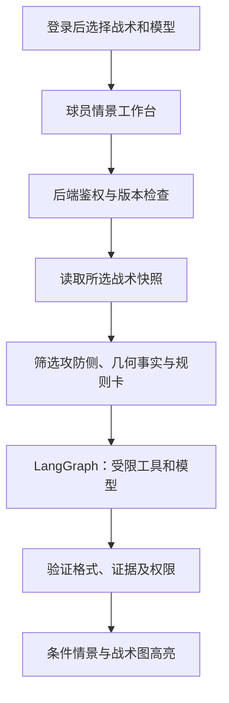

# 球员 AI 对局分析：首版开发设计

> 状态：开发实施文档。Agent 的状态图、工具、隐私边界和审核说明见 [Agent 工作流设计](AI_MATCHUP_AGENT_DESIGN.md)；目标和长期演进见 [AI 对局分析路线图](AI_MATCHUP_ANALYSIS_ROADMAP.md)；球队权限和迁移见[多球队路线图](MULTI_TENANCY_ROADMAP.md)。本版以单个工作区的两套战术做赛前学习与情景观察，不预测真实比赛或胜率。

## 用户路径

1. 登录后进入卡片式工作台，选择「编辑战术本」或「AI分析战局」。可返回工作台；未同步更改不能被静默丢弃。没有战术本的用户保留创建和导入入口。
2. 在 AI 页面选择有权访问的战术本、一套进攻、一套防守，可选观察位置和覆盖类型，并可左右镜像防守图以对齐；此调整只用于本次分析，不修改原战术。战术图叠加只取各自对应的攻防侧；原图战术只提供名称等有限信息，绝不伪造可编辑坐标。
3. 选择模型服务商，填写模型 ID 和个人 API Key。支持 DeepSeek 的 OpenAI 和 Anthropic 两种接口格式，以及 Anthropic、OpenRouter、OpenAI；DeepSeek 使用官方固定地址，无需填写 URL。管理员可通过 `AI_ALLOWED_HOSTS` 配置其他 HTTPS 主机后使用自定义地址，并选择 OpenAI 或 Anthropic 格式。密钥只存于当前页面的内存中，刷新或退出后需重填，不写入数据库、浏览器持久存储、日志或仓库。
4. 点击分析即把所选两套战术的必要数据发送给所选第三方模型。一次分析最多发起 4 次模型请求，需选择支持工具调用的模型。默认不传姓名、名单、图片和战术笔记；可主动选择附上每套战术前 3000 字的笔记。服务商自行计费和处理收到的数据。
5. 分析展示总览、可切换的条件情景、观察对象、可能情况、球员可考虑的选择、证据和缺失信息。图上只高亮已存在的对象；模型假设、几何重叠、已保存事实有不同标记。无法推断时明确说明，不假设区域归属或真实时序。

## 数据和服务边界

- `POST /api/workspaces/{id}/matchup-analysis` 仅接受战术 ID、`revision`、可选球员视角、覆盖类型、是否包含笔记及本次模型配置；服务端从 D1 读取有权限的快照。每次模型调用、工具执行前以及响应前重新检查登录、权限与版本。读取权限包括只读成员；API 费用由调用者的 Key 承担。
- 不接受客户端提交的完整战术作为权威数据；服务端只提取所选战术的相关球员位置、路线和区域，去除姓名。保存冲突返回 409，失权时不返回结果。
- 限制请求大小、模型响应大小、请求时长和每用户频率；不自动重试付费调用。错误不透传服务商的原文、密钥或完整请求。HTTPS 端点只允许固定服务商或管理员配置的明确主机，禁用重定向、私网地址和带用户名的 URL，避免成为开放代理。
- 使用 LangGraph 组织单个 Agent：先读取确定性的几何事实和已授权快照，再按需查询只读工具，最后校验 JSON 与证据，最多修正一次。每次分析最多 4 次模型请求、2 轮工具请求、6 次工具调用；界面展示实际请求次数，服务商提供完整 token 用量时展示汇总。模型内容不能执行任意命令或更新战术本。
- 选择的覆盖类型是用户提供的假设，不因前线阵型或区域名称自动推断。两侧坐标仅供纸面叠图；图上重叠不代表同时到达，默认演示时长不是实战时序。
- 保持现有的会话、同源检查、workspace 成员权限和修订号机制；不改变现有数据库表，不把模型配置放入共享战术本。

## 实施与验收

- [x] 实现登录后工作台，桌面和手机使用响应式卡片；自动化测试覆盖进入编辑和分析、返回工作台及原权限、保存流程。
- [x] 成员可选本工作区的两套战术，原图和缺少路线 / 区域时明确提示；自动化测试覆盖未授权、过期 revision 和分析期间撤权。
- [x] 实现第三方 Chat Completions / Anthropic Messages 调用以及失败、超时、响应格式错误和无效引用处理；Key 不由应用持久化。模型回复使用模拟响应验证。
- [x] 球员能切换不同情景、观察视角和防守镜像；高亮已有战术对象，任意 AI 文本按文本处理，不制造动态轨迹。
- [x] 用模拟模型服务测试授权、冲突、脱敏、频率限制、错误处理和证据校验；项目自动化回归及构建通过。
- [x] 通过 Miniflare / workerd 在 Worker 隔离环境运行实际 LangGraph、工具调用和结果校验，模型服务使用模拟响应。
- [x] 使用虚构战术和真实 DeepSeek Key 验证 OpenAI 与 Anthropic 两种格式的完整 Agent 工作流；详见 Agent 文档。
- [ ] 使用真实 Anthropic Key 验证原生 Claude 服务；在可连接的浏览器预览环境中复核桌面和窄屏视觉效果。

## 部署与后续

开发在独立分支进行，检查后创建 PR，合并后再同步部署；不直接推送默认分支。需由球队确认哪些资料可提交给第三方，模型供应商、费用和 API Key 由使用者选择。后续再评估持久化历史、动态情景、跨工作区、视觉识别以及 LangGraph 持久化恢复。
