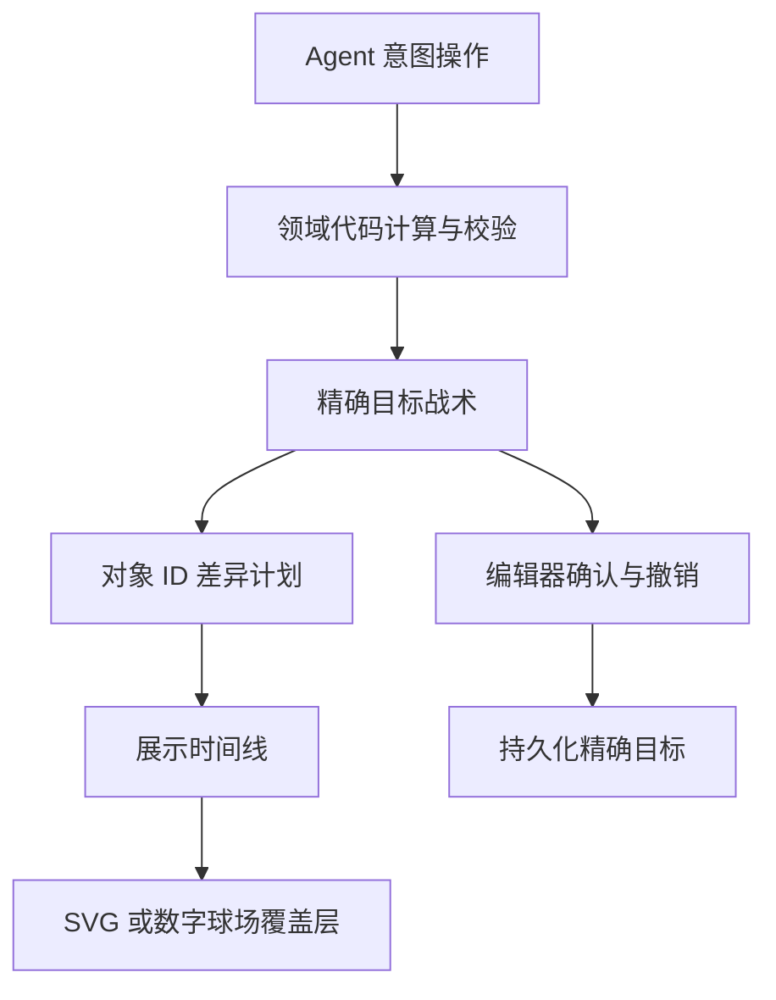

# AI 战术修改动效：调研与设计决策

调研日期：2026-11-04。目标是让教练看清 AI 修改了什么，例如左侧外接手的 GO 逐渐折成 POST；动画只表现已计算的修改，不参与 Agent 推理或领域几何计算。

## 选择

采用 **d3-interpolate-path 2.3.0 + 编辑器现有的 requestAnimationFrame 时间线**。保留单 Agent、意图操作、领域几何、编辑器写入的既有分层。增加的是展示层，不让模型生成逐帧坐标，也不把过渡中的坐标写进战术数据。

战术路线是有方向的开放路径：起点属于球员，末端箭头有含义。GO 通常只有一个主段，POST 有直跑段和折向段。核心问题是不同节点数的路径如何连续插值，同时保持起点、方向和最终点位；普通 CSS 属性过渡无法替代这一步。

## 候选库对比

| 方案 | 开放路线与节点数变化 | 时间线及打断 | 许可和代价 | 本项目判断 |
| --- | --- | --- | --- | --- |
| [d3-interpolate-path 2.3.0](https://github.com/pbeshai/d3-interpolate-path/tree/v2.3.0) | 为不同点数的路径补段；支持直线、二次和三次贝塞尔曲线；按输入顺序对应，不自动将路线旋转为封闭轮廓 | 返回 `t → d` 纯插值器，时钟和取消由宿主控制 | BSD-3-Clause；该版本无运行时依赖；本地压缩主体 6,088 B，gzip 2,544 B | **采用**。只引入缺失的路径几何插值，与已有 rAF 兼容 |
| [Flubber 0.4.2](https://github.com/veltman/flubber/tree/v0.4.2) | 重点是封闭形状；环标准化涉及绕向和起点匹配；官方明确把开放线条场景指向 d3-interpolate-path | 提供插值函数，宿主控制进度 | MIT；官方压缩文件 53,509 B，gzip 18,364 B | 不采用。闭合轮廓的对应策略不适合有固定起点、明确方向的球员路线 |
| [GSAP MorphSVG](https://gsap.com/docs/v3/Plugins/MorphSVGPlugin/) | 能处理不同点数的 SVG path；能转换 polyline 等图形；`shapeIndex` 主要解决封闭路径对应 | 成熟的 tween、timeline、kill 与覆盖控制 | [GSAP 标准许可](https://gsap.com/community/standard-license/)（免费使用但不是 MIT）；本次读取的 3.15.1 文件中，核心 73,357 B、插件 21,195 B | 能做，但引入核心和插件超出本次需要；不把“免费”误写成开源 MIT |
| [Motion](https://motion.dev/docs/animate) + 自定义 mixer | 能驱动数值，复杂 SVG 路径仍需合适的插值器；官方变形例子也是显式创建路径 mixer | 有播放、停止、取消等控制接口 | MIT；本次不以未测量的包体积作比较 | 不新增第二套动画时钟。若未来整个编辑器统一 Motion，可复用同一几何插值器 |
| CSS / Web Animations API 直接过渡 `d` | 相同指令结构可做插值；GO 与 POST 的段数变化需要先归一化 | 浏览器提供时间线和取消 | 无第三方依赖 | 不作为通用几何方案；仍需要补点与端点处理 |

体积测量方法：下载官方发布文件，按字节计数，使用 Node `gzipSync` 默认选项测压缩值。d3 的 24,709 B 官方 ESM 使用项目已锁定的 esbuild 0.28.0、`minify:true`、`format:'esm'`、`target:'es2020'` 得到表中主体大小。表中 gzip 是文件压缩结果，不是网络时延或帧率；GSAP 两个数是独立文件原始大小。许可证、来源头会略增加本地交付文件体积。没有把不同库的体积当成同等功能的基准测试。

## 其他项目怎么做

### Remotion：路径插值与时间进度分离

[Remotion 的 `interpolatePath` 源码](https://github.com/remotion-dev/remotion/blob/main/packages/paths/src/interpolate-path/interpolate-path.ts)保留了 d3-interpolate-path 的版权说明，并将它用于逐帧 SVG 几何插值；[官方 API 文档](https://www.remotion.dev/docs/paths/interpolate-path)让调用者传入进度。源码还对首尾进度直接返回输入路径，避免最终交付时保留补出来的节点。

借鉴：把路径生成、路径插值、时间线拆开。战术数据保留领域代码生成的精确目标；动画结束恢复精确目标字符串，临时补点不进入编辑历史。Remotion 是视频框架，这里借鉴插值边界，不引入其视频渲染运行时。

### d3-line-chunked：不同节点数的线条连续更新

[真实项目源码 `lineChunked.js`](https://github.com/pbeshai/d3-line-chunked/blob/master/src/lineChunked.js)导入 `interpolatePath`，在更新线图的 `attrTween('d', …)` 中使用它。数据变化时路径仍作为同一对象更新，避免用旧图消失、新图出现代替线条形变。

借鉴：通过稳定对象 ID 对应修改前后路线。GO → POST 应表现为同一名球员的路线发生弯折；只有新增、删除才使用绘入或消退。

### Motion：从当前显示状态出发

[Motion 官方 SVG path morphing 示例](https://motion.dev/examples/js-svg-path-morphing)读取元素当前的 `d`，创建插值器，再用数值进度驱动它。[动画控制文档](https://motion.dev/docs/animate)区分停止和取消。

借鉴：连续请求、撤销、关闭预览不能让旧回调覆盖新状态。新的过渡若衔接现有过渡，应从屏幕当前几何开始；若编辑器切换上下文，取消旧时间线并清除临时展示层。

### D3：生命周期需要显式设计

[D3 transition 控制文档](https://d3js.org/d3-transition/control-flow)说明同名过渡的中断机制、延后到启动时读取起始值，以及需要立即停止时使用 `interrupt()`。

借鉴：是否动画、何时读取起点、谁拥有取消权，都由编辑器控制。不能仅在每次收到 AI 结果后启动一个不受管理的 timeout。

## 应用到战术板的边界



关键约束：

- 路线按对象 ID 对应。未改变的路线不重复绘制；被动画接管的原线暂时隐藏，避免旧线与新线叠出重影。
- 相同球员、相同起点的路线保持起点固定。过渡从旧路径到新路径，箭头随当前末段方向变化。新增路线从起点绘入，删除路线收回或消退。
- 在球场坐标中计算插值；SVG 与数字球场使用各自的投影渲染。视图缩放、旋转不能改变战术坐标。
- 预览、应用、撤销属于同一编辑器状态机。动画期间的临时几何不应触发自动保存、增加 undo 步骤，或者污染 `intent`、`blockTargets` 等领域字段。
- 一次 AI 批量修改使用一条受控时间线；不要为每个对象创建互不管理的循环。常规修改约半秒到三分之二秒，批量延迟保持有上限，不让教练等待逐条播放。
- 动画打断和清理由宿主负责。更换战术、手工编辑、撤销、隐藏或销毁预览时，旧帧不能继续改 DOM 或覆盖新战术。
- `prefers-reduced-motion` 下直接呈现目标状态；隐藏标签页后恢复时按真实经过时间结束，而不是补播积压帧。
- 对无法安全对应的对象允许淡入淡出；不为了“丝滑”把不同球员、不同路线语义强行对应。

## 实现与维护

`web/assistant-transition.js` 只管理临时 SVG 展示层。`app.js` 从领域代码产生的两份战术中按 ID 筛出变化对象，传入旧图与目标图，使用单个 rAF 循环。普通时长为 620 ms，批量错峰每个 22 ms、最多 110 ms，采用 cubic ease-out。

| 修改 | 展示方式 |
| --- | --- |
| 已有路线（例如 GO → POST） | 对 `d` 插值，按原顺序匹配开放路径；起点相同则保持固定，结束恢复目标的精确字符串 |
| 新增路线 | 从起点绘入并淡入；保留可选路线、传球线的虚线语义 |
| 删除路线 | 临时删除标记淡出，正式数据直到确认应用才删除 |
| 球员站位、区域、注释 | 对平移、椭圆位置及半径、文字位置插值；无法安全对应的内容淡入 |
| 路线颜色、宽度 | 现有十六进制颜色与数值线宽插值；结束恢复精确目标属性 |

未改对象不进入预览层。被预览接管的原对象暂时隐藏，数字模式使用 `presentationMask` 同步隐藏旧棋子、阴影和路线光晕，取消后恢复。预览演练可先结束变形，再播放目标战术；应用前归零演练位置，避免将最后一个跑动帧留在场上。

应用会等待当前变形结束，通过原有编辑器写入目标、记录一次历史并自动保存，复用当前 SVG 根及数字渲染器。数字球场在新纹理解码并实际绘制之前保留最终预览，随后用 180 ms 退场，避免纹理异步更新时闪回旧图。交接期间暂停区域光效的定时纹理刷新，避免慢解码设备被装饰更新持续占住；正式时间、主题和显式刷新仍有效。导出前清除展示层，只导出正式战术；数字纹理未就绪时等待至多一秒，再回退到正式 SVG，等待期间已更换或修改战术也使用请求时的正式 SVG。

更换战术、手工操作、撤销、关闭或放弃预览会取消旧时间线；移除层后旧 rAF 不再写入。并发提案仍使用原来的对象冲突检查与重算流程。动画没有新增 Agent 节点、提示词或结果 schema；模型和领域代码仍负责语义与几何。

网格、亮暗主题等需要重建正式 SVG 内容的操作同样先清除预览，避免重建节点脱离旧遮罩后产生残影。

**功能性过渡与装饰动效分开**：传统模式和手机上的 `data-effects="off"` 不禁用路线变形。初始或运行中开启系统 `prefers-reduced-motion` 都立即完成到精确目标并清理回调。隐藏标签页完成当前过渡，销毁页面取消回调，返回时不补播积压帧。

## 验收范围

- `tests/assistant-transition.test.mjs`：GO → POST 中间几何、固定起点、曲线路线、精确终态、绘入/淡出、颜色与线宽、取消、传统模式，以及系统减少动态效果的初始和运行中切换。
- 数字渲染专项：真实 Three 场景配合测试渲染器，检查纹理解码后必须实际绘制、连续刷新合并、失败回退、预览遮罩恢复，以及区域纹理解码慢于刷新周期时仍能交接。此类测试不代表 GPU 实机性能。
- Chromium 桌面传统模式：通过真实浮窗输入和工具协议，观测到 GO → POST 连续中间形态且每帧起点相同；验证确认前数据不变、精确应用、保留 SVG 根、退场、撤销、放弃、关闭、演练后应用、鼠标操作和网格重渲染取消。
- Chromium 390 px 手机视口：预览、应用、撤销及取消通过；系统减少动态效果场景直接到目标、无中间形态。这里是浏览器视口模拟，未宣称手机实机验收。
- 本次浏览器使用脚本化模型回复以稳定验证展示流程，未改 Agent 契约、提示词或领域几何；没有将它当成真实模型理解能力评测。

运行命令：`npm run check`、`npm run typecheck`、`npm test`、`npm run build`。完整 WebGL 浏览器测试在本次无头软件图形环境中启动阻塞，不能据此宣称硬件 GPU 上的帧率或完成了该环境的端到端验收。

## 固定来源与复现

浏览器加载仓库内的 `web/vendor/d3-interpolate-path-2.3.0.js`，没有 CDN 运行时请求，也没有新增 npm 依赖。完整 BSD 许可保存在相邻的 `d3-interpolate-path-2.3.0.LICENSE.txt`。

| 输入 | 固定 URL | SHA-256 |
| --- | --- | --- |
| 官方 2.3.0 ESM | [d3-interpolate-path.mjs](https://unpkg.com/d3-interpolate-path@2.3.0/build/d3-interpolate-path.mjs) | `eccf65c427bfcdc526638710fc868fcc206fd29eb585acc0b43f832f4d8edc14` |
| 完整许可 | [LICENSE](https://unpkg.com/d3-interpolate-path@2.3.0/LICENSE) | `1597f3f5aed68aa69adeb7bec49a311d338de88c1d1668f9acd481dcae18e90f` |

安装项目锁定的开发依赖后，运行以下命令。

```sh
node scripts/bundle-route-morph.mjs
```

脚本仅在开发时下载固定版本，校验两份输入哈希，检查 esbuild 为 0.28.0，再压缩官方 ESM 并复制许可；输入或工具版本不一致即失败。输出保留版本、版权、许可指向、输入哈希和重建命令。升级版本时须重新调研、更新输入哈希并检查开放路径、固定起点、首尾状态、取消及缩减动效行为。

本次连续重建两次所得 JS 哈希均为 `76a2e88b95c54f83402c5217abd866c563fb114cbe0ef6a89cca6164df4d51b9`，含来源头 6,341 B，gzip 2,730 B。独立 Node 检查覆盖不同节点数的 GO → POST，在七个进度点验证起点固定、无意外闭合和非有限数字、终点返回精确目标，以及收回到起点。纯插值微测量中 11 条路线 × 12,000 帧调用共 132,000 次耗时约 249 ms；这不包含 DOM、投影、浏览器绘制，不能据此宣称端到端帧率，球场实机验收仍必需。
