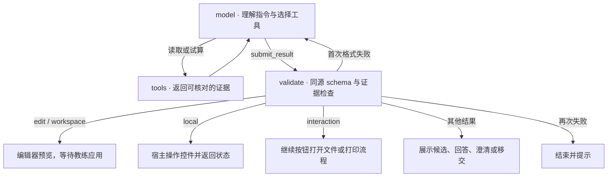

# 战术板 AI 助手架构与使用边界

画布上的助手由一个 LangGraph Agent、共享命令层和编辑器共同完成任务。模型读取真实能力与状态，选择编辑命令或本机控件。战术数据先预览再提交一次可撤销事务，本机视图由宿主执行，文件流程保留浏览器交接。[完整功能覆盖与共享命令架构](EDITOR_COMMAND_ARCHITECTURE.md) · [状态图](../web/assistant-harness.js) · [编辑器接入](../web/app.js)

## 状态图与统一契约



结果类型与操作参数统一定义在 [assistant-schema.js](../web/assistant-schema.js)。Zod 定义同时生成模型工具的 JSON schema 和程序校验器。提示词只说明使用方式，最终结果通过 `submit_result` 提交。连续查询无进展时要求选择该工具。服务商明确不支持指定工具时，传输层回退到 JSON 正文，仍使用同一个 schema 和证据校验。

| 工具 | 功能 |
|---|---|
| `list_capabilities` | 按当前战术、工作区和只读状态发现 `play`、`workspace`、`local`、`interaction` 能力及可用原因。 |
| `get_command_schema` | 获取已注册编辑命令的权威参数 schema。 |
| `read_board` | 提供完整战术快照与场上人员信息，路线带 ID、时序和可选 intent。 |
| `read_editor` | 读取真实战术 ID、名单、自定义阵型、人员组及当前工具、视图、演练和布局状态。 |
| `resolve_player` | 根据位置、姓名片段、号码和相对位置定位真实棋子。 |
| `resolve_players` | 批量定位多组条件，位置组可以返回多名球员。 |
| `search_madden` | 按名称、近似几何标签、阵型与球队检索，或按当前战术寻找相似条目。 |
| `preview_edit` | 调用共享提案函数，完整校验整组操作，返回实测深度、折向、阻挡顺序、变更 ID 与摘要。 |
| `preview_actions` | 准备战术本变更、本机操作或文件交互，返回真实变更清单；同组不得混合执行通道。 |
| `submit_result` | 提交 edit、editor、search、answer、clarify 或 handoff。编辑与编辑器操作必须对应已经试算并查看过的完整命令组。 |

Agent 试算与编辑器预览均调用 [proposeEdit](../web/assistant-proposal.js)。它校验原战术、运行整组操作，再对结果执行完整 `validatePlay`。同一规范化战术和操作会得到相同的新对象 ID。变更清单复用该函数的几何测量摘要。模型有机会根据工具返回的实际效果修正提案，编辑器负责最终写入、自动保存和一次撤销。

球员、路线、区域、文字、球权、元数据、镜像、阵型和人员操作由 [editor-play-commands.js](../web/editor-play-commands.js) 提供共享执行器；战术本、视图和交互由 [editor-actions.js](../web/editor-actions.js) 分类。模型可添加对象并用 `as` 声明组内别名，后续命令通过 `$别名` 引用，不必先让用户手动创建球员。

战术本修改先显示变更清单，应用后整组撤销；本机视图操作执行后返回状态；文件和打印流程显示「继续」并保持 `awaiting_user`。打开文件选择器不是完成导入，打开打印面板不是完成打印。知识库和 Madden 目录用于提供资料与条目，助手的执行能力来自共享命令注册表。

图的状态保存下一节点、调用统计和修正标志。工具证据与模型消息只存在于本次运行。正常推进的任务没有固定模型轮数或工具调用总额。连续三轮没有新增有效工具证据时，要求模型根据已有信息提交结果；仍重复查询则以明确的无进展说明结束。长对话压缩重复历史，保留原始指令、唯一工具证据和最新完整工具轮次，120,000 字节仅触发压缩。单条消息最多提出 5 个工具调用，执行层依次执行；模型单次回复上限为 1,800 tokens，格式校验失败允许修正一次。每次模型 HTTP 请求及响应读取有 90 秒超时，正常推进的整个任务没有 90 秒总时限；用户取消仍可立即结束任务。[循环与进展检查](../web/assistant-harness.js) · [传输适配](../web/assistant-provider.js)

## 意图、跟进与并发

概念路线将 `intent` 随战术保存，包含 concept、depthYards 和可选 breakTo，刷新后仍能通过 `read_board` 查看。手动改线型、拖点或平移改形会清理失效意图。旧数据没有 intent 时，模型仍可查看路点，但需要从几何判断或向教练确认。生成和预览都以唯一的进攻中锋为横向参照，找不到唯一中锋时使用场地中线。预动后的路线按实际起跑点判断折向。方向与路线概念冲突时校验会拒绝，场地边界裁切会在预览中显示实际深度。

浮窗在当前工作区和战术内保留最近五条结构化记录，包括已应用与已放弃的提案、操作和涉及的 ID。刷新或切换战术会清空会话记录。放弃后可以接着说“换成 post”。这些记录提供上下文，每次运行仍须通过工具重新确认对象。

提案冲突按涉及的球员、路线、目标和球权等依赖判断。无关标题或其他棋子的修改会在最新战术上重算。应用时如果需要重算，浮窗刷新预览并再次等待确认。引用的对象被删除，或相关对象在等待期间被修改，则拒绝该提案。[冲突判断](../web/assistant-conflicts.js) · [编辑器接入](../web/app.js)

浮窗提供“查看过程”，在当前页面展示工具名、参数、结果摘要和校验错误，不记录 API Key 或模型内部推理。静态版通过回调接收事件，云端通过 NDJSON 接收事件。`handoff` 保留原始指令和可用的防守上下文，进入独立的战局分析功能。

## 支持的指令

可以直接添加球员或本地 4–3 防守，无需 Madden 目录或先创建空白防守板。修改指定球员时可引用已核对的场上球员或本组新建对象的别名。姓名可用名、姓或全名匹配，号码支持 `12`、`#12` 和 `12号`。多个匹配对象会要求教练澄清。以下示例描述期望的结果，实际调用顺序由模型决定；[完整命令覆盖表](EDITOR_COMMAND_ARCHITECTURE.md#功能覆盖表)同时包含视图、演练与文件功能。

| 指令示例 | 期望的预览 |
|---|---|
| “添加一名蓝色方形 LB” | 创建防守球员并设置标签、颜色、形状；不要求用户先放置球员。 |
| “把战术改名为 Red Mesh，再左右镜像” | 在同组预览中修改标题和镜像图面；一次撤销。 |
| “复制当前战术”或“新建一套 11 人 4–3 防守” | 基于真实战术或内置阵型展示战术本变更清单，应用后切换到结果战术。 |
| “切到浅色球场，隐藏码线，半速循环演练” | 通过本机通道操作现有视图和演练控件，不修改战术数据。 |
| “导出 SVG”或“导入本地战术本” | 准备交互并展示「继续」，随后进入真实浏览器下载或文件选择流程。 |
| “在这张 Mesh 上添加 4–3 防守” | 使用 `defense_formation` 添加 4 名锋线、3 名线卫和 4 名后卫，保留进攻与路线，不自动指定覆盖。固定完整 11 人，不按工作区人数设置截断。 |
| “把现有防守重置为 4–3” | 明确替换旧防守，移除旧防守路线、清理失效阻挡引用并修复球权。预览后才应用；未明确重置时拒绝覆盖已有防守。 |
| “X 跑 12 码 dig，向内折” | 生成概念路线。支持 slant、out、in、dig、curl、comeback、hitch、post、corner、go、fade、seam、flat、wheel、drag 和 screen。 |
| “C 先挡前面的 DT，再挡叫 Avery 的 LB” | 按顺序生成分段阻挡。演练时目标的当前位置用于计算接触点。 |
| “OL 全线向左 zone 阻挡” | 批量定位锋线，一次提议多条阻挡路线。还支持 gap 和 pass protection 方案。 |
| “Z 先向左 jet motion，再跑 flat” | 创建预动和后续路线。已有 motion 可与主路线共存。还支持 orbit、across 和 shift。 |
| “X 向外移动 3 码” | 移动球员并平移其路线。也支持 wide、slot、tight、off 站位。 |
| “传给 Y，2.5 秒出手，3.5 秒到达” | 设置接球人、传球和到达时序，并生成传球路线。 |
| “画左侧 deep third，CB 落到这个区域” | 添加预设防守区域和球员落位路线。支持 deep third、deep half、flat、hook curl、curl flat、middle hole。 |
| “把 X 的主路线延迟 1 秒、持续 3 秒” | 调整已有主路线的时序。 |
| “删掉 X 的主路线” | 移除指定球员的主路线。 |
| “在 X 旁标注外侧释放” | 在球员旁新增文字注释。 |
| “再深两码” | 利用近期上下文提出后续修改。提案仍需核对，并在预览后应用。 |
| “这套谁是第一读？” | 模型可结合画布信息给出回答，并请求高亮已核对的球员或路线。教练应核实回答。 |
| “分析这套战术对上这套防守” | 可跳转至独立的 AI 对位分析入口，在那里选择攻防战术进行分析。 |
| “找一些打 Cover 3 的 Madden 战术” | 检索目录，返回含图例、可编辑状态和简短依据的候选。教练点击后导入。 |
| “找和这套类似的战术” | 按阵型与可编辑路线的近似概念特征排序候选。 |

改图结果先显示半透明预览和变更清单，教练可以预览演练、放弃或应用。切换网格或亮暗主题会保留预览。其他操作清除预览时，浮窗会提供「重新预览」，重新显示后才能应用。应用前重新检查当前战术、权限和请求快照，整组修改进入一次编辑事务。撤销可回滚整组。手机端使用半高底部面板，预览时收起以露出球场。[预览和事务](../web/app.js) · [领域操作](../web/assistant-operations.js)

## 当前限制

- 几何是基于固定开球线 `y=67`、进攻方朝减小的 y 方向和画布比例生成的近似示意，路线和阻挡方案仍需教练检查。阻挡目标被删除后使用保存的路线点。没有目标 ID 的旧路线沿用原有动画。
- Madden 当前目录包含 13 支球队的进攻战术。可编辑轨迹的标签按几何近似生成，并非经战术教练逐条认证。原图条目只提供名称和阵型等元数据，不提供推测的路线标签。目录缺少人员组、跑传和比赛情境数据，模型检索工具暂不提供这些筛选参数。
- 几何标签仍有漏检。以当前可编辑目录的战术名称作弱标注，FLOOD 命中 17/23、SMASH 命中 9/13、CURL 命中 13/20、VERTICAL 命中 16/18。名称不是逐条真值，这些数字用于检查召回，不能作为准确率。检索分别标明名称标签和近似几何标签，可靠评估还需要教练标注的独立样本。
- 模型推荐的依据和战术问答是辅助判断。图上对象的来源可校验，战术解释的正确性仍取决于模型与所给上下文。
- 相似检索依赖可编辑路线和阵型特征。AI 不会从原图中即时识别完整战术。只有原图的战术仍是参考图，无法按可编辑路线演练。
- 会话只保留当前页面最近五轮。历史记录不会在刷新后恢复，也不能跨战术沿用。静态版需要用户配置 API Key，语音听写依赖浏览器和麦克风权限。
- 能力受实际上下文约束：参考图不能编辑几何或演练，手机和 iPad 使用传统模式，名单与人员组须已存在。导入、打印、原图转换等入口可以由助手打开，后续仍需提供文件或完成相应流程。账号及团队管理属于战术板之外的功能。

## 模型接口

战术板助手和攻防分析、浏览器静态版和云端 Worker 共用 [model-protocol.js](../web/model-protocol.js) 的服务商配置、请求构造和响应解析。用户配置说明见 [AI 功能指南](AI_GUIDE.md#连接模型)。

| 格式 | 请求与返回 | 多轮工具续接 |
|---|---|---|
| OpenAI Chat Completions | `/chat/completions`；`messages`、`choices[].message` | `tool_calls` 与 `tool_call_id`；保留服务商返回的 reasoning 字段 |
| Anthropic Messages | `/messages`；独立 `system` 与内容块 | `tool_use` 与聚合的 `tool_result`；原样保留已签名 thinking 块 |
| OpenAI Responses | `/responses`；`instructions`、`input` 与 `output` 项 | `function_call`、`function_call_output` 通过 `call_id` 关联，完整重放原始输出及加密 reasoning |

预设支持 DeepSeek（Chat / Messages）、Anthropic（Messages）、OpenAI 与 OpenRouter（Chat / Responses）；自定义服务可选择三种格式。自定义基础 URL 或完整接口地址会保留路径前缀，并按所选格式替换末尾接口；不会自动补 `/v1`。云端继续检查管理员允许的 HTTPS 主机。

Responses 使用 `store:false`，应用维护本次上下文，不依赖 `previous_response_id`。工具 schema 包含可选字段，因此显式使用 `strict:false`，最终操作仍由统一 schema 与领域层验证。不支持强制工具选择时，按原协议重建文本回退请求；不会把 Chat 的 `messages` 塞入 Responses。拒绝、截断、未完成响应不作为可执行结果。

这里的 Claude Code message 格式指 **Anthropic Messages API**，不依赖 Claude Code CLI 或其登录凭据。浏览器直连官方 Anthropic 地址使用该 API 要求的浏览器访问头；第三方网关仍受自身 CORS 支持影响。

参考：[OpenAI Responses 迁移](https://developers.openai.com/api/docs/guides/migrate-to-responses)、[Anthropic 工具调用](https://platform.claude.com/docs/en/agents-and-tools/tool-use/handle-tool-calls)、[OpenRouter Responses](https://openrouter.ai/docs/api/api-reference/responses/create-a-response)。协议回归包括三种真实 HTTP 消息形状、静态与 Worker 两入口、并行结果、多轮续接、JSON 修复和错误处理；使用脚本化响应，不等同真实服务商语义评测。

## 宿主与数据

GitHub Pages 在浏览器中加载 LangGraph 浏览器包，并直接调用选择的服务商。云端由 Worker 调用相同的图，使用服务端目录并在请求入口、模型调用前以及结果返回前核对身份、工作区权限和版本。返回编辑提案需要写权限。客户端还会在应用预览时重新检查权限和画布是否变化。[浏览器与云端传输](../web/assistant-provider.js) · [云端处理](../server/api.mjs)

画布快照包含场上球员的姓名、号码、位置以及战术内容。使用时，这些必要信息会按工具调用发送给所选模型服务商。API Key 用于当次模型请求，静态页保存在当前页面内存中。

## 框架选型

项目有两个入口。GitHub Pages 在浏览器中持有本地战术本和用户本次输入的 API Key。云端工作台通过 Worker 鉴权并检查战术本版本。两者需要共用工具名称、输入约束、循环退出条件和最终结果格式。现有对位分析已使用 `@langchain/langgraph`，依赖版本由项目的锁文件固定。

| 方案 | 本场景可以复用的能力 | 接入成本与判断 |
|---|---|---|
| Claude Agent SDK | Claude Code 的工具循环、权限和会话。官方 TypeScript SDK 支持 Node，浏览器 SDK 也提供与远端 CLI 通信的传输接口。 | 采用远端 CLI 需提供运行服务并管理其会话。战术板当前需要的是画布对象和目录查询，以及教练选择的兼容模型。单独引入该运行环境的收益有限。 |
| Pi agent-core | 可嵌入的工具循环、流式事件、自定义模型传输和停止控制。官方示例也包含浏览器代理传输。 | 可胜任这两个交互。采用 Pi 将另引入一套消息和工具适配层，需要同时维护它和已有对位分析所用的 LangGraph。 |
| LangGraph.js | 状态图、条件边和单次运行的状态。节点可以调用项目自己的模型适配器与领域工具。 | 选用此方案。两套宿主共享图与工具契约，模型可在同一轮指令中读取画布、查找球员或迭代检索目录，再给出操作。 |

框架资料来自 [Claude Agent SDK](https://github.com/anthropics/claude-agent-sdk-typescript)、[Claude 浏览器 SDK 更新记录](https://github.com/anthropics/claude-agent-sdk-typescript/blob/main/CHANGELOG.md)、[Pi agent-core 文档](https://github.com/earendil-works/pi/tree/main/packages/agent) 和 [LangGraph.js](https://github.com/langchain-ai/langgraphjs)。

## 维护与回归

新能力先在 [战术命令](../web/editor-play-commands.js)或[编辑器动作](../web/editor-actions.js)定义 schema、执行和结果，再接入手动控件、[能力发现](../web/editor-capabilities.js)、预览及宿主提交，并补充[覆盖表](EDITOR_COMMAND_ARCHITECTURE.md#功能覆盖表)。不要单独给 AI 增加一套与按钮不同的领域逻辑。增加数据字段时检查 [model.js](../web/model.js) 的校验、保存与旧数据兼容。Madden 几何标签的生成入口在 [脚本](../scripts/build-madden-search-tags.mjs)，路线特征在 [madden-concepts.js](../web/madden-concepts.js)。

更新 LangGraph 依赖后运行 `node scripts/bundle-board-agent.mjs`，提交生成的浏览器包和署名文件。下列测试使用脚本化模型，无需 API Key。

```sh
node --test --test-concurrency=2 tests/assistant-*.test.mjs tests/editor-play-commands.test.mjs tests/editor-actions.test.mjs tests/board-assistant-ui.test.mjs
```

## 真实模型评测

[评测集与说明](../evals/board-assistant/README.md)包含 50 条中英文用例，覆盖编辑操作、歧义、跟进、检索与问答。每条设置结果类型和关键断言。使用真实模型运行时记录通过率、模型与工具调用数、修正次数和耗时。

```sh
node scripts/eval-board-assistant.mjs --list
# 先在环境中设置 BOARD_ASSISTANT_API_KEY
node scripts/eval-board-assistant.mjs --run --model gpt-6.1-terra --concurrency 3 --out /tmp/board-evaluation.json
```

默认只列出用例。`--run` 才调用模型。提示词、工具描述或默认模型变更后应重跑该集合，并保留失败项。脚本化测试检查框架行为，真实模型结果用于衡量指令理解能力。
