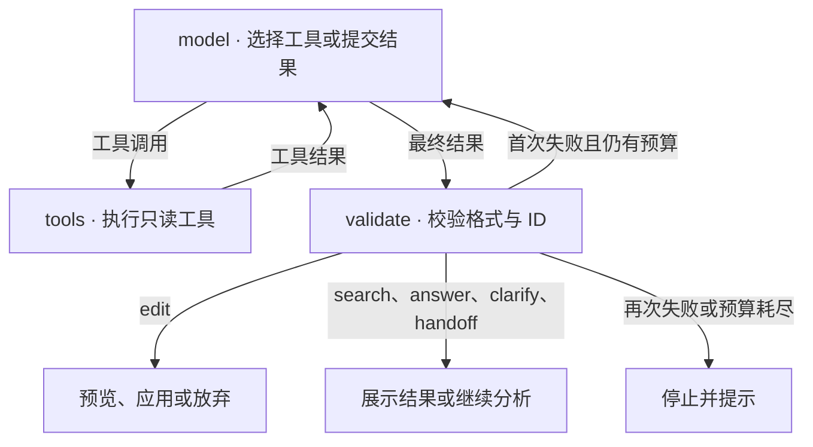

# 战术板 AI 助手架构与使用边界

画布上的助手由一个 LangGraph Agent 和编辑器共同完成任务。模型决定读取什么、调用哪个工具、如何组织修改提案。编辑器根据提案构造预览，教练确认后再提交一次可撤销的事务。[状态图](../web/assistant-harness.js) · [编辑器接入](../web/app.js)

## 状态图



图状态只保存下一步、模型调用次数和修正标志。当前请求的消息、解析到的球员和路线 ID，以及检索候选保存在该次运行的内存中。浮窗在同一工作区与战术范围内保留最近五轮结构化记录，供后续指令参考。每次新请求仍须通过工具核验引用。切换战术或刷新页面会清空这些记录。

| 工具 | 功能 |
|---|---|
| `read_board` | 提供球员、路线、阵型、持球与传球时序、区域、注释和坐标信息。路线包含 ID、点位和时序。 |
| `resolve_player` | 依位置、姓名词元、号码、攻防侧或相对位置解析当前画布上的球员。 |
| `resolve_players` | 批量解析多组条件。明确指定整个位置组时可选择多个结果，例如 OL。 |
| `search_madden` | 按名称概念、近似路线标签、阵型与球队检索，或按当前战术的阵型与路线特征寻找相似条目。 |

选择「画阻挡路线」后保留编辑模式标签，模型可以使用画布和球员定位工具。选择「找 Madden 战术」后使用检索工具。标签可以清除，清除后由模型判断。运行时状态行展示工具进度，云端使用流式事件，浏览器直接运行图时由工具回调更新。

一次运行最多调用模型 6 次、工具 10 次，每条模型消息最多提出 5 个工具调用，工具依次执行。一次输出最多 1,800 tokens，下一次模型调用前检查 120,000 字节对话上限。90 秒超时和用户取消均会终止运行。最终结果不合格且仍有预算时允许一次修正。[运行限制与结果验证](../web/assistant-harness.js) · [工具定义](../web/assistant-tools.js)

## 支持的指令

先将涉及的球员放在当前战术图中。姓名可用名、姓或全名匹配，号码支持 `12`、`#12` 和 `12号`。多个匹配对象会要求教练澄清。以下示例描述期望的提案，实际调用顺序由模型决定。

| 指令示例 | 期望的预览 |
|---|---|
| “X 跑 12 码 dig，向内折” | 生成概念路线。支持 slant、out、in、dig、curl、comeback、hitch、post、corner、go、fade、seam、flat、wheel、drag 和 screen。 |
| “C 先挡前面的 DT，再挡叫 Avery 的 LB” | 按顺序生成分段阻挡。演练时目标的当前位置用于计算接触点。 |
| “OL 全线向左 zone 阻挡” | 批量定位锋线，一次提议多条阻挡路线。还支持 gap 和 pass protection 方案。 |
| “Z 先向左 jet motion，再跑 flat” | 创建预动和后续路线。已有 motion 可与主路线共存。还支持 orbit、across 和 shift。 |
| “X 向外移动 3 码” | 移动球员并平移其路线。也支持 wide、slot、tight、off 站位。 |
| “传给 Y，2.5 秒出手，3.5 秒到达” | 设置接球人、传球和到达时序，并生成传球路线。 |
| “画左侧 deep third，CB 落到这个区域” | 添加预设防守区域和球员落位路线。支持 deep third、deep half、flat、hook curl、curl flat、middle hole。 |
| “把 X 的主路线延迟 1 秒、持续 3 秒” | 调整已有主路线的时序。 |
| “删掉 X 的主路线” | 移除指定球员的主路线。 |
| “在 X 旁标注外侧释放” | 在球员旁新增文字注释。 |
| “再深两码” | 利用近期上下文提出后续修改。提案仍需核对，并在预览后应用。 |
| “这套谁是第一读？” | 模型可结合画布信息给出回答，并请求高亮已核对的球员或路线。教练应核实回答。 |
| “分析这套战术对上这套防守” | 可跳转至独立的 AI 对位分析入口，在那里选择攻防战术进行分析。 |
| “找一些打 Cover 3 的 Madden 战术” | 检索目录，返回含图例、可编辑状态和简短依据的候选。教练点击后导入。 |
| “找和这套类似的战术” | 按阵型与可编辑路线的近似概念特征排序候选。 |

改图结果先显示半透明预览和变更清单，教练可以预览演练、放弃或应用。应用前重新检查当前战术、权限和请求快照，整组修改进入一次编辑事务。撤销可回滚整组。手机端使用半高底部面板，预览时收起以露出球场。[预览和事务](../web/app.js) · [领域操作](../web/assistant-operations.js)

## 当前限制

- 几何是基于固定开球线 `y=67`、进攻方朝减小的 y 方向和画布比例生成的近似示意，路线和阻挡方案仍需教练检查。阻挡目标被删除后使用保存的路线点。没有目标 ID 的旧路线沿用原有动画。
- Madden 当前目录来自 Eagles 和 Ravens 的进攻战术。可编辑轨迹的标签按几何近似生成，并非经战术教练逐条认证。原图条目只提供名称和阵型等元数据，不提供推测的路线标签。人员组、跑传和比赛情境过滤仅匹配目录真实记录的元数据，缺少对应字段时可能没有结果。
- 模型推荐的依据和战术问答是辅助判断。图上对象的来源可校验，战术解释的正确性仍取决于模型与所给上下文。
- 相似检索依赖可编辑路线和阵型特征。AI 不会从原图中即时识别完整战术。只有原图的战术仍是参考图，无法按可编辑路线演练。
- 会话只保留当前页面最近五轮。历史记录不会在刷新后恢复，也不能跨战术沿用。静态版需要用户配置 API Key，语音听写依赖浏览器和麦克风权限。

## 宿主与数据

GitHub Pages 在浏览器中加载 LangGraph 浏览器包，并直接调用选择的服务商。云端由 Worker 调用相同的图，使用服务端目录并在请求入口、模型调用前以及结果返回前核对身份、工作区权限和版本。返回编辑提案需要写权限。客户端还会在应用预览时重新检查权限和画布是否变化。[浏览器与云端传输](../web/assistant-provider.js) · [云端处理](../server/api.mjs)

画布快照包含场上球员的姓名、号码、位置以及战术内容。使用时，这些必要信息会按工具调用发送给所选模型服务商。API Key 用于当次模型请求，静态页保存在当前页面内存中。

## 框架选型

项目有两个入口。GitHub Pages 在浏览器中持有本地战术本和用户本次输入的 API Key。云端工作台通过 Worker 鉴权并检查战术本版本。两者需要共用工具名称、输入约束、循环退出条件和最终结果格式。现有对位分析已使用 `@langchain/langgraph`，依赖版本由项目的锁文件固定。

| 方案 | 本场景可以复用的能力 | 接入成本与判断 |
|---|---|---|
| Claude Agent SDK | Claude Code 的工具循环、权限和会话。官方 TypeScript SDK 支持 Node，浏览器 SDK 也提供与远端 CLI 通信的传输接口。 | 采用远端 CLI 需提供运行服务并管理其会话。战术板当前需要的是画布对象和目录查询，以及教练选择的 OpenAI 模型。单独引入该运行环境的收益有限。 |
| Pi agent-core | 可嵌入的工具循环、流式事件、自定义模型传输和停止控制。官方示例也包含浏览器代理传输。 | 可胜任这两个交互。采用 Pi 将另引入一套消息和工具适配层，需要同时维护它和已有对位分析所用的 LangGraph。 |
| LangGraph.js | 状态图、条件边和单次运行的状态。节点可以调用项目自己的模型适配器与领域工具。 | 选用此方案。两套宿主共享图与工具契约，模型可在同一轮指令中读取画布、查找球员或迭代检索目录，再给出操作。 |

框架资料来自 [Claude Agent SDK](https://github.com/anthropics/claude-agent-sdk-typescript)、[Claude 浏览器 SDK 更新记录](https://github.com/anthropics/claude-agent-sdk-typescript/blob/main/CHANGELOG.md)、[Pi agent-core 文档](https://github.com/earendil-works/pi/tree/main/packages/agent) 和 [LangGraph.js](https://github.com/langchain-ai/langgraphjs)。

## 维护与回归

新能力先在 [工具注册表](../web/assistant-tools.js)或[领域操作](../web/assistant-operations.js)中定义可验证的输入与结果，再扩展[图的结果校验](../web/assistant-harness.js)和编辑器事务。增加数据字段时检查 [model.js](../web/model.js) 的校验、保存与旧数据兼容。Madden 几何标签的生成入口在 [脚本](../scripts/build-madden-search-tags.mjs)，路线特征在 [madden-concepts.js](../web/madden-concepts.js)。

更新 LangGraph 依赖后运行 `node scripts/bundle-board-agent.mjs`，提交生成的浏览器包和署名文件。下列测试使用脚本化模型，无需 API Key。

```sh
node --test tests/assistant-*.test.mjs tests/board-assistant-ui.test.mjs
```
