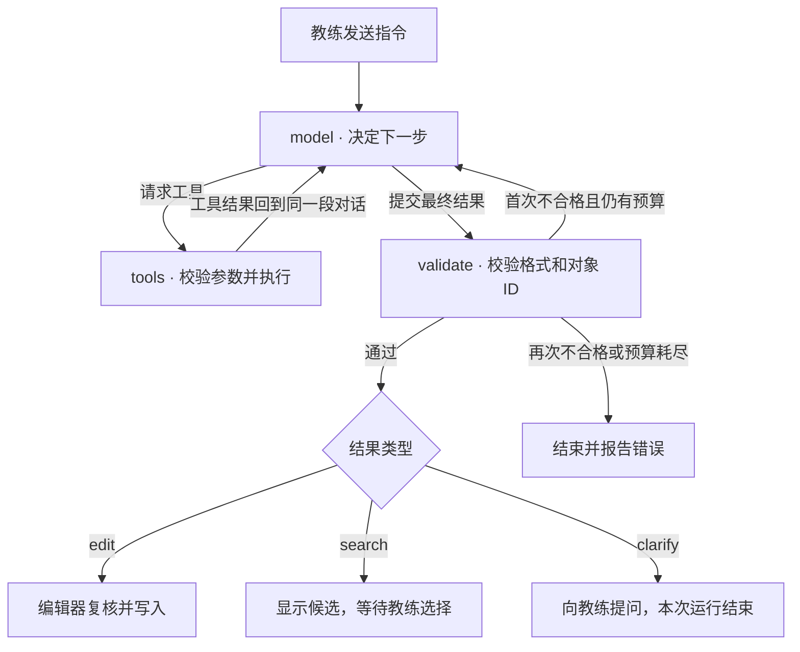

# 战术板 AI 助手的 Agent 架构

悬浮窗后面只有一个教练助手 Agent。它读取教练的指令，选择需要的工具，再根据工具结果决定下一步。改路线和找 Madden 战术共用这个循环。两者都围绕当前战术展开，也都需要在交付结果前核对对象 ID，因此可以共用一次运行的上下文和校验规则。独立入口「AI 分析战局」有自己的 Agent，分析两套已保存的攻防战术。浮窗不会把任务转交给它。[对位分析 Agent 设计](AI_MATCHUP_AGENT_DESIGN.md)

## 三个节点如何协作

一次发送启动一个 LangGraph `StateGraph`。图中只有 `model` 节点调用大模型。`tools` 执行注册的只读函数，`validate` 用代码校验最终结果。浮窗上的「画阻挡路线」和「找 Madden 战术」会填入可修改的示例指令。教练也可以直接描述需求，由同一个模型选择工具。[状态图与退出条件](../web/assistant-harness.js) · [浮窗入口](../web/board-assistant.js)



| 谁负责 | 可以决定什么 | 代码入口 |
|---|---|---|
| 浮窗与编辑器 | 将听写或键入内容和当前工作副本交给 Agent。写入、保存、撤销均由编辑器执行 | [浮窗](../web/board-assistant.js) · [编辑器接入](../web/app.js) |
| 模型与传输层 | 模型选择工具、查询条件及下一步。传输层负责服务商协议、超时和取消 | [模型适配器](../web/assistant-provider.js) |
| 工具注册表 | `read_board` 读取快照。`resolve_player` 找场上球员，唯一匹配才登记 ID。`search_madden` 查询目录并登记本次返回的候选 ID | [注册表与参数契约](../web/assistant-tools.js) |
| 结果校验与领域代码 | 校验操作中引用的球员、目录条目及坐标，计算阻挡接触点，按目录 ID 还原卡片 | [结果校验](../web/assistant-harness.js) · [路线生成](../web/assistant-edit.js) · [目录检索](../web/assistant-search.js) |

`edit` 当前接受两种操作。有序阻挡使用 `block(playerId, targetIds)`，目标为 1–6 名已经定位的对手。普通跑动使用 `route(playerId, points)`，接受 1–32 个新的路点，坐标范围为 0–100，起点由编辑器取自球员当前位置。`read_board` 中的路线按所属球员、类型、是否可选和路点传递。区域、独立路线 ID 和演练时间参数仍由编辑器管理。[快照字段](../web/assistant-provider.js) · [操作契约](../web/assistant-harness.js)

## 状态保存在哪里

| 生命周期 | 保存的内容 | 用途 |
|---|---|---|
| LangGraph 单次运行 | `next`、`modelCalls`、`repaired` | 选择下一节点、限制模型调用次数、记录是否已尝试修正 |
| 同一次请求的内存 | 画布快照、模型与工具消息、已唯一定位的球员 ID 集合、历次检索候选 ID 的并集 | 让后续步骤引用早先找到的对象。首条用户消息只含指令、语言和选中的球员 ID，模型按需调用工具获取更多信息 |
| 浮窗与编辑器 | 待澄清的问题、当前工作区与战术、编辑撤销历史 | 教练补充信息时，浮窗将原指令、问题和补充答案组成新请求。新运行基于当时的画布重新收集证据。被接受的编辑进入战术本的正常保存流程 |

图按请求创建，运行结束后释放，没有持久化检查点或跨会话记忆。每条模型消息最多可提出 5 次工具调用，工具节点按消息中的顺序逐个执行。单次指令最多调用模型 6 次、工具 10 次，最后一次模型调用关闭工具。每次模型回复上限为 1,800 tokens，调用前检查对话记录是否超过 120,000 字节。模型运行设有 90 秒超时并接收浮窗的取消信号。校验失败最多允许修正一次。成功的结果附带 `toolsUsed` 和 `modelCalls`，可在测试中区分模型轮数和工具次数。[运行预算](../web/assistant-harness.js) · [请求生命周期](../web/assistant-provider.js)

## 两条指令的执行过程

### C 先挡面前的 DT，再去找叫 Avery 的 LB

下面沿用仓库测试里的三个球员 ID。该测试使用脚本化的模型回复，任何人都能重放这条路径。真实模型可以选择不同的调用顺序。[可重放的工具调用测试](../tests/assistant-provider.test.mjs)

| 模型轮次 | 模型提出的操作 | 程序核对与执行 |
|---|---|---|
| 1 | 找 `role=C`，再找 `role=LB, name=Avery` | 两项可放在同一条消息，分别唯一匹配场上的 `c` 和 `l` |
| 2 | 找 `role=DT, relation=in_front, relativeToId=c` | 工具先确认 `c` 已登记，再沿 C 的前进方向筛选 DT，按球场距离取最近者，得到 `d`。同距会返回多个候选 |
| 3 | 返回下面的有序阻挡操作 | 校验器确认执行者已定位、两个目标均来自对方且各不相同。编辑器随后计算接触点 |

```json
{"kind":"edit","operation":{"kind":"block","playerId":"c","targetIds":["d","l"]}}
```

编辑器把操作写成 C 的一条 `stagedBlock` 路线，包含起点、DT 旁的接触点和 LB 旁的接触点。演练先在第一处停留，再走第二段。接触点取自改图时的站位，后续移动防守人不会使路线自动追踪。整条路线作为一次编辑提交。若名字没有匹配到场上棋子，或仍有两个同样符合条件的目标，模型可以返回 `clarify` 请教练补充姓名或球衣号。[球员定位与接触点](../web/assistant-edit.js) · [演练时序](../web/model.js) · [路线回归测试](../tests/assistant-edit.test.mjs)

### 找几套能打 Cover 3 的 Madden 进攻战术

1. 模型把防守问题转成可查的英文战术概念，例如调用 `search_madden({"concepts":["flood","sail","curl flat","vertical"]})`。工具在目录名称中匹配这些概念，也支持阵型、球队及可编辑状态筛选。模型可以看完首轮候选后调整条件再查。
2. 这组条件可返回 Eagles 的 Gun Trips TE **FLOOD** 和 Ravens 的 Gun Tight Slot Flip **SAIL**。FLOOD 有可编辑重建数据，工具可以提供主要跑动路线的起终点与开球线位置。SAIL 只有原图，模型得到的是名称和阵型等元数据。教练能在候选卡看到原图。每次查询最多返回 12 项。
3. 模型从本次已检索到的 ID 中选出 0–4 项，为每项写一句推荐依据。例如，面对三深区域时，Flood 的同侧多层路线可让四分卫根据外侧浅区防守人的落位选择传球层次。校验器能核实条目来源、排除重复 ID、检查理由是否非空。对具体 Cover 3 变体是否适用，仍是战术判断。
4. 编辑器用目录 ID 读取真实名称、阵型和图片。到这里战术本尚未更改。教练点击「加入战术本」后，现有导入流程才创建所选战术，分别保留可编辑路线或原图参考。[目录检索与证据](../web/assistant-search.js) · [真实目录回归测试](../tests/assistant-search.test.mjs) · [导入入口](../web/app.js)

## 两种宿主与写入边界

| | GitHub Pages 免登录版 | 云端工作台 |
|---|---|---|
| 谁运行图 | 浏览器按需加载已打包的 LangGraph | Worker 使用项目依赖中的 LangGraph |
| 图可以读取什么 | 编辑器当前快照，浏览器加载的 Madden 目录 | 客户端提交的编辑快照，服务端随版本打包的 Madden 目录。客户端传入的候选列表不作为目录证据 |
| 模型请求怎样发送 | 当前页面使用本次填写的 Key 调用所选服务商 | 请求经过 `POST /api/workspaces/:id/board-assistant`，Worker 使用该次请求的凭据调用服务商 |
| 何时检查权限与版本 | 编辑器在应用结果时检查战术和编辑状态 | 入口、每次模型调用前、返回结果前均复核身份、成员权限与工作区版本。返回改图要求 owner 或 editor，viewer 可以检索或澄清 |

两种宿主都使用同一份图、工具注册表和结果校验。云端助手接口只返回操作或候选。应用改图前，编辑器还要确认当前工作区和战术与发起请求时一致、当前战术内容未变、用户有编辑权且没有正在进行的拖动或绘图。若教练在模型运行时已手动改图，过期操作会被拒绝。浮窗的「撤销改图」仅能撤销仍位于历史栈顶的那笔编辑。[客户端接入](../web/app.js) · [云端接入与版本复核](../server/api.mjs) · [服务端目录](../server/board-assistant-catalog.mjs)

## 框架选型

项目有两个入口。GitHub Pages 在浏览器中持有本地战术本和用户本次输入的 API Key。云端工作台通过 Worker 鉴权并检查战术本版本。两者需要共用工具名称、输入约束、循环退出条件和最终结果格式。现有对位分析已使用 `@langchain/langgraph`，依赖版本由项目的锁文件固定。

| 方案 | 本场景可以复用的能力 | 接入成本与判断 |
|---|---|---|
| Claude Agent SDK | Claude Code 的工具循环、权限和会话。官方 TypeScript SDK 支持 Node，浏览器 SDK 也提供与远端 CLI 通信的传输接口。 | 采用远端 CLI 需提供运行服务并管理其会话。战术板当前需要的是画布对象和目录查询，以及教练选择的 OpenAI 模型。单独引入该运行环境的收益有限。 |
| Pi agent-core | 可嵌入的工具循环、流式事件、自定义模型传输和停止控制。官方示例也包含浏览器代理传输。 | 可胜任这两个交互。采用 Pi 将另引入一套消息和工具适配层，需要同时维护它和已有对位分析所用的 LangGraph。 |
| LangGraph.js | 状态图、条件边和单次运行的状态。节点可以调用项目自己的模型适配器与领域工具。 | 选用此方案。两套宿主共享图与工具契约，模型可在同一轮指令中读取画布、查找球员或迭代检索目录，再给出操作。 |

框架资料来自 [Claude Agent SDK](https://github.com/anthropics/claude-agent-sdk-typescript)、[Claude 浏览器 SDK 更新记录](https://github.com/anthropics/claude-agent-sdk-typescript/blob/main/CHANGELOG.md)、[Pi agent-core 文档](https://github.com/earendil-works/pi/tree/main/packages/agent) 和 [LangGraph.js](https://github.com/langchain-ai/langgraphjs)。

## 维护与回归

| 下次要加什么 | 从哪里改起 | 要验证什么 |
|---|---|---|
| 新的只读能力，如查询某名球员当前的路线 | 在 [`createBoardTools`](../web/assistant-tools.js) 注册工具描述、参数 schema 和执行器，领域函数返回稳定 ID 或可核对的数据 | 正常调用、非法参数、空结果。已有请求能继续选用其他工具 |
| 新的画布操作，如移动球员 | 在[状态图](../web/assistant-harness.js)扩充模型可返回的操作及校验，在[领域层](../web/assistant-edit.js)实现，再接入[编辑器事务](../web/app.js) | 伪造 ID、歧义、只读、过期响应均无法写入。成功时可以保存、撤销、重载 |
| 更换模型服务商或升级 LangGraph | 服务商协议放在[模型适配器](../web/assistant-provider.js)。升级依赖后运行 `node scripts/bundle-board-agent.mjs`，一起提交静态版 ESM 与署名文件 | 静态与云端两种入口都能完成工具循环，并能在取消、超时或达到预算时退出 |

以下命令从仓库根目录运行。测试使用脚本化模型，无需 API Key，覆盖连续阻挡、多轮检索、伪造 ID、预算耗尽、读写权限、过期响应和浮窗交互。

```sh
node --test tests/assistant-provider.test.mjs tests/assistant-edit.test.mjs tests/assistant-search.test.mjs tests/board-assistant-ui.test.mjs
```
