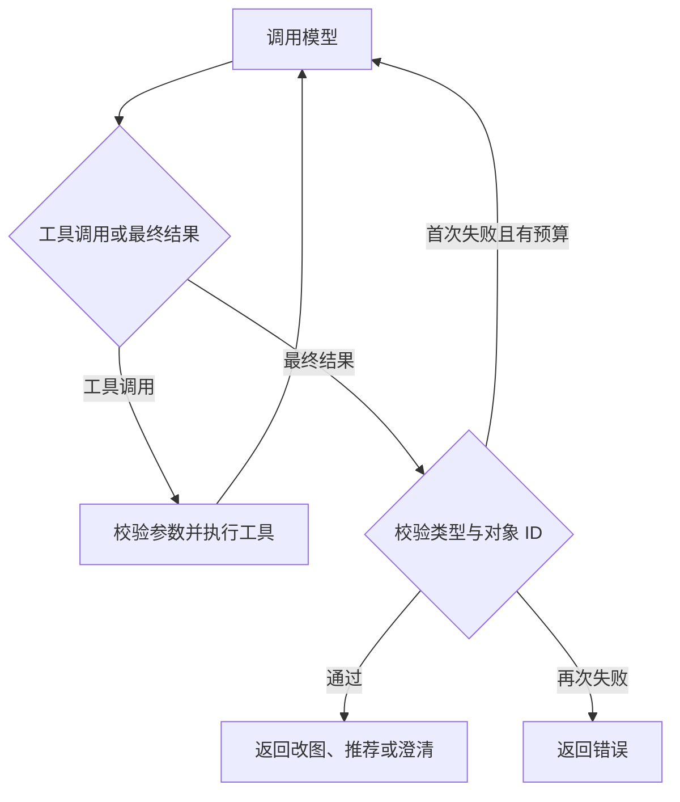

# 战术板助手的 Agent Harness

教练可以在画布上输入或口述改图要求，也可以描述想找的 Madden 进攻战术。编辑器为一次指令提供当前画布的工作副本。模型选择工具和参数，工具返回能够核对的球员或战术目录条目。编辑器负责把通过校验的路线提交为一次可撤销的编辑，或把搜索结果呈现为可加入战术本的卡片。

## 框架选型

项目有两个入口。GitHub Pages 在浏览器中持有本地战术本和用户本次输入的 API Key。云端工作台通过 Worker 鉴权并检查战术本版本。两者需要共用工具名称、输入约束、循环退出条件和最终结果格式。现有对位分析已使用 `@langchain/langgraph`，依赖版本由项目的锁文件固定。

| 方案 | 本场景可以复用的能力 | 接入成本与判断 |
|---|---|---|
| Claude Agent SDK | Claude Code 的工具循环、权限和会话。官方 TypeScript SDK 支持 Node，浏览器 SDK 也提供与远端 CLI 通信的传输接口。 | 采用远端 CLI 需提供运行服务并管理其会话。战术板当前需要的是画布对象和目录查询，以及教练选择的 OpenAI 模型。单独引入该运行环境的收益有限。 |
| Pi agent-core | 可嵌入的工具循环、流式事件、自定义模型传输和停止控制。官方示例也包含浏览器代理传输。 | 可胜任这两个交互。采用 Pi 将另引入一套消息和工具适配层，需要同时维护它和已有对位分析所用的 LangGraph。 |
| LangGraph.js | 状态图、条件边和单次运行的状态。节点可以调用项目自己的模型适配器与领域工具。 | 选用此方案。两套宿主共享图与工具契约，模型可在同一轮指令中读取画布、查找球员或迭代检索目录，再给出操作。 |

框架资料来自 [Claude Agent SDK](https://github.com/anthropics/claude-agent-sdk-typescript)、[Claude 浏览器 SDK 更新记录](https://github.com/anthropics/claude-agent-sdk-typescript/blob/main/CHANGELOG.md)、[Pi agent-core 文档](https://github.com/earendil-works/pi/tree/main/packages/agent) 和 [LangGraph.js](https://github.com/langchain-ai/langgraphjs)。

## 一次指令的生命周期

`web/assistant-provider.js` 将当前指令和编辑器快照准备为本次运行的输入。静态页按需加载本地 [LangGraph 浏览器包](../web/vendor/README.md)。云端的 `POST /api/workspaces/:id/board-assistant` 调用项目已安装的 LangGraph 并使用服务端目录。两种入口调用同一份 [状态图](../web/assistant-harness.js)。API Key 仅用于模型传输，模型运行期间的消息与工具证据保存在该次调用的内存中。



| 注册工具 | 输入及结果 |
|---|---|
| `read_board` | 读取本次战术的棋子、位置、已选对象和已有路线。 |
| `resolve_player` | 按位置、名字、球衣号、攻防侧或相对方位查找。相对方位可以引用本次已找到的棋子。唯一匹配时登记 ID，零个或多个候选时返回相应状态。 |
| `search_madden` | 按模型选定的概念、阵型、球队和可编辑状态查询目录。只登记本次实际返回的条目，供最终推荐引用。 |

[运行预算](../web/assistant-harness.js)限制每次指令最多进行 6 次模型调用和 10 次工具调用，每条模型消息至多包含 5 个工具调用。每次模型调用的输出上限为 1,800 tokens，发起下一次调用前检查消息记录大小，最多 120,000 字节。90 秒超时、主动取消、超出预算均会停止请求。最终结果格式或证据校验失败时允许修正一次，仍受同一预算限制。对工具调用次数和模型调用次数的计数可用于回归排查。

## 模型与编辑器如何分工

- **连续阻挡**。例如“C 先挡面前的 DT，再去找叫 Alex 的 LB”。模型需要从当前球场找到进攻球员及两个对手。名字、位置和相对方位由实际棋子和已关联名单核对。确认目标后，领域代码生成按顺序经过两处接触点的路线。演练按该路线移动并在中间接触点短暂停留。目标不明确时，教练可以补充名字或球衣号。
- **寻找对付 Cover 3 的进攻战术**。模型选择适合检索的战术概念或阵型，根据目录结果调整查询。每张推荐卡对应真实目录 ID，展示球队、阵型、可编辑状态和简短战术依据。球员路线来自可编辑条目的图上重建。只有原图的条目用目录名称和阵型作为依据。推荐说明应保留成立条件，例如对手采用的具体 Cover 3 变体。
- **写入**。改图经现有编辑器提交、保存，并进入撤销历史。搜索本身只读，教练点击卡片的加入操作后才调用现有 Madden 导入逻辑。一次生成期间如果切换战术、修改当前画布或撤销操作，提交前应重新核对当前上下文。

云端在请求开始时核对身份、工作区读取权限和 revision，在模型返回后再核对身份、权限与 revision。返回改图操作需要写权限。

## 维护与回归

添加诸如“查看当前球员已分配的路线”这样的能力时，先定义一个返回稳定对象 ID 的只读工具。在 [assistant-tools.js](../web/assistant-tools.js) 的 `createBoardTools` 中登记其名称、用途、输入结构和执行器。普通模块负责读取、过滤、排序或产生可校验的操作，模型负责决定何时调用。若新能力会修改战术，扩展最终结果的操作类型、领域校验和编辑器事务，并验证旧战术文件仍可回读。运行判断在 `validateBoardReply`，领域实现分别位于 [assistant-edit.js](../web/assistant-edit.js) 与 [assistant-search.js](../web/assistant-search.js)。

依赖升级后运行 `node scripts/bundle-board-agent.mjs`，将更新后的浏览器 ESM 和署名文件一起提交。GitHub Pages 构建会直接复制这些资源。

在仓库根目录执行以下检查。测试使用脚本化的模型响应时，无需外部服务或 API Key。

```sh
node --test tests/assistant-provider.test.mjs tests/assistant-search.test.mjs tests/assistant-edit.test.mjs tests/board-assistant-ui.test.mjs
npm run check
npm run typecheck
npm test
```

变更工具或提示词时，至少回放一次“检索返回后再检索”和“球员同名需要澄清”。变更写入或演练时，覆盖连续阻挡顺序、撤销恢复，以及请求等待期间切换战术的情况。变更模型传输时，分别验证静态入口和云端入口对取消、权限变化及超出运行预算的处理。
