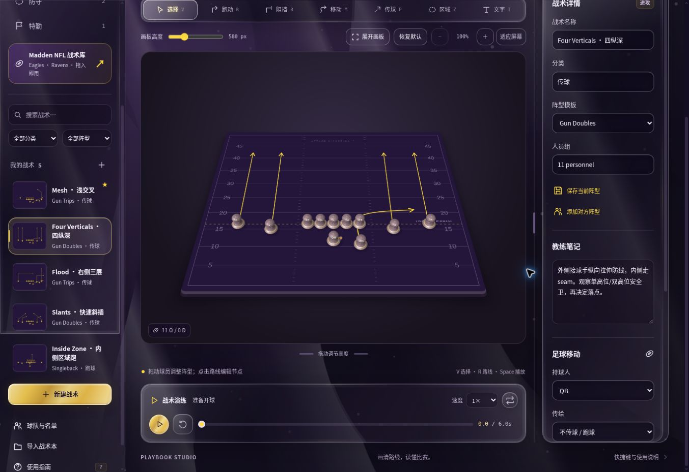
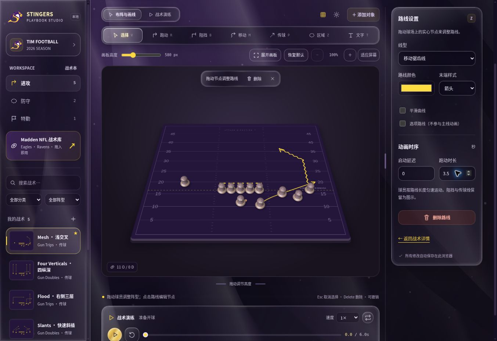
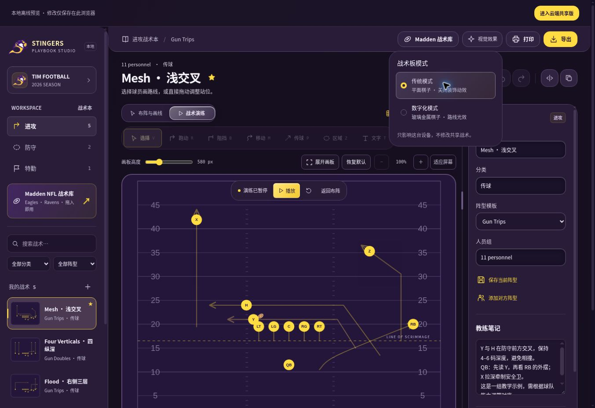
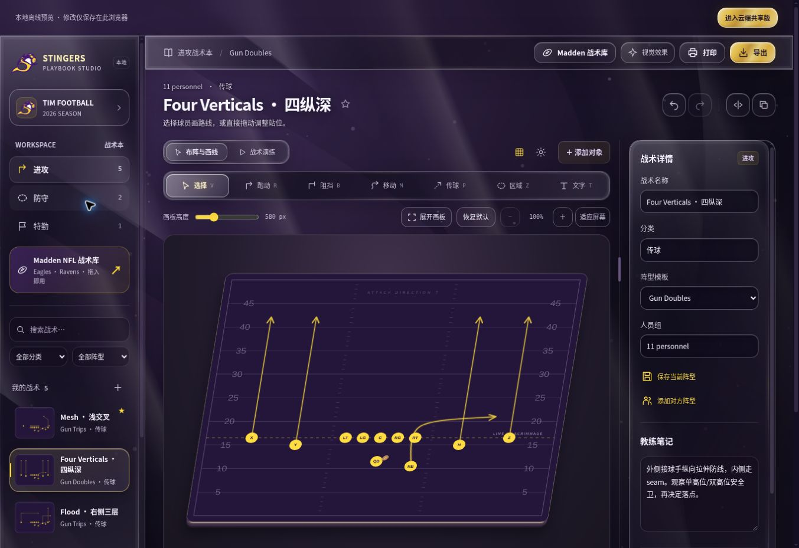

# Traditional and digital board modes

## Viewing preference

- `传统模式` is the default. Flat SVG symbols, solid interface surfaces, no decorative animation. Playback, speed, scrubbing, editing and exports remain functional.
- `数字化模式` is an explicit desktop choice. It enables the existing liquid interface material and particles plus the digital board renderer.
- Phones and iPads cannot select digital mode. Detection includes mobile/tablet user agents, User-Agent Client Hints, touch-enabled Mac identity used by desktop-site iPads, and coarse/no-hover devices. Window width alone does not misclassify a narrow desktop browser.
- The preference lives under `playbook-visual-mode` in local storage. It is absent from shared playbooks, JSON backups and cloud writes. Mode changes preserve selection, drafts, playback time, zoom and history.
- Reduced motion stops decorative movement while retaining digital materials. Page hiding stops render frames. Stale asynchronous startups are disposed.

## v4.2 materials, geometry and camera

The desktop board lazily loads the pinned MIT-licensed Three.js 0.186.0 and `MeshTransmissionMaterial` from `@pmndrs/vanilla` 1.25.0. Both are self-hosted with upstream licenses. No React migration or external HDR/CDN request is needed.

A real Three.js `PerspectiveCamera` now views the field at 50° elevation with a 42° field of view. The field surface, raised frame, 22-unit plinth, pieces, selection rings, shadows and football occupy one world-space scene. The former orthographic camera, inverse ground scaling and outer affine skew are removed. A rectangular 5:4 stage contains the complete camera image and provides ordinary scrolling at 100–300% zoom; the digital viewport uses fixed 12px padding.

Pieces are 50.3 world units high, with a shaped metal foot, sculpted ceramic body, thin metal collar and glass head around a colored core. Circular, square and softened triangular footprints retain the editable shape distinction. Champagne metal and smoke-purple glass use neutral studio softboxes and restrained dispersion. Labels are camera-facing sprites positioned on the heads. Hover and dragging lift the piece while its ground shadow and selection ring remain anchored to the field. Gameplay positions still come exclusively from the shared animation model.

The field is a textured mesh that receives actual Three.js shadow-map shadows; pieces and the three-dimensional football cast shadows. A separate offscreen pass captures the world without glass heads and labels, providing the glass material with the actual field and opaque silhouettes for refraction. The field texture is refreshed from the SVG geometry and route feedback. The final canvas contains the entire scene; it does not try to read underlying DOM pixels.

The SVG editing layer is projected using the same camera's homography. The stage itself remains untransformed. Input is converted through the inverse camera projection, and elevated pieces use Three.js raycasting. This keeps drawing, dragging and selection aligned after zooming and scrolling. The visible scene replaces the SVG presentation while the underlying editing and accessibility semantics remain available.

Route feedback uses the same playback time for moving highlights, player/ball trails, block-end pulses, catching rings and coverage contours; it is sampled into the field texture for the Three.js scene. Pause and scrubbing are deterministic. A block-only player follows its block path; when a primary running route exists it retains precedence. This does not simulate collisions or infer a successful block. The football is a separate 3D object, with a visible arc and rotation during a pass.

When the selected holder has a non-optional drawn passing route and a receiver, its bends are retained and its endpoints are adjusted to release/catch positions. Rehearsal draws this same adjusted path. No receiver or no drawn pass retains the existing ball behavior. Coverage remains manually drawn defensive coverage, not a computed probability region.

## Export and failure behavior

- With WebGL ready, digital PNG exports the complete current 3D scene, including the camera view, field, routes, pieces, labels, shadows and football. The scene is not projected again or overlaid with duplicate SVG players.
- When WebGL is unavailable, an independent CPU mesh renderer projects piece vertices into SVG using the same perspective camera. It preserves upright pieces, depth ordering, shading, labels and selection; it approximates materials and does not reproduce physical glass refraction or GPU shadows. Its geometry is a separate compatibility model, not the exact Three.js mesh.
- Compatibility-view PNG explicitly exports a flat diagram, including the current playback geometry and route feedback. The export dialog states this difference.
- SVG and printed playbooks retain a portable flat vector representation. JSON contains editable geometry, without device preferences.
- Reference-image Madden plays remain reference images.
- If WebGL initialization, context or shader rendering fails, the perspective compatibility renderer and input layer remain available, route feedback continues, and a visible notification explains the fallback. A mode switch can retry. The UI never claims that the compatibility view is a hardware-rendered glass scene.

## v4.2 validation — 2026-10-25

- `npm run check`, `npm run typecheck`, `npm test` (150 tests), and the production build passed.
- Real Three scene lifecycle tests retain geometry, materials, camera and raycaster while replacing GPU submission; both actual material shaders with the PCF shadow branch compile and link as GLSL ES 3.0 in Mesa EGL.
- Browser checks confirmed raised-head selection, dragging and undo, traditional-mode cleanup, theme switching, and deletion at 150% retaining scrollLeft=82, scrollTop=269 and pageTop=214.
- Regression coverage checks camera projection and inverse input, raised piece geometry, stage sizing from 100% to 300% and back, traditional/digital/reference transitions, preserved scroll offsets after deletion and history operations, and complete-scene versus compatibility PNG export behavior.
- The cloud preview browser reports WebGL disabled. The compatibility screenshot below shows the perspective layout and CPU-rendered pieces. It is not evidence of GPU rendering, physical glass refraction, shadow-map quality or the final hardware appearance.
- Hardware-browser visual validation of the Three.js scene and physical iPhone/iPad testing remain incomplete. Numerical projection tests and automated checks do not substitute for those checks.

## v4.2.1 route-edit continuity

Editing a route no longer replaces the live board stage or SVG root. Selection, inspector changes, point commits and undo/redo reconcile the same mounted scene; feedback and compatibility pieces update synchronously before the next paint. The Three renderer retains its last complete texture while the replacement SVG image decodes, then swaps a fully rasterized spare canvas atomically. Failed and superseded decodes cannot blank the field or overwrite a newer mounted play. Compatibility remounts retain the existing piece overlay and picking bounds.

Regression coverage checks retained stage/SVG/canvas identity, synchronous feedback updates, compatibility remount continuity, delayed/out-of-order decoding and rasterization failures. All 157 tests, syntax checks and TypeScript checks pass. Browser checks covered route type changes, committed duration edits, node dragging, undo and redo with all 11 pieces and 92 yard lines retained. Hardware WebGL pixel verification remains subject to the limitation documented above.

## Original v4.0 validation — 2026-10-25

- `npm run check`, `npm run typecheck`, `npm test`: passed (116 tests).
- Added coverage for desktop-site iPad restrictions, default/persisted modes, storage-write failures, obsolete renderer startups, renderer recovery, unchanged play geometry, block timing, curved pass endpoints, scrubbing, theme remounts and WebGL-unavailable fallback.
- Both actual material shader variants were expanded with Three.js r186's `WebGLProgram` and compiled/linked as GLSL ES 3.0 using Mesa llvmpipe through a standalone EGL context. No shader-source compatibility translation was required.
- Browser checks confirmed mode persistence, preserved paused playback time, retained yard lines and players after theme changes, WebGL failure recovery, and the PNG download event.
- The cloud preview browser reports WebGL disabled. Hardware browser rendering, final glass appearance and physical iPhone/iPad behavior are not visually verified by this run. DOM/device-policy tests and the shader check do not substitute for those checks.

## Upstream references

- https://github.com/mrdoob/three.js/tree/r186
- https://threejs.org/docs/pages/MeshPhysicalMaterial.html
- https://threejs.org/docs/pages/PerspectiveCamera.html
- https://threejs.org/docs/pages/Raycaster.html
- https://github.com/pmndrs/drei-vanilla
- https://github.com/pmndrs/drei-vanilla/blob/main/.storybook/stories/MeshTransmissionMaterial.stories.ts

## Historical v4.1 refinement — superseded by v4.2

The following records the previous implementation and its validation. Its orthographic/affine rendering, growing zoom gutters and projected SVG PNG path have been replaced by the v4.2 architecture above; the scroll and component-spacing fixes remain.

- The complete SVG/canvas board has one fixed affine axonometric transform, with a visible plinth and contact shadow. Input uses the inverse SVG screen matrix, preserving placement through skew, zoom and scrolling. Traditional mode and reference images stay flat.
- Zoom gutters grow with projected width, so every corner remains reachable at 300% without feeding padding back into the zoom calculation.
- Deleting routes and undo/redo restore nested board scroll offsets after restoring zoom dimensions.
- Digital PNG exports bake the same projection into a standalone SVG before rasterization; shared geometry and ordinary SVG/print exports remain unchanged.
- Panel/control/inset radii follow a consistent scale. Edge-to-edge sidebar/header surfaces meet without scalloped corner gaps; tool indicators use the same inset and cell widths as their buttons.
- Regression coverage includes ground-plane registration, vertical thickness, inverse input matrices, scroll restoration, zoom gutter stability and PNG bounds.
- The preview browser still disables WebGL. The 2.5D layout is visually inspected in fallback mode; both updated material shaders compile/link as GLSL ES 3.0 in Mesa EGL. Final hardware-rendered glass appearance remains unverified.

References: https://threejs.org/docs/pages/OrthographicCamera.html and https://threejs.org/docs/pages/ExtrudeGeometry.html.

Validation: 135 tests, syntax checks and TypeScript checks passed. Browser deletion at 150% kept scrollLeft=112, scrollTop=201, pageTop=215 unchanged.

