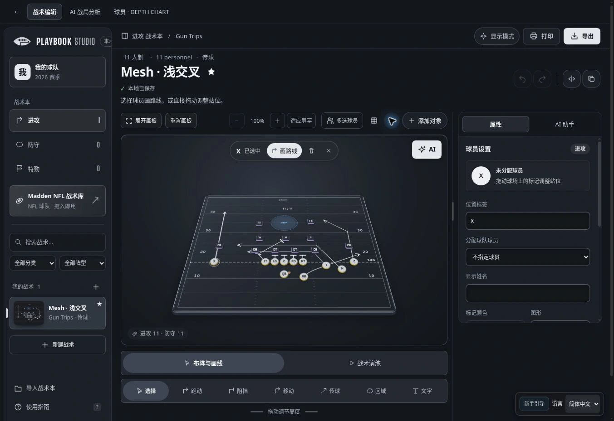
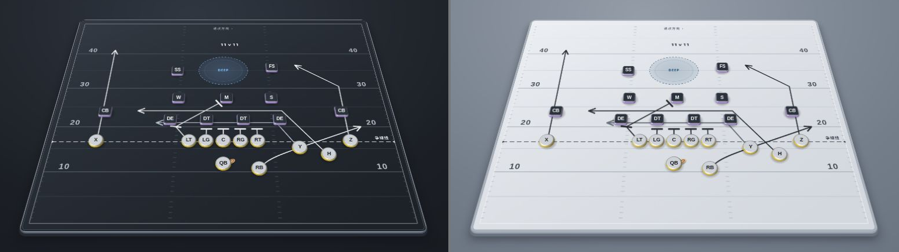
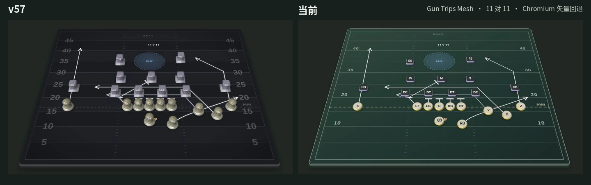
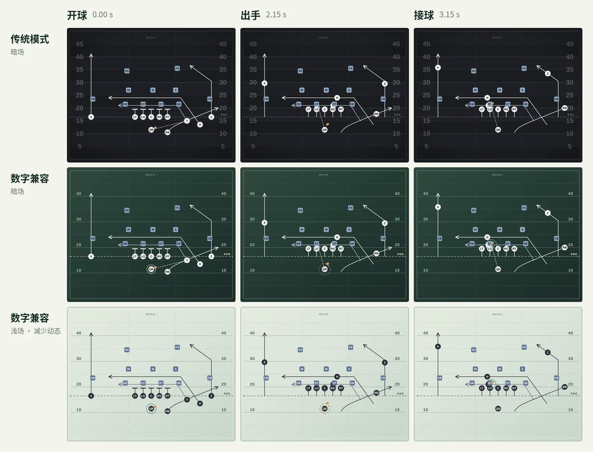

# 数字球场视觉验收

## 数字编辑器的静止画面与局部动效

在桌面打开数字编辑器，载入 11 对 11 的 Mesh。选中外接手 X 时，球场上只加粗他自己的任务线。棋子保留队色侧缘，常驻工具使用实底，球场的明暗由太阳按钮单独控制。



| 检查 | 验收结果 |
| --- | --- |
| 布阵、选中与拖动 | 单选、多选和清空选择更新对应路线。悬停显示轮廓，拖动时棋子抬升。虚线、封堵端帽和其他球员的路线仍可读。 |
| AI 将 Go 改为 Post | 编辑器接收固定模型回复后，原路线的直跑段保持稳定，只在新内切段描线一次。中断或放弃提案后清除描线；系统开启减少动态时直接显示最终状态。 |
| 回放与导出 | 时间轴、出手与接球沿用战术时钟。纹理解码过程中切换选中对象并导出时，过期纹理不能覆盖最新任务线。 |
| 工作区切换 | 回到编辑器时销毁页面装饰，直接进入时跳过初始化。系统减少动态和减少透明度分别控制位移动画与菜单磨砂。 |

在同一前台 Chromium、1363 × 936 视口和 SVG 兼容渲染下，保持数字模式与完整动效，待 Mesh 布阵稳定后采样约 2.2 秒。计数器记录页面的 `requestAnimationFrame` 回调，以及液态面板画布实际调用 `drawImage` 的次数。

| 空闲采样 | v59 | 本版 |
| --- | ---: | ---: |
| 液态面板画布 | 11 | 0 |
| 背景粒子画布 | 1 | 0 |
| 液态面板绘制次数 | 24 | 0 |
| 页面执行的动画帧回调次数 | 6 | 0 |

实操中，X 的位置经鼠标拖动后可撤销回原点，深浅主题往返后选中状态仍在。时间轴从 3.3 秒「接球后跑动」回拖到 2.5 秒时，阶段恢复为「传球中」。[查看逐项记录](acceptance/evidence/digital-workspace-idle.json)

这些结果反映了闲置页面的装饰工作量。此次浏览器未提供硬件 WebGL，时间轴播放中的 GPU 帧率需要在物理设备上测量。

## v59 深浅球场配色

在桌面 Chromium 中打开数字化编辑器，以同一机位查看 22 人的 Mesh 浅交叉，点击「切换球场明暗」取得两张 SVG 兼容视图截图。下图从每张截图截取相同的 770 × 435 像素区域，按原尺寸并排保存。左侧是石墨深色，右侧是冷银浅色，两边都能辨认黄色与紫色的棋子边带、蓝色防守区域及虚线争球线。



另对这套战术的平面场地图和暂停在 2.15 秒的兼容导出图进行 1000 × 800 像素采样。按绿色分量高于红、蓝至少 4 级计算，场地图中偏绿像素的比例从深色 94.46%、浅色 96.35% 均降至 0%。自动回归还覆盖战术卡缩略图，以及球员与路线使用自选绿色时的显示颜色。[配色回归测试](../tests/digital-palette.test.mjs)

## v58 历史验收

2026-11-19。以下测试记录、绿色珐琅球场的图片及演示来自 v58 的 T4 验收。场景取自项目自带的 Mesh 浅交叉。[各版性能数据与设备条件](DIGITAL_BOARD_PERFORMANCE.md)

| 场景 | 操作与验收条件 | 本轮证据 |
| --- | --- | --- |
| 手机和平板 | 带数字模式偏好的 iPhone 进入编辑器，暂停在传球中段后导出；iPad 桌面身份尝试启用数字模式 | DOM 集成通过。手机 PNG 使用屏幕上的球位和传统图层；触控 Mac 身份的 iPad 保持传统模式。设备判定还覆盖 Android 与粗指针 |
| 键盘与编辑 | 键盘激活元素，多选后移动或取消；Go→Post 后撤销，再前进；系统开启减少动态 | 编辑器键盘与交互测试覆盖操作入口。路线测试验证共享起跑段、最终命中几何和精确终点。减少动态直接显示最终状态 |
| 暂停与回拖 | 同一时间从两个方向抵达；在接球后拖回出手，再返回接球 | 数字兼容导出的 SVG 在第二次到达 3.1 秒时完全一致。减少动态保留静态阶段标识，关闭自转和飞行拖尾 |
| WebGL 导出 | 交互缓冲区低于目标分辨率时输出透视 PNG，再继续编辑；下载时模拟上下文丢失 | Three 场景和受控渲染器核对 2000×1600 输出、交互分辨率恢复、整景只嵌入一次。读取绘制缓冲失败时，导出回到已保存的战术与当前时间 |
| 数字兼容与传统导出 | 开球、出手、接球各一次；暗场与浅场；对比屏幕、图层和栅格后的球位 | 9 张 PNG 全部为 2000×1600。各帧含 22 名球员与 11 条路线。数字兼容 PNG 使用平面视角，保留场地主题与阶段轮廓 |
| 普通 SVG 与参考图 | 比较 SVG 分享、打印与参考图选项 | 既有 SVG/打印入口使用平面战术图；原图模式的 PNG 导出规格仍为 2000×1120。导出描述回归覆盖四种入口 |

[T2 选中、接管与撤销演示](acceptance/evidence/digital-edit-continuity.mp4)取自实际编辑器的 22 人 Mesh。固定的 AI 工具回复将 X 的路线改为 13 码 Post。演示包含预览中途按下鼠标并拖动、重新提案、应用、撤销和重做，各步核对持久化路线。影片共 97 帧、5.39 秒，由实际 SVG 图层按相机投影采样并离线栅格化。

### v57 与 v58 布阵对照



高度对照采用同一套 Mesh 站位，比较 50.3、32.7、27.7 和 10 个场景单位，以及 0.34、0.78 两档顶面粗糙度。选择高度 10 和粗糙度 0.78 时，中锋身后的封堵端帽清晰可见。棋子研究图用生产网格与机位在 Cycles CPU 中渲染，布阵对照图取自浏览器中的矢量兼容视图。

[v57 开球阵型](acceptance/evidence/v57-formation.jpg) · [v58 开球阵型](acceptance/evidence/candidate-formation.jpg) · [棋子形状与缩放对照](acceptance/evidence/digital-puck-study.webp) · [v57 与 v58 演练对照录像](acceptance/evidence/digital-rehearsal-compare.mp4)

### v58 编辑器与构建

在前台 Chromium 156 的完整本地编辑器中，打开 Mesh，经「显示模式 → 数字化模式 → 战术演练」把时间轴回拖至 5.99 秒，再从「导出战术本 → 高清图片」下载。界面提示使用立体棋子兼容视图。实收 PNG 签名正确，尺寸 2000 × 1600，文件 2,103,953 字节。

最终源码通过 885 项 JavaScript 测试、4 项 Python 测试、语法检查、TypeScript 检查和生产构建。

### v58 PNG 像素复验

在仓库根目录运行以下命令。最后一个命令可跟一个目录，将 9 张图片输出到该目录供放大检查。

```sh
node --test tests/digital-export.test.mjs tests/digital-png-frame.test.mjs tests/effects.test.mjs tests/editor-selection-ui.test.mjs
node scripts/check-digital-png.mjs
```

场上包括默认 Mesh 进攻、4–3 防守及一条显式传球线。脚本用实际导出代码生成 SVG，再由 libvips 栅格化。每个画面分别栅格化含球与移除球的两个版本，比较模型球位附近 56×56 像素区域。表内为至少一个 RGB 通道变化超过 20 的像素数。

| 导出画面 | 开球 0.00 秒 | 出手后 2.15 秒 | 接球后 3.15 秒 |
| --- | ---: | ---: | ---: |
| 传统暗场 | 804 | 802 | 804 |
| 数字兼容暗场 | 801 | 798 | 802 |
| 数字兼容浅场，系统减少动态 | 779 | 776 | 785 |



桌面物理 GPU 的着色、高分屏显示器上的最终质感和真机 Safari 下载仍需在对应设备复验。CPU 栅格化验证平面图像的内容；受控 Three 渲染器验证场景协议和切换分辨率。两项证据覆盖不同环节。
