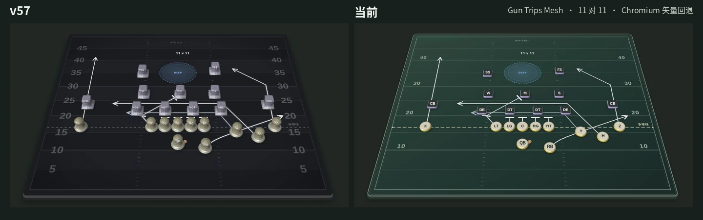

# 数字球场性能验收

对照版本为 [v57 源码 8f267d9](https://github.com/TIMPICKLE/playbook-studio-web/tree/8f267d946059e1bd7ecd84cb493c40dcece448d9)。固定球场为 11 对 11 Gun Trips Mesh，包含 5 条接球路线、5 条封堵路线、深区和标注；LT 的两个阶段跟随 DE、M。球在 2.0 秒出手、3.0 秒到 Y。两版读取同一份 [战术样本](../scripts/bench-digital/mesh.json)，使用原有 50° 机位、42° 垂直视场和 1000 × 800 场景坐标。



[分场景测量结果 JSON](acceptance/evidence/digital-board-bench.json)

## 调度和失效

载入确认后，给数字板控制器 120 次可用的调度时隙，阵型、输入与战术时间保持不变。启用动效并保留深区时，v57 额外绘制 120 次，队列中还有 1 帧；本版额外绘制 **0 次**，队列中有 **0 帧**。这是生产控制器配合真实矢量替代渲染器的确定性检查。

自由拖动 W，两个版本在 108 次采样里均有 **0 次**场地几何失效。拖动分段封堵的第一个防守目标 DE，两版均有 **108 次**。该计数来自生产手势绑定的返回值；WebGL 是否实际序列化、上传由浏览器另行采集。材质实现的每次整场 draw 从两次 Three.js scene render 减至一次。底层阴影、材质仍可能产生多条 WebGL 绘制指令。

## 替代渲染器的 CPU 耗时

Linux，Intel Xeon Platinum 8573C，Node v24.22.3，项目锁定的 Happy DOM，逻辑窗口 1280 × 800。使用真实的 SVG 路线反馈、棋子投影、几何、球位置和属性写入。预热一轮，再测三轮，每项 108 个样本。每个采样后交回一次事件循环，该等待排除在 CPU 读数外。数值按 P50 / P95 / 最大值排列，单位为 ms。强制绘制一张静止画面用于比较单次工作量，日常空闲调度另见上节。

| 场景 | v57 | 本版 |
| --- | ---: | ---: |
| 强制绘制静止球场 | 10.22 / 17.25 / 21.57 | 0.10 / 0.56 / 7.38 |
| 无路线依赖的 W 拖动 | 12.95 / 83.34 / 666.36 | 0.91 / 1.84 / 20.86 |
| 封堵目标 DE 拖动 | 13.16 / 64.53 / 960.94 | 0.92 / 2.16 / 5.99 |
| X / Y 切换选择 | 18.93 / 96.21 / 450.78 | 0.30 / 0.69 / 1.71 |
| 演练推进 | 54.70 / 146.22 / 732.12 | 5.37 / 9.35 / 173.01 |
| 时间轴来回跳转 | 58.75 / 214.84 / 1406.26 | 6.84 / 17.25 / 62.01 |

DOM 环境不执行浏览器布局、栅格化、合成和 GPU 指令。进程调度和垃圾回收计入单次同步耗时，尤其会影响最大值。16.7 ms 是 60 Hz 的呈现预算；判断桌面硬件是否达标需要同机前台浏览器数据。

## 前台浏览器

页面按相同故事板预热一轮，再测三轮，每场景共 18 个样本。采用最近秩分位数，在这个样本量下 P95 等于最大值。自由拖动与有依赖拖动通过编辑器使用的手势绑定更新几何。选择在 X 和 Y 间切换，演练从开球扫到接球后，回拖则按固定序列跨越出手和接球点。单独的交互回归覆盖原生编辑器入口、提交和撤销。浏览器记录以下实测量：

- CPU 计时从一次工作负载开始，到生产 SVG 更新和渲染器 draw 返回。帧间隔来自前台 requestAnimationFrame 的相邻时间戳，含设备调度及实际等待。
- 每次序列化 2000 × 1600 场地 SVG 计一份纹理任务；对该尺寸 Canvas 发出的 texImage2D / texSubImage2D 调用计上传。异步解码可能跨越场景边界。总 drawCalls 包含底层几何与阴影指令。
- 浏览器提供 EXT_disjoint_timer_query_webgl2 时记录有效的 GPU 时间样本。矢量模式不产生 WebGL 绘制或纹理上传；GPU 和显卡扩展不可用时以 null 记录。

桌面前台 Chromium 156，DPR 为 1，视口 1363 × 936，实际场景 850 × 680 CSS 像素。两版创建 WebGL 上下文均失败，均自动进入矢量绘制。rAF 中位数约为 1016.4 ms，反映了远端浏览器调度；该设备无法给出桌面 60 Hz 或物理 GPU 结论。

| 场景 | v57 CPU P50 / P95 | 本版 CPU P50 / P95 | v57 rAF P50 / P95 | 本版 rAF P50 / P95 |
| --- | ---: | ---: | ---: | ---: |
| 强制绘制静止球场 | 10.4 / 66.7 | 0.5 / 4.2 | 1016.5 / 1099.7 | 1016.4 / 1049.8 |
| 无路线依赖的 W 拖动 | 12.5 / 51.8 | 1.8 / 335.5 | 1016.4 / 1016.5 | 333.3 / 3182.6 |
| 封堵目标 DE 拖动 | 12.9 / 47.2 | 1.3 / 34.9 | 1016.4 / 1033.1 | 1016.4 / 1016.6 |
| X / Y 切换选择 | 30.3 / 550.0 | 1.1 / 85.0 | 1016.4 / 3715.9 | 1016.5 / 1033.1 |
| 演练推进 | 92.7 / 2639.5 | 18.4 / 55.9 | 1016.5 / 5098.9 | 1016.4 / 1033.1 |
| 时间轴来回跳转 | 57.3 / 511.3 | 21.7 / 67.7 | 1016.4 / 2049.6 | 1016.4 / 1016.6 |

无路线依赖的 W 拖动出现长尾。同步耗时中位数从 12.5 ms 降至 1.8 ms，但该场景 18 个样本中的最大值（也是 P95）从 51.8 ms 升至 335.5 ms。此次测量没有取得该次停顿的线程调用栈，原因仍待定位。

两次测试中，WebGL 绘制、场地序列化和纹理上传的浏览器计数均为零，原因是两次均使用 SVG 替代通道。回退的演练和回拖仍有超过 16.7 ms 的同步样本；需在实际设备上检验呈现预算。

## 复现

安装本项目锁定的依赖后，在仓库根目录执行下面的命令。BASE_WEB 指向只读 v57 checkout 的 web 目录。QA_ROOT 指向独立的静态预览目录。

```sh
node scripts/bench-digital/node.mjs "$BASE_WEB"
node scripts/bench-digital/node.mjs ./web
node scripts/bench-digital/prepare.mjs "$BASE_WEB" "$QA_ROOT/v57"
node scripts/bench-digital/prepare.mjs ./web "$QA_ROOT/candidate"
```

使用同一浏览器、视口和缩放比例，依次打开静态预览中的 v57/local.html 和 candidate/local.html，点击 **Run benchmark**。页面会显示当前轮次并输出 JSON。默认尝试 Three.js，初始化失败后回退到 SVG；追加 `?renderer=vector` 可强制复核同一替代通道。在测量期间保持该标签前台、不要修改预览文件。Formation、Selected X、Release 和 Catch 按钮固定成相同的比较画面。
