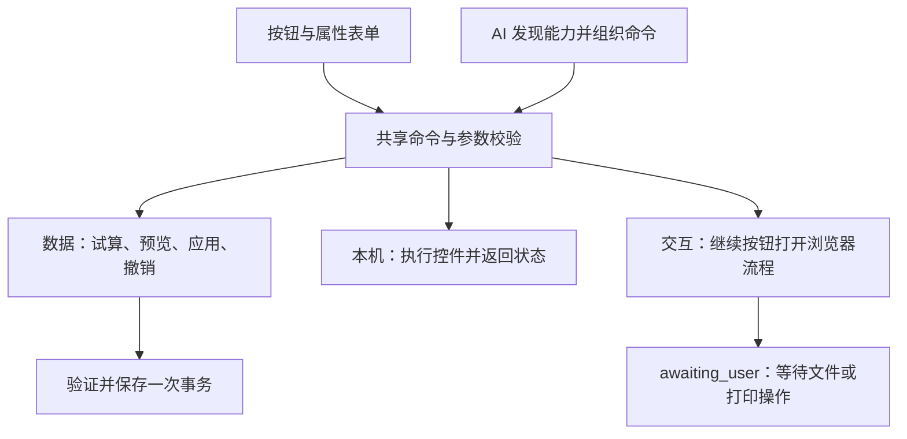

# 战术板共享命令架构

战术板的 AI 助手通过编辑器命令完成操作。按钮、属性表单和 AI 提案复用领域执行器；模型负责理解意图和选择参数，编辑器负责几何、引用、保存、演练和文件流程。知识库提供教练资料，Madden 提供战术目录，两者都不决定助手能否编辑球员。

## 能力定义与发现

| 模块 | 职责 |
|---|---|
| [editor-play-commands.js](../web/editor-play-commands.js) | 当前战术的对象、属性、阵型和人员命令；集中定义 schema、执行逻辑及摘要。 |
| [editor-actions.js](../web/editor-actions.js) | 战术本事务、本机控件和文件交互命令；定义执行通道、破坏性标记、撤销策略与 UI 绑定。 |
| [editor-capabilities.js](../web/editor-capabilities.js) | 汇总可发现的能力，结合参考图、工作区上下文及只读状态说明可用条件，提供命令参数 schema。 |
| [assistant-tools.js](../web/assistant-tools.js) | 读取真实对象和编辑器上下文，发现能力，执行只读试算，记录预览证据。 |
| [app.js](../web/app.js) | 将手动入口和 AI 结果接到相同领域逻辑，执行应用、撤销、本机操作和浏览器交互。 |

模型可用 `list_capabilities` 按 `play`、`workspace`、`local`、`interaction` 查询能力，再用 `get_command_schema` 获取已注册命令的参数。`read_board` 返回图面对象，`read_editor` 返回真实战术 ID、名单、保存的阵型、人员组和当前视图状态。语义路线、阻挡、预动等操作仍由 `preview_edit` 的统一 schema 定义。

不能仅在提示词中宣称支持一个功能。增加能力需要同步完成可执行命令、宿主接入、可发现描述和回归验证。

“改图／找战术”只表达当前偏好，不裁剪工具权限。查看防守图时仍可检索并导入进攻战术；实际写入权限、参考图和设备条件由执行层检查。

## 三种执行方式

### 数据修改

当前战术修改使用 `preview_edit → submit_result(kind=edit)`。试算先克隆战术，运行完整操作组，再验证结果；失败不会留下半组修改。图面预览沿用对象 ID 动画，应用后一次撤销整组。新建对象可声明 `as` 别名，后续操作使用 `$别名`，由领域层生成持久 ID，模型不猜测新 ID。

战术本级修改使用 `preview_actions → submit_result(kind=editor)`。`play_create`、`play_duplicate`、`play_delete`、`formation_save` 和 `catalog_import` 在克隆工作区中生成计划，先展示变更清单；应用时提交一次编辑事务，可整组撤销。工作区数据变化会使等待中的计划失效，需要重新准备。复制、新建或删除改变当前战术时，助手同步更新作用域。

当前战术提案按涉及对象与上下文检查冲突；无关修改可在最新状态上重算，并重新展示预览。阵型重置还跟踪防守集合、相关路线、阻挡引用和球权，避免覆盖等待期间的新安排。

### 本机操作

选择对象、绘图工具、历史、演练、视图、布局、筛选、侧栏和切换战术使用 `local` 通道。模型先读取编辑器状态并试算参数，宿主通过现有控件逻辑执行，再返回实际状态。这些动作不作为一组战术数据变更进入撤销历史；其中 `history_action` 操作已有历史，结束草稿则沿用原绘图流程提交草稿。

### 浏览器交互

导出、打印、导入和打开对话框使用 `interaction` 通道。助手显示「继续」，点击后调用原有浏览器流程，以保留文件选择、下载和打印所需的用户交互。

`awaiting_user` 表示流程已准备或已打开，不表示本地文件已被读取、导入已完成、下载已成功保存或打印机已经打印。文件内容仍由用户选择，打印仍由用户在打印流程中完成。不同通道的命令不混在一个操作组中。

## 功能覆盖表

| 战术板功能 | 命令或工具 | 执行结果与边界 |
|---|---|---|
| 添加、命名、移动、换色、换形状、绑定名单球员 | `player_add`、`player_update`、`move_player` | 数据预览；移动保留附属路线关系，绑定已有名单 ID。 |
| 删除球员、路线、区域或文字 | `object_remove`、`remove_route` | 清理失效引用并维持有效持球人；不可删除最后一名球员。 |
| 绘制及修改跑动、阻挡、预动、传球路径 | `route_add`、`route_update`，以及语义 `route`、`block`、`motion`、`pass` | 支持落点、线型、颜色、平滑、末端、可选路线和时序；完整操作组通过数据模型校验。 |
| 概念路线与多人阻挡 | `route`、`block`、`resolve_players` | 使用真实球员和目标；路线深度以码表示，几何由领域层生成。 |
| 区域和文字 | `zone_add`、`zone_update`、`annotation_add`、`annotation_update`，以及语义 `zone`、`annotate` | 支持位置、尺寸、颜色、标签和文字；不从防守阵型自动推断覆盖。 |
| 球权和传球时序 | `ball_update`、`pass`、`timing` | 使用存在的球员；接球时间必须晚于出手时间。 |
| 标题、分类、人员组描述、笔记、收藏 | `play_update` | 元数据预览；参考图可修改这些信息。 |
| 镜像、内置或自定义阵型、对手阵容 | `play_mirror`、`formation_apply`、`opponents_set` | 替换阵型会清除当前路线、区域和文字并重置球权，预览中说明变更。 |
| 在进攻图上添加或重置 4–3 防守 | `defense_formation` | 完整 11 人；添加保留进攻，重复添加拒绝，重置须明确要求；阵型本身不指定覆盖。 |
| Madden 锋线间距与已有首发人员组 | `line_space`、`personnel_apply` | 沿用现有安全间距算法和角色匹配；人员组须真实存在。 |
| 新建、复制、删除战术、保存自定义阵型 | `play_create`、`play_duplicate`、`play_delete`、`formation_save` | 工作区变更清单与一次撤销；战术本至少保留一套战术。 |
| 检索和导入 Madden 战术 | `search_madden`、`catalog_import` | 导入只能引用当前实际目录返回的条目，不接受猜测 ID；已有条目可直接定位。 |
| 选择、绘图工具、结束或取消草稿、退回一点 | `selection_set`、`tool_set`、`draft_action` | 宿主执行真实控件；草稿不足有效落点时不能结束。 |
| 撤销与重做 | `history_action` | 对现有编辑历史操作；没有相应历史时说明原因。 |
| 编辑与演练、播放暂停、重置、循环、速度、时间轴 | `playback_set` | 本机状态；参考图没有可演练轨迹。速度使用现有 0.5、1、1.5、2 倍档位。 |
| 球场主题、码线、姓名、传统与数字模式 | `view_set` | 本机状态；手机和 iPad 沿用传统模式限制。 |
| 缩放、适应、展开、高度、属性栏宽度 | `layout_set` | 使用现有布局范围，不修改战术坐标。 |
| 列表搜索、分类、阵型、攻防战术本筛选 | `filter_set` | 本机列表状态。 |
| 战术列表、属性栏、球场定位与切换战术 | `panel_set`、`play_select` | 使用真实战术 ID，切换时检查未完成草稿。 |
| PNG、SVG、当前战术 JSON、战术本 JSON | `export_request` | 点击「继续」进入真实下载流程，完成状态取决于浏览器。 |
| 打印当前、筛选结果或全部战术 | `print_request` | 打开战术本、腕带或 call sheet 布局；等待用户完成打印。 |
| 导入本地战术本文件 | `import_request` | 打开文件选择器；后续内容校验与确认沿用现有导入流程。 |
| 帮助、新建、导出、人员、Madden、原图对照、恢复与原图转换入口 | `dialog_open` | 打开已有面板；需要文件或后续设置的流程保持等待用户状态。 |
| 图面问答、高亮和独立攻防分析 | `read_board`、`answer`、`handoff` | 读取事实后回答；战术判断仍需教练核对，对位分析使用独立入口。 |

## 维护与验收

新增或修改按钮、表单与快捷键时，同时检查命令映射，避免手动路径和 AI 路径出现不同删除、引用清理或阵型逻辑。本机控件复用宿主控制逻辑，文件流程复用已有浏览器入口，不通过任意 DOM selector 执行模型输出。

测试至少覆盖共享执行器的手动与 AI 结果一致、预览不保存、操作组原子失败、稳定 ID、失效引用、并发修改、整组撤销，以及浏览器流程的等待状态。脚本化模型验证协议和宿主行为，真实服务商评测用于检查自然语言理解，二者不能互相替代。

## 参考与取舍

- [tldraw Agent starter kit](https://tldraw.dev/starter-kits/agent)：动作模块集中组织 schema、校验、执行及展示，按模式开放能力。本项目借鉴组织方式，保留既有橄榄球领域与 LangGraph。
- [tldraw history](https://tldraw.dev/sdk-features/history)：复杂操作按一次历史事务处理；本项目区分战术数据与本机视图状态。
- [OpenAI function calling](https://developers.openai.com/api/docs/guides/function-calling)：工具需要明确参数和结果。能力发现使用本项目工具，兼容不同服务商，不依赖特定模型的原生工具搜索。
- [MCP ToolAnnotations](https://modelcontextprotocol.io/specification/2025-06-18/schema#toolannotations)：借鉴只读、破坏性与幂等性描述；这些标记只是说明，真正的可用条件、校验和提交仍由本地代码执行。

OpenAI 的 `strict:true` 有额外 schema 要求，不能对包含可选字段的现有工具盲目开启。应用始终使用同一程序校验器检查输入和结果，服务商格式适配不改变领域约束。
