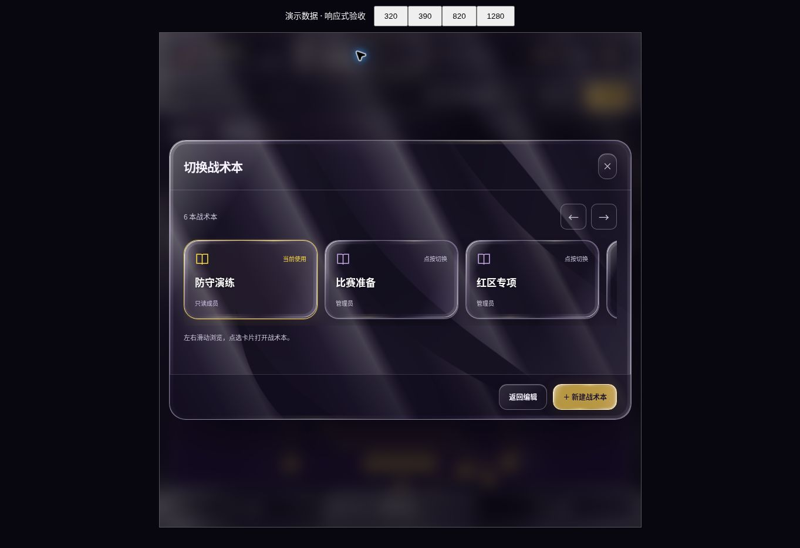

# Liquid glass and liquid metal

> v4 更新：此页保留面板材质的实现记录；当前模式入口和移动设备限制以 [数字化战术板](DIGITAL_BOARD.md) 为准。

Implemented after reviewing upstream projects on 2026-10-25. This is an Apple-inspired material treatment for Playbook Studio, not Apple's proprietary renderer.

## Research and choice

| Reference | Decision |
| --- | --- |
| [Paper Shaders](https://github.com/paper-design/shaders) | Use the vanilla Liquid Metal shader and ShaderMount, Apache-2.0, pinned to 0.0.82 / `71be01576e8402c62ac76386bb4a7c59092e24c7`. A subset bundle is self-hosted with license, notice, source URLs, hashes and source map. |
| [liquidGL](https://github.com/naughtyduk/liquidGL) | Reviewed v3 source. Its DOM snapshot/content-layer and target opacity/pointer-event changes are invasive for live editor controls; no library code incorporated. |
| [liquid-glass-react](https://github.com/rdev/liquid-glass-react) | Reviewed existing control approach; the editor is vanilla DOM and needs a shared animated material across many surfaces. |
| [WebGL glass example](https://github.com/rezzminator/liquid-glass) and [Kube optical tutorial](https://kube.io/blog/liquid-glass-css-svg/) | Reference for rounded surface distance, lens profiles and refraction. Playbook's lens compositor is independently implemented. The tutorial's SVG backdrop path is Chrome-specific, so it is not the cross-device foundation. |

## Shipped behavior

- A continuous silver/purple liquid-metal scene with full-resolution WebGL rendering. The minimum world pixel ratio is 2, and there is no automatic screen-size or performance tier.
- A shared lens renderer samples that animated scene for headers, toolbars, playback, side panels, dialogs and playbook cards. Rounded bevel normals, refraction, RGB dispersion, specular edges and pointer-following light make the material visible. Main action buttons use molten-gold coloring.
- Text, inputs, buttons, SVG players and routes remain live DOM/SVG. Decorative canvases are `aria-hidden` and cannot intercept pointer input. The field is opaque for route readability.
- Full is the default. Soft mode is an explicit slower-flow preference. Off and the system's reduced-motion preference stop the material animation. Hidden pages pause; restoration reuses one engine and animation loop. Preferences do not enter shared playbooks.
- If WebGL initialization is unavailable, an animated Canvas ribbon scene and highlighted glass treatment provide a capability fallback. It is an approximation, not GPU refraction. No device-speed probe selects this path.

The glass refracts the generated metal scene, **not arbitrary overlapping DOM text or the football field**. This avoids stale DOM screenshots, copied form controls and broken interaction layers. This release changes no account, API, database or playbook geometry schema.

## Verification

- `npm run check`, `npm test` (107 passing), and `npm run typecheck` passed.
- New lifecycle tests cover rapid mode changes, late initialization, disposal, hidden-tab pause/resume, non-cancelled pointer input, renderer failure/restart and preservation of focused card buttons during cloud reconciliation.
- In the actual browser preview, checked 320, 390, 820 and 1280 CSS-pixel layouts; card selection and viewer permissions; phone property drawer; full/off/soft/full restoration; field light/dark restoration; and dragging a live player. No horizontal document overflow in the narrow check. A single material world and particle layer remained after repeated switches.
- The cloud browser disables WebGL. Its visual checks therefore exercised the animated Canvas path. The unchanged Paper shader and Playbook lens were additionally compiled, linked and rendered in native Mesa OpenGL ES 3, following ShaderMount's precision promotion. Two metal frames differed, the lens sampled the rendered texture, and rounded transparent corners passed pixel checks.
- Native shader validation does not replace browser-driver or physical iPhone/iPad Safari verification. Those real-device checks remain outstanding; no claim of physical-device testing is made.

The screenshot below uses disposable demonstration workspaces in the local preview, not a user's private playbook data.

