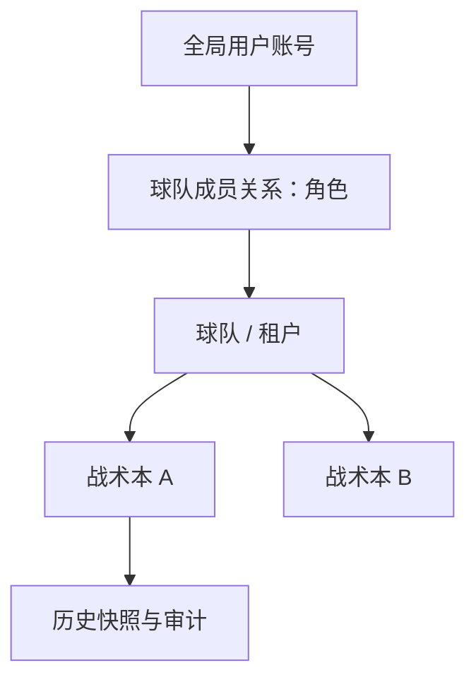
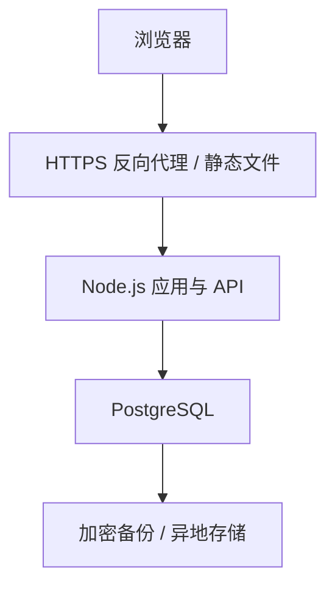

# 多球队多租户与独立部署路线图

> 状态：**规划中，尚未实施**。本文用于指导后续开发，不表示新球队模型、独立服务器或 PostgreSQL 已经上线。
>
> 调研基线：2026-10-27，`main` 的 [`dc264ac9ecf15e4ac73a4cd7b94666e73df0c088`](https://github.com/TIMPICKLE/playbook-studio-web/tree/dc264ac9ecf15e4ac73a4cd7b94666e73df0c088)。动手前应重新核对最新代码、依赖与部署环境。

> 相关规划：[AI 对局分析：Agent 与知识库技术路线图](AI_MATCHUP_ANALYSIS_ROADMAP.md)。AI 原型可先基于现有战术本权限实施；多球队隔离、独立服务和迁移分别以本文 P0–P5 的验收为准。

## 1. 目标与范围

让多个美式橄榄球球队使用同一个 Playbook Studio 服务，各自管理成员和战术；随后能够从当前 Sites / Cloudflare 环境迁移到独立 Linux 服务器。

### 1.1 首版期望

- 每支球队拥有独立的球队主账号、成员、战术本和访问边界。
- 主账号邀请教练或球员；成员使用自己的账号登录，不需要 ChatGPT 账号。
- 教练可以编辑，球员可以只读查看和演练。
- 一个账号可以加入多支球队，在不同球队中拥有不同角色。
- 一支球队可以有多本战术本，成员在球队内切换战术本。
- 保留当前战术编辑、Madden 库、演练、导出、同步冲突处理和历史版本能力。
- 提供可迁移到独立服务器的运行入口、数据库迁移和恢复流程。

### 1.2 本文的工作假设

这些是便于推进的**暂定产品选择**，并非已经实现或不可更改。实施 P0 前确认：

1. **一个球队是一个租户。** 同一球队内所有成员默认能访问该队所有战术本；角色决定能否编辑。战术本内现有的进攻 / 防守 / 特勤分类保持原样。
2. 一个账号是一个真实用户的全局身份，可加入多个球队；“子账号”描述成员关系，不代表密码属于球队主账号。
3. 新球队默认有一名主账号。迁移旧数据时如果存在多名原管理员，先保留其管理能力，再明确主账号，不自动移除或降权。
4. MVP 先用主账号复制一次性邀请链接，成员自行设置密码；真实邮箱验证与自动发信可作为增强。链接是持有者凭证，不能当作对指定人员身份的验证。
5. 初期由平台运营者控制开队资格；是否开放自助注册、球队数量和成员配额，作为上线前产品决策。不要把平台运营者默认设为所有球队的成员。
6. 第一版不做单本战术本的例外权限、收费、复杂组织层级、跨队共享战术或实时多人光标。

如果需要“球员只能看本队部分战术本”，必须在实施球队级默认授权前调整模型和迁移方案；不能依赖前端隐藏卡片。

## 2. 当前代码基线：已有与缺失

| 领域 | 已有实现 | 实际缺口 |
|---|---|---|
| 数据与权限 | `workspaces` 存战术本 JSON；`members` 把用户与单本战术本关联，角色为 owner / editor / viewer。见 [db/schema.ts](../db/schema.ts) | 没有球队表；对多本战术本需要分别加人 |
| 账号 | 用户名 / 密码、加盐 PBKDF2、数据库会话、改密和限流。见 [server/auth.mjs](../server/auth.mjs) | 独立部署要处理身份来源、密码升级、账户找回和可信代理；现有账号邮箱是内部占位值 |
| 邀请 | 单本战术本支持邮箱绑定邀请、7 天有效、一次接受和撤销；已有账号也可由管理员按用户名直接加人。见 [server/api.mjs](../server/api.mjs) | 邀请对象不是球队；邮箱绑定流程不能直接当作现有用户名账号的真实邮箱验证；没有自动发信 |
| 协作 | 约 900 ms 自动保存、空闲时约 6 秒轮询、revision CAS、三方合并、本机草稿和最近 20 个快照。见 [web/sync.js](../web/sync.js) 和 [docs/CLOUD.md](CLOUD.md) | 迁移后需保留语义，并对权限撤销与并发写入重新验证 |
| 球队信息 | 每个战术本 JSON 内已有 `team`、`roster`、`formations` 和 `settings`。见 [web/model.js](../web/model.js) | 它们目前不构成跨战术本自动共享的球队资料 |
| 运行环境 | API 通过 Vinext / Cloudflare Worker 使用 D1；静态入口和 GitHub Pages 不提供共享数据库 | 普通 Linux 生产环境还没有完成服务入口、数据库驱动和部署运维适配 |
| 测试 | [账号测试](../tests/accounts.test.mjs)、[云端 API 测试](../tests/cloud-api.test.mjs)、[同步测试](../tests/cloud-sync.test.mjs) 覆盖现有角色、邀请、CAS 和部分并发 | 需要真实 PostgreSQL、多球队越权、邀请竞态、迁移与恢复测试；不能只靠 SQLite 测试替身 |

**重要现状：** `workspaces.owner_id` 与 `members.role='owner'` 并不保证永远一一对应。例如，旧战术本可在初始化团队账号时保留原 owner，并额外加入一个 owner。迁移时不得把 `owner_id` 当作唯一管理员来源。

当前 `npm run start` 使用 Wrangler 的本地开发运行方式；仓库里的静态 `scripts/serve.mjs` 不提供共享 API。两者都不能直接视为已验证的普通服务器生产部署方案。

## 3. 目标架构与数据模型

### 3.1 概念关系

例子：A 球队主账号邀请教练成为编辑者、球员成为只读成员；A 的两本战术本都归 A 球队。B 球队有独立成员和战术。教练如果也受邀加入 B，其在 A 和 B 的角色分别计算。

### 3.2 建议数据表

下表是**目标模型草案**，字段名称可在实现阶段调整；数据库约束和迁移必须作为一体设计。

| 表 / 字段 | 用途和约束 |
|---|---|
| `users` / `accounts` | 全局身份和凭证；保留旧用户 ID、用户名，用户名的规范化唯一性由数据库保证 |
| `teams` | `id`、球队名称、`primary_owner_user_id`、状态和创建时间。主账号必须是本队有效 owner；不能出现无主球队 |
| `team_members` | `team_id + user_id` 唯一；保存 owner / editor / viewer、加入时间及有效状态。主账号关系与成员角色变更应在同一事务中处理 |
| `team_invites` | 球队、受邀角色、随机 token 摘要、创建者、有效期、状态、接受者与接受时间；不能保存明文 token |
| `team_audit_events` | 记录开队、球队邀请、成员变更与主账号转交等球队级操作；球队还没有战术本时也能审计，不能硬塞到某本战术本的日志中 |
| `workspaces.team_id` | 每本战术本只属于一个球队；保留现有 `id`、`data_json`、`revision` 和同步语义 |
| `snapshots` / 原 `audit_events` | 保留与战术本的关联及旧记录，并可明确归属球队；查询必须检查相应球队权限 |

迁移完成后应确立**单一权限权威**：球队成员关系。旧 `members` 作为核对和回滚数据保留一段时间，但不能在新旧关系之间使用“任一允许就放行”的逻辑，否则会扩大权限。迁移尚未完成时，必须明确每个阶段哪套关系负责授权。

### 3.3 首版权限矩阵

| 操作 | 球队主账号 / 保留的旧管理员 | 编辑者 | 只读成员 | 非成员 |
|---|---:|---:|---:|---:|
| 查看球队及其战术本 | 是 | 是 | 是 | 否 |
| 查看、演练、导出、打印 | 是 | 是 | 是 | 否 |
| 新建和编辑本队战术本 | 是 | 是 | 否 | 否 |
| 邀请、移除成员和调整角色 | 是 | 否 | 否 | 否 |
| 恢复历史版本 | 是 | 否 | 否 | 否 |
| 转交主账号 | 仅当前主账号，且对方接受 | 否 | 否 | 否 |

- 默认不存在跨球队访问。服务端对不存在或不可访问的球队 / 战术本返回一致的不可访问结果；前端隐藏按钮只是辅助。
- 普通邀请不能授予 owner。主账号转交应有明确的发起、对方确认和审计流程，并在事务内防止失去最后一个 owner。
- 新球队默认一个主账号；迁移遇到多个旧 owner 时，保留等效管理权限，直至负责人确认处理方式。
- 平台管理、账号恢复和基础设施运维属于单独的权限域。是否允许平台人员查看业务内容，需要明确授权和审计；不要在代码里默认绕过球队权限。

迁移多本旧战术本到同一球队时，还必须比较**每本的具体角色**。例如，某人对旧战术本 A 是 viewer、对 B 是 editor，用球队级单一角色无法完全保留原状：统一为 editor 会扩大 A 的权限，统一为 viewer 又会收回 B 的编辑能力。在支持单本例外权限之前，应保持这些旧本分属不同球队；若业务确实要合并，先明确并确认新增或收回的权限，不能由脚本自行决定。

### 3.4 名单与战术本数据

MVP 保留现有 `data_json` 和每本战术本自己的 `team / roster / formations / settings`，新球队名称用于组织和导航。不得同时把名单写入两处却没有同步规则。现有创建者最多 50 本的限制也要纳入兼容评估：在球队级配额规则确定前，不能静默取消或错误沿用导致已有用户无法继续使用。

后续如果要做“全队一份名单”，先定义冲突处理、旧战术本名单合并、球员 ID 稳定性、离线草稿和导出格式，再单独迁移。当前约 950 KB 的云端请求 / 文档限制及备份模型限制保持原行为，修改限制需要单独评估。

## 4. 账号、邀请与权限撤销

### 4.1 邀请流程

1. 主账号选择角色，创建单人、单次、限时邀请；界面明确提示链接可以被转发，不应发到公开群。
2. 服务端生成高熵随机 token，只存摘要；数据库状态包括 `pending / accepted / revoked / expired`。过期既要在读取时检查，也可通过后台清理标记。
3. 访问链接仅展示必要的球队与角色信息，**GET 不消费邀请**。登录后的确认使用 POST，并检查 Origin / CSRF。
4. 新用户在受邀流程中自行设置用户名和密码；已有用户登录后选择接受。用户名全局唯一，撞名时允许换名，不泄露其他人的资料。
5. 接受时在一个事务中锁定 / 条件更新邀请、验证有效期和目标角色、创建或关联成员、写审计；并发接受只能成功一次，失败不留下半个账号或半条成员关系。
6. 主账号可撤销或重新生成；失效、已使用、被撤销和网络失败给出可理解提示。链接、token、密码不得进入访问日志、分析事件或审计详情；设置合适的 Referrer-Policy，及时从地址栏移除敏感参数。

**身份边界：** 手动复制的 bearer 链接只证明“持有链接”，不证明姓名或真实邮箱。若产品需要定向邀请，先验证受邀人的真实邮箱或采用其他可靠身份核验，不能用现有 `@accounts.playbook.invalid` 占位邮箱冒充已验证邮箱。自动邮件需要另行配置邮件服务、发信域名和失败重试。

### 4.2 不把球队管理员等同于全局账号管理员

当前 [resetAccount](../server/auth.mjs) 允许账号创建者重置自己创建的成员账号密码；同一账号还可以被加入其他战术本。若该账号跨球队使用，原创建者控制密码就可能获得该用户在其他球队的访问能力。

MVP 应取消球队主账号对其他人的**全局密码直接重置**，改为用户自己完成改密 / 安全找回。球队主账号只能撤销本队成员关系。没有可验证邮箱的旧账号需要单独的、可审计的人工恢复流程；在恢复能力准备好以前，不应直接删除唯一的找回路径。

成员从 A 队移除后：

- 新的 A 队读写请求立即受到服务端权限检查；进行中的请求按数据库事务和锁的先后顺序确定结果。
- 该用户在 B 队的成员关系和登录会话不应因为离开 A 队被无条件删除。
- 已下载、打印或保存在设备中的内容无法保证远程撤回；界面不能承诺“移除成员后清除其所有副本”。

### 4.3 凭证升级与旧账号兼容

- 现有密码使用 PBKDF2-SHA256、100,000 次迭代及随机盐，`accounts.password_version` 用于会话失效，不是密码算法版本。
- 新密码建议采用成熟实现的 Argon2id；记录算法和参数，进行登录并发及内存开销测试。参考 [OWASP 密码存储建议](https://cheatsheetseries.owasp.org/cheatsheets/Password_Storage_Cheat_Sheet.html)。
- 旧账号成功验证后再用新方案重新哈希；无法直接从旧哈希“转换出”新密码。旧校验必须保留原迭代次数、盐及其原始文本编码语义；不能把旧十六进制盐字符串误当成已经解码的二进制盐。
- 新部署的域名下应要求重新登录，旧会话不迁移；密码、token、密钥不写入源码或文档。
- 复用并补强现有限流。独立服务器没有 Cloudflare 的 `cf-connecting-ip` 时，应仅从可信反向代理获取真实客户端地址，不信任任意用户提交的转发头。

## 5. 服务端隔离与并发

### 5.1 每个入口都必须校验

- 从可信服务端会话得到 `user_id`，再验证其与请求目标 `team_id` 的有效成员关系。客户端传入的 `userId`、`role`、`teamId` 只是请求参数，不能作为授权证明。
- 战术本读取、保存、列表、历史、恢复、导入导出、成员、邀请和审计查询均按球队检查，不能只保护编辑页面。
- 原 `/api/workspaces/:id` 可以暂时保持兼容，但必须先解析该战术本所属球队，再检查当前用户的球队权限；新增球队接口应使用明确的球队上下文。
- 非成员拿到其他球队的 team / workspace / snapshot ID 也不能读取、修改、恢复或推断其内容。只读成员的写入在服务端拒绝，即使绕过界面。
- 删除成员、降权、恢复历史、接受邀请和保存战术的权限检查与修改必须按事务设计；不能只在事务外检查一次。

### 5.2 建议的接口边界

以下是设计草案，具体命名和返回体可以随现有代码调整；所有角色均由服务端会话与数据库关系计算。

| 方法与路径 | 行为和权限 |
|---|---|
| GET `/api/teams` | 只列出当前用户有权访问的球队及其本队角色 |
| POST `/api/teams` | 依照 P0 决策限制开队资格；球队和初始 owner 在同一事务创建 |
| GET `/api/teams/:teamId/members` | owner 查看本队成员和必要的邀请状态 |
| POST `/api/teams/:teamId/invites` | owner 创建 editor / viewer 邀请；撤销接口也要校验本队 owner |
| GET `/api/invites/:token` | 只提供接受所需的最小预览，不消费邀请 |
| POST `/api/invites/:token/accept` | 已登录用户确认加入；令牌检查、成员写入与消费在同一事务 |
| GET / POST `/api/teams/:teamId/workspaces` | 按本队权限列出或创建战术本，不接受客户端伪造的创建者或角色 |
| GET / PUT `/api/workspaces/:id` | 可兼容现有客户端；从战术本反查球队并检查成员关系，PUT 保留 revision CAS |
| POST `/api/teams/:teamId/ownership-transfer` | 仅主账号发起；接受者单独确认后事务完成转交 |

未登录、无权限、邀请失效、冲突和限流应返回稳定且可理解的错误；不可访问资源的响应不能泄露其他球队内容。健康检查只暴露必要的存活 / 就绪状态，不返回成员或战术数据。

### 5.3 并发与协作语义

- 保留现有 `revision` 比较并更新、409 冲突、客户端三方合并、本机草稿和 20 个快照；旧版冲突提示中返回的最新数据也要经过重新授权。
- 保存、权限变更、成员移除可能并发。为成员关系、目标文档和必要的球队状态规定一致的加锁顺序；例如在事务中锁定相关成员行，再执行带版本条件的更新。并发请求按实际锁顺序串行化，不能只靠先前一次角色查询。
- 撤权提交后发起的新请求必须失败；撤权与保存同时发生时，测试两种锁顺序，确保结果与提交顺序一致且不会出现无权限的新快照。
- 战术、快照、审计应在同一事务内提交；CAS 失败或权限失败不产生新快照和成功审计。
- 邀请接受、创建球队、转交主账号也需要针对重复点击、并发和中途中断测试幂等性。

### 5.4 PostgreSQL 行级安全：第二道防线

建议对球队范围数据启用 RLS，应用层依然要检查业务权限。每次先根据可信身份确认成员关系，再在**同一事务**中建立球队上下文；使用连接池时不得把球队上下文遗留到下一个请求。普通应用连接不得使用超级用户、`BYPASSRLS` 或默认绕过策略的表所有者身份。

邀请在接受前没有成员关系，创建球队时也还没有初始 owner 成员关系；两者需要单独设计最小权限的安全入口与事务，不能为了方便给所有请求绕过 RLS。覆盖 `SELECT / INSERT / UPDATE / DELETE` 的策略、缺少上下文时默认拒绝、连接复用和角色切换，都要用真实 PostgreSQL 测试。RLS 不是对应用服务器被完全攻陷的防护，也不是备份权限管理的替代品。

参考：[PostgreSQL 行级安全](https://www.postgresql.org/docs/current/ddl-rowsecurity.html)、[事务内 SET LOCAL](https://www.postgresql.org/docs/current/sql-set.html)。

## 6. 独立服务器技术方案

### 6.1 部署形态

- 保留现有前端及其编辑能力；同一域名下提供 `/editor/` 和 `/api/`，减少跨域与 Cookie 复杂度。
- 基于当前 Node.js 24 开发约束，新增经过验证的 Node 服务入口；可以使用轻量 HTTP 框架或适配现有 Request / Response 接口，不要求改写战术板。
- 第一次部署可使用 Docker Compose、Caddy / Nginx、Node 应用和 PostgreSQL；数据库不直接暴露公网。实际服务器规格根据球队数、战术本大小、备份和压测确定，不预先承诺并发量。
- 配置 HTTPS、健康检查、日志轮转、监控告警、重启策略和必要的磁盘余量。可信代理必须剥离伪造的身份 / 转发头，正确恢复外部 HTTPS 来源，确保 Origin 检查与 `Secure`、`HttpOnly`、`SameSite` Cookie 生效。
- 独立部署不能直接信任 `oai-authenticated-user-*` 等 Sites 身份头。若未来支持外部身份提供方，必须经过服务端验证，并显式定义账户绑定流程。

### 6.2 D1 / SQLite 到 PostgreSQL 的实际改造

当前 [server/api.mjs](../server/api.mjs) 和 [server/auth.mjs](../server/auth.mjs) 大量直接调用 D1 的 `prepare().bind().first()/all()/run()` 和 `batch()`。Drizzle 的 D1 模型和 SQLite 迁移也不是 PostgreSQL 迁移。应：

1. 为账号、球队、战术本、邀请、快照、审计定义清晰的数据库访问边界与事务接口，逐步替换直接依赖 D1 的调用。
2. 建立独立 PostgreSQL schema / 迁移；检查占位符、`ON CONFLICT`、条件更新、返回行数、外键和事务行为，不假定 SQLite SQL 全部可直接运行。
3. 现有时间为 JavaScript 毫秒时间戳；PostgreSQL 的 `integer` 是 32 位，不能容纳这些值。使用 `bigint` 或明确的时间类型，并定义驱动返回值与 JavaScript 安全整数的转换规则。
4. 旧 ID 包含 `acct_...` 和其他文本 ID，迁移时保持文本及引用，不强制转为 UUID 类型。
5. 第一版可继续将战术 JSON 作为文本保存，以减少格式变化；验证解析后的语义、版本和内容，而不只比较行数。
6. 在真实 PostgreSQL 上复跑权限、CAS、冲突、并发、回滚和大文档测试；D1 的 SQLite 测试替身不能证明 PostgreSQL 行为等价。

Drizzle 对 PostgreSQL 的支持可作为实现参考，但不意味着现有 D1 调用自动兼容：[Drizzle PostgreSQL 文档](https://orm.drizzle.team/docs/get-started-postgresql)。

### 6.3 备份与恢复

- 对数据库做定时备份、加密、异地保留，并监控备份是否成功；备份密钥不与备份放在同一公开位置。
- 定期在隔离环境执行恢复演练，核验用户、球队、成员、战术、快照与权限，而非只确认备份文件存在。
- 如需只恢复一支球队，先在隔离环境恢复整库并制定经过核验的球队级导出 / 导入流程；不能直接覆盖共享数据库中其他球队的数据。
- 发布前约定可接受的数据丢失窗口（RPO）和恢复时间（RTO）；是否需要 PostgreSQL WAL 时间点恢复由业务和运维能力决定。
- 当前 20 个历史版本是应用内操作历史，**不是**数据库损坏、误删或服务器故障的完整备份。
- 每本战术最多接近 950 KB，快照还可能保存多个完整副本；服务器磁盘、WAL 与备份空间必须按实际数据量监控。

## 7. 数据迁移与切换计划

以下流程用于未来正式迁移；本路线图不授权或触发当前生产数据导出。

### 7.1 迁移前盘点

1. 盘点每份旧战术本的 `owner_id`、全部 `members`（包括多个 owner）、成员账号类型、revision、快照和审计记录；数据仅在授权环境中处理。
2. 确认哪些用户通过用户名 / 密码登录，哪些依赖 Sites / ChatGPT 身份；为后者设计本人可验证的账号认领，不仅凭邮箱或用户名自动合并。
3. 确认每本战术本应归属哪个新球队，标记无可确认主账号、多 owner、成员集合不同及身份冲突等情况；无法确认时暂停该条迁移。
4. 备份旧数据库和配置，记录校验值、备份时间、恢复步骤和回滚负责人；先在隔离环境恢复成功。

### 7.2 避免扩大旧数据权限

- 默认一份旧战术本创建一个新球队，原成员和角色原样映射。多个旧 owner 均保留等效管理权限；通过明确确认选择主账号，不自动降权。
- 合并旧战术本前生成“每位成员对每本战术的查看、编辑和管理能力”差异清单；存在新增或收回权限时必须由有权负责人确认。仅有球队级角色且无法满足原权限时，保持分队或先实现经过评审的单本权限模型。
- 迁移完成后核验：球队、战术本、成员、角色、战术 / 名单 / 模板内容、revision、快照及审计数量和语义；对大 JSON 做规范化内容比对，不因键顺序不同误报。
- 保留原 ID，保证播放器路线、战术本引用和历史关联不变。对不满足新约束的数据输出异常清单，不静默跳过。
- 旧邀请链接因域名 / 流程改变全部失效并重新发放；旧站会话不导入新站。必要的历史邀请状态可只作为审计资料迁移。

### 7.3 切换和回滚

1. 用脱敏或经授权的备份多次试迁，执行数据一致性、权限矩阵、同步和恢复测试。
2. 约定维护窗口：旧站停止新写入，等待正在进行的保存完成，提醒用户导出未同步草稿。不同域名的浏览器本地草稿不会自动迁移。
3. 从一致快照导出，导入 PostgreSQL；迁移过程应可重复执行或安全中止，不生成重复球队和成员。
4. 使用测试账号完成两队隔离、主账号邀请、编辑 / 只读、保存冲突、历史和恢复验证；核对通过后再切流。
5. 保持旧系统可恢复。若新站已接收写入，回滚前必须导出 / 对账这些增量；不能直接切回旧站并丢弃新数据。迁移完成后的保留期和最终清理须经确认。

## 8. 实施阶段与交付门槛

估算按一名熟悉当前代码的开发者、已有可用测试服务器计算，约 **14–22 人日**；独立服务器采购、域名 / 邮件准备、第三方授权和正式切换等待另计。发现旧数据冲突、身份无法认领或 PostgreSQL 兼容问题时应调整工期。

| 阶段 | 任务 | 估算 | 完成门槛 |
|---|---|---:|---|
| P0 规则与验证 | 确认谁能创建球队、球队默认权限、邀请身份要求；梳理旧账号 / 多 owner；验证数据库与认证适配方案 | 0.5–1 天 | 决策记录完成，异常迁移案例和验收数据准备好 |
| P1 球队模型与权限 | 团队、成员关系、角色与球队级授权；保持旧战术本数据格式 | 2–3 天 | A / B 队隔离与角色测试通过；不会因客户端参数越权 |
| P2 账号与邀请 | 一次性邀请、加入 / 撤销、账号自设密码、旧密码兼容、找回方案 | 3–5 天 | 新旧账号、失效 / 竞态 / 取消、跨队密码控制均有测试 |
| P3 界面 | 球队切换、成员管理、邀请状态、只读提示和战术本列表 | 2–3 天 | 桌面、手机 / iPad 主要路径可用；保持现有编辑与同步体验 |
| P4 独立运行 | Node 入口、PostgreSQL schema / 事务 / RLS、反向代理和容器配置 | 3–5 天 | 干净环境可启动，真实 PostgreSQL 的回归及越权测试通过 |
| P5 迁移与恢复 | 试迁、权限差异确认、备份恢复、切换 / 回滚演练 | 3–5 天 | 数据和权限对账通过；恢复及带增量回滚流程可执行 |

阶段可拆成独立 PR；每个 PR 应说明兼容行为、实际执行的检查和尚未覆盖的设备 / 环境。不要把设计文档或单元测试通过当作生产部署完成。

### 8.1 与 AI 对局分析路线图的衔接

| 现有阶段 | AI 工作如何安排 | 必要条件 |
|---|---|---|
| 现在 / P0 | 可以先用虚构数据做 AI 技术验证，并在当前单个战术本权限下规划 MVP | 同一本战术本授权、战术版本与来源必须可核验；AI 方案的 A0–A1 不代表本路线的 P0–P1 已完成 |
| P1–P3 | 球队权限和界面逐步切换时，AI 接入同一权威权限层 | 成员撤权、历史、缓存和知识检索均需通过球队隔离验收；不能同时以旧权限或新权限任一放行 |
| P4–P5 | 根据 Worker 验证结果，评估独立 Node 服务及迁移 | 先验证服务身份、密钥、持久化、备份和回滚，不能假定 D1 或 Worker 配置自动迁移 |

AI 的方案、图示、知识库选型和验收案例见[配套路图](AI_MATCHUP_ANALYSIS_ROADMAP.md)；两条路线的估算与进度分别记录。

## 9. 必须执行的验收清单

### 9.1 用户与球队

- [ ] 建立球队 A、B；A 成员无法通过列表、直接 ID、历史、导出或 API 读取 B 的数据，反之亦然。
- [ ] 同一用户加入两队，A 为编辑者、B 为只读成员；切换后权限正确，B 的所有写入 API 被拒绝且数据不变。
- [ ] 主账号邀请新用户和已有用户；对方分别完成注册 / 登录与确认加入，能够看到预期战术本。
- [ ] 邀请过期、撤销、重复接受和两个请求同时接受时，最多产生一条有效成员关系；失败不创建残缺账号。
- [ ] 主账号被转交前，接受者拒绝 / 超时 / 网络中断不会导致球队无主；最后一名 owner 不能被直接移除。
- [ ] 移除成员或降权后，新请求立即失去对应权限；其其他球队权限保持不变；并发保存与撤权符合事务顺序。
- [ ] 球队主账号不能更改跨球队成员的全局密码；旧账号仍可按确定的方式安全登录或找回。

### 9.2 战术本与协作

- [ ] 原有 Madden 选择、画线、移动球员、演练、导出和打印回归通过；传统 / 数字化模式与手机 / iPad 限制不改变。
- [ ] 多人修改同一战术本时，保留 revision 检查、409 冲突处理、本机草稿与历史快照；权限撤销后不再提交保存。
- [ ] 旧战术本迁移前后 JSON 语义、成员权限、revision 和快照一致；合并战术本不会悄悄扩大权限。
- [ ] 切换球队或战术本时，未同步草稿先保存、保留或供用户导出，不能被另一球队覆盖。

### 9.3 部署与安全

- [ ] 干净 Linux 测试环境可按文档启动；HTTPS、可信代理、Cookie、Origin、限流、健康检查有效。
- [ ] 模拟伪造 Sites 身份头、客户端 role / user ID、跨队 ID、过期 Cookie、重放邀请和无球队上下文，均不能越权。
- [ ] 使用无 `BYPASSRLS` 的普通应用数据库账号运行真实 PostgreSQL 测试；连接池复用不泄漏球队上下文。
- [ ] 备份在隔离环境恢复成功；模拟切换失败和新站已有增量写入后的回滚，不静默丢失数据。
- [ ] 不在日志、错误信息、审计、仓库、备份说明或测试报告中泄露密码、邀请 token、会话密钥或战术正文；审计仅保留必要的球队 / 操作人标识和操作记录，且按球队隔离。测试报告不使用未授权的真实球队数据。

## 10. 现成项目调研与选型门槛

### Better Auth：候选，不预设接入

[better-auth/better-auth](https://github.com/better-auth/better-auth) 为 MIT 协议；其 [Organization 插件](https://better-auth.com/docs/plugins/organization) 提供组织、角色和邀请能力。应先做小型验证：现有用户名账号、占位邮箱、复制链接、旧 PBKDF2 校验、会话迁移和独立 Node 部署能否兼容。

其常见组织邀请流程要求处理邮箱投递；用户名注册示例也包含邮箱。若使用真实邮箱邀请，需验证邮箱所有权，并在实施时复查 [组织邀请安全公告](https://github.com/better-auth/better-auth/security/advisories/GHSA-fmh4-wcc4-5jm3) 和版本配置。即使采用认证框架，球队数据访问与战术本授权仍需本项目负责。

### Next.js SaaS Starter：参考模型，不直接替换项目

[nextjs/saas-starter](https://github.com/nextjs/saas-starter) 使用 PostgreSQL 和 Drizzle，可参考用户、团队和成员关系。其邀请邮件发送部分仍是 [TODO](https://github.com/nextjs/saas-starter/blob/main/app/%28login%29/actions.ts)，不能当成已完成的生产邀请系统。不要为了套用模板重写已运行的战术板。

### 素材与开放范围

现有 Madden / Huddle 第三方图片、游戏素材和来源水印不属于本项目 MIT 代码许可证。扩大到多个球队或对外提供服务前，应单独确认使用范围和授权；不能把源码开源许可误认为图片授权。见 [README 的 Madden 数据边界](../README.md#madden-nfl-战术库)。

## 11. 开发前待确认的产品决策

1. 谁能开设新球队：仅平台运营者、受邀负责人，还是开放注册？每队和每人是否设配额？
2. 球队成员是否默认访问本队全部战术本？是否有仅部分教练可见的战术？
3. 首版是否接受手动链接的持有者风险，还是必须验证真实邮箱？没有邮箱的旧账号如何安全找回？
4. 每队只保留一位主账号，还是需要可管理成员的第二管理员？旧系统的多个 owner 如何保留和确认？
5. 是否需要首版就实现跨战术本共用名单，还是先保留每本独立名单？
6. 正式服务器的域名、邮件服务、备份位置、RPO / RTO、运维权限和可用维护窗口是什么？

这些问题未确认之前，可以先完成代码盘点、数据库抽象和使用测试数据的隔离验证；不可将未确认的权限扩大、身份合并或生产切换作为默认操作。
