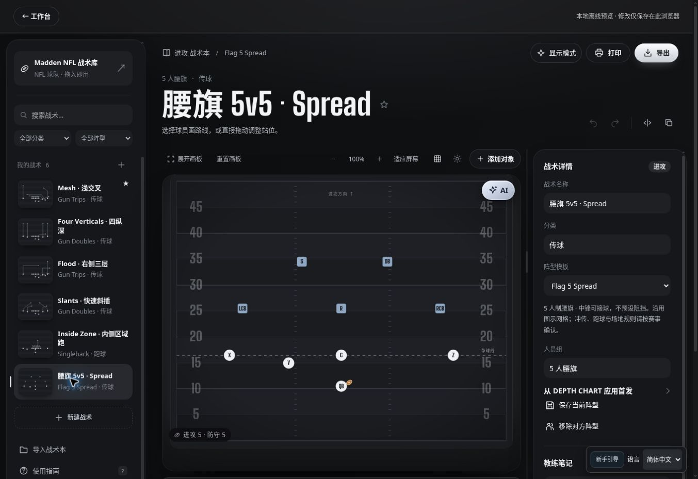
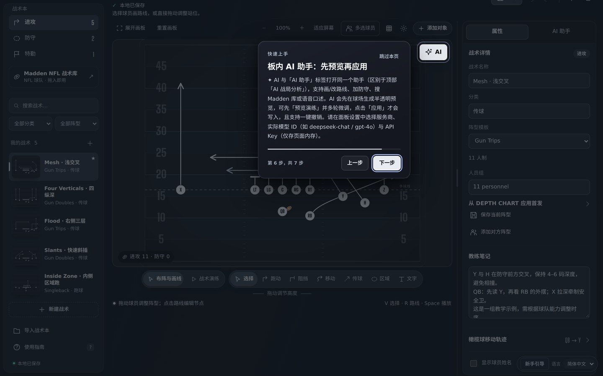
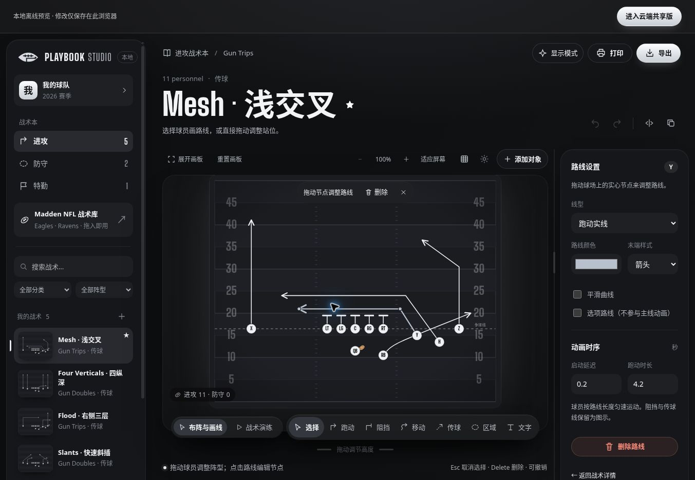
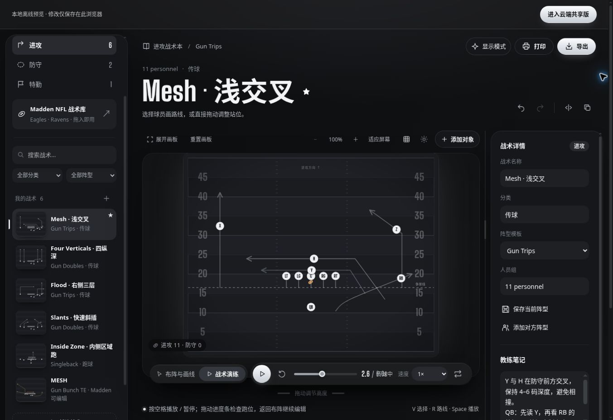
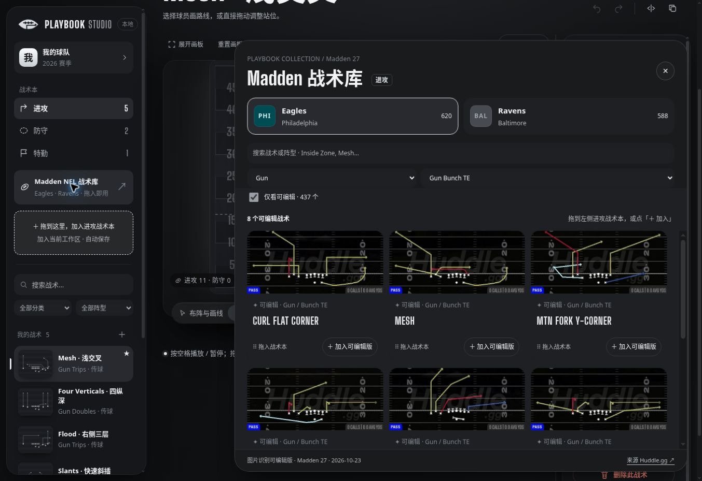
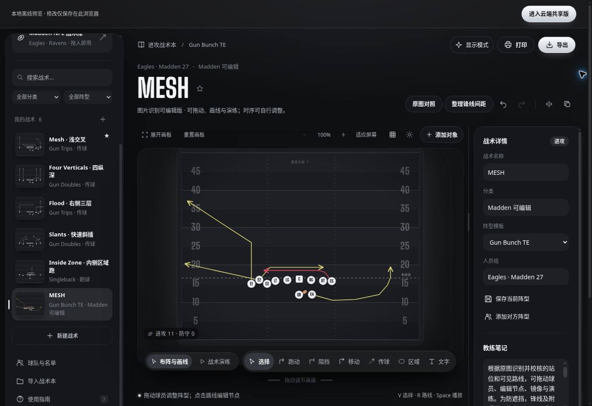

# User guide

[简体中文](USER_GUIDE.md) · **English** · [Back to README](../README.en.md)

Detailed instructions for editing, rehearsal, roster management, Madden imports and cloud collaboration. Start with the [no-sign-in demo](https://timpickle.github.io/playbook-studio-web/). For AI workflows, see the [AI feature guide](AI_GUIDE.en.md).

## Quick start

1. Open the [demo workspace](https://timpickle.github.io/playbook-studio-web/). Select **Edit playbook**, then choose a sample or select **新建战术** (New play).
2. Drag players into position. Use **添加对象** (Add objects) to add individual players or a complete **4–3 defensive formation**.
3. Select a player, choose **跑动** (Route) or press `R`, then click to place route points. Press `Enter` or select **完成** (Finish).
4. Switch to **战术演练** (Rehearsal) to play, pause, or scrub the timeline. The space bar also toggles playback.
5. Save in the current browser or export a JSON backup. For team sharing, sign in to the [cloud app](https://playbook-studio-tim.kind-wolf-6204.chatgpt.site/editor/) and create a playbook.

Eight teaching examples are included: Mesh, Four Verticals, Flood, Slants, Inside Zone, Cover 3, Nickel Blitz, and Field Goal. Formation tools support **5v5 flag football**, plus 6-, 7-, 8-, 9-, 11-, and 12-player formats and custom templates.

## 5v5 flag football

1. Select **New play**, set **Players per side** to **5v5 flag football**, and choose offense or defense.
2. Offense offers Spread, Trips and Bunch with C, QB, X, Y and Z. Defense offers Zone and Man with R, LCB, RCB, S and DB. The center can receive; templates do not create blocking assignments.
3. Use **Add objects → Add 5-player opponents**, or the properties panel, to create a 5-on-5 diagram. Routes, mirroring, rehearsal, exports and printing work as usual.
4. In **Player management → DEPTH CHART**, create a **Flag 5 Offense / Flag 5 Defense** group, assign starters, then apply matching positions from play properties.

The default player count affects new plays. Each play retains its own format. Changing the default does not trim existing plays, rosters or personnel groups; Madden imports retain their original 11 players. Saved formations are filtered by home-side count, and backups preserve format metadata.

This is a five-player diagram mode using the existing diagram grid, rather than a regulation field or officiating simulator for a particular event. Confirm rush distance, QB running, timing and other competition-specific rules. The non-contact, no-blocking defaults draw on [NFL FLAG rules](https://nflflag.com/coaches/flag-football-rules) and [USA Football's rules overview](https://usafootball.com/national-team/rules).

## Quick tour

On your first visit to the workspace home, play editor, AI analysis or player management, the tour highlights relevant modules and explains them beside the page. Choose **Next** or **Back** to browse, then **Get started** to finish the current page's tour. Automatic tours wait while you draw, rehearse, enter information or have a panel open.

Choose **Skip guide** or press `Esc` to leave at any time; automatic tours will then stop across all pages. To revisit a tour, choose **Quick tour** beside the language selector. Completing a tour only stops automatic guidance for that page; other pages can still show their tours on the first visit.

Completion and skip choices are stored in this browser's `localStorage`, independently of your account or shared playbook. Clearing site data or using another browser brings the tours back. The tour explains controls without changing plays, opening AI conversations or sending requests. On phones and iPads, it highlights visible playbook and properties menu buttons without opening drawers; try the controls after the tour.

## Keyboard shortcuts

| Action | Shortcut | Action | Shortcut |
|---|---|---|---|
| Select / move | `V` | Route | `R` |
| Block | `B` | Pre-snap motion | `M` |
| Pass | `P` | Coverage zone / text | `Z` / `T` |
| Play / pause | `Space` | Finish a route | `Enter` |
| Undo | `Ctrl / ⌘ + Z` | Redo | `Ctrl / ⌘ + Shift + Z` |
| Cancel / close | `Esc` | Delete selection | `Delete` |

## Game-day DEPTH CHART

1. Open **Player management** from the workspace. The **DEPTH CHART** opens in formation view. Choose offense, defense or special teams, then a personnel group. Switch from Spread to Bunch to see the receivers cluster on one side. Other templates include the 4-2-5 defense, kickoff, kickoff return, punt, punt return and field goal.
2. Select a position on the field to see its starter and backups. Choose your name under **Find player** to highlight each role you fill and its depth order. Use **Depth order** to compare positions or **Starters only** for a sideline roll call. Coaches can select **Adjust** to assign players, or choose **Start** beside a backup and save to swap the two players. Add new players in **Player roster**.
3. Copy a group for an upcoming opponent to keep its lineup and change just the positions you need. For example, select a returner for this week’s Punt Return group and add game-day instructions about when to make the substitution.
4. To use a lineup on the field, open **Edit playbook** from the workspace. In the details of an editable play, choose a personnel group from the same unit. Review the position matches and select **Apply matching starters**. For example, the QB on the DEPTH CHART matches a single QB marker on the play. Field positions, routes and rehearsal timing stay intact.

For a custom personnel group, choose **Group options → Edit group details → Field diagram template**. Matching positions appear on the field. Other positions are listed separately with their starters and backups.

## Visual walkthrough

### 1. Select a route and adjust its points and timing

Open **Mesh · 浅交叉** from the play list and click a route on the field. Drag its solid control points to change the path. The right panel switches from play details to **路线设置** (Route settings).

| Task | Control |
|---|---|
| Change a route's direction or depth | Drag the solid points on the selected route |
| Draw a new route | Select a player → choose **跑动** or press `R` → click turning points → press `Enter` |
| Change line appearance | Set the line type, color, end marker, or **平滑曲线** (Smooth curve) in the right panel |
| Adjust departure and arrival timing | Set **启动延迟** (Start delay) and **跑动时长** (Duration), in seconds, under **动画时序** |
| Undo a change | Use the undo button next to the title or press `Ctrl / ⌘ + Z` |

### 2. Scrub the timeline to inspect crossings and passes

Select **战术演练** (Rehearse) below the field, then press play or the space bar. Drag the timeline to inspect player positions at a specific moment. The toolbar also provides speed, loop, and reset controls.

This example is paused at **2.6 seconds**, showing the crossing routes and the ball in flight. Switch back to **布阵与画线** (Edit) to make changes. Set the passer, receiver, and pass timing under **足球移动** (Ball movement) in the right panel.

## Madden play library

Filter by team, formation group, specific formation, or English play name. Preview a play, then drag it into your playbook or select **＋ 加入** (Add); the button also works on mobile. Importing detects duplicates and supports undoing the most recent eligible addition.

### 3. Filter and import an editable play

1. Open **Madden NFL 战术库** on the left and choose a team, such as **Eagles**, **Ravens**, or **Rams**.
2. Enable **仅看可编辑** (Editable only), then choose a formation. The example below uses **Gun → Gun Bunch TE**.
3. Click an image to preview it. Select **＋ 加入可编辑版** (Add editable version), or drag the card into the dashed target on the left.
4. Close the library and continue editing. Next to the play title, **原图对照** (Original image) opens the source image, and **整理锋线间距** (Normalize line spacing) spreads crowded positions.

**MESH after importing:** the visible source routes are now selectable, editable objects. Continue adjusting player positions, route points, and rehearsal timing.

| Current Madden 27 catalog snapshot | Count |
|---|---:|
| Teams | 13 |
| Eagles entries | 620 |
| Ravens entries | 588 |
| Other 11 teams | 619 |
| **Total entries** | **1,827** |
| Editable entries | 1,056 |
| Image-only entries | 771 |
| Deduplicated source image files | 1,121 |

**Editable plays** let you move players, adjust visible routes, mirror the formation, and rehearse. Open the original image for comparison. Imports normalize offensive line spacing; existing editable plays also have an undoable **整理锋线间距** (Normalize line spacing) action.

**Image-only plays** can be favorited, annotated with notes, exported, and printed. Players inside the image cannot be moved, and its original routes cannot be played automatically. Editable reconstructions use only visible image content: off-image routes, real timing, and game decisions cannot be established from the image. Rehearsals use adjustable default timing.

[Catalog data](../web/data/huddle-catalog.json) · [Data notes](MADDEN_BATCH.md) · [Reconstruction records](MADDEN_REVIEW_2026-10-28-FINAL.md)

## Traditional and digital views

| View | Experience |
|---|---|
| **Traditional** | Enabled by default. Flat player markers, clear routes, and no decorative motion for everyday editing and reading |
| **Digital** | Optional on desktop. Low-profile metal pucks sit on a light or dark enamel field. Each puck shows the position on its face and the player color around its edge. Rehearsal highlights the release, catch and blocking contact points |

Switch views through **Display mode** in the upper right. A notched silver ring marks a selected puck. The line of scrimmage remains visible when you hide the grid.

Phones and iPads use the traditional view while retaining editing and rehearsal. When WebGL is unavailable, digital mode uses an interactive compatibility view. Reduced-motion preferences retain materials while stopping decorative movement.

The board supports **100–300% zoom**, fit-to-screen, and adjustable height. Desktop users can also change its width or expand the board. Display preferences stay on the current device and do not modify shared plays. See the [digital board guide](DIGITAL_BOARD.md).

## Cloud collaboration and storage

| Entry point | Access | Data and capabilities |
|---|---|---|
| [Cloud app](https://playbook-studio-tim.kind-wolf-6204.chatgpt.site/editor/) | An administrator-provided username and password, or the existing ChatGPT sign-in option | Cloud database, member permissions, access across devices, version history, and AI analysis |
| [Demo without sign-in](https://timpickle.github.io/playbook-studio-web/) | Choose one of three workspace cards | The browser stores plays, the roster and each group’s DEPTH CHART locally. The AI demo uses a sample matchup and your own API key |
| [Migration guide](https://timpickle.github.io/playbook-studio-web/landing.html) | Project links and migration tools | Opens the cloud app or local demo and exports data from the earlier browser-only version |

Sharing is scoped to a **playbook**, with independent membership for each one. Owners manage members and restore history; owners and editors can maintain the roster and each personnel group’s DEPTH CHART. Viewers can inspect starters and backups and search the roster, as well as inspect, rehearse, export and print plays. Under **成员与权限** (Members and permissions), an owner can create a member account or add an existing one. Email invitation links must be copied and sent manually.

Changes save automatically, and background polling retrieves other members' updates. Conflict handling retains the local draft and asks users to resolve changes that cannot be merged automatically. Owners can restore from the latest **20 saved versions**. Unsynced drafts support recovery on the original device; they do not guarantee offline sign-in or a cold start. Keep JSON backups of important playbooks.

To migrate from the earlier version, open the [migration guide](https://timpickle.github.io/playbook-studio-web/landing.html) on the **original device and browser**, export the local plays, then upload the JSON when creating or importing a cloud playbook. Browser storage is separate for the two domains. Uploading during playbook creation imports the full backup; **导入战术本** (Import playbook) inside the editor appends plays.

A separate team hierarchy, team owner accounts, and full multi-tenant team management remain planned. Current collaboration is implemented at the playbook level. See the [cloud architecture guide](CLOUD.md) and [multi-team roadmap](MULTI_TENANCY_ROADMAP.md).

## Scope and licensing

- Rehearsal is a teaching visualization, with no autonomous defensive AI or real game physics. AI matchup analysis is not a game-outcome predictor either.
- Cloud requests for a single playbook are limited to approximately **950 KB**. Exporting an image-only play as SVG still embeds the image; it does not turn it into editable vector routes. Calibrate printed pages and wristband sizes for your printer.
- Local data belongs to the current browser. Export before clearing browser data or switching devices; cloud saving is not a substitute for personal backups.
- The project independently implements features inspired by public examples. It does not connect to the Playmaker X backend, and compatibility with that product's file format has not been verified.
- Source code is available under the [MIT License](../LICENSE). Original Madden / Huddle.gg images, game assets, official runtime templates, and third-party components retain their respective terms. **The project's MIT license does not cover the Madden source images.** Catalog sources: [Eagles](https://huddle.gg/playbooks/eagles-off/) / [Ravens](https://huddle.gg/playbooks/ravens-off/).
