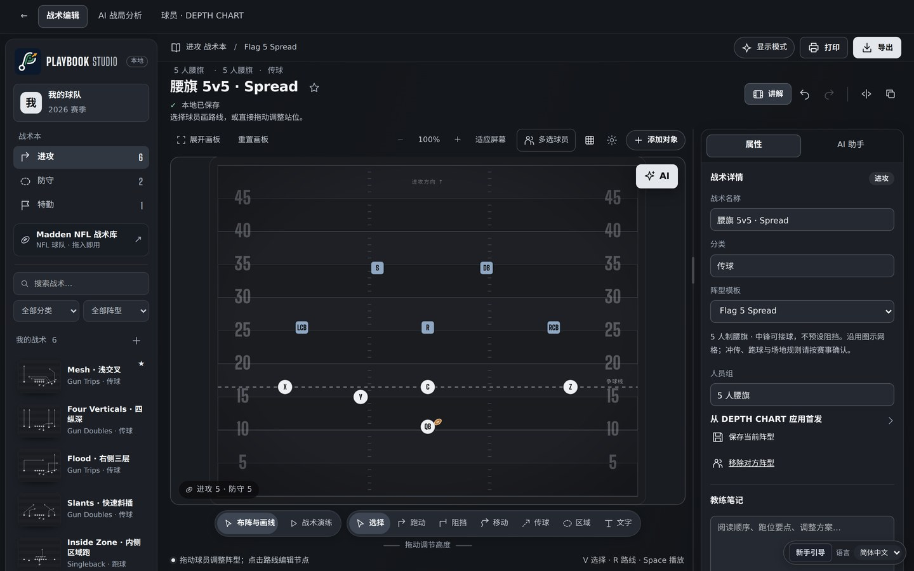
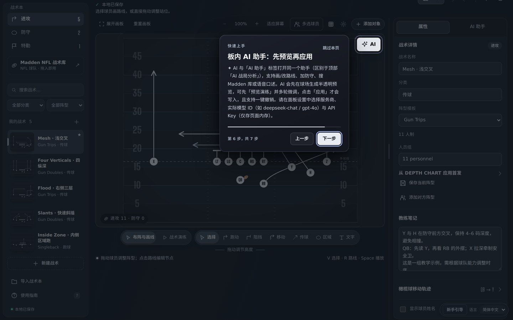
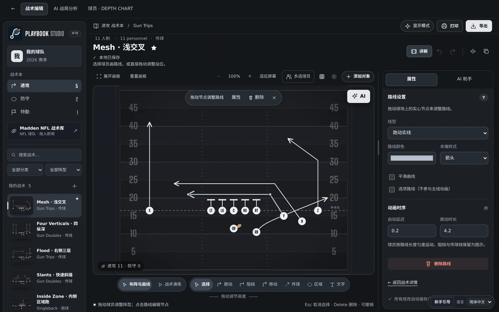
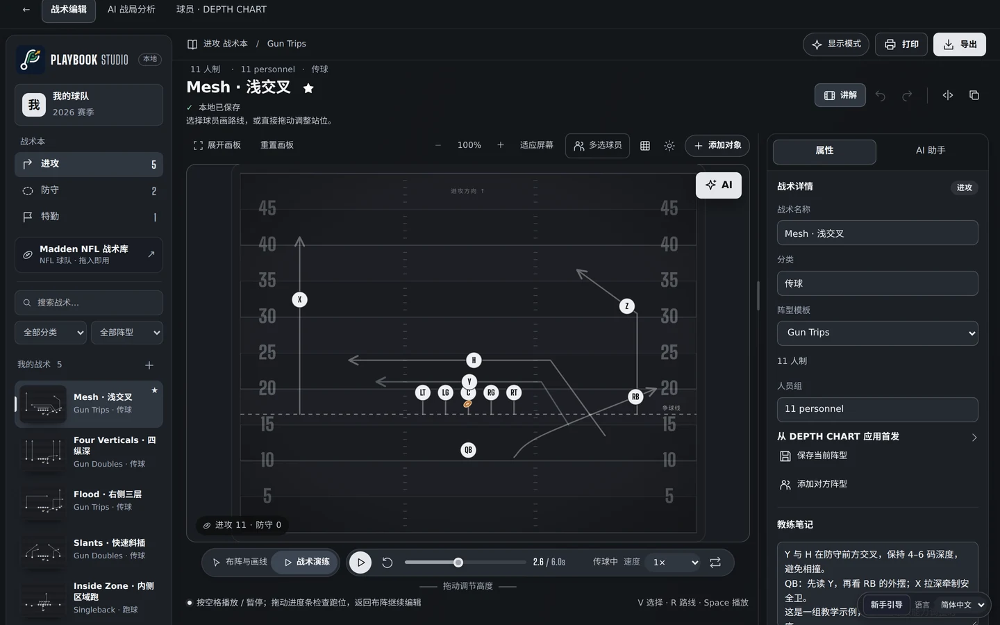
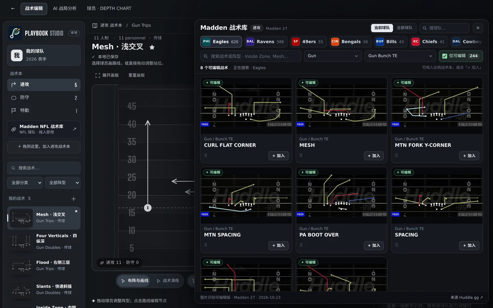
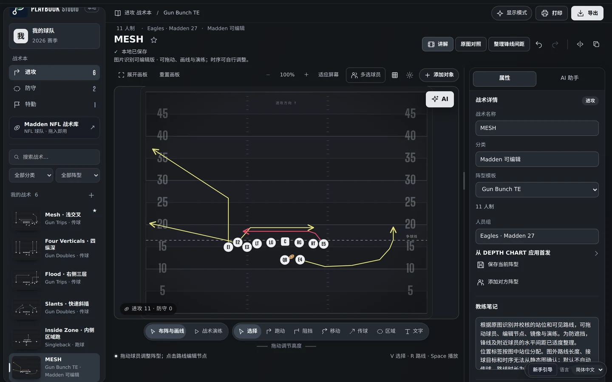

# 使用指南

**简体中文** · [English](USER_GUIDE.en.md) · [返回 README](../README.md)

本指南保留战术编辑、演练、球员管理、Madden 导入和云端协作的完整操作说明。先从[免登录工作台](https://playbook-studio-tim.kind-wolf-6204.chatgpt.site/editor/local)（或 [GitHub Pages 静态镜像](https://timpickle.github.io/playbook-studio-web/)）开始；AI 功能请看 [AI 功能详解](AI_GUIDE.md)。

## 快速开始

1. 打开[免登录演示工作台](https://playbook-studio-tim.kind-wolf-6204.chatgpt.site/editor/local)，进入 **「编辑战术本」**，选择内置示例或点击 **「新建战术」**。
2. 拖动球员调整站位。在 **「添加对象」** 中可以加入球员，也可以一次加入完整的 **4–3 防守阵型**。
3. 选中球员，选择 **「跑动」** 或按 `R`，依次点击路线点，按 `Enter` 或点击 **「完成」**。
4. 切换到 **「战术演练」**，使用工具栏播放、暂停或调整进度；按空格也可播放 / 暂停。
5. 保存到当前浏览器，或导出 JSON 备份。需要团队共享时，使用[云端版](https://playbook-studio-tim.kind-wolf-6204.chatgpt.site/editor/)登录并创建战术本。

内置 Mesh、Four Verticals、Flood、Slants、Inside Zone、Cover 3、Nickel Blitz 和 Field Goal 八个教学示例。阵型支持 **5 人制腰旗**以及 6、7、8、9、11、12 人制，并可另存自定义模板。

## 5 人制腰旗

1. 点击 **「新建战术」**，将 **「人数 / 每方」** 设为 **「5 人制腰旗」**，再选择进攻或防守。
2. 进攻可选 Spread、Trips、Bunch，位置为 C、QB、X、Y、Z；防守可选 Zone、Man，位置为 R、LCB、RCB、S、DB。中锋可以画接球路线，模板不自动添加阻挡。
3. 在 **「添加对象」→「添加 5 人对方阵型」** 或右侧属性中加入对手，形成 5 对 5；继续使用画线、镜像、演练、导出和打印。
4. 在 **「球员管理」→「DEPTH CHART」** 创建 **Flag 5 Offense / Flag 5 Defense** 人员组，安排首发后可在战术属性中按位置应用。

默认人数只决定后续新建战术；每张战术保留自己的制式。切换默认人数不会裁剪已有战术、名单或人员组，Madden 导入仍是原有 11 人战术。自定义阵型按本方人数筛选，备份会保留人数信息。

当前支持的是五人腰旗战术图，球场沿用现有图示网格，不是特定赛事的标准场地或裁判模拟。冲传距离、QB 跑球、计时等应按所属赛事规则确认。非接触、无阻挡的默认设计参考 [NFL FLAG 规则入口](https://nflflag.com/coaches/flag-football-rules) 与 [USA Football 规则说明](https://usafootball.com/national-team/rules)。

## 新手引导

首次进入战术编辑器、AI 战局分析或球员管理时，页面会逐步高亮相关模块并说明用途（工作台首页不再自动弹窗）。点击 **「下一步」** 或 **「上一步」** 浏览，最后点击 **「开始使用」** 完成当前页面的引导。正在画线、演练、填写内容或打开面板时，引导会等当前操作结束后再出现。

随时点击 **「跳过本页」** 或按 `Esc` 退出；跳过按页面独立记忆，仅停止当前页的自动弹窗，不影响其他首次访问的页面。需要重看时，桌面端可点击语言切换旁的 **「新手引导」**，移动端可从标题栏 **「⋯」** 溢出菜单点击 **「新手引导」**。

完成和跳过的选择通过 `localStorage` 保存在当前浏览器，不随账号或共享战术本同步；清除站点数据或换浏览器后会重新显示。引导仅作说明，不会修改战术、打开 AI 会话或提交请求。手机和 iPad 会指向实际可见的战术本、属性和更多菜单入口，不自动展开抽屉；结束引导后即可自行尝试。

## 常用快捷键

| 操作 | 快捷键 | 操作 | 快捷键 |
|---|---|---|---|
| 选择 / 移动 | `V` | 跑动路线 | `R` |
| 阻挡 | `B` | 开球前移动 | `M` |
| 传球线 | `P` | 防守区域 / 文字 | `Z` / `T` |
| 播放 / 暂停 | `Space` | 完成路线 | `Enter` |
| 撤销 | `Ctrl / ⌘ + Z` | 重做 | `Ctrl / ⌘ + Shift + Z` |
| 取消 / 关闭 | `Esc` | 删除选中对象 | `Delete` |

## 比赛日 DEPTH CHART

1. 在工作台打开 **「球员管理」**，**DEPTH CHART** 默认打开阵型图。先选进攻、防守或特勤，再选人员组。试着从 Spread 切到 Bunch，观察接球手在同一侧收拢。防守有 4-2-5，特勤包括开球、开球回攻、弃踢、弃踢回攻和射门。
2. 球员点选场上的位置即可查看该位置的首发和替补。也可以通过 **「查找球员」** 选自己的名字，查看自己在这个组担任的所有位置和顺位。切到 **「顺位表」** 可并排核对所有位置，**「只看首发」** 可快速点名。教练点 **「调整」** 后可以指派球员，或在替补旁点 **「换上首发」** 并保存。新增球员请到 **「球员名单」**。
3. 针对不同对手，可以复制现有人员组，保留整套排阵后调整个别位置。例如，为本周的 Punt Return 组选择回攻手，并在比赛日说明中写明换人时机。
4. 要把排好的首发放进战术图，从工作台进入 **「编辑战术本」**，在可编辑战术的详情中选择同组别的人员组。检查按位置标签匹配的预览后，点击 **「应用匹配的首发」**。例如，DEPTH CHART 中的 QB 会对应战术图上唯一的 QB，球员站位、路线与演练时序均保留。

自建人员组可在 **「管理人员组」→「编辑人员组」→「场地图模板」** 选择阵型。能够匹配的位置会出现在场上，其余位置单独列出，仍可查看完整顺位。

## 图解教程

### 1. 选中路线，调整节点与时序

从左侧打开 **Mesh · 浅交叉**，点击球场中的一条路线。路线上的实心节点可以拖动；右侧会从「战术详情」切换成「路线设置」。

| 想做什么 | 在哪里操作 |
|---|---|
| 改变跑位方向或深度 | 拖动选中路线的实心节点 |
| 新画一条路线 | 选中球员 → 点击「跑动」或按 `R` → 点击转折点 → 按 `Enter` 完成 |
| 调整线条样式 | 右侧设置线型、颜色、末端样式或「平滑曲线」 |
| 调整起跑与到达时间 | 右侧「动画时序」设置启动延迟、跑动时长，单位为秒 |
| 撤回刚才的修改 | 点击标题右侧的撤销按钮，或按 `Ctrl / ⌘ + Z` |

### 2. 拖动时间轴，检查交叉与传接球

点击球场下方的 **「战术演练」**，再点击播放或按空格。拖动进度条可以停在指定时刻，检查球员位置；工具栏还可调整速度、循环播放或重置动画。

图中停在 **2.6 秒**，可对照交叉路线与传球位置。需要继续改图时，切回 **「布阵与画线」**；传球人、接球人和传球时机在右侧 **「橄榄球移动轨迹」** 中设置。

## Madden 战术库

按球队、阵型大类、具体阵型或英文名称筛选，预览后拖入战术本，或点击 **「＋ 加入」**。手机端可直接使用加入按钮。导入支持去重，并提供最近一次符合条件的加入撤销。

### 3. 筛选并加入可编辑战术

1. 点击左侧 **「Madden NFL 战术库」**，选择球队，例如 **Eagles**、**Ravens** 或 **Rams**。
2. 勾选 **「仅看可编辑」**，再选择阵型。例如下图的 **Gun → Gun Bunch TE**。
3. 点击卡片图片可放大预览；点击 **「＋ 加入可编辑版」**，或把卡片拖到左侧虚线框。
4. 关闭战术库，在工作台继续编辑。标题旁的 **「原图对照」** 可查看来源图片，**「整理锋线间距」** 可调整拥挤的站位。

**加入后的 MESH**：原图中的路线已成为可选中、可修改的对象，可以继续调整球员、路线节点和演练时序。

| 当前 Madden 27 目录快照 | 数量 |
|---|---:|
| 球队数量 | 13 |
| Eagles 战术条目 | 620 |
| Ravens 战术条目 | 588 |
| 其他 11 支球队条目 | 619 |
| **条目总计** | **1,827** |
| 可编辑条目 | 1,056 |
| 仅原图条目 | 771 |
| 去重后的原图文件 | 1,121 |

**可编辑战术**可以移动球员、修改可见路线、镜像和演练，并打开原图对照。导入时会整理锋线间距；已有可编辑战术也可使用「整理锋线间距」，操作支持撤销。

**原图战术**可以收藏、记录笔记、导出和打印；图片中的球员不能直接移动，原版路线不能自动演练。可编辑版本依据图片可见内容重建，图外路线、真实时序和比赛决策无法由图片确定；演练使用可调整的默认时序。

[目录数据](../web/data/huddle-catalog.json) · [数据说明](MADDEN_BATCH.md) · [识别记录](MADDEN_REVIEW_2026-10-28-FINAL.md)

## 传统与数字化模式

| 模式 | 体验 |
|---|---|
| **传统模式** | 默认开启；平面棋子、清晰路线，关闭装饰动效，适合日常布阵与阅读 |
| **数字化模式** | 桌面可选。石墨或冷银色球场上使用哑光棋子，顶面显示位置缩写，侧缘显示球员颜色。选中球员后，其路线以原色加粗。演练中可跟随出手、接球和封堵接触点 |

从右上角 **「显示模式」** 切换。银色缺口环标出所选棋子。关闭网格后仍可通过争球线确认阵型位置。

手机和 iPad 固定使用传统模式，仍可编辑和演练。WebGL 不可用时，数字化模式切换到可操作的兼容视图。系统要求减少动态效果时保留材质、停止装饰运动。

画板支持 **100–300% 缩放**、适应屏幕与调整高度；桌面还可调整宽度或展开画板。显示偏好保存在当前设备，不修改共享战术。详见[数字化战术板说明](DIGITAL_BOARD.md)。

## 云端协作与数据保存

| 入口 | 使用方式 | 数据与能力 |
|---|---|---|
| [云端版](https://playbook-studio-tim.kind-wolf-6204.chatgpt.site/editor/) | 使用管理员分配的账号密码，或原有 ChatGPT 登录入口 | 云端数据库、成员权限、跨设备访问、历史版本与 AI 分析 |
| [无需登录演示](https://timpickle.github.io/playbook-studio-web/) | 从三张功能卡片选一项 | 战术、球员名单和各组的 DEPTH CHART 保存在当前浏览器。AI 演示使用预设攻防战术和自己的 API Key |
| [旧版迁移指南](https://timpickle.github.io/playbook-studio-web/landing.html) | 项目入口与旧版迁移 | 链接云端版、导出旧浏览器数据并打开本地演示 |

云端以**战术本**为共享单位，每本的成员权限独立：管理员管理成员与恢复历史，管理员和编辑者可维护本册的球员名单、人员组和 DEPTH CHART，只读成员可查看各组首发和替补、搜索名单，以及查看、演练、导出和打印战术。在「成员与权限」中可以新建成员账号或加入已有账号；邮箱邀请链接需自行复制发送。

修改自动保存，成员更新通过后台轮询同步。冲突处理会保留本机草稿，并让用户确认无法自动合并的内容；管理员可以从最近 **20 个已保存版本**恢复。断网草稿用于原设备恢复，不保证离线重新登录或冷启动。重要战术建议另存 JSON 备份。

旧版迁移需在**原设备、原浏览器**打开[旧版迁移指南](https://timpickle.github.io/playbook-studio-web/landing.html)，导出本地战术，再在云端新建或导入时上传 JSON。两个域名的浏览器存储互相隔离；新建时上传为完整导入，编辑器内的「导入战术本」为追加导入。

独立球队层级、球队主账号和完整多租户管理仍在规划中，当前已实现的是战术本级协作。详见[云端技术说明](CLOUD.md)与[多球队路线图](MULTI_TENANCY_ROADMAP.md)。

## 使用边界与许可

- 战术演练用于教学图示，不包含自主防守 AI 或真实比赛物理模拟；AI 对位分析也不是比赛预测器。
- 云端单份战术本请求上限约 **950 KB**。原图条目即使导出 SVG，内部仍是图片，不会自动转换成可编辑矢量路线。实际打印与腕带尺寸需按设备校准。
- 本地数据属于当前浏览器，清除浏览器数据或更换设备前请先导出；云端保存不替代个人备份。
- 项目参考公开功能独立实现，不接入 Playmaker X 后端，也未验证其文件格式兼容性。
- 源代码采用 [MIT License](../LICENSE)。Madden / Huddle.gg 原始图片、游戏素材、官方运行时模板及第三方组件保留各自许可；**Madden 原图不适用本项目的 MIT 许可证**。目录来源：[Eagles](https://huddle.gg/playbooks/eagles-off/) / [Ravens](https://huddle.gg/playbooks/ravens-off/)。
