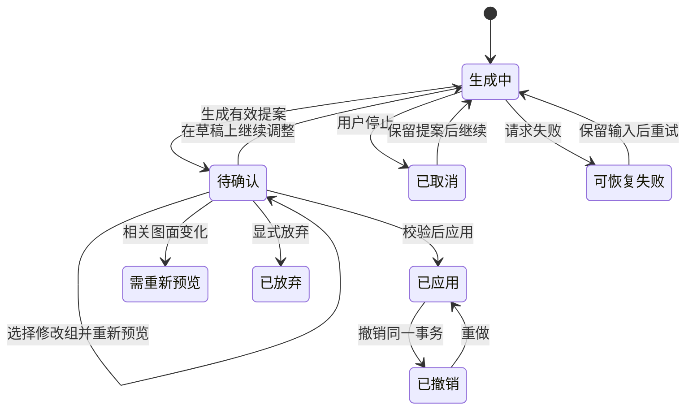
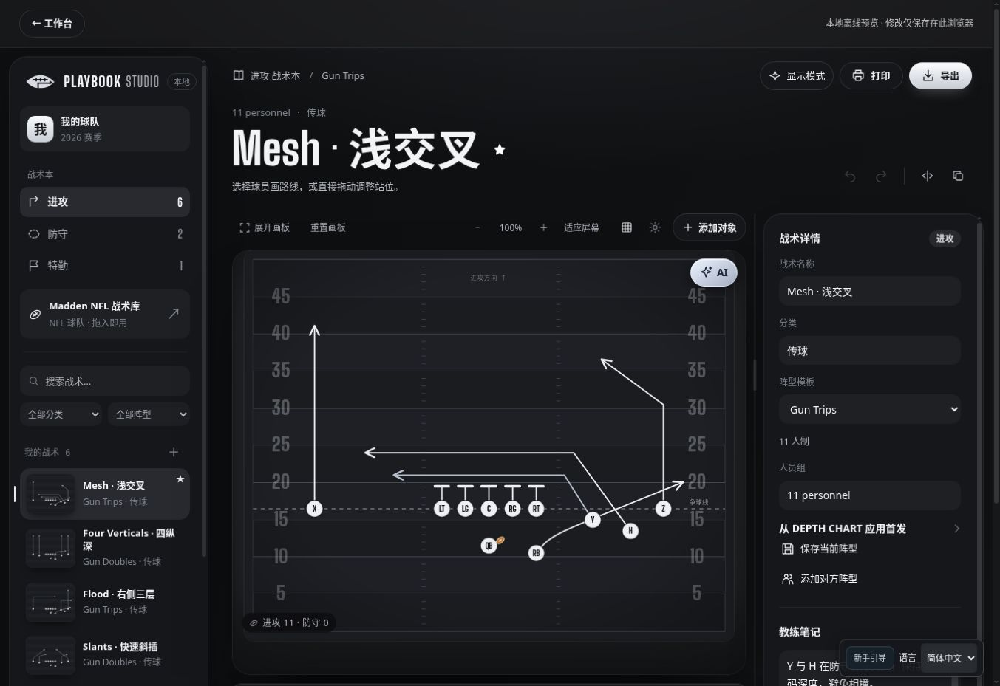
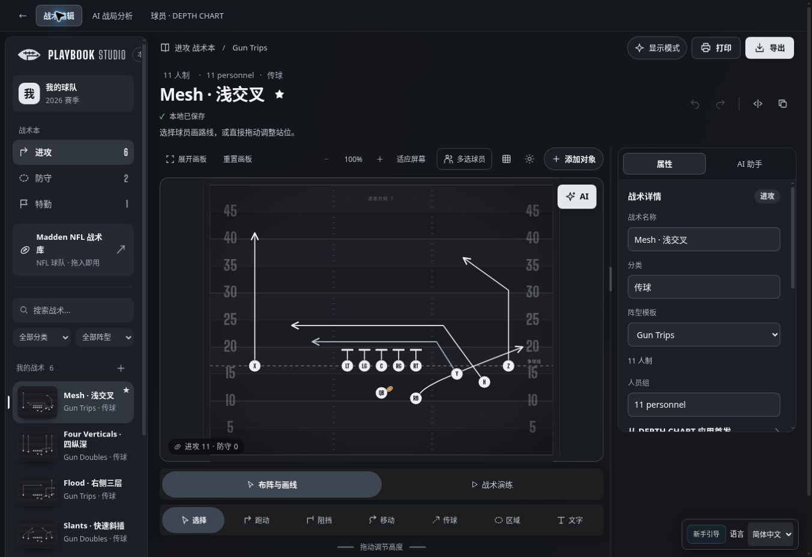
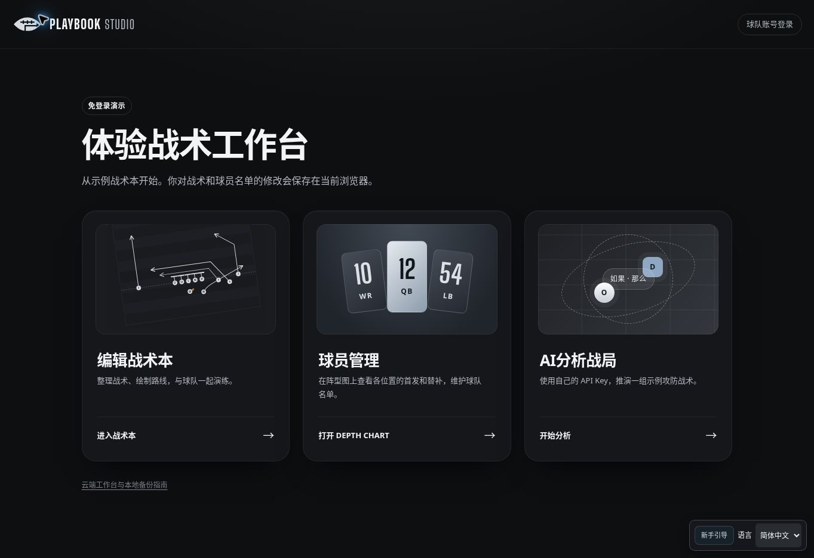
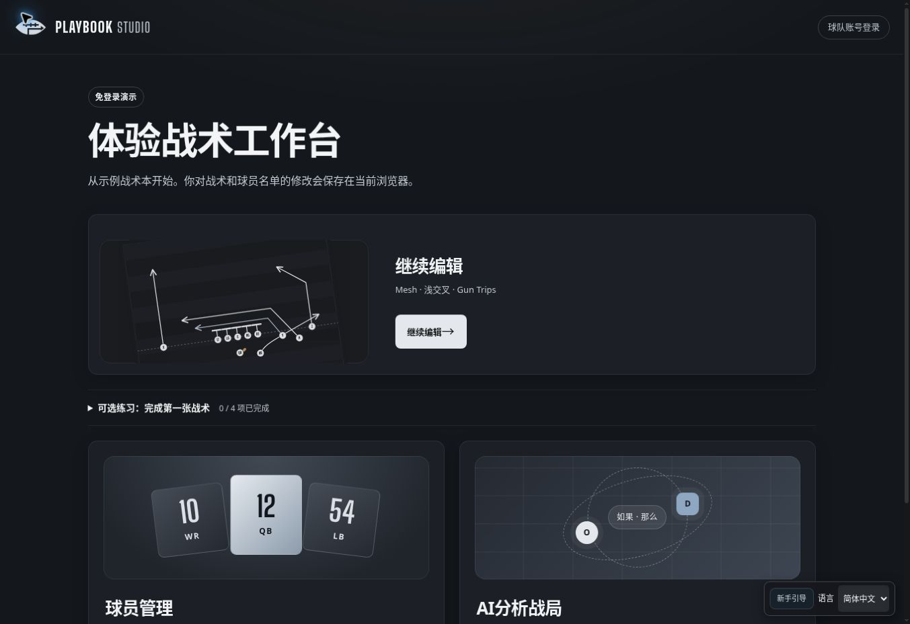
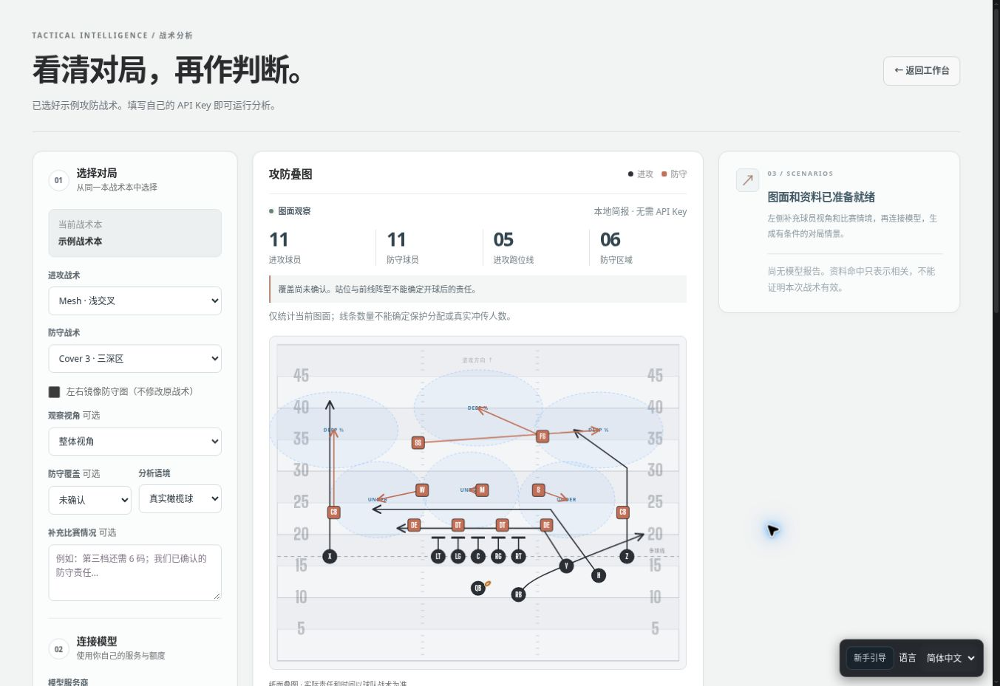
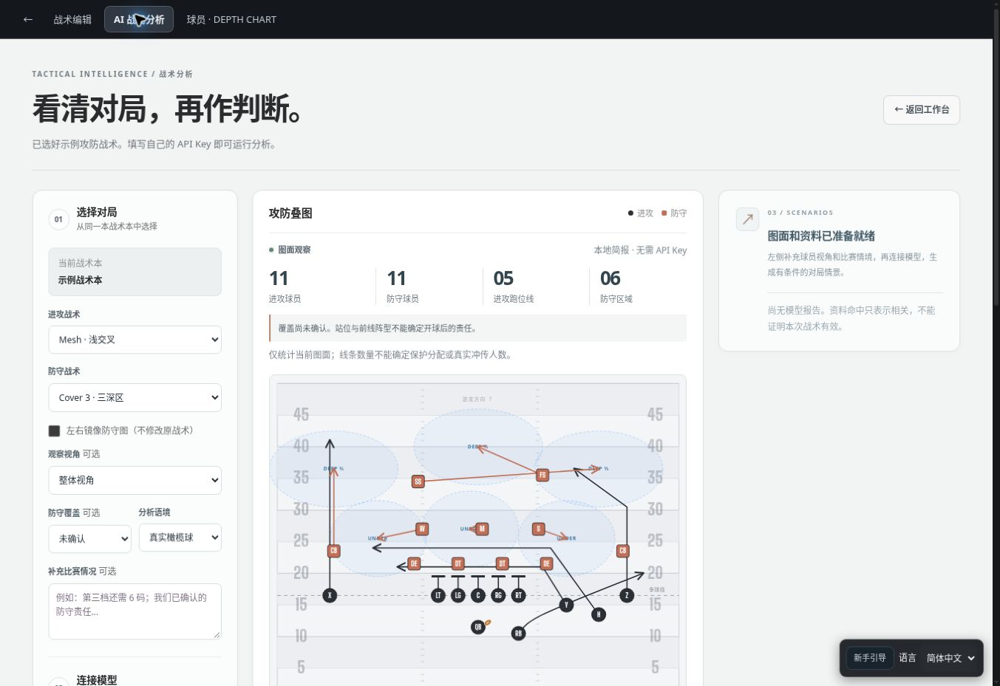

# Playbook Studio 全局 UX 改造报告

本轮围绕战术编辑、AI 提案和跨模块操作的连续性实施改造。审查与实现基于 `feature/ux-workflow-redesign`，开发基线为 `36c9be7`（包含 PR #49 的连续 AI 草稿基础）。本报告记录交付行为、代码边界和验证证据；最终测试数量、浏览器检查及发布结果统一记录在文末。

先阅读 [统一交互与设计规范](UX_DESIGN_SYSTEM.md)。使用方法见 [AI 功能指南](AI_GUIDE.md)、[使用指南](USER_GUIDE.md)；已有按需加载和原生弹窗优化见 [Web 平台优化](WEB_PLATFORM_OPTIMIZATION.md)。

## 1. 本轮结果

- 战术编辑器保持主要工作区；属性与 AI 在桌面共用一个任务区，保留浮动方式，触屏使用可收起面板。
- 连续 AI 修改使用暂存提案；对话历史、操作状态、目标澄清、分组选择和撤销回执相互对应。
- 多球员选择、整组移动和删除共用领域命令；一次操作对应一次撤销。
- 保存状态保持可见；人员调整不再通过清空整个编辑器历史来保护数据。
- 分析报告、球员管理与战术库保留可恢复的上下文；模块之间可直接切换。
- 统一语义 tokens、焦点、错误与功能动效，保留现有静态／完整部署、5 人腰旗和 11 人制边界。

这些结果不等于已验证所有真实模型对话，也不等于已完成 iOS 真机验收。具体证据和未验证项见第 7–9 节。

## 2. 原问题与计划编号对应

编号对应审查阶段的问题清单。P0 表示影响修改可靠性，P1 表示明显影响任务完成或连续性，P2 表示一致性和效率问题。浏览器外观假设与真实模型问题不能仅靠源码归因。

| 编号 | 优先级 | 原问题 | 本轮交付与边界 |
| --- | --- | --- | --- |
| A01 / A02 | P0 | 追问、收起助手与放弃提案混在一起 | 承接 PR #49 的累积草稿；进一步显示独立提案、对话和执行状态。收起不等于应用或拒绝，显式放弃才取消暂存修改 |
| A03 | P0 排查项 | 用户报告已应用修改在后续对话中丢失 | 模拟模型集成链路验证累积、应用、撤销和后续编辑不回退；真实服务商的原始故障对话未实测，不能认定所有丢失现象已归为同一根因 |
| A04 | P1 | 上下文过短、用户看不见之前的对话 | 按战术隔离可见历史；模型上下文保留活动草稿、最近记录和有效目标，删除或过期对象不作为定位依据。会话内存不是永久聊天存档 |
| A05 | P1 | 撤销后对话仍称修改已应用 | 编辑事务有标识和名称；助手根据同一事务回执更新已应用、已撤销、已重做状态 |
| A06 | P1 | 无效输出、目标歧义和对象变化被混成一句报错 | 显示执行阶段与失败信息，保留输入和有效提案；目标不明确时提供候选定位，失败可重试，过期提案重新预览 |
| A07 | P1 / P2 | 分析完成后无法连续追问或转入编辑 | 追问携带报告、对局版本和当前情景；建议转入编辑器助手的待发送指令，仍需模型生成、核对并应用提案 |
| E01 | P1 | 修改球员名单会清空战术撤销历史 | 历史快照对人员、DEPTH CHART 与相关团队设置更新基线；撤销图面修改不恢复旧姓名、已删除绑定或旧顺位。团队远端版本变化仍有明确历史重置边界 |
| E02 | P1 | 只能逐个选中和移动球员 | Shift 点选与触屏多选；整组移动、精确偏移和删除，关联路线及引用一起处理。首批范围为球员组，不包含混合对象框选、旋转和缩放 |
| E03 | P1 | 紧凑布局中保存状态藏在战术抽屉 | 标题／工作区保留已保存、保存中、离线、失败或只读状态；失败提供重试和导出备份 |
| E04 | P1 | 文字标注可聚焦，却不能按键激活 | 标注与球员、路线、区域采用一致的 Enter／Space 选择语义，避免误触演练快捷键 |
| M01 | P1 | SVG 缩小时实际触摸命中区一起缩小 | 按实际投影比例换算透明命中区；密集球员显示候选选择，保留触摸取消回滚。真实设备误触率尚未测量 |
| W01 | P1 | 离开球员管理后返回会重置位置 | 恢复 tab、人员组、攻防单元、视图、筛选及滚动；按战术本隔离，失效 ID 安全回退 |
| W02 | P1 | 改输入、新请求失败会直接丢掉分析报告 | 保留报告与原图快照；战术条件改变时标注旧版本，新请求失败或取消仍可回看旧结果 |
| W03 | P1 / P2 | 编辑、球员和分析主要经首页跳转 | 常驻轻量模块导航；切换保留当前战术与可恢复状态，未完成表单或草稿有明确处理路径 |
| L01 | P1 | Madden 搜索范围不清楚，局限于当前球队 | 明示当前／全部球队；支持球队、城市和缩写查找，跨队结果带来源；恢复筛选、分页和滚动，添加失败可直接重试 |
| D01 | P2 | 多层 CSS 重复定义颜色和控件规则 | `theme.css` 作为语义 token 来源；移除旧样式中的重复 palette，领域样式消费统一变量。仍保留必要旧变量映射与领域 CSS，未宣称全部历史样式已消除 |
| D02 | P2 | 传统／数字渲染与所有动效开关耦合 | 球场渲染、装饰与功能反馈分离；传统模式仍有必要反馈，系统减少动态偏好独立生效 |
| D03 | P2 | 焦点、按钮和提示的规则不一致 | 统一 focus ring、状态与层级 tokens；整理共享任务区、就近错误、可撤销反馈和危险操作确认 |
| N01 | P2 | 认识控件的引导未帮助完成首个任务 | 首页编辑器成为主入口；增加默认折叠、可选的首张战术练习清单，只记录实际操作，原有跳过和重看保留 |

## 3. 架构和设计决策

### 3.1 延续现有编辑引擎

前端主体仍为原生 JavaScript ES modules、SVG 球场与数字球场适配；React／Next 宿主没有被用于重写整个编辑器。本轮复用共享命令、冲突校验、局部 DOM 更新、原生 dialog 和已有路线形变，没有引入新的 UI 框架。

| 状态 | 所属与用途 | 不应混用的边界 |
| --- | --- | --- |
| 战术数据 | 球员、路线、区域、文字、战术本与人员关系 | 面板打开、筛选和选择不写入共享战术或 JSON 备份 |
| 编辑事务 | 真实操作名称、事务 ID、作用战术与撤销／重做回执 | Toast 文案不能决定某项操作是否可撤销 |
| UI 会话 | 当前模块、图面选择、列表筛选、人员视图和滚动 | 按战术本隔离；当前主要保证页面会话内恢复，不能当成跨设备同步 |
| AI 对话 | 按战术组织的指令、结果、目标和状态 | 不把“说过已应用”当成画板事实；图面及事务状态必须重新核对 |
| 暂存提案 | 基线、修改步骤、预览和依赖 | 预览与正式数据分开；收起、取消网络请求和拒绝提案是不同动作 |
| 模型连接 | 两个 AI 入口共享连接偏好 | 非密钥配置可在本机保留；Key 仅当前页面内存，不进入战术、导出或日志 |

相关实现：[`editor-history.js`](../web/editor-history.js)、[`workspace-ui.js`](../web/workspace-ui.js)、[`model-connection.js`](../web/model-connection.js)、[`assistant-session.js`](../web/assistant-session.js)。

### 3.2 先处理状态，再调整布局

实施按“基线与规范 → 状态／事务 → 编辑与触控 → 模块连续性 → 统一视觉与动效 → 综合回归”推进。每部分都有对应行为测试，而非一次换肤后只检查构建。

属性和 AI 共用任务区域，避免同时增加多个侧栏挤压画板。桌面允许切回浮动面板；触屏保留底部操作和收起方式。面板切换只改变工作视图，不作为保存或放弃修改的隐式指令。

### 3.3 事务范围与人员同步

编辑器继续使用经过验证的快照历史，并附加事务元数据。人员更新时重建历史中的人员基线和标记绑定，避免删除“清空历史”后让旧快照复活已删除成员。人员顺位的快速调整有自身的受控撤回；发生后续修改、删除或权限变化时不覆盖新数据。

这是一项增量调整，没有在 UI 任务中引入完整事件溯源系统。远端战术版本替换旧版本时，较早图面历史仍可能重置，并给出说明。

### 3.4 修改页面与组件

| 页面／底层 | 主要文件 | 责任 |
| --- | --- | --- |
| 战术编辑 | `app.js`、`field.js`、`editor-selection.js`、`player-group.js` | 工作区、选择、命中、组命令和编辑反馈 |
| 悬浮／停靠助手 | `board-assistant.js/.css`、`assistant-session.js` | 对话、提案、执行状态和修改组 |
| AI 分析 | `ai-matchup.js/.css`、`matchup-model.js`、`server/matchup-agent.mjs` | 报告原图、版本、追问和建议交接 |
| 球员与 DEPTH CHART | `roster.js`、`depth-chart.js`、`personnel-groups.js` | 模块会话、快速调序、确认和撤回 |
| 战术库 | `madden.js/.css`、`madden-model.js` | 范围、球队查找、筛选恢复和导入反馈 |
| 首页与导航 | `studio-home.js/.css`、`workspace-ui.js`、`guest-workspace.js`、`cloud.js` | 编辑主入口、任务清单和直接模块切换 |
| 共享视觉 | `theme.css`、`component-layout.css`、`motion.js`、`effects.js` | tokens、任务区、焦点和动效偏好 |

路径未特别标出时均位于 `web/`。模块继续沿用原有存储和 API 路径。

## 4. 核心流程变化

### 4.1 连续 AI 修改

收起助手不改变待确认状态。连续多轮可以在同一草稿上累积；“再深两码”等省略指令使用仍有效的会话目标和当前选择。存在多个可能对象时显示候选，而不是直接修改猜测的球员。

多个修改轮次可以按组选择，先更新预览再应用；如果后一步依赖被排除的前一步，重新构建失败并解释依赖，不提交残缺修改。这里的局部选择单位是整轮修改组，不是任意勾选原始工具操作。切换战术后按独立会话恢复历史，旧提案需重新预览，不带到另一张图直接写入。

### 4.2 选中、移动和撤销

桌面可用 Shift 点选；触屏可开启多选后逐个增减球员，再完成选择。选中数量、可执行操作和取消入口可见。整组平移保留相对站位并统一限制边界；附属路线和相关球权／阻挡引用使用共享领域逻辑处理，手动和 AI 行为一致。

密集阵线不通过扩大可见棋子来解决命中问题。透明命中区跟随投影换算；多个候选可明确选择。文字标注也支持键盘激活。保留原有指针丢失、触摸取消和窗口失焦时的回滚机制。

### 4.3 分析、追问和编辑衔接

已完成报告保留对局条件与原图快照。新分析失败或取消不清空旧报告；图面改变后报告标注过期，可回看原图，但不能把旧证据高亮误挂到新对象上。

追问携带相同对局、当前情景和上次有效回答。需要采用建议时，将建议带到正确进攻战术的助手输入区；用户发送后才生成可确认提案。该入口不把分析自然语言直接当作已经完成的图面操作，也不绕过编辑权限、版本检查或应用确认。

### 4.4 人员、战术库和新手路径

DEPTH CHART 提供就近晋升首发、顺位上移／下移及撤回，不必为每次调序打开弹窗；现有详情和编辑表单继续可用。删除球员和位置采用明确确认，取消时保留正在编辑的表单。

Madden 搜索明确当前球队和全部球队；球队也能单独搜索，且不会清掉已经输入的战术关键词。添加期间新筛选结果同样保持禁用，关闭会取消旧导入任务；成功反馈保留查看和撤销，失败有直接重试。

首页将继续当前战术作为主要入口。可选练习清单记录新建、完成路线、播放演练及导出完整 JSON 备份四类真实动作，不把示例、单图下载或引导播放当成完成。清单默认折叠，不替用户编辑正式战术；只读用户不被引向需要编辑权限的练习。

## 5. 统一视觉与动效

完整规则以 [设计系统](UX_DESIGN_SYSTEM.md) 为准：银灰色控制区、清晰文字层级、语义状态色、统一间距和焦点。进攻／防守、原图／提案／已应用不只用颜色表达；关键状态有文字、标签或描边。

| 交互 | 本轮处理 |
| --- | --- |
| 控件与焦点 | 使用共享语义 tokens；可执行、进行中、禁用、错误和危险操作保持区分 |
| 面板与模块 | 短促状态反馈，避免整体工作区重复入场；任务切换保留可恢复内容 |
| 拖动 | 指针实时跟随，不增加延迟；松手后一次校验与提交 |
| AI 路线变化 | 继续使用领域几何形变；提案状态和应用结果有文字说明 |
| 传统模式 | 关闭重装饰与材质开销，仍保留必要功能反馈 |
| 减少动态 | `prefers-reduced-motion` 禁止不必要位移及连续装饰，保留结果和状态说明 |

本轮没有把粒子、发光或更多动画作为完成标准，也没有为 UI 改造改变战术坐标、人数制或演练领域规则。

## 6. 改造前后截图

截图用于比较信息层级、工作区组织和布局，不证明模型输出或真实触摸操作正确。截图版本、视口及实际浏览器检查以最终集成记录为准。

| 页面 | 改造前 | 改造后 |
| --- | --- | --- |
| 战术编辑器 |  |  |
| 首页 |  |  |
| AI 分析 |  |  |

## 7. 验证矩阵与自动化证据

以下矩阵列出验收范围，不表示每个真实设备或浏览器项目均已完成。实际执行结果以第 10 节为准。

| 层级 | 主要覆盖 | 能证明什么／不能证明什么 |
| --- | --- | --- |
| 领域与状态测试 | 组合移动／删除、引用清理、事务、人员基线、对话与提案生命周期 | 可验证状态和几何一致性；不验证实际屏幕布局 |
| Happy DOM 集成 | 连续提案、取消／重试、组选择、导航、表单／焦点、Madden 异步取消、任务进度、报告恢复 | 可运行真实模块与事件；没有浏览器排版或真实触摸引擎 |
| 桌面浏览器 | 1440×900、1280×720 的画板／任务区、按钮、遮挡、焦点和弹窗 | 实际执行范围见最终记录；截图不能代替操作断言 |
| 触屏视口模拟 | iPad 横／竖屏、iPhone 390×844／375×667，安全区与面板 | 仅能验证模拟视口；不等于 iOS Safari、软键盘或手指触控验收 |
| 真实外部模型 | 三协议的服务商真实调用及多轮省略主语理解 | 本轮未执行；模拟响应验证协议和宿主流程，不证明自然语言质量 |
| 真机 | iPhone／iPad Safari、中文输入法、旋转、系统中断、触摸命中率 | 本轮未执行，保留人工验收项 |

专项测试入口：

- [AI 会话状态](../tests/assistant-session.test.mjs) · [连续草稿集成](../tests/assistant-continuity-ui.test.mjs)
- [选择模型](../tests/editor-selection.test.mjs) · [多选界面](../tests/editor-selection-ui.test.mjs) · [共享组命令](../tests/editor-group-commands.test.mjs)
- [屏幕命中区](../tests/field-hit-targets.test.mjs) · [人员与图面撤销](../tests/editor-history-domain.test.mjs)
- [报告连续性](../tests/matchup-continuity.test.mjs) · [共享模型连接](../tests/model-connection.test.mjs)
- [人员工作流](../tests/roster-workflow.test.mjs) · [Madden 工作流](../tests/madden-workflow-ui.test.mjs)
- [导航与输入焦点](../tests/workspace-navigation-ui.test.mjs) · [首个任务集成](../tests/home-workflow-integration.test.mjs) · [功能动效](../tests/ux-motion.test.mjs)

测试还需覆盖中英文、编辑／只读、本机静态／完整账号版、5 人腰旗／11 人、传统／数字与减少动态效果。最终通过数、构建、类型检查和浏览器结果使用同一集成版本记录，不累计多次运行当作额外测试数量。

## 8. 性能测量边界

本轮保留此前 Madden 几何按需加载、局部 DOM 渲染、缩略图缓存与数字球场休眠。UI 会话和选择状态不进入共享战术，未增加新的前端框架依赖。

本轮没有完成同硬件、同网络下的 LCP、INP、加载耗时、内存或帧率前后量测，因此不声称具体性能提升百分比。此前“首屏静态源码减少约 46.6%”属于 [上一轮平台优化](WEB_PLATFORM_OPTIMIZATION.md)，不能作为这次 UX 改造的收益。功能动效时长属于设计参数，不是运行帧率测量结果。

后续性能检查应固定数据集、语言、视口、设备和构建，分别测量密集球员拖动、多选、提案形变与大报告展示；不能通过减少业务数据、忽略输入或延迟提交来取得更好数字。

## 9. 保留边界与后续建议

1. **真实模型理解仍需评测。** 用显式目标、代词、多人歧义、应用后追问及撤销后追问分别评测；记录错误对象率与修改保持情况，不只看模型回复是否流畅。
2. **iOS 真机验收仍需完成。** 重点为密集 OL／DL 选择、画线、软键盘、横竖屏、系统手势与取消恢复。屏幕投影测试只能证明命中区计算，不能给出手指成功率。
3. **多选有明确首批范围。** 当前为球员组移动／删除；复杂混合对象框选和通用变换未在本轮实现。手机和 iPad 仍使用传统模式，没有承诺移动 3D。
4. **上下文不是无限期存档。** 页面刷新、退出账号和权限变化有清理边界；跨设备长期会话、团队共享对话不属于本轮实现。
5. **报告建议不自动应用。** 报告只负责辅助理解和形成后续指令；几何修改由编辑器共享命令、校验和提案确认承担。
6. **发布状态独立核查。** 本地自动化和构建通过不能证明线上已经更新；最终记录应分别写明仓库、站点和 GitHub Pages 的状态。

## 10. 最终集成记录

集成日期：2026-11-16。源码基线 `36c9be7`，改造分支 `feature/ux-workflow-redesign`。

| 核验 | 最终结果 | 证据与范围 |
| --- | --- | --- |
| JavaScript 全量回归 | 754 通过，0 失败、0 跳过 | [`npm test` 日志](assets/ux/tests.txt)，包含真实宿主 DOM、领域命令、连续草稿、局部应用、导航焦点和模块恢复 |
| PDF 资料导入回归 | 4 通过 | [Python unittest 日志](assets/ux/pdf-tests.txt) |
| 语法／类型 | `npm run check`、`npm run typecheck` 通过 | 原有检查与 TypeScript `--noEmit --incremental false` |
| 生产构建 | 通过 | [生产构建日志](assets/ux/build.txt)，使用现有 Sites 构建流程 |
| 桌面真实浏览器 | 已检查 | 1363 × 936 CSS 视口；分析页返回编辑器后球场高 478px，工具栏下缘约 900px；模块导航、助手停靠／收起和无横向溢出 |
| 窄布局真实浏览器 | 已检查，有边界 | 桌面 Chromium 200%／300% 缩放形成 676 × 468、451 × 312 CSS 视口；确认紧凑导航、助手输入聚焦、关闭恢复和无横向溢出。不是移动设备模拟，也不是触摸或 Safari 验收 |
| 精确视口浏览器矩阵 | 8 项未运行 | [矩阵记录](assets/ux/qa-matrix.json)：隔离 Chromium 启动所需 singleton socket 被执行环境拒绝；0 通过、0 产品失败，不能记为通过 |
| 真实模型与 iOS | 未验证 | 模型协议使用脚本 fixture；未发送外部模型请求，未取得 iPad／iPhone 真机 |

机器可读记录见 [`validation.json`](assets/ux/validation.json)。最终两项导航回归还覆盖了“导航必须位于所有工作面之前”和“先隐藏上一模块再测量编辑器”，防止分析内容影响战术板默认高度。所有统计来自一次最终全量运行，未把各阶段重复测试累加。

关键页面前后截图见第 7 节；额外证据为[助手停靠](assets/ux/assistant-after.jpg)和[窄布局](assets/ux/narrow-after.jpg)。截图均为运行中页面直接捕获。

仓库合并、Sites 生产发布和 GitHub Pages 工作流状态在最终交付中分别报告。本记录不把本地构建成功等同于线上发布成功，也不把缩放布局或 DOM 测试等同于 iOS 真机测试。
