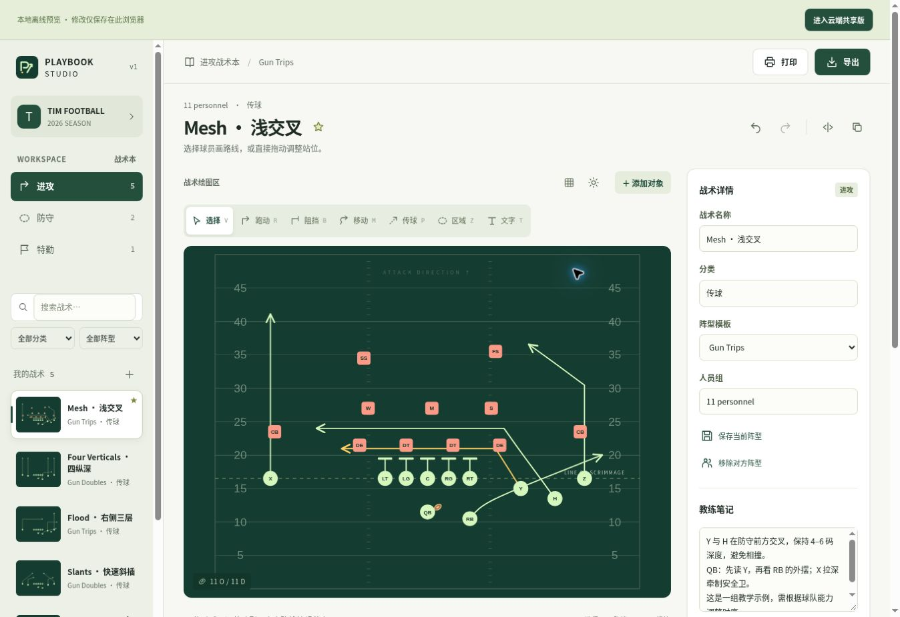

# 验证记录

日期：2026-10-13。环境：Node.js 24.19.0，Happy DOM 20.8.4。

## v3.1 核心交互修正

日期：2026-10-18。语法检查、类型检查、生产构建通过；**64 项测试通过**。新增真实 DOM 行为检查：拖动期间 SVG / 球员节点保持相同、批量指针移动后松手才提交、实时草稿不写入存储、退一步 / 重复点工具保留草稿、浮动按钮点击、输入面板节点稳定、暂停 / 拖时间轴保持球员节点、返回布阵不修改战术，以及主路线与选项的唯一性。

管理预览内已实际完成：选中 X → 画路线 → 点击落点 → 退一步 → 完成；拖动 X 后其位置和关联路线同步更新；移动鼠标生成下一段虚线预览；添加完整 4–3 防守；播放与返回布阵。390px 宽 iframe 已检查七种工具与浮动绘图操作，不等同于真实手机触摸或帧率测试。没有宣称跨设备固定帧率。

## v3 交互与账号改版

日期：2026-10-18。`npm run check`、`npm run typecheck` 与生产构建通过。`npm test`：**60 passed / 0 failed**。

新增独立账号的真实 SQL 测试：一次性初始化、密码与会话摘要、Secure / HttpOnly Cookie、角色读取与只读写入限制、登录限流、过期会话、修改密码、旧会话撤销、管理员重置范围、复用现有战术本，以及已有账号加入不同战术本时的权限隔离。登录 DOM 测试覆盖空表单、重复提交阻止、忙碌状态与服务器错误提示。编辑器测试增加未完成路线确认、阵型替换确认 / 取消 / 撤销和空名称内联提示。

浏览器核验使用官方管理的内部预览。已检查桌面登录页与编辑器；手机 390 × 844 通过真实浏览器内固定宽度 iframe 检查，核验登录、工具栏、球场与演练控件排版。实际点击「添加对象」中的 4–3 防守后，新增 11 名防守球员，保留进攻，并显示成功提示及可撤销状态。

真实设备触摸、打印纸张与所有浏览器组合未逐一人工验证。账号密码流程使用 API / SQL / DOM 测试，浏览器内不自动填写或读取真实密码。

生产 API 已逐个验证 5 个正式账号：均可登录同一个共享战术本，管理员 / 编辑者 / 只读角色正确，成员管理受限，无效编辑请求不改变战术内容，退出后会话立即失效。初始密码不写入此记录。

## v2 共享云端版

`npm run check`：8 个 JavaScript 模块语法检查通过。`npm run typecheck`：TypeScript 检查通过。官方 Sites / Vinext 生产构建通过。

`npm test`：**47 passed / 0 failed / 0 skipped**。保留原 30 项编辑器测试，新增 7 项真实 SQLite / API 集成测试、6 项协作同步测试、4 项云端 DOM 测试（含父测试）。

| 云端验证 | 结果 |
|---|---|
| 未登录 / 非成员不能读数据，列表不暴露他人的战术本 | 通过 |
| 编辑者写入、只读成员禁止写入、管理员管理权限 | 通过 |
| 请求 JSON 的身份与角色不能冒充服务器身份 | 通过 |
| 邀请邮箱绑定、摘要存储、过期、撤销、接受一次 | 通过 |
| CAS 过期写入拒绝，主数据和历史不被竞争请求覆盖 | 通过 |
| 检查权限后撤销角色的竞态仍无法写入 | 通过 |
| 最近 20 版保留、管理员恢复生成新版本、恢复 CAS 检查 | 通过 |
| 同源检查、JSON 格式与大小、角色与备份校验 | 通过 |
| 分离修改自动合并、相同字段与删除 / 编辑冲突提示 | 通过 |
| 请求进行时的新编辑保留，离线草稿刷新恢复 | 通过 |
| 只读控件与脚本事件防护、角色更新、云端保存 | 通过 |
| 完整 JSON 文件迁移与管理员邀请界面 | 通过 |

自动化身份测试使用服务器验证上下文的测试替身；没有用真实多个 ChatGPT 账号完成手工登录协作验证。生产健康端点返回 ready=true / cloud / 2.0.0；无用户身份的数据请求返回 401。已通过浏览器确认公开共享登录入口加载，生产 D1 六张数据表存在。完整结果和架构见 [CLOUD.md](CLOUD.md)。

## v1 已执行

`npm run check`：3 个应用模块语法检查通过。

`npm test`：**30 passed / 0 failed / 0 skipped**。其中包含 14 个模型 / 导出测试、15 个实际 DOM 交互子测试和 1 个集成父测试。

| 验证内容 | 结果 |
|---|---|
| 8 个示例战术完整备份 / 导入校验 | 通过 |
| 球员、路线、区域及标注的双镜像恢复 | 通过 |
| 拖动球员时全部路线节点整体平移；到边界不剪切路线 | 通过 |
| 6 / 7 / 8 / 9 / 11 / 12 人制阵型 | 通过 |
| 曲线绘制与动画共用几何，起终点一致 | 通过 |
| 路线启动延迟 / 时长，选项分支不参与主线动画 | 通过 |
| 持球、出手、传球插值与接球后跟随 | 通过 |
| 撤销、重做、删除战术后恢复 | 通过 |
| 非法颜色、坐标、引用、重复 ID 和传球时间导入拒绝 | 通过 |
| 标签和注释转义，SVG 不生成用户注入的活动元素 | 通过 |
| 实际 DOM 的画路线、拖球员、创建战术与保存模板 | 通过 |
| 实际 DOM 的播放 / 暂停 / 拖时间轴 | 通过 |
| 战术本、腕带及 Call Sheet 内容生成 | 通过 |
| 名单、球队信息保存，导出入口 | 通过 |
| 一键布置完整 4–3 防守；保留进攻，不重复叠加，支持撤销 | 通过 |
| 重设防守时仅移除旧防守路线，修复持球 / 接球引用 | 通过 |
| 合法 JSON 追加导入并撤销；错误文件不修改存储 | 通过 |

## 验证边界

托管执行环境没有 Sites 所要求的 `control-browser` 能力，因此没有启动托管预览或进行系统性浏览器交互 / 视觉回归。发布后已打开 GitHub Pages 的实际网页，确认初始界面、球场和编辑控件加载，并保留交付截图。Happy DOM 测试与这次初始加载确认不证明真实设备的触摸手感、下载弹窗或打印尺寸。PNG 使用浏览器 Canvas、SVG 图像和 Blob 接口；已实现代码路径，但未在真实浏览器验证生成图片。离线 Service Worker 亦未进行真实浏览器离线切换测试。

原版 Playmaker X 仅观察登录前入口和公开脚本，未验证账号内编辑器，也没有证明行为等价。REA 的完整语义图限制单列在 [调查报告](PUBLIC_BUNDLE_STATIC_FINDINGS.md)。

## v2 发布核验

- [云端共享版](https://playbook-studio-tim.kind-wolf-6204.chatgpt.site/editor/)：生产发布成功；公开入口显示登录界面。
- D1 绑定 `DB` 的六张表已创建。
- 线上健康接口返回 `ready: true, storage: cloud, version: 2.0.0`。
- 不注入登录用户身份的请求：session 返回 null；workspaces 返回 401，不暴露战术数据。
- [GitHub Checks #3](https://github.com/TIMPICKLE/playbook-studio-web/actions/runs/38429952333)：成功；47 项测试及语法 / 类型检查通过。
- [GitHub Pages #3](https://github.com/TIMPICKLE/playbook-studio-web/actions/runs/38429952454)：成功；后续修正入口文件目标路径，额外检查入口和本地预览产物逐字等于对应源文件。

## v1 发布核验

- 首次发布的实现提交：`083d934a6137c8f81da82b1a3bc76997661e2105`。
- [GitHub Actions Checks #1](https://github.com/TIMPICKLE/playbook-studio-web/actions/runs/38377984370)：成功；远端执行语法检查与相同测试集。
- [GitHub Pages Deploy #1](https://github.com/TIMPICKLE/playbook-studio-web/actions/runs/38377984422)：成功。
- 公开访问地址：<https://timpickle.github.io/playbook-studio-web/>；实际网页首次加载确认成功。

## 使用时可复查

1. 桌面与手机分别拖动一个球员、绘制一条路线、修改转折点。
2. 验证 SVG 和 PNG 下载，确认图像包含全部球员和路线。
3. 导出 JSON，刷新网页后确认本地数据，再在另一浏览器导入。
4. 打印 A4 战术本、腕带和 Call Sheet；使用真实腕带时再校准尺寸。
5. 在 HTTPS 环境首次加载后断网，检查缓存页面及本地编辑。

## 完整 4–3 防守增量更新

右侧「添加对象」新增整组防守按钮，固定添加 11 人（4 名锋线、3 名线卫、4 名后卫）。已有防守时可重设，保留进攻球员和路线，移除被替换防守球员的路线，避免悬空引用。已通过完整 30 项测试；缓存版本更新至 1.0.1。
