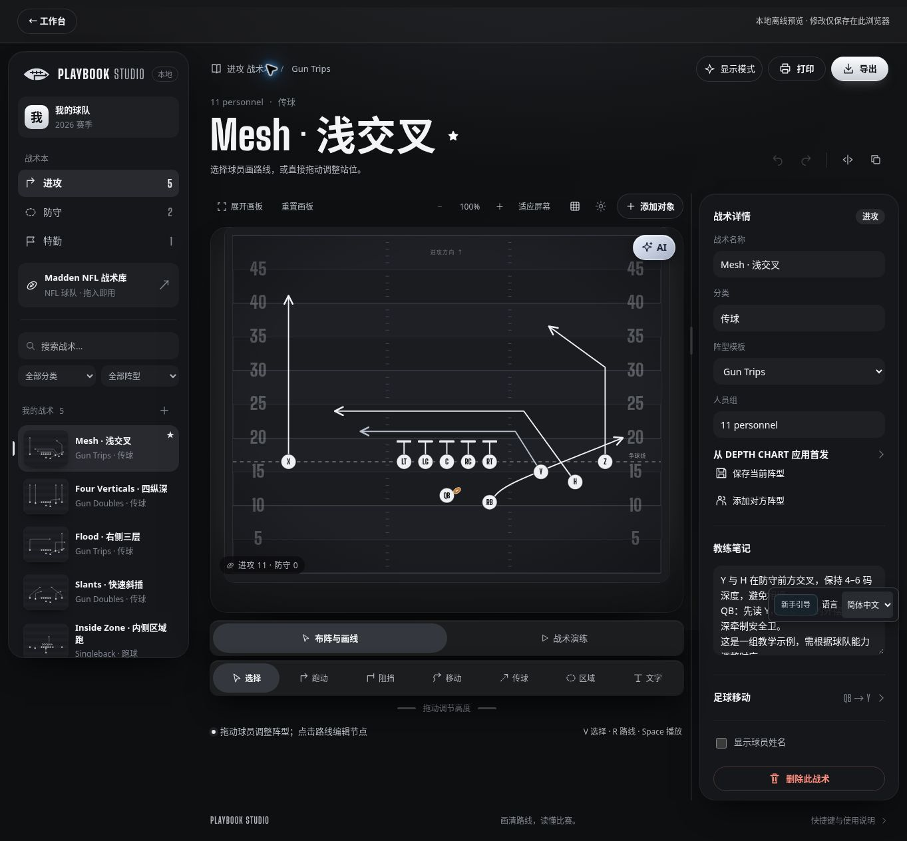

# Web 平台优化与回归方法

[返回 README](../README.md) · [部署手册](AGENT_DEPLOYMENT.md) · [触摸设备说明](TOUCH_WORKSPACE.md)

本轮调整集中在浏览器原生能力、Madden 数据加载和编辑器更新边界。目标是减少无关加载、避免中文输入误触发、保留连续操作中的 DOM 与焦点，并让控件适应实际分配的宽度。这里记录实现与复验方法，不预先宣称某个设备上的耗时或帧率达标。

## 实现范围

| 调整 | 当前行为 | 主要代码 |
|---|---|---|
| 中文输入法 | 弹窗键盘处理先检查 `isComposing` 和 `keyCode === 229`，避免确认选词的 Enter 被当作提交；战术搜索在组合输入结束后更新结果 | [app.js](../web/app.js) |
| 通用弹窗 | 使用原生 `<dialog>.showModal()` 进入 top layer，由浏览器管理模态焦点与背景不可交互；保留不支持该 API 的降级处理及关闭后的焦点恢复 | [app.js](../web/app.js)、[editor-dialog.css](../web/editor-dialog.css) |
| Madden 数据分层 | 轻量存在性索引与搜索证据独立于完整路线坐标，只有真实导入才动态加载所需几何分片 | [madden-traces.js](../web/madden-traces.js)、[madden-model.js](../web/madden-model.js)、[assistant-search.js](../web/assistant-search.js) |
| 同一战术的更新 | 局部更新编辑器外壳，保留由球场、AI、材质模块管理的节点；搜索只更新列表，复用仍在结果中的卡片和缩略图 | [editor-render.js](../web/editor-render.js)、[play-thumbnails.js](../web/play-thumbnails.js)、[app.js](../web/app.js) |
| 组件宽度适配 | 画板工具栏与属性控件按各自容器的实际宽度调整；外层工作台仍按视口选择桌面列或触摸抽屉 | [component-layout.css](../web/component-layout.css) |

局部更新有明确边界：只在同一战术且编辑器结构兼容时使用；切换战术或原图／可编辑结构时保留完整重建。它不替换战术数据模型、撤销历史或手动／AI 共享命令流程。容器查询只作用于具备实际布局宽度的画板和属性区域，不把 SVG 或桌面的 `display: contents` 包装层变成尺寸容器。

## Madden：浏览、搜索与导入分开加载

| 数据层 | 内容与用途 | 加载时机 |
|---|---|---|
| 存在性索引 | 目录 ID 对应的几何分片，源码约 19 KB；用于可编辑标记、筛选和别名解析 | 静态模块依赖 |
| 搜索证据 | 主路线起止点的精简文字证据，源码约 95 KB；结合已有概念标签返回可核对的搜索结果 | 搜索模块依赖 |
| 六份几何分片 | 完整球员与路线坐标，源码合计约 1.64 MB | 导入、拖入或从原图创建可编辑副本时加载所需分片 |

以上为当前文件的原始字节量级，使用十进制 KB／MB；不含压缩、网络、缓存和 JavaScript 解析执行成本。目录 JSON、缩略图、AI 图编排等资源有各自的加载路径，不能从这张表推导整个页面的实际传输量。

`loadEditableEntries(ids)` 在构建可编辑战术前准备几何。相同分片的并发请求共享加载任务；加载失败不把数据写入战术本。手动与 AI 的导入均先等待所需数据，再进入原有校验与应用流程。不要让新功能同步读取尚未加载的几何，也不要用“可编辑”标记代替完整坐标已经到位的判断。

生成源数据后，使用 [build-madden-trace-index.mjs](../scripts/build-madden-trace-index.mjs) 更新索引和搜索证据，并使用 [build-madden-search-tags.mjs](../scripts/build-madden-search-tags.mjs) 更新搜索标签：

```bash
npm run build:madden-index
node scripts/build-madden-search-tags.mjs
npm run build:madden-index -- --check
```

`--check` 只核对已提交的索引和证据是否与源几何一致，不改文件。生成脚本可以读取完整几何；浏览器的浏览和搜索路径应保持轻量。

### 离线能力与部署要求

- [Service Worker](../web/sw.js) 不把六份完整几何列入安装预缓存。成功获取且未重定向的同源资源可进入运行时缓存；仍须等待缓存写入并受浏览器存储清理影响。
- 尚未请求过的几何分片，首次离线导入不可用。先联网加入所需战术，再检查离线场景；仅浏览卡片或打开首页不足以保证分片已获取。
- 已加入战术本的球员和路线是保存的数据，编辑它们不依赖再次加载来源分片。静态版保存属于当前浏览器；云端登录、共享与同步仍需要网络。原图图片是否可离线显示还取决于它自身的获取与缓存。
- 发布完整静态产物，包含所有几何分片，保持模块路径与 JavaScript MIME 正确；采用新缓存版本，不混用新索引与旧几何。加载失败时应展示错误，并允许联网后重试；必要时刷新页面重新加载模块。

## 开发 Agent 如何使用现代 Web 参考

使用固定版本 `modern-web-guidance@1.0.0`，按当前问题逐步检索，无需安装整套技能，也不把检索资料打包为前端运行时或橄榄球 AI 知识包。

1. 先描述具体问题和目标浏览器，例如“中文输入法确认误提交”“iPhone 软键盘下弹窗超出屏幕”“宽屏内的窄属性栏”。
2. 用 `search` 找到对应主题，再用 `retrieve` 阅读命中的规范或浏览器说明；同时核对仓库现有实现。不要仅凭扫描警告全面重写界面。
3. 选择与问题直接相关的原生能力，检查 Safari／Chrome 和桌面支持，明确必要的渐进增强或降级边界。
4. 修改后运行静态审计、项目检查与相关回归，再在真实浏览器验证交互。把验证环境、证据和剩余限制写入 PR。

例如，针对长任务先检索再读取命中的主题：

```bash
npx --yes modern-web-guidance@1.0.0 search "break up long tasks"
npx --yes modern-web-guidance@1.0.0 retrieve break-up-long-tasks
```

## 可重复的审计命令

```bash
npm run audit:web
npm run audit:startup
npm run audit:startup -- --ref acb803e
npm run check
npm run typecheck
npm test
npm run build
```

`audit:web` 使用固定的 `modern-web-guidance@1.0.0` 执行 `legacy-scan web --json`，默认设置 `DISABLE_TELEMETRY=1`。这是开发时检查，不会在用户打开页面时执行；工具首次运行可能需要获取指定版本的包。扫描结果是线索，需要结合 API 用途与支持范围判断。

`audit:startup` 从页面入口追踪静态模块依赖，统计原始源码字节；`--ref` 与指定 Git 修订比较。动态导入的几何不会计入静态依赖闭包，但其首次使用成本仍然存在。该报告不是浏览器网络瀑布、压缩后资源预算或加载时间承诺，也不等于 Service Worker 安装请求量。`audit:web` 不替代 `audit:startup`，两者都不替代浏览器性能采样。

需要报告首屏表现时，注明提交 SHA、设备与浏览器版本、网络条件、冷／暖缓存、Service Worker 状态，以及采样次数。将首次访问、已缓存重访、首次 Madden 导入和重复导入分别记录，不把某一种缓存状态的结果泛化为所有用户体验。最终性能数字应附对应运行证据。

## 浏览器回归清单

至少覆盖 iPhone 与 iPad 的 Safari、Chrome，以及桌面 Chrome／Safari 等目标浏览器；按实际设备记录结果，未运行的组合标为未验证。

| 场景 | 核对点 |
|---|---|
| 中文输入 | 在新建／重命名弹窗用拼音输入，Enter 先确认候选字，不提前提交；Escape 取消组合输入时不误关闭；确认完成后正常提交和关闭 |
| 弹窗与焦点 | Tab／Shift+Tab 留在弹窗，背景不可操作，关闭后回到仍存在的入口；连续打开下一步弹窗不受旧弹窗关闭事件影响 |
| 触摸与软键盘 | 竖屏／横屏打开弹窗和输入法，内容能滚动，提交／关闭按钮可达，收起键盘后布局恢复 |
| 按需几何 | 新会话浏览和搜索不请求完整几何；加入可编辑战术时才请求相应分片；同分片重复操作复用已加载数据 |
| 异步导入 | 慢网、失败、重复点击及加载期间换战术本／关闭库时，不重复插入或写入错误目标；联网后可恢复操作 |
| 连续编辑与搜索 | 连续输入时保留光标和焦点；结果卡片、缩略图稳定；路线选择、绘制、撤销／重做及 AI 修改后显示一致 |
| 组件布局 | 拖窄画板、缩窄属性栏并切换抽屉，按钮、时间轴和表单不溢出；布局跟随组件宽度，球场坐标与拖动不偏移 |
| 离线边界 | 分别验证已缓存与从未获取的几何分片；未获取时给出失败反馈，已保存战术仍可读取；云端能力按网络状态如实呈现 |

自动化测试覆盖加载器、异步导入、编辑器更新与弹窗流程的逻辑；真实输入法、浏览器 top layer、软键盘及布局仍需上述浏览器检查。记录测试通过和未验证项时，应以本次实际运行结果为准。

## 本轮验证记录（2026-11-16）

对照主分支 `acb803e`，首屏静态模块源码从 3,253,453 字节降至 1,737,735 字节，约减少 46.6%；模块数从 101 变为 99。完整几何从首屏静态依赖及 Service Worker 安装预缓存中移除，源几何内容保持不变。[原始报告](web-platform-audit-2026-11-16.json)记录了计量方法与限制。

本轮全套 634 项测试通过，语法、类型、构建、变更文件 ESLint 和 diff 检查通过。官方扫描器 35 条规则命中从 1 项降到 0 项，仍不代表其覆盖范围外没有问题。

桌面 Chrome 实际验证了导入、库内撤销、原生弹窗 Esc 与焦点、220–428px 属性栏、中英文排布及浏览器缩放到 545×374 的窄视口。库打开时会暂时隐藏语言与引导控件，避免覆盖右下角结果操作；关闭后恢复。加载过程中关闭库、切换页面或开始填写属性时，旧导入不会迟到切换战术。

尚未执行真实 iPhone／iPad 的 Safari／Chrome 输入法与软键盘验收，亦未把源码缩减当作浏览器耗时、INP 或帧率提升实测。


