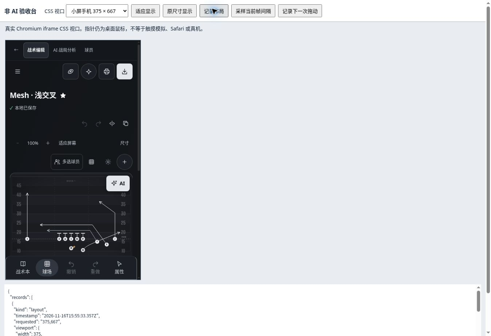
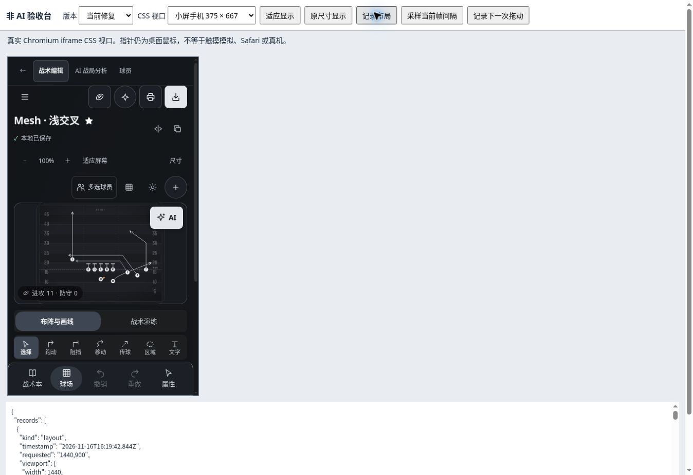
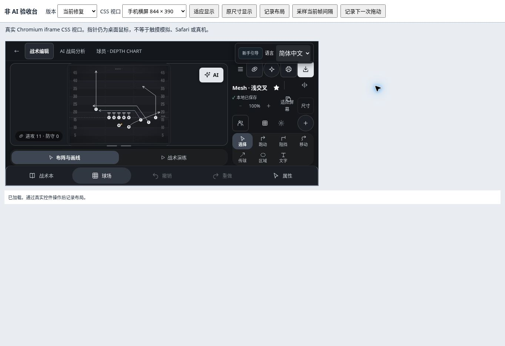
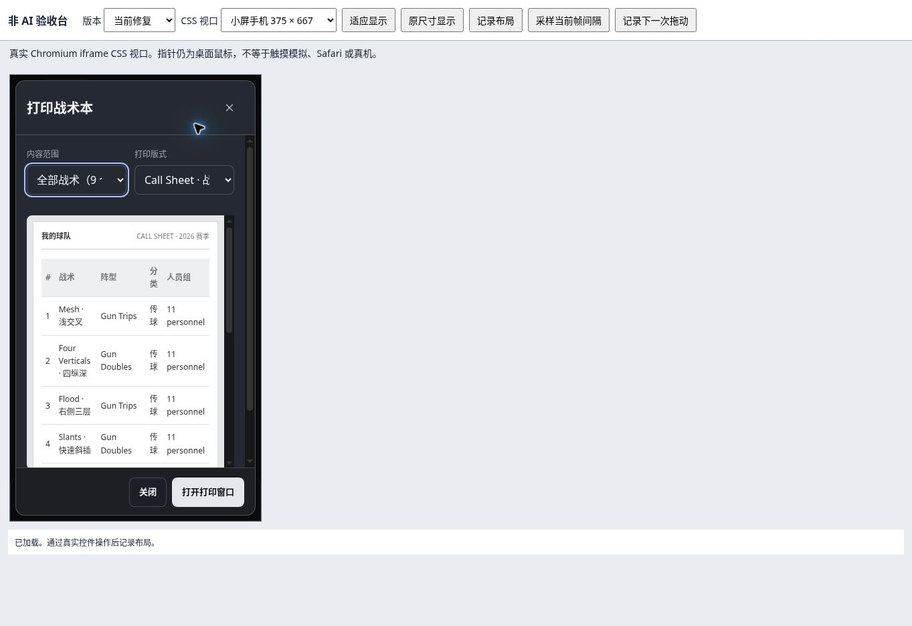

# 非 AI 严格验收记录

[数字战术板讲解台 F1–F6 与试点验收](COACH_FILM.md)

[战术板与 DEPTH CHART 的 P0 动效计划、操作与验收结果](P0_MOTION.md)

## PR #51 交叉审查后的复测（2026-11-18）

在合并提交 `5512635` 上重跑独立审查包，16 项中有 15 项复现缺陷，立即撤销导入的对照通过。修复后的同一组断言为 **16/16 通过**。下方保留 PR #51 当时的验收记录。

| 操作 | 本次复测结果 |
| --- | --- |
| 编辑中收到旧轮询、保存冲突或权限变更 | 旧响应不能回退画板或角色。输入和手势可继续完成；失去权限后，未同步编辑可导出。[同步测试](../../tests/cloud-sync.test.mjs) · [界面测试](../../tests/cloud-ui.test.mjs) |
| 拖动未松手时取消、离开或导出 | 拖动预览只属于本次手势，撤回时球场、磁盘和撤销记录一致。[手势测试](../../tests/editor-gesture-acceptance.test.mjs) |
| 导入期间开启表单，或导入后调整名单再撤销 | 保留表单，支持继续或取消导入；撤销和重做保留独立改名，后续引用发生冲突时保留数据和历史。[跨模块测试](../../tests/local-recovery.test.mjs) · [历史测试](../../tests/editor-history-domain.test.mjs) |
| 补空首发、跨位置调人 | 后备顺位保持；触屏、键盘与拖拽执行同一笔可撤回的调动。[顺位测试](../../tests/depth-drag-workflow.test.mjs) |
| 横屏绘制第二条路线、跨设备缩放 | 在球场上选择“新增为备选”后，原主路线及演练轨迹保持；桌面缩放保留此前的小屏高度偏好。[手势测试](../../tests/editor-gesture-acceptance.test.mjs) · [画板测试](../../tests/compact-board-height.test.mjs) |

真实设备、真实账号、原生下载与系统打印，以及设备级性能的放行条件仍见下方“尚未放行的项目”。独立 Chromium 因启动环境限制未能执行新版十配置 E2E。

## PR #51 原验收记录

本轮遵循用户最新范围：**排除 AI 与 GitHub Pages**。基线为 PR #50／`2239aec`；本轮在 `fix/non-ai-acceptance` 执行实际复现、修复和复测。

**整体验收状态：部分通过，尚未全量放行。** 已实现与已上线、自动化通过、真实 Chromium 操作、iOS 真机是不同证据层级。未运行或受阻的项目不记为通过。

## 本轮确认的缺陷与修复

| 范围 | 优先级 | 复现与修复 |
| --- | --- | --- |
| 编辑手势 | P1 | Esc、撤销、切图／切模块后迟到的 pointerup 仍可提交预览；统一取消入口，恢复基线后才执行后续动作 |
| 密集对象 | P1 | 已确认重叠路线节点后仍重复弹候选，无法拖动；仅为下一次同战术、同选择且仍命中该对象的触摸保留明确目标 |
| 保存失败 | P1／P2 | 重试成功仍报永久失败；本机配额失败后刷新缺少保护；增加恢复成功反馈与离页保护，并避免颜色显示映射造成误警告 |
| 图面提交 | P1／P2 | 拖动结束重建整页及列表观察器；改为局部刷新，保留完整几何重绘与错误回滚，补充 Motion、区域、200 张战术和滚动／焦点回归；同时保留人数徽标 |
| DEPTH CHART | P1 | 缺少拖拽分配／排序；补桌面原生拖拽和触屏／键盘分配路径，沿用一次提交与撤回 |
| 人员一致性 | P1 | 首发从 QB 移到 X 后，明确空缺的 QB 旧绑定阻止重新应用；为唯一匹配且明确空缺的位置原子解除绑定，不清空未映射或歧义位置，不修改路线 |
| 战术库预览 | P1 | 桌面预览遮住的列表仍在焦点路径；隔离背景并统一可见预览的键盘边界 |
| 战术库筛选 | P1 | 清空筛选后下拉仍显示旧值；共享 DOM patcher 同步受控 select，保留节点及焦点 |
| 同步竞争 | P1 | 同本重载后旧保存／409／轮询／权限回包覆盖新版状态；载入代次与编辑代次分开，忽略旧载入的迟到回执 |
| 文件导入 | P1 | 离开模块后迟到弹确认，慢文件覆盖后来选择；读取后与确认前核对本、视图代次和最新文件序号 |
| 手机小屏 | P1 | 375 × 667 工具栏被底部导航遮挡；缩减重复控制和空白，绘图工具单行且保持 44px 目标，保留放大与展开 |
| 手机横屏 | P1 | 844 × 390 初始球场在首屏下方；改为球场左、控制右；修复转向继承的尺寸面板覆盖工具，支持 Esc／外部点击恢复 |
| 弹窗触达 | P2 | 小屏打印操作按钮实测仅 37.5px；修复主题规则优先级，复测为 44px，弹窗保持视口内滚动 |

详细步骤、异常注入与证据边界分别见 [编辑器](EDITOR.md)、[球员与人员组](ROSTER.md)、[战术库与首页](CATALOG.md)、[保存与同步](PERSISTENCE.md)、[响应式与性能](RESPONSIVE.md)。

## 最终集成结果

| 项目 | 状态 | 证据 |
| --- | --- | --- |
| 全量 JavaScript 回归 | 822 通过，0 失败／跳过 | [最终日志](evidence/final-tests.txt)。包含既有公共模块回归，不把其中 AI fixture 当成本轮 AI 验收 |
| 语法、类型 | 通过 | [语法](evidence/syntax-check.txt)、[类型](evidence/typecheck.txt) |
| 生产构建 | 通过 | [构建日志](evidence/build.txt)，生成的开发验收入口不进入生产输出 |
| 非 AI 模块专项 | 对应明确层级通过 | 各模块报告及日志；不把重复运行累加到 822 |
| 七种精确 CSS 视口 | 布局通过 | 1440×900、1280×720、1024×768、768×1024、390×844、375×667、844×390；[原始测量](evidence/layout-final.json) |
| 英文紧凑布局 | 布局通过 | 375×667，7 项工具无遮挡，最小约 48.7×44px；[记录](evidence/english-small.json) |
| 系统减少动态偏好 | 自动化通过，系统级待验证 | 不把 DOM 偏好模拟当作真实操作系统设置验证 |

所有七个视口均在真实 Chromium 的 iframe 中形成精确 `innerWidth/innerHeight`，没有缩放桌面页面冒充设备尺寸；显示时可缩放整个验收窗以容纳截图。每个视口都检查了真实布局和 `elementFromPoint`，7 项绘图工具均可命中且高度至少 44px，无横向文档溢出。**指针仍是桌面鼠标，不能据此认定 iPad／iPhone 触摸、软键盘或 Safari 已通过。**

## 实际浏览器操作

| 路径 | 预期与实际结果 | 结论 |
| --- | --- | --- |
| 选 X → 原生键盘输入姓名 → Tab → 撤销 | 从正在编辑变为本地已保存，产生调整球员事务；撤销恢复原状态 | 当前 Chromium 通过 |
| 原生鼠标拖动 X → 撤销 | SVG 位置实际改变，保存和事务反馈可见，一次撤销恢复 | 当前 Chromium 通过 |
| DEPTH CHART 原生拖 QB 首发到 X → 撤销 | QB 明确待定，X 为 #12 TIM，原 X 顺延；一次撤销恢复两个位置 | 当前 Chromium 通过，[截图](evidence/roster-drag.jpg) |
| 全部球队搜索 mesh → 预览 → Shift+Tab → Esc | 预览首项反向 Tab 到末项链接；Esc 恢复结果及原预览入口焦点 | 当前 Chromium 通过 |
| 加入可编辑 MESH → 撤销 → 可见关闭入口 | 新战术出现且明确已加入；撤销恢复数量和原战术；关闭后全部库浮层消失 | 当前 Chromium 通过；两种正常关闭路径另有宿主回归 |
| 375×667 打印预览 → 全部战术 → Call Sheet | 显示 9 张战术清单；弹窗 375×667、内容 359×651，操作按钮 44px 且可命中 | 应用内预览通过；未执行系统打印 |
| 完整 JSON 导出 | 触发了浏览器下载，但下载事件回传超时，无法取得本次下载字节核验 | 原生下载端到端仍阻塞；序列化与导入回归通过 |

浏览器前台与后台的性能采样分开。后台采样和不足帧数不能用于流畅度结论。前台固定 1440×900、11 名球员／10 条路线，空闲帧间隔中位约 16.7ms；PR50 的一次拖动观察到 166ms 长任务，局部提交后对应短手势未观察到 >50ms 间隔或长任务。但短拖动各仅 7／8 个帧间隔，均标为 `insufficient-samples`，**不能据此宣称稳定 60fps 或给出提升百分比**。[基线](evidence/baseline-performance-foreground.json) · [本轮](evidence/final-performance.json)。

## 截图

375×667 改造前，绘图工具低于首屏且被固定导航遮挡；改造后全部可见。

| 修复前 | 修复后 |
| --- | --- |
|  |  |

## 尚未放行的项目

| 项目 | 当前状态 | 放行所缺证据 |
| --- | --- | --- |
| iPhone／iPad Safari | 阻塞 | 可操作的真机或设备测试会话；真实选中、密集节点拖动、画线、软键盘、旋转与系统手势回归 |
| 独立浏览器触摸 E2E | 阻塞 | 执行环境允许正常启动浏览器；当前 Chromium singleton socket 被拒绝，8 项标准 E2E 明确 not-run，见 [矩阵](evidence/non-ai-matrix.json) |
| 云端真实账号闭环 | 未执行 | 专用测试账号／战术本；实际登录、保存、断网重连和权限变化。协议与数据库 fixture 不能替代 |
| 原生下载／系统打印 | 未完成 | 可取得并核验导出文件及系统输出的受支持浏览器；不以 Toast 或应用内预览代替 |
| 性能全面验收 | 部分完成 | 固定硬件和数据集上的多次长手势、较大画板、数字模式与移动设备样本 |

以上阻塞项仍属于非 AI 范围，没有因排除 AI／GitHub Pages 而被删除，也没有被默认为通过。生产构建和站点发布另行记录，发布成功不改变本页的验收结论。

## 本轮发布状态

用户已于 2026-11-17 明确授权将本轮源码、验收报告和截图提交至公开仓库 `TIMPICKLE/playbook-studio-web`，并更新现有 Sites。此前公开写入因授权范围被自动审批拒绝，本次在取得针对这批交付和目的地的明确授权后继续提交。实际合并 PR、Sites 版本和部署终态由最终交付分别记录；发布成功不等于上述未放行项已经通过。

复现工具：`scripts/qa-non-ai.mjs` 是不调用模型的标准 E2E；`scripts/prepare-acceptance.mjs --baseline` 生成仅供开发的视口验收页。生产 `prepare-web` 会移除该生成目录，不向用户产品流程加入测试入口。
