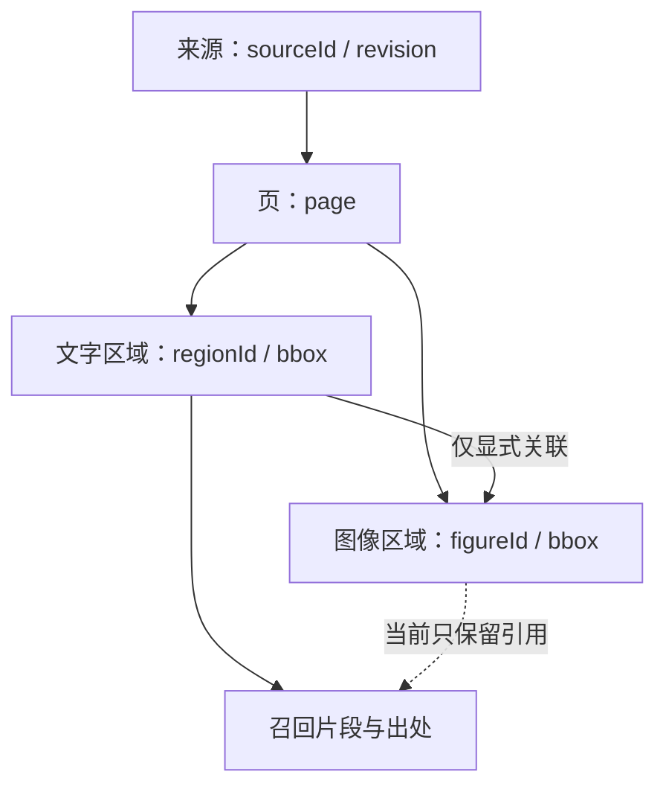

# AI 战术分析：知识架构与图文证据契约

资料检索与代码基线核对日期：**2026-11-15**。领域为**美式橄榄球（American football）**。

本文记录研究结论、第一阶段契约和后续扩展路线。它不是功能完成清单。文中“应”“目标”“第一阶段”均表示实现要求；实际交付范围以同分支代码、测试和最终验证记录为准，不能仅因本文描述了某项能力就在产品界面中宣称已经支持。

## 1. 架构决策概览

1. **战术图提供可核查事实，知识库提供有适用条件的原则。** 模型把二者结合为建议；资料里的通用原则不能直接证明当前对局会成功。
2. **先做本机文本、JSON 资料包和领域检索。** 第一阶段不要求 embedding 服务、专用 GPU 或独立向量数据库。关键词、术语别名和标签检索必须如实命名，不能标成“语义向量检索”。
3. **图文通过显式 ID 和区域关系联结。** 检索命中文本后回补对应图例；命中图例后回补相应说明。整页相邻不是语义关联的充分条件。
4. **沿用已有 LangGraph.js 与模型适配层。** 现有云端已经有工具读取、模型调用、证据校验和有限修复，不再平行引入另一套 Agent 框架。
5. **每条输出区分观察、原则、推断与建议。** 图上重叠、检索命中分数和模型自评都不显示为传球成功率、胜率或预期得分。
6. **先验证检索与引用，再扩大资料量。** 没有真实样本与标注，不能从论文表现推导本项目的准确率或资源预算。

## 2. 已核对的项目基线

以下是本次开发开始时可直接从源码核实的情况，不代表后续提交后的最终状态：

| 路径 | 已有职责 | 本轮应衔接的边界 |
| --- | --- | --- |
| `server/matchup.mjs` | 从选定攻防侧提取对象；对路线和椭圆区域做几何相交计算；生成证据；校验模型 JSON 与引用 | 扩展知识来源，不把知识文本混成几何事实；保留现有对象 ID 和镜像逻辑 |
| `server/matchup-agent.mjs` | 使用 LangGraph.js 执行 model、tools、validate 节点；限制调用次数；最多一次修复 | 将知识检索作为有范围、可追溯的工具或输入阶段；继续使用相同模型协议适配 |
| `web/ai-matchup.js` | 选择进攻、防守、覆盖假设、模型与球员视角，显示叠图和结果 | 为知识、证据和本地分析补充明确入口，不绕开快照选择 |
| `web/ai-demo.js` | 静态演示调用模型，原基线返回的证据为空 | 若扩展为本地知识模式，应共用检索与证据契约，不能仅装饰一份假报告 |
| `package.json` | 固定 `@langchain/langgraph` 为 `1.5.3` | 以锁文件和实际 API 为准，避免照抄更新版本文档接口 |

基线只内置了极少量 Cover 3 知识。扩充资料数量之前，应先把来源、适用条件、检索范围和引用链做成通用契约。已有几何相交是空间观察，不提供球员速度、开球后的时序、盯防交接或真实空位。

## 3. 四种证据不能混用

| 类型 | 示例 | 可以支撑的结论 | 不能直接支撑的结论 |
| --- | --- | --- | --- |
| 已保存图形事实 | 外侧接球手路线穿过指定区域 | 图形路径与区域相交 | 该球员在接球时刻处于空位 |
| 用户确认或本次假设 | 用户选择 Cover 3 spot | 在此覆盖假设下讨论读点 | 真实防守开球后一定如此落位 |
| 文献或教练资料原则 | Flood 用不同深度给侧翼覆盖制造阅读压力 | 该概念的常见设计目的和检查方向 | 当前所有 Flood 都能击穿所有 Cover 3 |
| 模型条件推断 | 若 flat defender 扩到浅区，可检查中间窗口 | 带触发条件的观察与练习建议 | 已校准的完成概率、比赛胜率或必然结果 |

两深安全卫 shell 不足以确认 Cover 2；同一 shell 可以轮转或采用不同匹配规则。六人冲传对五人保护可以提示潜在数量压力，但在没有保护分配、滑步方向、RB 责任和实际时机时，不能指定某名防守人必然无人阻挡。NFL 高级统计依赖持续追踪数据；逐帧防守职责建模本身也存在标签歧义。[12][13]

报告应包含 `observations`、`assumptions`、`principles`、`recommendations` 和 `unknowns` 的等价表达，未必要求一次性重写已有 JSON 协议。需要兼容原情景格式时，可把这些含义映射到 `observation / condition / possibility / action / limitations`；证据关联继续由程序校验。

## 4. 图文资料包：精确定位与可重建关系

### 4.1 标识和定位



共享页码只说明两个区域来自同一页。当前实现仅按显式父链或图示引用保留关联，不从箭头、距离或版面位置猜测图意；图像像素接入属于后续阶段。

建议的规范化资料结构如下。字段名是目标契约示例，具体实现可以采用等价命名，但必须保留相同语义：

```json
{
  "schemaVersion": 1,
  "source": {
    "sourceId": "sha256:original-file-digest",
    "sourceVersion": "original-file-digest",
    "title": "Team Passing Manual",
    "fileName": "passing-manual.pdf",
    "sourceUrl": null,
    "provenanceType": "team",
    "importedAt": "2026-11-15T00:00:00Z"
  },
  "chunks": [{
    "id": "manual:p12:play-a:explanation",
    "sourceId": "sha256:original-file-digest",
    "pageNumber": 12,
    "pageLabel": "10",
    "parentId": "manual:p12:play-a",
    "regionId": "manual:p12:text-3",
    "bbox": [0.05, 0.30, 0.46, 0.65],
    "text": "...",
    "tags": ["flood", "cover3_spot"],
    "linkedAssetIds": ["manual:p12:figure-2"],
    "appliesWhen": ["coverage confirmed as spot-drop Cover 3"],
    "exceptions": ["match rules and protection may change the read"]
  }],
  "assets": [{
    "id": "manual:p12:figure-2",
    "sourceId": "sha256:original-file-digest",
    "pageNumber": 12,
    "parentId": "manual:p12:play-a",
    "regionId": "manual:p12:figure-2",
    "bbox": [0.50, 0.25, 0.94, 0.72],
    "path": "assets/manual-p12-figure-2.png",
    "caption": "Flood concept",
    "linkedChunkIds": ["manual:p12:play-a:explanation"]
  }]
}
```

- `sourceId` 标识原始内容而不是文件名。相同文件重复导入可以去重；同名文件内容变化必须产生新版本或可追溯版本关系。
- `pageNumber` 使用原始 PDF 的物理页码，**从 1 开始**；印刷页号另存 `pageLabel`。不能把二者混在引用中。
- `parentId` 表示一个战术、一个概念或经确认的图文单元，不是整个页面。两张无关图即使位于同页，也应有不同 parent。
- `regionId` 标识原页上的具体文本或图形区域；`bbox` 建议规范成左上原点、相对页宽高的 `[left, top, right, bottom]`，范围为 0 到 1。保留解析器原坐标时应同时保存页尺寸与坐标原点。
- `linkedAssetIds / linkedChunkIds` 是显式关联；`caption` 是来源文字或标记过的人工说明。自动生成的图片描述必须另带 `generated` 标记，不可冒充原文。
- 手工文本和 Markdown 不一定有页码或 bbox。没有定位信息时填空或省略，界面显示“手工条目/文本资料”，不能编造“第 1 页”。

Docling 的 provenance 模型已提供 page、bbox、char span；其图片、标题和 caption 结构可作为后续导入适配依据。[4][5] 图片嵌在文本附近不代表两者已经被正确关联，解析结果必须保留不确定状态。

### 4.2 受约束的 sibling expansion

检索和回补分两步执行：

1. 先检索少量子块，返回命中原因、原始排名和来源 ID。
2. 回补显式 `linkedAssetIds`，再按相同 `sourceId + sourceVersion + parentId` 补充缺失说明和图例。
3. 使用独立 token/字数/图片数预算，截断时优先保留命中块与显式关联图，不因回补淹没命中内容。
4. 对 parent 跨页的情况，只有确实存在 continuation 或人工关联记录才扩展到下一页。不能自动取前后所有页面。
5. 没有 parent 或显式关系时，可返回所在页缩略图供核查，但不要把同页全部文本作为该图的解释。未确认的关联应标为“可能相关”。

因此，“检索文本是否一起找回图像”的答案是：**由关联契约与回补策略保证；向量库或文本切块本身不会自动保证。** 同页有左、右两套战术时，一套的说明不能被回补成另一套图的依据。该场景必须进入固定回归案例。

## 5. 第一阶段：本机可运行的检索与导入

### 5.1 实际能力边界

第一阶段目标为用户能直接使用的文本/JSON 知识导入、资料管理、检索与引用。在没有额外 OCR 或视觉模型的情况下，不应提供一个只保存文件名的“PDF 已入库”按钮。

本机提取 CLI 可以作为 PDF 的实用入口：

- 对可提取文本的 PDF，按物理页与文本块导出正文、bbox、页面尺寸和原页预览；如果提取嵌入图片，应保留实际区域与原页对应关系。
- 对扫描页，检测“无可提取文本”，在清单中标记 `needs_ocr`，不能把空文本索引当作成功。允许以后接入 OCR，或由用户对单页补充说明。
- PDF 里的矢量战术图未必是嵌入位图。只导出嵌入图片不等于完整提取战术图；需要保留页面渲染，裁剪区域可以由解析器或人工确定。
- 对散装图片，可以保留原图与手工说明；没有 OCR/VLM 时，检索依赖文件附带文本与标签，应清晰显示实际依据。
- CLI 应输出同一资料包契约，页面导入不依赖解析库。这样解析质量可独立升级，网页无需承担所有文件处理。

知识包中的 `path` 是对包内资产的定位，不是允许网页任意读取本机绝对路径。若当前只支持 JSON 文本元数据而不导入图像二进制，应显示图像位置和未挂载状态，不能显示为“模型已经看过原图”。

### 5.2 检索策略

输入由当前覆盖假设、战术名称、已知路线标签、图形事实和用户问题组成。先做领域术语规范化，例如 `Cover 3 / cover3 / 三深`、`flat / 平区`、`hot / 热读`；保留原词以免缩写被错误扩展。

首版可采用字段加权关键词/BM25 风格检索，加上 concept、coverage、personnel、situation 等确定性标签匹配。词频评分不是模型置信度；对外优先显示“匹配 Cover 3、Flood、侧翼阅读”等命中原因，而不是没有解释的百分比。适用条件不满足的条目应剔除或作为对比证据，不能因标题同词而直接注入答案。

本机知识使用浏览器存储时，应明确其作用域是当前浏览器和设备。服务端无需默认持有整库；需要在线分析时，只发送本次命中的有限条目及其来源元数据。刷新和删除的行为必须一致。已有服务端资料权限与本机知识不是同一种持久化，不应在产品中暗示自动同步。

检索无命中时，仍可展示真实的战术几何观察，并明确“本次没有命中资料”。模型服务报错不能被悄悄替换成本地报告再显示“AI 完成”；应提供独立、可识别的本地分析结果。

## 6. 第二阶段：Docling、视觉索引与混合检索

资料量和真实错误样本足够后，再引入可替换适配层：

1. **解析层**：Docling/OCR 输出结构化正文、标题、caption、图形区域与 provenance。按结构切分，再按 embedding token 限制细分，避免把图例标题与说明切断。[4][5][6]
2. **多路索引**：文本 sparse/关键词路径负责精确战术名与术语；dense 路径处理表达差异；页面/图形的 ColPali 或 ColQwen 多向量路径保留视觉线索。[7][8]
3. **融合与重排**：各路先独立召回，以 RRF 等基于排名的方法融合，再对有限候选重排。不要未经归一化把 BM25 与 cosine 原分数线性相加。[9]
4. **图文回补**：无论候选来自文本还是图像，最终都使用相同 parent 和显式链接组装证据包。
5. **生成层**：模型支持图像时发送实际裁剪图；不支持时只发送原文与经过确认的结构化信息，并显示分析边界。

ColPali/VisRAG 证明了视觉文档检索是可行路线，不意味着在橄榄球战术图上已达到其论文报告效果。[7][8] 页面多向量数量大，检索与存储成本应以实际页数、模型与分辨率测量；Qdrant 给出了粗表示召回和原始多向量重排的工程路径。[10] 一次部署全部组件不是第一阶段前提。

补充 chunk 专属上下文可以减少切分后失去概念标题的问题，但必须与来源原文区分。Anthropic 的 Contextual Retrieval 提供了这种方法的研究依据；其测试收益不能直接写成本项目的提升百分比。[11]

## 7. LangGraph 接入与运行契约

保留项目的模型端点适配、当前工具边界、终止预算、取消与有限修复。知识节点应回答“本次从哪里找了什么”，不能替代事实计算，也不需要让多个模型重复阅读同一份战术。[1][2][3]

建议的逻辑阶段为：输入快照检查 → 确定性事实 → 知识检索/图文回补 → 条件分析 → 结构和引用校验 → 展示。它可以映射到现有图中的工具调用，不必为了阶段名称重建整套状态图。框架负责调度，图形相交、引用 ID 和来源关联由普通代码完成。

一次运行应持有不可变战术快照与检索结果。允许模型引用的集合来自**本次**有效图形证据和命中知识，而不是全库所有 ID。校验至少包括：

- 引用 ID 是否存在且属于本次范围；来源版本和知识 ID 是否仍有效。
- 相关路线、球员、区域是否来自本次所选攻防侧；镜像后方向是否一致。
- 模型输出是否保留必要的覆盖假设和资料限制。
- 格式或引用出错时是否只做有限修复，预算耗尽后明确失败或部分结果。

“ID 存在”只能证明引用可解析，不能证明结论被来源语义支持。UI 不应把通过结构校验称为“教练结论已验证”。语义支持需要固定案例、人工复核和辅助评估共同判断。Claude 的现有原生 citations 支持文本、PDF 页码和自定义内容块，不能代替应用维护图像区域引用。[14]

## 8. 评估集与验收指标

### 8.1 固定案例

建议将小规模人工编写案例作为代码测试与离线评估输入，逐渐加入真实失败样本。不要先生成大量模型答案，再用同一个模型给自己打高分。

| 维度 | 必备案例 | 检查结果 |
| --- | --- | --- |
| 足球事实 | 同一 Flood 对 Cover 3 spot 与 Cover 2 | 检索与条件解释随覆盖变化，而非只改标题 |
| 未知责任 | 两深 shell，未指定覆盖 | 保留未知，不断言 Cover 2 |
| 保护 | 六人冲传、五人保护、分配未知 | 提示潜在压力，不宣称特定 free rusher 已被证明 |
| 名称冲突 | 名称 Four Verts，实际短路线 | 标明冲突，不用名称覆盖图形事实 |
| 图文关联 | 同页两图、两组说明 | 只回补对应 parent 的资料 |
| 页码 | 封面偏移、印刷页号与物理页号不同 | 引用原 PDF 物理页，印刷页另列 |
| 空资料 | 扫描 PDF、空正文、错误 JSON | 明确未索引或导入失败，无假成功 |
| 版本 | 同名不同文件、相同文件重复导入、删除条目 | 可去重、可追溯，删除后不再召回 |
| 引用 | 模型生成不存在的 knowledge ID | 拦截并有限修复，不创建伪来源 |
| 运行 | 401、超时、取消、空响应 | 终止与错误状态准确，不显示完成 |

### 8.2 指标分层

- **提取质量**：有文本页的提取覆盖、页码与 bbox 正确性、图文关联准确率、扫描页识别情况。缺原始资料样本时不能给出实测数值。
- **检索质量**：人工标注 relevant IDs 后计算 Recall@k、MRR 或 nDCG；同时检查负例，特别是 Cover 3 spot 与 Cover 3 match 的混淆。训练/调权案例与保留测试案例分开。
- **引用质量**：ID 可解析率、引用位置正确性、主张支持程度和必要引用覆盖率。引用多不等于正确，复制同一条资料到每个情景也不算证据充分。
- **足球分析质量**：事实正确、条件完整、建议可操作、没有未支持概率、没有把空间交叉当成同步相遇。
- **运行质量**：输入与知识版本可复现、耗时分布、模型/工具调用次数、取消退出、错误恢复和单次请求体积。

RAGAS 和 ALCE 提供了分离检索、答案忠实性与引用质量的研究框架。[15][16] 可使用 LLM judge 辅助发现问题，但足球结论应保留人工预期事实、禁止结论和教练复核。暂未建立真实评估集时，报告“通过哪些固定案例”，不要报告虚构的“专业准确率”。

## 9. 部署、资源与阶段退出条件

| 阶段 | 运行位置 | 依赖 | 退出条件 |
| --- | --- | --- | --- |
| 第一阶段 | 浏览器资料与检索；现有 Worker 或浏览器模型请求 | 小型文本/JSON 包，现有模型适配与 LangGraph | 真实导入、删除、检索、引用、无 Key 本地路径与有 Key 模型路径分别验收 |
| PDF 文本接入 | 本机提取 CLI | 已验证的 PDF 文本/图像解析工具 | 原页、页码、bbox 可追溯；扫描页不假成功；同页多图不串联 |
| OCR/视觉检索试点 | 独立本机或服务进程 | Docling/OCR、视觉 embedding、候选存储 | 在自有样本测得质量收益和延迟/内存成本后再接入正式流量 |
| 多设备团队知识 | 持久化后端与资料对象存储 | 版本、团队作用域、HTTP 服务接口 | 明确同步、可见范围和来源更新；不把浏览器本机资料暗示为共享库 |

现有 Worker 适合处理请求、检索少量文本证据和编排模型调用；它不应承担本机 PDF 批量 OCR 或大型视觉模型加载。公开小型知识卡可以随代码分发，用户导入资料应保持其实际作用域。对独立向量服务使用明确 HTTP 接口，不假定普通 Node 的文件系统、后台常驻进程或原生依赖可直接在 Worker 内工作。

第一阶段的完成应由代码与测试证明。本文提出的 Docling、ColPali/ColQwen、dense/sparse RRF、rerank、持久化恢复和跨设备知识同步，只有在对应实现与验证出现后才能从“后续路线”转为“已支持”。

## 10. 原始资料与引用

以下来源访问日期均为 **2026-11-15**。论文或厂商给出的实验数据仅适用于其测试条件，本文不将其转写为本项目的质量承诺。

1. LangChain，*Thinking in LangGraph — JavaScript*：https://docs.langchain.com/oss/javascript/langgraph/thinking-in-langgraph
2. LangChain 官方文档源，*Graph API overview*：https://github.com/langchain-ai/docs/blob/main/src/oss/langgraph/graph-api.mdx
3. LangGraph.js，*StateGraph API reference*：https://langchain-ai.github.io/langgraphjs/reference/classes/langgraph.StateGraph.html
4. Docling，*DoclingDocument / ProvenanceItem*：https://docling-project.github.io/docling/reference/docling_document/
5. Docling，*Vision Models*：https://docling-project.github.io/docling/usage/vision_models/
6. Docling，*Chunking*：https://docling-project.github.io/docling/concepts/chunking/
7. Faysse et al.，*ColPali: Efficient Document Retrieval with Vision Language Models*：https://arxiv.org/abs/2407.01449
8. Yu et al.，*VisRAG: Vision-based Retrieval-augmented Generation on Multi-modality Documents*：https://arxiv.org/abs/2410.10594
9. Qdrant，*Hybrid and Multi-Stage Queries*：https://qdrant.tech/documentation/hybrid-queries/
10. Qdrant，*Multivector Document Retrieval*：https://qdrant.tech/documentation/tutorials-search-engineering/pdf-retrieval-at-scale/
11. Anthropic，*Contextual Retrieval*：https://www.anthropic.com/engineering/contextual-retrieval
12. NFL Football Operations，*Performance Tracking Data / Next Gen Stats*：https://operations.nfl.com/game-operations-logistics/technology/performance-tracking-data-next-gen-stats
13. Song et al.，*Decoding Defensive Coverage Responsibilities in American Football Using Factorized Attention Based Transformer Models*（2026）：https://arxiv.org/abs/2603.25901
14. Claude Platform，*Citations*：https://platform.claude.com/docs/en/build-with-claude/citations
15. Es et al.，*RAGAS: Automated Evaluation of Retrieval Augmented Generation*：https://arxiv.org/abs/2309.15217
16. Gao et al.，*Enabling Large Language Models to Generate Text with Citations / ALCE*：https://aclanthology.org/2023.emnlp-main.398/
17. Liu et al.，*Lost in the Middle: How Language Models Use Long Contexts*：https://arxiv.org/abs/2307.03172

长上下文并不能代替良好的检索和证据预算。[17] 本项目应把大量资料整理为可定位、可回补、可核查的少量相关证据，再让模型进行有限的条件分析。
